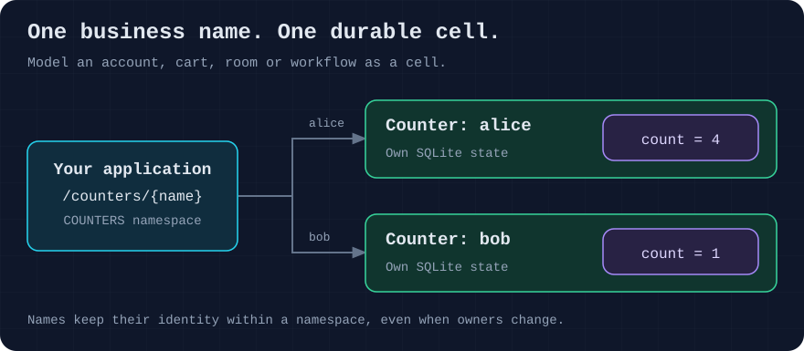
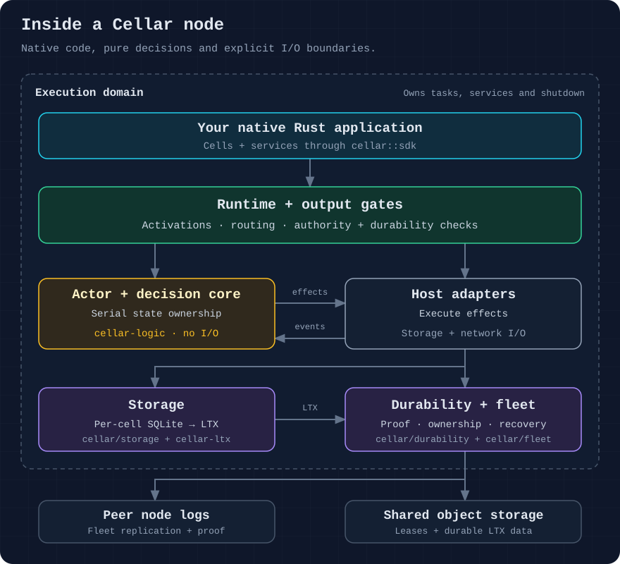
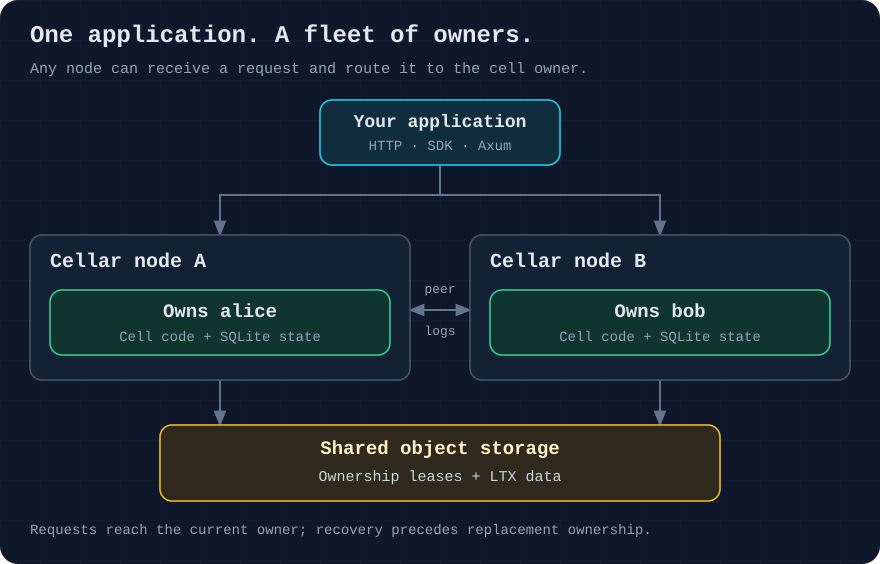
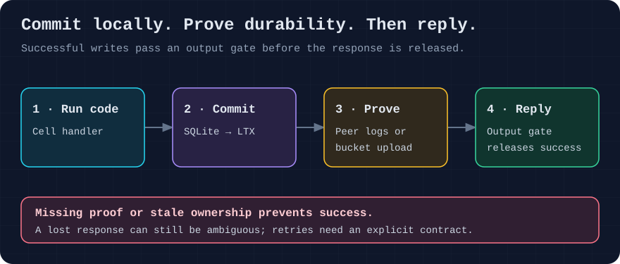

# Cellar

Build Rust applications around durable business cells.

Give each account, cart, room or workflow its own SQLite state. Write the
business logic in Rust; Cellar handles ownership, routing, replication and
recovery.

The optional [embedded Python adapter](examples/python/README.md) runs Python
business logic in a native Rust host using CPython 3.14 and PyO3, with Cellar
storage, alarms, KV, SQL, queues and cron.
The [FastAPI order example](examples/python-fastapi/README.md) includes OpenAPI,
durable creation receipts and verified Python dependency packaging/deployment.

[Quickstart](#quickstart) · [Write code](#work-with-cells) ·
[Architecture](#how-cellar-works) · [Examples](#explore-the-sdk) ·
[Documentation](docs/README.md)



## Why cells?

A cell brings a business object's behavior and state together:

- A **cart** keeps its items and checkout state in one place.
- An **account** owns its balance, settings and transaction history.
- A **room** coordinates participants and live connections.

Choose boundaries around data that changes together. Transactions stay within
a cell; cells communicate through calls or durable events.

## Quickstart

You need Rust 1.94.1 or later, Cargo, native C/C++ build tools, and curl. Run
these commands from a checkout of this repository. See [build guidance](AGENTS.md#build-and-validation)
for local target-directory setup.

Start the counter application:

```sh
cargo run -p cellar --bin cellar --locked -- \
  dev examples/native-counter/project.json
```

Once the server is ready, open another terminal:

```sh
# Increment alice's counter.
curl -sS -X POST http://127.0.0.1:9876/counters/alice
# {"count":1}

# Read the same cell.
curl -sS http://127.0.0.1:9876/counters/alice
# {"count":1}

# A different name has separate state.
curl -sS http://127.0.0.1:9876/counters/bob
# {"count":0}
```

These values assume fresh state. Stop with Ctrl-C, restart with the same
command, and read `alice` again: its count remains. `dev` watches the project
and keeps local state beside its configuration under `.cellar/`.

Open [the counter source](examples/native-counter/main.rs) or follow its
[walkthrough](examples/native-counter/README.md) for routing, assets and cleanup.

## Work with cells

### Update a cell's state

Inside a cell handler, use its SDK context to access storage. This helper
increments a counter in one transaction:

```rust
use cellar::sdk::Context;

fn increment(context: &Context) -> anyhow::Result<u64> {
    let storage = context.storage()?;
    storage.transaction_sync(|tx| {
        let count: u64 = match tx.get_json("count")? {
            Some(value) => serde_json::from_value(value)?,
            None => 0,
        };
        let next = count
            .checked_add(1)
            .ok_or_else(|| anyhow::anyhow!("counter overflow"))?;
        tx.put_json("count", &serde_json::json!(next))?;
        Ok(next)
    })
}
```

The storage belongs to the current cell. Cellar checks ownership and durability
before releasing a successful handler response.
See [storage and transactions](docs/06-storage-transactions.md).

### Call a cell by name

In a gateway handler, resolve a declared namespace and forward the request:

```rust
use cellar::sdk::{Context, Invocation, Output, Registry};

let application = Registry::new(|context: Context, invocation| {
    Box::pin(async move {
        let Invocation::Fetch(request) = invocation else {
            anyhow::bail!("expected an HTTP request");
        };
        let counter = context.namespace("COUNTERS")?.get_by_name("alice");
        Ok(Output::Http(counter.fetch(&context, request).await?))
    })
});
```

`COUNTERS` is a namespace binding declared in your
[project configuration](examples/native-counter/project.json).
The same name finds the same cell within that namespace, even when its owner
changes. The [complete counter](examples/native-counter/main.rs) also registers
its cell factory; this gateway snippet shows only request forwarding.

### Use Axum or embed the runtime

[cellar-axum](crates/cellar-axum/README.md) lets you use Axum handlers, middleware
and optional OpenAPI. Run the same counter in an Axum-owned HTTP server:

```sh
# Stop the earlier server before reusing port 9876.
cargo run -p cellar-axum-counter --bin axum-host --locked -- \
  127.0.0.1:9876 examples/.cellar/axum-counter
```

POST to `/counters/alice`, or open `/docs` for Swagger UI. The
[two-host example](examples/axum-counter/README.md) includes both hosting modes
and a generated Rust client.

To own listeners, executors and node lifecycle directly, start with the
[embedded Node example](examples/embedded-node/README.md).

## How Cellar works

### Four concepts

| Concept | Meaning |
| --- | --- |
| **Cell** | Business behavior with its own durable SQLite state. |
| **Namespace** | A binding used to find and call cells by name or ID. |
| **Node** | A process running compiled applications and hosting cells. |
| **Fleet** | Nodes sharing an object store for ownership and durable data. |

### Inside a node



Applications use `cellar::sdk`. Inside the host, a serial actor owns the pure
decision core; adapters execute effects and return completion events. The
execution domain owns tasks, services and shutdown.

Arrows show component relationships. For the request lifecycle and component
boundaries, see [architecture and ownership](docs/03-architecture.md).

### Route to the owner



Each cell has one authoritative owner. A request can arrive at another node;
Cellar routes it to the owner. Before a replacement owner serves the cell,
Cellar recovers the required state and log history.

### Prove a write before replying



SQLite writes are captured as **LTX**, the replication format. A single
bucket-backed node waits for upload proof. A fleet can prove durability through
peer logs before uploading to the bucket.

The output gate checks the required proof before releasing success. If a reply
is lost, the caller may still have an ambiguous outcome; use an explicit
[idempotency and retry contract](docs/07-routing-rpc.md).

## Explore the SDK

Pick a working example for the part you need:

| Build | Start here |
| --- | --- |
| Stored data and transactions | [SQL](examples/sql/README.md), [KV](examples/kv/README.md), [Blob](examples/blob/README.md) |
| Calls between cells | [RPC](examples/rpc/README.md) |
| Background jobs | [Alarms](examples/alarm/README.md), [queues](examples/queues/README.md), [workflows](examples/workflow/README.md) |
| Event delivery | [Transactional outbox](examples/transactional-outbox/README.md), [durable streams](examples/durable-streams/README.md) |
| Web applications | [Static assets](examples/static-assets/README.md), [WebSockets](examples/native-websocket/README.md) |
| Fleet management | [Fleet console](crates/cellar-admin/README.md), [FleetCare lab](examples/fleetcare/README.md) |

See the [full example catalog](examples/README.md) for more recipes.
Event-delivery work and its remaining qualification gates are tracked in the
[implementation status](plans/outbox-implementation-status.md).

## Package and deploy

Build a package containing your compiled application:

```sh
cargo run -p cellar --bin cellar --locked -- \
  build examples/native-counter/project.json --output counter-package
```

The CLI can publish a package with `deploy` and download a verified executable
with `install`. Run that application executable on your nodes; the generic CLI
does not contain your application's factories.

Follow [packaging and deployment](docs/12-packaging-deployment.md) for credentials,
shared storage, installation and rollout. The
[distributed fleet example](examples/distributed-fleet/README.md) covers local
recovery and handoff drills.

## Workspace crates

Start with `cellar` to build an application. The other crates separate HTTP
integration, fleet administration and runtime internals:

| Crate | Purpose |
| --- | --- |
| [cellar](crates/cellar/README.md) | Application SDK, production host and CLI |
| [cellar-axum](crates/cellar-axum/README.md) | Axum handlers, external ingress and optional OpenAPI |
| [cellar-admin](crates/cellar-admin/README.md) | Authenticated fleet management API and dashboard service |
| [cellar-logic](crates/cellar-logic/README.md) | Pure runtime decisions and state transitions |
| [cellar-native](crates/cellar-native/README.md) | Rust values, codecs and web primitives |
| [cellar-ltx](crates/cellar-ltx/README.md) | SQLite write capture, LTX replication and restore |

## Documentation

| Learn about | Guide |
| --- | --- |
| Modeling cells and choosing boundaries | [Cell modeling](docs/04-cell-modeling.md) |
| Application contexts and resource lifetimes | [SDK and lifetimes](docs/05-sdk-and-lifetimes.md) |
| Owning the runtime in your application | [Embedding](docs/10-embedding.md) |
| Running and recovering a fleet | [Operations](docs/17-operations.md), [recovery](docs/18-recovery-backup.md) |
| Evidence and remaining release gates | [Production readiness](docs/21-production-readiness.md) |

The [documentation library](docs/README.md) contains the full guides. Open the
[visual explorer](docs/index.html) locally for crate maps, hosting and lifetime
diagrams, plus interactive request, write, recovery and shutdown flows.

## Contributing

Read [AGENTS.md](AGENTS.md) for repository boundaries and Rust conventions.
Use `cargo format` to format code and `cargo check-layout` to check module
placement. The [SDK CI workflow](.github/workflows/native-sdk.yml) defines the
full validation commands.

Cellar executes native Rust applications without a JavaScript engine. Current
Cellar development uses fresh configuration and state; legacy Celld aliases and
persisted-state migration are unsupported.

## License

Apache-2.0. See [LICENSE](LICENSE) and [NOTICE](NOTICE).
