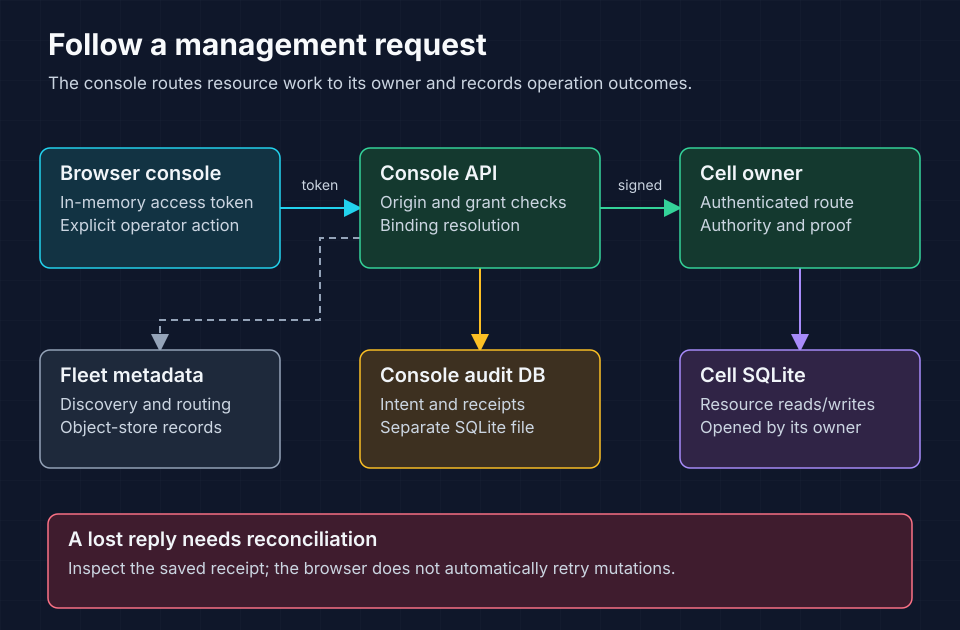

<!-- Copyright 2026 Cellar Project Authors. Licensed under Apache-2.0. -->


# cellar-admin

Inspect and manage a Cellar fleet through an authenticated API and browser
console. The `cellar-dashboard` binary serves the console; the `Console` library
supports application-owned hosting. Explore nodes and cells, inspect data,
manage background work and reconcile durable operation receipts.

The [dashboard plan](../../plans/003-fleet-dashboard.md) records scope,
verification and deployment limits. You supply the hosting infrastructure.

[Run](#run-the-dashboard) · [Access](#configure-access) ·
[Resources](#resource-behavior-and-limits) · [Embed](#embed-the-console) ·
[Event delivery](#event-delivery) · [Stop receipts](#node-stop-receipts)



The Vite/React/shadcn app and its authenticated API share an origin. Resource
operations run through the owner; the console never opens cell SQLite files.
A separate audit database records management intent and outcomes. Inspect
receipts after an ambiguous response; mutations are never automatically replayed.

## Run the dashboard

Build browser assets in `packages/console/` with `npm ci && npm run build`. Copy
`console.example.json` to a private location and configure the fleet bucket,
optional endpoint and region. Paths resolve relative to that configuration.
Set `assets` to the dashboard's built `dist` directory. `local_store` may replace
`bucket` to inspect an existing development object-store database; never point
it at a cell's SQLite state. Use a private, writable path for `audit`.

Provide at least 32 bytes of randomly generated token material through the
environment variable named by each user's `token_env`. The configuration stores
only that variable name. The browser holds its access token in memory.

```sh
# Follow AGENTS.md for a checkout-specific CARGO_TARGET_DIR first.
cargo run -p cellar-admin --bin cellar-dashboard --locked -- \
  --config /path/to/console.json
```

Open the configured address and enter the token. For frontend development, run
`npm run dev` in `packages/console/`; Vite proxies `/api` to `127.0.0.1:4174`. Add the
browser's exact origin to `origins`. No cross-origin API access is enabled.
For remote access, terminate TLS at your authenticated deployment boundary and
configure the external origin. The private Cellar peer listener stays private.

## Configure access

Permissions are independent per fleet: `metadata_read`, `data_read`,
`data_write`, `operate`, `configure`, `fleet_topology`, and `fleet_cancel`. Resource operations resolve declared
application bindings on the server before routing. Do not distribute tokens
with grants broader than the operator needs. The service currently uses static
host-configured principals; applications can construct `Console` with their own
explicit principal provisioning.

## Managed Raft placement operations

The SDK, admin API and dedicated `cellar raft fleet` CLI expose durable
keep-set rebalancing, operation status, paginated movement admissions, wait and
cancellation. Enable this interface explicitly; ordinary dashboard fleets have
no Raft mutation adapter. The browser does not yet provide placement controls.

For an existing managed fleet, add `raft` to its private dashboard configuration:

```json
{
  "cluster_id": "01010101010101010101010101010101",
  "incarnation_id": "50505050505050505050505050505050",
  "coordination_prefix": "hosts/",
  "namespaces": [
    {
      "namespace_id": "02020202020202020202020202020202",
      "schema_digest": "0303030303030303030303030303030303030303030303030303030303030303",
      "catalog_prefix": "raft/",
      "scope": "bucket",
      "managed": true
    }
  ]
}
```

These are example identities: use the original cluster, fleet incarnation,
namespace schema and storage prefixes. Supply the complete rooted namespace
inventory, including previously imported namespaces with their original
`managed` setting. `bucket` resolves namespace metadata within the fleet's bucket
prefix; explicit `store_root` is for deployments whose existing namespace metadata
is outside that prefix. Connection opens existing roots and verifies inventory;
it never initializes a missing fleet or namespace. A separately started,
node-owned topology service must execute admitted work with trusted deployment
resource inputs. This server connection does not start that service.

Grant `metadata_read` for observation, `fleet_topology` for rebalance admission,
and `fleet_cancel` for cancellation. Neither `operate` nor `configure` grants
these mutations. The authenticated principal supplies the audit identity;
request bodies cannot impersonate another principal. Each mutation is audited
before dispatch. An exact retry reconciles the real catalog even when an earlier
audit entry exists. A confirmed historical admission cannot be downgraded by a
later unconfirmed retry.

See the [runnable operator workflow](../../plans/multi-raft/fleet-operations/operator-workflows.md#delivered-keep-set-workflow)
for commands, catalog-generation pins, API routes and retry semantics. This
delivery balances replica placement among already admitted nodes. Node
registration/activation, maintenance, resize, failure-driven recovery and
infrastructure provisioning remain separate delivery work.

## Validate changes

Run the service tests from the repository root:

```sh
cargo test -p cellar-admin --locked
```

API tests cover fleet isolation, authorization, origin rejection, 10,000-cell
pagination, event permissions, durable operation deduplication and receipt
reconciliation. Browser fixture tests cover navigation, permissions, resource
controls, ambiguous outcomes, responsive views and keyboard focus. Native tests
verify SQL/KV/Queue state across graceful handoff and forced owner closure; shutdown
receipts cover handoff, preserve, cancellation and deadline expiry. A standalone
process test verifies cron adoption and a joined stop receipt. See the plan for
the complete verification record and test-environment limits.

## Resource behavior and limits

Resource operations use the authoritative owner and retain explicit outcomes.
The following limits apply to the console unless stated otherwise.

### SQL and schema inspection

Read-only SQL is enforced by SQLite's authorizer, including CTEs and PRAGMAs.
Console queries have a 64 KiB input limit, 1,000 rows per result, a 1 MiB value
budget and a VM-work/time budget. Read/write queries are atomic. Exports contain
only returned results. These console limits do not change CLI SQL behavior.
Schema and column browsing use the same enforced read-only console. Migration
history pages read only approved bookkeeping tables, without creating absent tables.
Queue previews cap payload bytes before loading message bodies and report truncation.

### Conditional KV edits

KV console inspection caps values at 1 MiB before reading blob contents. Larger
values report `valueOmitted`, size, metadata, expiry and revision. Conditional
`kv_edit` and `kv_delete_if` require both data read and data write permissions.
Conditional requests also carry the inspected binding identity; deployment
rebinding is rejected before dispatch, so a draft cannot cross namespaces.
A decimal-string revision identifies the inspected live key; `null` requires
absence.

All namespace puts, including SDK, bulk and older operator writers,
assign a new persisted revision. The owner rechecks the condition in the write
transaction, including expiration after asynchronous blob publication.

`preserve` keeps the exact stored expiry; `never` clears it; `at` uses absolute
Unix milliseconds. Metadata is JSON text or absent, preserving JSON `null`.
Definite conflicts return HTTP 409 and audit `rejected`; transport failures retain
`outcome_unknown`. Existing unconditional SDK and CLI signatures remain unchanged.

The browser does not retry mutations automatically. Conditional editing requires
all fleet owners to run the revision-aware framework. Mixed old/new framework
ownership is not qualified: older runtimes can mutate values without advancing
revisions. Complete the framework rollout before enabling these console edits.

### Workflow discovery and history

Workflow discovery reads a bounded page of retained application workflow cells
through their owners. It reports continuation and unavailable observations, and
may return an empty matching page with a continuation. History uses event IDs.
Non-JSON structured outputs retain an encoded structured-clone representation.
Definition graphs preview declared steps and branches before a run. The execution
explorer separates generations and offers a recorded path, activity timeline,
input/output inspector and the definition snapshot captured for that run. See
[workflow definitions and inspection](../../docs/08-asynchronous-work.md#visual-definitions-and-execution-inspection)
for publishing diagrams and explicitly recording step inputs.

The explorer adds pinned step snapshots, recorded duration overlays and side-by-side
run/definition comparisons. `history_search` requires `data_read` and scans at most
64 events per request, with explicit continuation even on an empty matching page.
Search results retain redaction; oversized data fields are explicitly omitted from
search hits and remain available through ordinary history. History pages include
the owner scope so the browser cannot merge a rebound binding's earlier events.

Changes to an existing workflow require its observed execution generation. After
a restart, inspect the new execution before issuing another control.

### Cron configuration and adoption

Cron preview uses the same five-field UTC parser as scheduling. The separate
schedule editor requires `configure`, checks the observed deployment and schedule
revisions, and conditionally writes a configuration document. Overrides are keyed
by deployment prefix and declared expressions; a new version or changed declarations
supersedes an older override. Re-publishing identical declarations retains it.
The immutable executable, asset index and queue attachment are not rewritten.

The standalone fleet deployment watcher adopts schedule changes at its polling interval.
The `cellar dev` supervisor owns application reloads and disables that watcher;
its node reports the update as pending until the supervisor restarts it.
Embedded hosts explicitly reload `DeploymentGraph::load` and call `Node::adopt`.
Hand-built `LoadedDeployment` values use `cron_revision: None` for their declarations.
Saving returns acceptance; the node adoption table compares actual loaded revisions
and expressions, and reports unreachable/older nodes separately. Adoption does not
prove that an occurrence ran. An empty override retains the scheduling cell so it
can clear an old alarm. Workflow schedule declarations remain deployment configuration.

### Cron execution history

`GET /api/v1/fleets/{fleet}/applications/{application}/cron/executions` requires
`data_read`, with optional `before`, `limit` (1–100, default 50) and `expression`
filters. Only the primary application owns a scheduling cell. Reads are owner-routed
and do not arm schedules or create an absent journal. A signed
`inspection=cron_history_v1` query is refused by older entrances before dispatch;
new entrances reuse the cancellable owner-routed `__cronHistory` RPC. Older
owners refuse this unsupported RPC instead of interpreting a legacy fetch as arming.

The scheduling cell's SQLite journal and output gate retain the last 256 actual attempts with configuration identity, occurrence, attempt,
start/end timing, duration, handler result kind, failure and drained background-error
count. `started` without completion evidence may be running or interrupted; a retry
request does not prove another attempt occurred. Attempt numbering follows the
existing activation-local retry state; record IDs distinguish all retained attempts.

`workflow_accepted` confirms only the
create request, with a linkable instance ID. Old framework executions are not
backfilled. Removing a schedule retains inspection access; anonymous `/do/` access
to cron cells is refused. These observations do not change retry or replay policy.

### Queue previews

Queue console peek snapshots add observation time, total delivery attempts (including
a recorded lease), lease activity/expiry/generation and transfer provenance. They
remain non-consuming and bounded by the existing 512 KiB payload preview budget.
Dead-letter acceptance resets age and attempts in the receiving queue; the panel
explicitly distinguishes these from unretained earlier source-queue history.

### Node controls and cell eviction

Node controls use signed private requests with process-generation
preconditions. Balancing preferences propagate through node leases; acceptance of
a preference does not prove that every donor has observed it. Embedded hosts
without a deployment watcher report reload as unavailable. Cell eviction also
checks the observed ownership epoch inside the serial core and waits for the
existing eviction proof and completion. It releases residency, preserves data,
and does not promise that later demand will leave the cell inactive.
The live node cell view scans at most 100 routing records per page and reports
locally observed alarms; it is not a fleet-wide alarm history.

Resource routing checks the observed owner and at most 128 node lease records,
retaining up to four current compatible entrances. Exhausting that sample means
availability is unknown, not that the fleet is empty.

## Embed the console

Library callers supply `Console::domain`, construct storage clients within that
domain, and keep its executor alive until `domain.shutdown().await` completes.
Each request enters the domain explicitly; no global Cellar host is installed.

## Event delivery

Cells expose outbox lanes and root event-state gauges; node pages expose
generation-pinned host event metrics. Stream workspaces resolve deployed
bindings and provide bounded catalog discovery, non-consuming event reads,
producer watermarks and subscription inspection. An explicit fleet inspection
walks one bounded root-directory page with at most four concurrent owner probes;
it includes undispatched sources and catalog/stream identities beyond deployed
bindings. Page gauges exclude unavailable roots and never claim whole-fleet
completeness. Metadata sheets page retained resources, producers and source
operation history; exact-resource terminal proof is independent of resource grants.
Payload reads are explicit;
payload JSON text and decimal-string counters preserve large integer values.

Reads require `data_read`. Outbox retry and subscription pause/resume additionally
require `operate`; subscription reset/delete, source destruction/recreation and
stream retirement also require `data_write`. Destruction and retirement reviews
require exact identity confirmation and an explicit loss or coordination
attestation. Acceptance is distinct from completed cleanup. Source cleanup can
be explicitly continued only with the original persisted request and operator;
ordinary writes are never automatically replayed.
Stream actions recheck the current binding's read/administer capability and
native grant. Mutation reviews pin the observed source revision or subscription
identity and require a reason. Retirement pins the observed configuration
revision; source lifecycle pins the observed producer incarnation. Native receipts use a principal-bound operator identity and reconcile only the exact locally recorded request. The Operations
page links to receipt lookup after navigation or reload; lookup never replays a
mutation. Cold inspection can activate a cell and progress existing work.

See [console scope and verification](../../plans/006-event-console.md) and the
[SDK event-delivery contract](../../docs/26-event-delivery.md).

## Node stop receipts

After live capability inspection, operators can request handoff and stop, or stop
with ownership preserved for the same node's restart. The console does not start
a replacement process. Each request captures the observed process generation and
a unique operation ID; the node durably records acceptance before requesting its
existing bounded shutdown driver.

Receipts report drain progress, the returned `ShutdownReport`, and whether the
host joined its owned work. Only complete required phases plus the host join
produce a completed receipt. Forced cancellation, deadline expiry and missing
receipts remain distinct. The host publishes the final receipt through a separate
reporting domain after the serving domain joins. Failed publication leaves the
last observation; process exit or an unreachable listener is never substituted
for proof.

Open **Operations → Inspect stop receipt** to read and reconcile an outcome after
the node has disappeared or the console has restarted. Receipt identities include
the console actor so two operators' request IDs cannot collide. Inspecting a
receipt never repeats the stop request, and a late acceptance cannot overwrite a
reconciled completion. Keep the fleet bucket available during shutdown.
