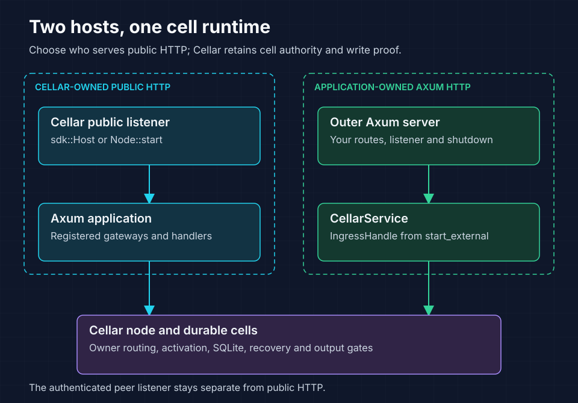

# cellar-axum

Use Axum handlers for Cellar applications, or mount an embedded Cellar node in
an application-owned Axum server. Both hosts execute the same durable cells,
owner routing, recovery, replication, and output gates.

[Cell routes](#define-a-cell-route) · [Hosting](#choose-the-http-host) ·
[Middleware](#middleware-and-application-events) ·
[Streaming](#streaming-and-websockets) · [OpenAPI](#describe-apis-with-openapi)



Choose who owns public HTTP before configuring ingress. Both hosting paths keep
Cellar's private peer listener and cell durability checks.

## Define a cell route

Register the cell factory and its public route in one application definition:

```rust,no_run
use axum::{routing::get, Router};
use cellar_axum::{ApplicationBuilder, AxumCell, CellContext};
use std::sync::Arc;

async fn count(CellContext(context): CellContext) -> String {
    context.identity().map(|cell| cell.class.clone()).unwrap_or_default()
}
fn definition() -> anyhow::Result<cellar_axum::ApplicationDefinition> {
    ApplicationBuilder::default()
        .cell("Counter", |_, _| Ok(Arc::new(AxumCell::new(
            Router::new().route("/counters/{name}", get(count))
        ))))?
        .cell_route("/counters/{name}", "COUNTERS", "Counter", "name")?
        .build()
}
```

The deployment graph must declare `Counter` and its `COUNTERS` namespace.
The builder validates those requirements before node startup or generation
adoption. The gateway calls the namespace stub; it never opens a cell database.
`CurrentCell` extracts the activation identity. `CellContext` exposes the actual
SDK context for the current invocation. Missing authority is an HTTP 500.
Neither extractor constructs an execution domain or searches process globals.

Register `definition()?.instantiate()` in `CompiledApplications`. Construct the
definition inside that factory when application Router State must be fresh per
node. Construct mutable cell Router State inside a `cell` factory, so each
activation has its own state. Fully initialized `Router<()>` values are required;
Axum's State, Path, Query, Json and other normal extractors remain available.

## Choose the HTTP host

For native HTTP, use `Node::start` or the compiled CLI's `sdk::Host`. For an
Axum-owned public listener, bind it first and supply its actual address to
`Node::start_external` through `ExternalNodeServices`. The returned
`IngressHandle` becomes `CellarService::new(ingress)` in a Router's
`fallback_service` or `nest_service`. The node retains its authenticated private
peer listener. An unrelated route in the outer Router runs as ordinary Axum.
`ExternalNodeServices::http_client` and `NodeConfig::http` configure SDK HTTP
egress. `NodeConfig::cell_limits` captures cell API budgets for either host.
See [the two-host counter](../../examples/axum-counter/README.md) for complete
startup, configuration, packaging and shutdown code.

### Admission and shutdown

`ingress_capacity` bounds calls from synchronous admission through response
body completion. Saturation or closed admission returns 503 with Retry-After;
mutations are never automatically retried. Dropping a queued or active call
cancels its owned work. Close admission before signaling the HTTP server's
shutdown. Await both the node's typed `NodeOutcome` and the server within a
bounded deadline. Inspect all `ShutdownReport` phases. A stalled body can cause
an incomplete drain; `Node::cancel` returns `Cancelled` without a durability
proof. Keep the caller's executors alive until joining finishes.

## Middleware and application events

`ApplicationDefinition::layer` wraps public gateways, document routes and named
HTTP entrypoints. `AxumApplication::with_application` delegates cell factories,
workflows and non-HTTP application events to an SDK application.
`ApplicationBuilder::events`, `workflow` and `entrypoint` register those contracts.
`AxumCell::with_cell` sends alarms, RPC and socket events to its SDK delegate.
An unregistered non-HTTP event returns an error.

Authentication, tracing, response-header and other middleware that polls the
handler in its current task can run inside these routers. Layers that buffer,
spawn, hedge or retry handler work are unsupported inside the invocation. Use
`Context::wait_until` for background application work. Outer server middleware
can reject before admission, but its request extensions, principals and tasks
are not transferred into SDK invocations or remote owner calls. Pass application
authentication as an explicit bounded representation that the application
validates; never treat an outer extension as fleet authority.

## Streaming and WebSockets

HTTP and server-sent event (SSE) bodies are polled by an invocation-owned
producer through a bounded SDK byte pipe. Each emitted chunk passes Cellar's existing response egress gate,
including storage writes made after the response head. Backpressure stops
producer polling, disconnect cancels it, and body or proof errors remain stream
errors. Use SDK runtime services instead of ambient spawning or timers in a
handler or producer. Cell routes retain the SDK fetch methods GET, HEAD, POST,
PUT, DELETE, PATCH and OPTIONS; other methods return 501. Conversion into SDK
HTTP requires text headers. Non-text Axum response headers and response trailers
are rejected with controlled errors.

Use `CellWebSocketUpgrade` in Cellar-backed handlers. `accept` returns an SDK
WebSocket and an Axum response; retain a regular consumer with
`Context::wait_until`. `accept_hibernating(tags)` delivers socket events to the
cell's SDK delegate. `http::response` preserves native upgrade targets when
forwarding SDK responses. SDK-to-cell upgrades transfer a socket capability
without requiring network handshake headers. The public transport validates
network handshakes. This uses Cellar's local and remote owner transports and
opening proof. Axum's ordinary `WebSocketUpgrade::on_upgrade` belongs on
ordinary outer Axum routes; it does not provide Cellar invocation authority.
The adapter currently supports the existing HTTP/1.1 WebSocket protocol.

## Describe APIs with OpenAPI

Enable `openapi` to use the re-exported Utoipa 6 / utoipa-axum 0.3 types:

```rust,ignore
ApplicationBuilder::default()
    .info(utoipa::openapi::Info::new("Counters", "v1"))
    .server("/api")
    .cell_api("Counter", "COUNTERS", "name",
        OpenApiRouter::new().routes(routes!(read, increment)))?
    .build()?
```

One `cell_api` registration provides the handler router, gateway paths and
schemas. A class registration can include several canonical paths. Name captures
must occupy a whole segment, such as `/counters/{name}`. Wildcards and implicit
rewriting are unsupported. An outer `nest_service("/api", ...)` strips its prefix
before dispatch; document that external prefix with `.server("/api")`.

The builder emits OpenAPI 3.1.0, adds the required cell name parameter, prefixes
cell operation IDs with class and namespace, and validates duplicate IDs,
ambiguous/overlapping documented routes, local references, and conflicting
components. Identical components may be shared. Use explicit operation IDs and
named shared DTO schemas. Utoipa supports OpenAPI 3.2, but this adapter's initial
contract is 3.1.0. `QUERY` and custom operations require additional method routing
and validation; accepting a 3.2 document is a separate capability from executing
those methods. External schema references are unsupported. GET includes Axum's
implicit HEAD behavior; it does not create a second documented operation unless
explicitly registered.

Security and error declarations belong to the application and must match its
middleware. OpenAPI declarations do not install authentication. Untyped Router
routes are not introspected; avoid overlapping them with cell gateways and
reserved `/openapi.json`. Named HTTP entrypoints have separate routing and are
not automatically public or added to the default document.

`ApplicationDefinition::export_openapi` performs no I/O and starts no node.
`/openapi.json` serves the same immutable document through either host, inside
the application's middleware. Adoption replaces the application and document as
one generation. Applications can merge a documentation UI into their public
Router. The counter example mounts vendored Swagger UI at `/docs` and redirects
`/api` there, using the existing `/openapi.json` route. Its optional UI dependency
is separate from this adapter. The counter also has an offline export binary,
checked-in contract, reproducible Rust client generator and client tests against
both hosts.

## Validate changes

Run both adapter feature modes and the counter integration tests from the
repository root, using the target directory required by
[build guidance](../../AGENTS.md#build-and-validation):

```sh
cargo test -p cellar-axum --no-default-features --locked
cargo test -p cellar-axum --all-features --locked
cargo test -p cellar-axum-counter --all-features --locked
```
