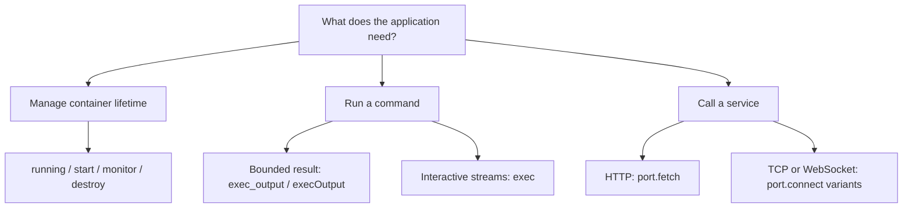
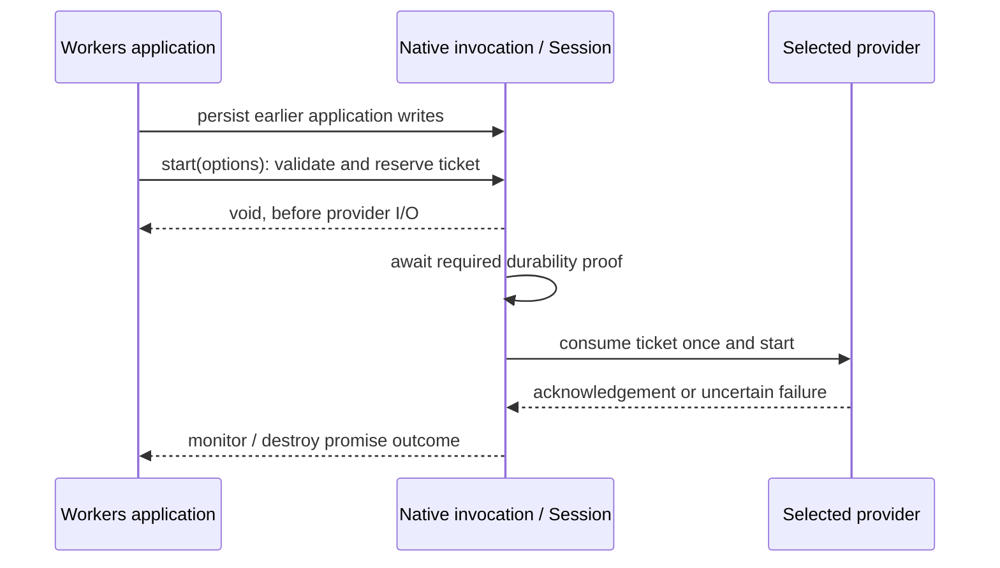
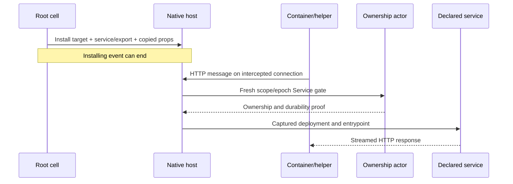

<!-- Copyright 2026 Cellar Project Authors. Licensed under Apache-2.0. -->

# cellar-container

**One provider boundary for Rust, Python, JavaScript and TypeScript container APIs.**
The default `Native` provider uses Cellar's existing Docker/Podman integration;
Rust hosts can supply another backend without changing the guest API.

[Quick start](#quick-start) · [Provider matrix](compatibility.md) · [Capabilities](#discover-capabilities) ·
[Lifecycle](#two-lifecycle-interfaces) · [Scheduled cleanup](supervision.md) · [Files](files.md) · [Add a provider](#add-a-provider) ·
[HTTP streams](streams.md) · [Wire reference](#bridge-protocol-version-1)

## Native containers, this adapter, or Workers?

`cellar-container` puts a shared provider boundary above Cellar's native
container engine. Selecting `Native` keeps the same Docker/Podman execution path.

| Your application needs… | Use | What it adds |
| --- | --- | --- |
| Typed Rust access to the configured local engine | `cellar::sdk::Context::container()` | Direct native lifecycle, exec and port APIs |
| A backend selectable by the host across Rust, Python, JS and TS | This crate's `Adapter` / `Session` | Shared operations, capabilities, validation and bounded replies |
| Existing Workers/Durable Object application APIs | Optional `@cellar/cloudflare` package | Experimental API compatibility above the same provider boundary |
| A hosted E2B sandbox | Experimental [`e2b::E2b`](e2b.md) provider | Bounded commands/files and durable lifecycle reconciliation; explicit weaker ownership profile |
| A hosted Vercel sandbox | Experimental [`vercel::Vercel`](vercel.md) provider | Bounded commands/files, durable named-resource identity and pinned sessions; explicit weaker ownership |
| Another hosted sandbox | A dedicated Rust `Provider` implementation | Extend the same boundary; additional providers remain planned |

Like celld, a durable object/cell owns container controls and the node executes
them. Cellar adds a host-selected provider shared by all four languages.
SDK compatibility is qualified against its matching image.

## How it fits together


| Layer | Owns |
| --- | --- |
| Language facade | `ctx.container`, typed options and byte conversion |
| `Adapter` / `Session` | Provider selection, validation, invocation authority and bounded replies |
| Provider | Backend effects, process/socket handles, isolation and cleanup |
| Native Cellar host | Cell ownership, activation epoch and required durability/output gates |

Hosts can also declare [named provider slots](bindings.md#select-a-host-declared-provider-slot).
All four language paths share their operations and discovery. Use
`ctx.containers.get("builds")` in Python/JS/TS; `ctx.container` retains the default.
Selection never falls back to a different provider when a slot is missing.

For remote resources that outlive requests, enable
[host-managed cleanup](supervision.md). Native internal work observes the original
resource and retires it at its configured maximum/idle deadline, independently
of application alarms. E2B and Vercel supply optional maintenance backends.

For durable remote resources, all four language facades expose
[`reconcile()`](bindings.md#reconcile-from-a-later-invocation): recover a matching
pending create, observe expiry or check pending deletion without creating,
resuming or deleting compute. Results carry lifecycle state and generation;
resource IDs and credentials stay in the host.

**The provider future runs inside the original native SDK invocation.** The
adapter does not move SDK effects onto the Python, Node or V8 runtime thread.

### What ships today?

| Path | Status | Where to look |
| --- | --- | --- |
| Local Docker / compatible Podman Engine | Implemented by the default `Native` provider | [Runnable native walkthrough](../../examples/native-container/README.md) |
| Custom container or sandbox backend | `Provider` / `ProviderSession` extension point is available; the host supplies the implementation | [Provider contract](#add-a-provider) |
| Local Cloudflare Workers / Containers / Sandbox APIs | Experimental compatibility slices in a separate package; full application/image conformance remains pending | [Cloudflare facade](../../packages/cellar-cloudflare/README.md) |
| E2B control API + envd | Experimental bounded execution/files; explicit weaker ownership, local protocol tests; live account qualification pending | [E2B configuration and recovery](e2b.md) |
| Vercel named sandbox + session API | Experimental bounded execution/files with image-local helper; local protocol/runtime tests; live VM qualification pending | [Vercel configuration and recovery](vercel.md) |
| Hosted Cloudflare, Daytona and Modal | Planned | [Delivery plan](../../plans/sandbox-provider-compatibility.md) |
| Dynamic Worker isolates, PTY and snapshots | Planned features; the current operation set does not implement them | [Implementation ledger](../../plans/sandbox-provider-progress.md) |

**Tested Sandbox baseline:** 0.12.9 SDK + matching image; unchanged exec, file,
background-process discovery and teardown routes pass. A published `execStream()`
probe also forwards output through Worker/DO HTTP responses before command
completion. Direct RPC `execStream()` also passes. Generic RPC byte-stream inputs
run through native sessions. With `SANDBOX_TRANSPORT=rpc`, a real 2 MiB SDK
binary upload now passes through Cap'n Web and native container WebSockets,
including a prefix observed before EOF and exact final bytes. The unchanged
SDK `readFile({ encoding: "none" })` returns those bytes through native RPC;
returned HTTP responses also preserve metadata and streamed body ownership.
Node Request/Response RPC arguments and Request results also pass their native
slice. The published HTTP preview helper now passes binary forwarding, token
checks, stale-runtime refusal and explicit re-exposure against the pinned image.
Worker/DO upgrade forwarding and selected WebSocket preview round trips also pass.
Full lifetime/upgrade/fault qualification remains open.
See the [evidence ledger](../../plans/sandbox-provider-progress.md#worker-and-durable-object-http-response-forwarding).

## Quick start

### 1. Configure the host

For the default backend, configure the cell's container image and the node's
Docker/Podman engine using the [native walkthrough](../../examples/native-container/README.md).
`Native` preserves that engine's image loading, network isolation, inactivity
policies and ownership cleanup.

| Host | Provider selection |
| --- | --- |
| Rust | `Adapter::default()` or `Adapter::new(Arc<dyn Provider>)` |
| Python adapter | `cellar_python::Source::container_provider(provider)` before runtime startup |
| JavaScript / TypeScript adapter | `cellar_javascript::Source::container_provider(provider)` before runtime startup |

Omitting `container_provider` selects `Native`. Selection applies to the
application's container calls; a custom provider can route using the context's
class or cell identity. Credentials and routing configuration stay in the host.

### 2. Call from a root-cell event

A session belongs to **one invocation**. Create it once for that event and retain
it for the event's later calls; reacquire it for the next event.

**Rust — dispatch through the selected provider:**

```rust,no_run
use cellar::sdk::Context;
use cellar_container::{Adapter, Limits, Operation};
use serde_json::json;

async fn running(adapter: &Adapter, ctx: &Context) -> anyhow::Result<bool> {
    let session = adapter.session();
    let limits = Limits { max_body_bytes: 1024 * 1024 };
    let value = session
        .execute(ctx, Operation::Running, json!({}), &limits)
        .await?;
    Ok(serde_json::from_value(value)?)
}
```

For typed Rust calls directly against the native engine, use
`ctx.container()?`; see the [integration guide](../../docs/09-integrations.md).

**Python — collect bounded output from an already-running container:**

```python
async def run_tool(ctx):
    output = await ctx.container.exec_output(
        ["/app/tool"], max_bytes=4096
    )
    return output.exit_code, output.stdout, output.stderr
```

**JavaScript / TypeScript — the same operation and combined byte budget:**

```ts
import type { Context } from "@cellar/sdk";

async function runTool(ctx: Context) {
  const output = await ctx.container.execOutput({ cmd: ["/app/tool"] }, 4096);
  return { code: output.exit_code, stdout: output.stdout, stderr: output.stderr };
}
```

`/app/tool` must exist in your configured image. Remove the type import and
annotation for plain JavaScript. Both language facades use the same Rust provider
boundary; Python returns `bytes`, and JS/TS returns `Uint8Array`.

### 3. Choose the operation you need



| Task | Python | JavaScript / TypeScript |
| --- | --- | --- |
| Discover operations and limits | `await c.capabilities()` | `await c.capabilities()` |
| Reconcile recovery / expiry / pending deletion | `await c.reconcile()` | `await c.reconcile()` |
| Check / start / wait for exit | `running`, `start`, `monitor` | Same async names |
| Stop or signal | `destroy`, `signal` | Same async names |
| Set idle timeout | `set_inactivity_timeout(ms)` | `setInactivityTimeout(ms)` |
| Binary files / metadata | `read_file`, `write_file`, `stat_file`, `list_files` | `readFile`, `writeFile`, `statFile`, `listFiles` |
| Interactive process I/O | `exec(cmd)` | `exec({ cmd })` |
| Terminal allocation | `exec(cmd, pty=(80, 24))` | `exec({ cmd, pty: { cols: 80, rows: 24 } })` |
| Process identity / terminal size | `process.info()` / `await process.resize(cols, rows)` | Same async names |
| Bounded stdout + stderr | `exec_output(cmd, max_bytes=n)` | `execOutput({ cmd }, n)` |
| Port readiness / buffered HTTP | `port(n).wait_ready` / `.fetch` | `port(n).waitReady` / `.fetch` |
| Raw TCP / WebSocket | `port(n).connect` / `.connect_websocket` | `port(n).connect` / `.connectWebSocket` |

Here `c = ctx.container`. Lifecycle, port and streaming examples are in the
[integration guide](../../docs/09-integrations.md#apis-in-each-language).

## Terminal execution

Check `exec_pty` before requesting a terminal. Dimensions are character cells,
from 1 to 65,535; the native engine requires Docker API 1.42 or newer. Terminal
discipline combines stdout/stderr and can transform input and line endings.
Use ordinary pipes for binary file transfers.

```javascript
const process = await ctx.container.exec({
  cmd: ["sh"],
  pty: { cols: 80, rows: 24 },
});
const { pid, is_pty } = await process.info();
await process.resize(132, 40);
await process.write(Uint8Array.of(101, 120, 105, 116, 10)); // "exit" then Enter
await process.closeStdin();
async function discard(read) {
  while ((await read()).length) {}
}
try {
  await Promise.all([
    discard(() => process.readStdout()),
    discard(() => process.readStderr()),
    process.wait(),
  ]);
} finally {
  await process.release();
}
```

| Boundary | Contract |
| --- | --- |
| Rust native SDK | `ExecOptions::pty` takes a validated `TerminalSize`; `Exec::info(context)` and `resize(context, cols, rows)` check cell/run authority |
| Portable Rust | `Operation::ExecInfo` and `Operation::ResizeExec` use the original event's resource handle |
| PID | Verified inside the container by the shell handshake; `None`/`null` when unavailable, never Docker's daemon-host PID |
| Resize | Original handle and run checks, required durability/output proof, then an acknowledged engine request; no retry after an uncertain reply |
| Workers void controls | `kill` and `resize` reserve one-shot native tickets synchronously, before queued execution; transaction/foreign-callback refusal precedes effects and failed acknowledgements remain event failures |
| Capability refusal | E2B/Vercel declare `exec_pty: false`; terminal requests refuse before provider dispatch |
| Output failure | Truncated or malformed framed output is an error; one large frame is read in bounded 64 KiB chunks |

PID metadata grants no new authority. Guest handles remain invocation-owned;
native Rust handles retain their existing cell/activation/run lifetime.

## Discover capabilities

Hosts can inspect configuration **without opening a session or contacting the
backend**:

```rust
use cellar_container::{Adapter, Environment, Limits};

let limits = Limits { max_body_bytes: 1024 * 1024 };
let capabilities = Adapter::default().capabilities(&limits);
assert_eq!(capabilities.provider, "native");
assert_eq!(capabilities.environment, Environment::Linux);
assert_eq!(capabilities.max_resources, Some(64));
```

Root-cell guests use `await ctx.container.capabilities()`. This checks invocation
authority, but does not start a container or call the provider's effect dispatcher.

| Descriptor field | Meaning |
| --- | --- |
| `format` | Descriptor version; currently `1` |
| `provider` | Host-selected backend name |
| `environment` | `linux`, `worker_isolate` or `unspecified`; the last means undeclared |
| `fencing` | Declared ownership protection: `native_cell`, `local_checks_and_expiry`, `provider_enforced` or `unspecified` |
| `operations` | Actually declared bridge operations, plus shared capability discovery |
| `max_body_bytes` | Host limit for binary bodies and bounded results |
| `max_resources` | Provider-declared live-handle cap; `null` means unknown, not unlimited |
| `synchronous_running` | Opt-in, authoritative running observation with no backend I/O; required by the Workers property |
| `queued_lifecycle` | Opt-in to bounded, synchronous lifecycle admission followed by asynchronous provider execution |
| `exec_pty` | Explicit terminal-allocation support; independent of a provider's Linux environment declaration |

`Native` declares Linux and enforces 64 live handles per invocation. JS and Python
return immutable metadata. The `worker_isolate` enum value describes a possible
environment; it does not mean an isolate provider is implemented.

## Two lifecycle interfaces

The portable API waits for provider acknowledgement. The experimental Workers
facade separates immediate admission from asynchronous execution.

| Action | Portable Python / JS / TS | Workers facade |
| --- | --- | --- |
| Observe state | `await c.running()` | `c.running` property |
| Start | `await c.start(options)` | `c.start(options)` returns `void`; validation may throw |
| Signal | `await c.signal(signal)` | `c.signal(signal)` returns `void` |
| Observe exit | `await c.monitor()` returns an exit code | `await c.monitor()` resolves normally or throws an exit error |
| Destroy | `await c.destroy()` | `await c.destroy(reason?)`; monitors receive the explicit reason |



Admission checks immutable inputs, event authority and provider prerequisites.
Each invocation retains at most **64 queued controls**, with their combined JSON
inputs bounded by `max_body_bytes`. Consumed tickets cannot be replayed; an
uncertain startup needs explicit reconciliation or cleanup.

The Workers path requires `Source::workers_lifetimes()` and both provider opt-ins.
Concurrency callbacks join their accepted controls before releasing the native
input gate. Transactions, including concurrency blocks nested inside them,
refuse before admission. A callback's returned continuation cannot admit another
control while the earlier controls drain. Node supports incremental port
and Worker/DO HTTP forwarding; the pinned Container example runs against an engine protocol peer,
and the Sandbox baseline also passes matching-image HTTP streaming and SDK RPC
uploads over container-port upgrades/local WebSocket pairs. Selected Worker/DO
upgrades also forward to clients; complete lifecycle/fault acceptance remains pending. See the
[Cloudflare execution evidence](../../packages/cellar-cloudflare/README.md#execution-evidence).

The separately pinned [Sandbox 1.0.3 profile](../../tools/sandbox/cloudflare-v1/README.md)
adds Node Workers `exec(argv)`, automatic byte-source stdin, byte output streams
and bounded output collection over the same native process operations. Its
published `Files` package runs the matching helper; full 1.x lifecycle, persistence and cloud qualification remain
open. Native process signalling requires a POSIX `/bin/sh` in the image; direct
exec remains available without it, while signalling refuses an unverified PID.
See the [native exec contract](../../docs/09-integrations.md#apis-in-each-language).
The optional [R2 backup gateway subset](../../packages/cellar-cloudflare/r2.md)
adds native resumable object storage for published gateway operations; complete
helper backup/restore has a separate matching-image qualification campaign.
The native [outbound transport and network helper](../cellar-egress/README.md)
now supply bounded streams, acknowledged firewall rules, persistent DNS and
joined process retirement. An explicit native host profile also starts an owned
helper before its application and removes the pair together. The optional HTTP
profile below routes those streams to native services.

### Optional native network-helper lifecycle

The hosting Rust process selects this profile for any handler language. Supply
an immutable Linux image containing `cellar-egress` and nftables; image packaging
and release qualification remain separate work. Existing hosts use
`network_helper: None`.

```rust,no_run
use cellar::sdk::{ContainerEngineOptions, ContainerNetworkHelperOptions};

fn engine(
    socket: std::path::PathBuf,
    helper_image: String,
) -> anyhow::Result<ContainerEngineOptions> {
    Ok(ContainerEngineOptions {
        socket,
        namespace: Some("my-native-host".into()),
        runtime: Some("runc".into()),
        dns: Vec::new(),
        network_helper: Some(ContainerNetworkHelperOptions::new(
            helper_image, // full sha256: ID or verified cellar-image: identity
            "/opt/cellar-egress/bin/cellar-egress".into(),
            "1.1.1.1:53".parse()?,
        )),
    })
}
```

| Boundary | Native behavior |
| --- | --- |
| Startup | Attach the exact helper ID, await readiness, then create/start the application |
| Runtime | Explicit `runc`; other runtimes refuse this profile before allocation |
| Namespace | Application joins its run's helper; the application retains no `NET_ADMIN` capability |
| Ports / DNS | Helper owns at most 64 combined image/class TCP publications and its explicit DNS upstream |
| Capacity | Reserve another 256 MiB for each allocated helper until removal is confirmed |
| Idle reconnect | Preserve the same application/helper IDs and join the old inactivity timer |
| Ownership loss | Retire private transport before waiting for SDK control; remove the application before the helper |
| Helper loss | Refuse usable routing, publish the failure and clean up both owned resources |

On macOS, the helper selects available local port candidates and holds them
through container creation. It releases those reservations before daemon startup
so the VM forwarder can bind. This is not an atomic port handoff; a working
daemon forwarder remains required.

The lifecycle option and HTTP provider opt-in are separate. See the
[real Engine campaign](../../tools/sandbox/egress/README.md) for evidence and gaps.

### Route outbound HTTP to a native service

Enable `Native.with_http_interception()` in the host's provider configuration
and configure the `runc` network helper above. Ordinary `Native`, E2B and Vercel
omit this operation from capability discovery and refuse it before dispatch.



The Workers facade accepts a declared service binding or an exported entrypoint:

```ts
await this.ctx.container.interceptOutboundHttp(
  "backups.internal",
  this.ctx.exports.Gateway({ props: { binding: "BACKUPS" } }),
);
await this.ctx.container.interceptAllOutboundHttp(this.env.OUTBOUND_GATEWAY);
```

Portable facades select a host-declared service binding by name:

| Language | Install a target |
| --- | --- |
| Rust native SDK | `ctx.container()?.intercept_outbound_http(&ctx, "*.example.test", &ctx.service("API")?).await?` |
| JavaScript / TypeScript | `await ctx.container.interceptOutboundHttp("*.example.test", "API")` |
| Python | `await ctx.container.intercept_outbound_http("*.example.test", "API")` |
| Common bridge | `container.intercept_outbound_http`, input `{"target":"*.example.test","service":{"kind":"binding","binding":"API"}}` |

| Boundary | HTTP profile behavior |
| --- | --- |
| Targets | Hostname, wildcard, IP/CIDR or catch-all; plain HTTP on port 80 |
| Before start | Hold bounded native route metadata; acknowledge helper rules before allocating the application |
| After start | Replace the same target in its original position; resolve the current handler for each message, including retained TCP connections |
| Route lifetime | Container run; no installing event, activation, guest closure or guest environment is retained |
| Authority | Host-minted scope, epoch and exact nonzero deployment generation; fresh Service gate per request; retired deployments refuse |
| Unmatched traffic | Marked direct connection through the helper's configured network policy |
| Resource bounds | 128 interceptor entries; hostnames and catch-all cost two, IP/CIDR one; 64 KiB captured route; 128 / 64 KiB headers; 8 KiB URL |
| Bodies | Stream with backpressure; buffered response prefix at most 1 MiB; stop transport and joined handlers on retirement |
| Refusal | Fixed 502 before response publication; later body failure closes the stream; no replay |
| Gaps | HTTPS interception, upgrades, trailers and full persistence/fault qualification |

Node Workers gateways opt in to incoming body streaming with
`Source::workers_http_streams()`. Each source pull uses the original invocation
and the configured per-chunk body limit; EOF, cancellation and errors release
the native reader. The ordinary SDK retains its buffered request limit.

The matching-image [Sandbox 1.0.3 fixture](../../tools/sandbox/cloudflare-v1/backups.mjs)
uses the published `DirectoryBackup` and `DirectoryBackupGateway`; its
[qualification instructions](../../tools/sandbox/cloudflare-v1/README.md)
keep SDK/image evidence separate from router and provider tests. S3 mounts and
complete Sandbox 1.x compatibility remain open.

The directory-backup campaign also restores from fresh native/Node processes
and checks allocation-time cancellation, missing/corrupt archives, destination
preservation and grant revocation. Abrupt crash and mid-transfer outcomes remain
separate qualification work.


## Understand lifetime and failure outcomes

| Resource | Lifetime / cleanup |
| --- | --- |
| Provider `Adapter` | Reusable host configuration |
| `Session`, context and process/socket handles | One root-cell invocation; drop cancels pending work and releases streams |
| Exec handle | Bound to its container run; `release` closes streams without killing the process |
| TCP / WebSocket handle | Event-owned transport; `release` closes it |
| Container instance | Separate from stream lifetime; follows the provider's inactivity, ownership and destroy policies |

For the native engine, an idle eviction can leave the container running during
its inactivity window. Ownership transfer, reset, node restart or shutdown can
destroy it. Persist job progress in cell state and expect a fresh process after
takeover.

| Native idle transition | Cleanup behavior |
| --- | --- |
| Idle eviction | Arm removal for the configured inactivity window |
| Successful reconnect | Cancel and join the previous timer before returning |
| Failed discovery/adoption | Retain the original cleanup deadline |
| Another idle eviction | Replace and join the prior timer; use the new window |
| Explicit ownership release | Cancel and join the timer before owned removal |
| Removal already admitted | Finish exact-resource removal before reconnect or replacement |

Native daemon operations retain the resource selected for that run:

| Identity | Native behavior |
| --- | --- |
| Cell scope | Application identity across events and activations |
| Container name | Creation/discovery key; discovery verifies node, host, cell and class labels |
| Full Engine ID | Captured at creation or owned adoption; used by wait, exec, files, signals and removal |
| Run counter | New process/file operations require the current run; older waiters retain their original ID |
| Host restart cleanup | Validates full IDs and host/node labels before removing each owned resource |

Renaming an owned container does not redirect its captured operations. A foreign
container that later occupies the old name cannot be adopted or removed by those
operations. A lost create response still needs owned discovery or reconciliation;
it does not authorize replay.

Remote provider bindings retain their journal across host configuration changes.
Changing the provider or its durable configuration identity requires confirmed
retirement of the previous resource:

| Retained binding | New provider / configuration |
| --- | --- |
| Create response lost, resource live, or deletion pending | Refuse before provider I/O; reconcile or retire with the original configuration |
| Deletion confirmed by the original configuration | `reconcile` reports `deleted`, `running` is false, and `destroy` is an I/O-free no-op |
| Explicit `start` after confirmed retirement | Persist a fresh request identity and next generation under the newly configured provider |

This supports host-controlled E2B/Vercel replacement without clearing cell state.
Changing a provider does not resolve a lost outcome or revoke work already
accepted remotely. Keep the original configuration available until cleanup is
confirmed. Optional [native supervision](supervision.md) schedules expiry and
cleanup. Selected cold-restart, removed-class and owner-expiry paths pass native
fleet tests with protocol peers. Live-account qualification, wider fault cases
and remote fencing remain separate work.


*Control calls wait for earlier cell writes to reach their required durability
proof. Stream reads and other observations can overlap a pending control.*

| Failure point | What callers can conclude |
| --- | --- |
| Unsupported operation or invalid input, before dispatch | `Validation`: provider effects did not occur |
| Submitted mutation fails or its reply is lost | Outcome may be unknown; reconcile before retrying |
| Reply fails size/type validation after execution | Effects may already have occurred; failure does not prove rollback |
| Explicit cancellation before dispatch | `Cancelled` / `not_committed`; provider was not called |
| Cancellation after admission | `Cancelled` / `unknown`; waiting stops and the provider future is dropped |

Commands are not transactional or exactly once. Cancellation stops waiting;
it does not establish whether an accepted command stopped or rolled back.

| Cancellation API | Usage |
| --- | --- |
| Rust | `Session::execute_with_signal` with a native abort signal |
| JS / TS port fetch / streamed reads | `port.fetch(request, { signal })` or `port.fetchStream(request, { signal })` |

See [HTTP response streams](streams.md) for incremental reads, limits and cleanup.

The runtime keeps reservations until native cancellation completes. Dropping a
native HTTP future cancels its connection/body work; custom providers must honor
the [future-drop cleanup contract](providers.md#backend-responsibilities).

## Add a provider

Implement these traits in the Rust host, then select the provider before runtime
startup. See the [trait definitions](lib.rs) and
[provider integration tests](tests/providers.rs) for concrete code.

### Example: expose only native status checks

This complete provider delegates execution to `Native` and advertises only
`Running`. The shared session refuses other operations before dispatch. A hosted
provider instead opens its own session and implements its backend effects.

```rust
use cellar_container::{
    Adapter, Environment, Native, Operation, Provider, ProviderSession,
};
use std::sync::Arc;

struct StatusOnly;

impl Provider for StatusOnly {
    fn name(&self) -> &str {
        "local-status"
    }

    fn environment(&self) -> Environment {
        Environment::Linux
    }

    fn operations(&self) -> &[Operation] {
        &[Operation::Running]
    }

    fn open(&self) -> Box<dyn ProviderSession> {
        Native.open()
    }
}

let adapter = Adapter::new(Arc::new(StatusOnly));
```

The [provider contract](providers.md) explains each trait method, fencing,
isolation, cleanup, the [durable binding journal](bindings.md) and uncertain
outcomes. Use the [wire reference](protocol.md)
for operation inputs and results.

## Bridge protocol, version 1

The [complete reference](protocol.md) documents the owned JSON contract. Most
applications use the language facade instead of constructing these messages.

| Operation family | Examples | Reply |
| --- | --- | --- |
| Discovery / lifecycle | `container.capabilities`, `.reconcile`, `.start`, `.monitor` | Capabilities, lifecycle observation, run token or exit code |
| Commands | `container.exec`, `.exec_output` | Process handle or bounded output |
| Process streams | `container.exec.read_stdout`, `.write` | Base64 bytes or `null` |
| Ports | `container.port.fetch`, `.fetch_stream`, `.connect` | Buffered response, streamed head or socket handle |
| HTTP response streams | `container.response.read`, `.cancel` | One bounded chunk / EOF, or local consumer release |
| Sockets / WebSockets | `container.socket.read`, `container.websocket.receive` | Bytes or a typed event |

Binary wire values use standard padded base64. Python exposes `bytes`; JS/TS
exposes `Uint8Array`. The host controls byte and resource limits.

## Validate changes

```sh
cargo test --locked -p cellar-container -p cellar-guest --lib
cargo test --locked -p cellar-container --test providers
cargo test --locked -p cellar-container --doc
python3 tools/docs/check.py
```

The provider tests cover supported subsets and invocation boundaries. Language
container integration tests in `cellar-javascript` and `cellar-python` use a
host-selected audit provider that delegates to native, covering selection,
binary streams, cancellation, timeout cleanup and ownership rejection through
CPython, Node and embedded V8.

For exact delivered slices and remaining live/fault qualification, consult the
[implementation ledger](../../plans/sandbox-provider-progress.md).
