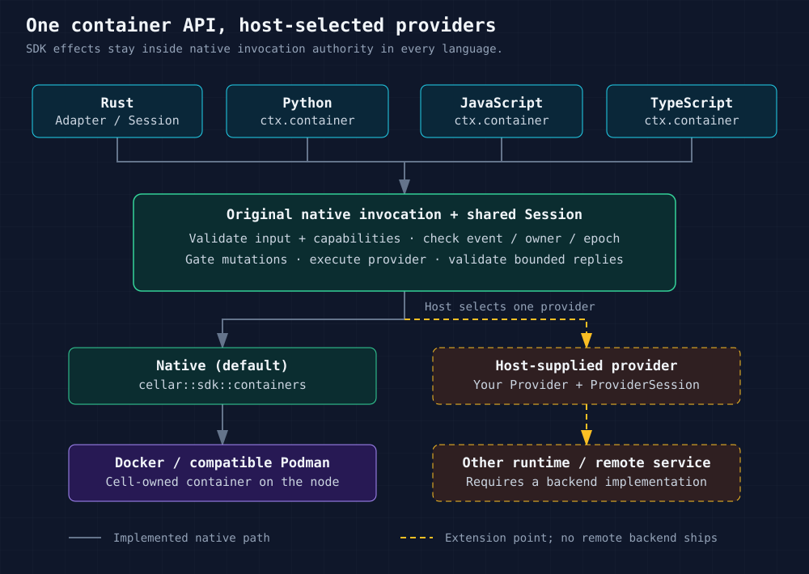
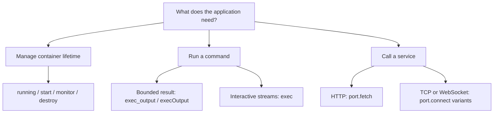
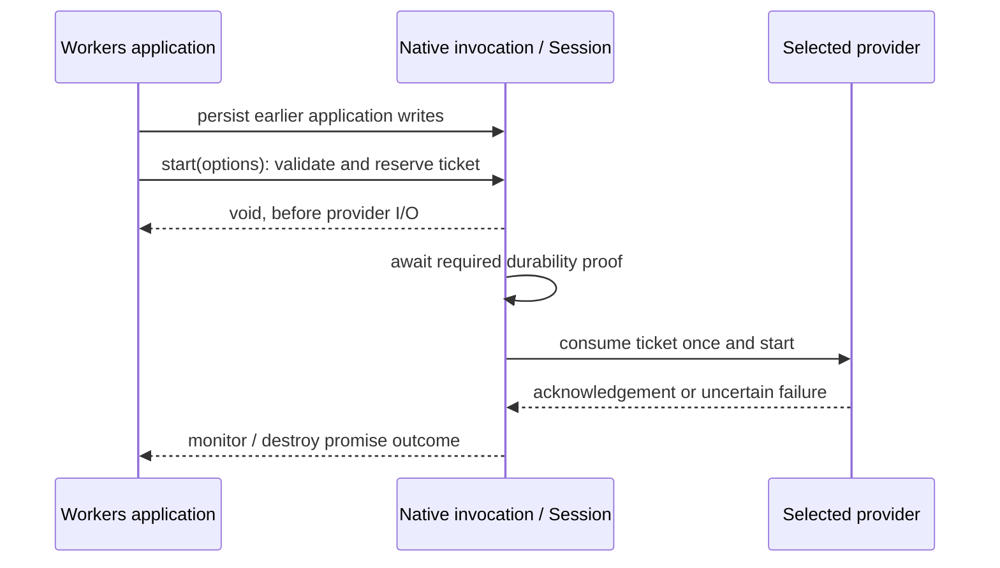
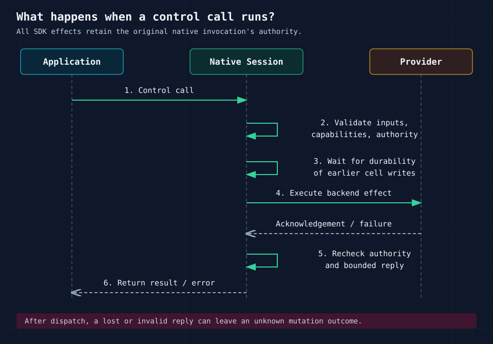

<!-- Copyright 2026 Cellar Project Authors. Licensed under Apache-2.0. -->

# cellar-container

**One provider boundary for Rust, Python, JavaScript and TypeScript container APIs.**
The default `Native` provider uses Cellar's existing Docker/Podman integration;
Rust hosts can supply another backend without changing the guest API.

[Quick start](#quick-start) · [Provider matrix](compatibility.md) · [Capabilities](#discover-capabilities) ·
[Lifecycle](#two-lifecycle-interfaces) · [Files](files.md) · [Add a provider](#add-a-provider) ·
[HTTP streams](streams.md) · [Wire reference](#bridge-protocol-version-1)

## Native containers, this adapter, or Workers?

`cellar-container` puts a shared provider boundary above Cellar's native
container engine. Selecting `Native` keeps the same Docker/Podman execution path.

| Your application needs… | Use | What it adds |
| --- | --- | --- |
| Typed Rust access to the configured local engine | `cellar::sdk::Context::container()` | Direct native lifecycle, exec and port APIs |
| A backend selectable by the host across Rust, Python, JS and TS | This crate's `Adapter` / `Session` | Shared operations, capabilities, validation and bounded replies |
| Existing Workers/Durable Object application APIs | Optional `@cellar/cloudflare` package | Experimental API compatibility above the same provider boundary |
| A hosted E2B sandbox | Experimental [`e2b::E2b`](e2b.md) provider | Bounded commands/files and durable lifecycle reconciliation; explicit weaker ownership profile |
| A hosted Vercel sandbox | Experimental [`vercel::Vercel`](vercel.md) provider | Bounded commands/files, durable named-resource identity and pinned sessions; explicit weaker ownership |
| Another hosted sandbox | A dedicated Rust `Provider` implementation | Extend the same boundary; additional providers remain planned |

Like celld, a durable object/cell owns container controls and the node executes
them. Cellar adds a host-selected provider shared by all four languages.
SDK compatibility is qualified against its matching image.

## How it fits together



| Layer | Owns |
| --- | --- |
| Language facade | `ctx.container`, typed options and byte conversion |
| `Adapter` / `Session` | Provider selection, validation, invocation authority and bounded replies |
| Provider | Backend effects, process/socket handles, isolation and cleanup |
| Native Cellar host | Cell ownership, activation epoch and required durability/output gates |

**The provider future runs inside the original native SDK invocation.** The
adapter does not move SDK effects onto the Python, Node or V8 runtime thread.

### What ships today?

| Path | Status | Where to look |
| --- | --- | --- |
| Local Docker / compatible Podman Engine | Implemented by the default `Native` provider | [Runnable native walkthrough](../../examples/native-container/README.md) |
| Custom container or sandbox backend | `Provider` / `ProviderSession` extension point is available; the host supplies the implementation | [Provider contract](#add-a-provider) |
| Local Cloudflare Workers / Containers / Sandbox APIs | Experimental compatibility slices in a separate package; full application/image conformance remains pending | [Cloudflare facade](../../packages/cellar-cloudflare/README.md) |
| E2B control API + envd | Experimental bounded execution/files; explicit weaker ownership, local protocol tests; live account qualification pending | [E2B configuration and recovery](e2b.md) |
| Vercel named sandbox + session API | Experimental bounded execution/files with image-local helper; local protocol/runtime tests; live VM qualification pending | [Vercel configuration and recovery](vercel.md) |
| Hosted Cloudflare, Daytona and Modal | Planned | [Delivery plan](../../plans/sandbox-provider-compatibility.md) |
| Dynamic Worker isolates, PTY and snapshots | Planned features; the current operation set does not implement them | [Implementation ledger](../../plans/sandbox-provider-progress.md) |

**Tested Sandbox baseline:** 0.12.9 SDK + matching image; unchanged exec, file,
background-process discovery and teardown routes pass. A published `execStream()`
probe also forwards output through Worker/DO HTTP responses before command
completion. Direct RPC `execStream()` also passes. Generic RPC byte-stream inputs
run through native sessions. With `SANDBOX_TRANSPORT=rpc`, a real 2 MiB SDK
binary upload now passes through Cap'n Web and native container WebSockets,
including a prefix observed before EOF and exact final bytes. HTTP-message RPC
transfers, previews and full fault qualification remain open.
See the [evidence ledger](../../plans/sandbox-provider-progress.md#worker-and-durable-object-http-response-forwarding).

## Quick start

### 1. Configure the host

For the default backend, configure the cell's container image and the node's
Docker/Podman engine using the [native walkthrough](../../examples/native-container/README.md).
`Native` preserves that engine's image loading, network isolation, inactivity
policies and ownership cleanup.

| Host | Provider selection |
| --- | --- |
| Rust | `Adapter::default()` or `Adapter::new(Arc<dyn Provider>)` |
| Python adapter | `cellar_python::Source::container_provider(provider)` before runtime startup |
| JavaScript / TypeScript adapter | `cellar_javascript::Source::container_provider(provider)` before runtime startup |

Omitting `container_provider` selects `Native`. Selection applies to the
application's container calls; a custom provider can route using the context's
class or cell identity. Credentials and routing configuration stay in the host.

### 2. Call from a root-cell event

A session belongs to **one invocation**. Create it once for that event and retain
it for the event's later calls; reacquire it for the next event.

**Rust — dispatch through the selected provider:**

```rust,no_run
use cellar::sdk::Context;
use cellar_container::{Adapter, Limits, Operation};
use serde_json::json;

async fn running(adapter: &Adapter, ctx: &Context) -> anyhow::Result<bool> {
    let session = adapter.session();
    let limits = Limits { max_body_bytes: 1024 * 1024 };
    let value = session
        .execute(ctx, Operation::Running, json!({}), &limits)
        .await?;
    Ok(serde_json::from_value(value)?)
}
```

For typed Rust calls directly against the native engine, use
`ctx.container()?`; see the [integration guide](../../docs/09-integrations.md).

**Python — collect bounded output from an already-running container:**

```python
async def run_tool(ctx):
    output = await ctx.container.exec_output(
        ["/app/tool"], max_bytes=4096
    )
    return output.exit_code, output.stdout, output.stderr
```

**JavaScript / TypeScript — the same operation and combined byte budget:**

```ts
import type { Context } from "@cellar/sdk";

async function runTool(ctx: Context) {
  const output = await ctx.container.execOutput({ cmd: ["/app/tool"] }, 4096);
  return { code: output.exit_code, stdout: output.stdout, stderr: output.stderr };
}
```

`/app/tool` must exist in your configured image. Remove the type import and
annotation for plain JavaScript. Both language facades use the same Rust provider
boundary; Python returns `bytes`, and JS/TS returns `Uint8Array`.

### 3. Choose the operation you need



| Task | Python | JavaScript / TypeScript |
| --- | --- | --- |
| Discover operations and limits | `await c.capabilities()` | `await c.capabilities()` |
| Check / start / wait for exit | `running`, `start`, `monitor` | Same async names |
| Stop or signal | `destroy`, `signal` | Same async names |
| Set idle timeout | `set_inactivity_timeout(ms)` | `setInactivityTimeout(ms)` |
| Binary files / metadata | `read_file`, `write_file`, `stat_file`, `list_files` | `readFile`, `writeFile`, `statFile`, `listFiles` |
| Interactive process I/O | `exec(cmd)` | `exec({ cmd })` |
| Bounded stdout + stderr | `exec_output(cmd, max_bytes=n)` | `execOutput({ cmd }, n)` |
| Port readiness / buffered HTTP | `port(n).wait_ready` / `.fetch` | `port(n).waitReady` / `.fetch` |
| Raw TCP / WebSocket | `port(n).connect` / `.connect_websocket` | `port(n).connect` / `.connectWebSocket` |

Here `c = ctx.container`. Lifecycle, port and streaming examples are in the
[integration guide](../../docs/09-integrations.md#apis-in-each-language).

## Discover capabilities

Hosts can inspect configuration **without opening a session or contacting the
backend**:

```rust
use cellar_container::{Adapter, Environment, Limits};

let limits = Limits { max_body_bytes: 1024 * 1024 };
let capabilities = Adapter::default().capabilities(&limits);
assert_eq!(capabilities.provider, "native");
assert_eq!(capabilities.environment, Environment::Linux);
assert_eq!(capabilities.max_resources, Some(64));
```

Root-cell guests use `await ctx.container.capabilities()`. This checks invocation
authority, but does not start a container or call the provider's effect dispatcher.

| Descriptor field | Meaning |
| --- | --- |
| `format` | Descriptor version; currently `1` |
| `provider` | Host-selected backend name |
| `environment` | `linux`, `worker_isolate` or `unspecified`; the last means undeclared |
| `fencing` | Declared ownership protection: `native_cell`, `local_checks_and_expiry`, `provider_enforced` or `unspecified` |
| `operations` | Actually declared bridge operations, plus shared capability discovery |
| `max_body_bytes` | Host limit for binary bodies and bounded results |
| `max_resources` | Provider-declared live-handle cap; `null` means unknown, not unlimited |
| `synchronous_running` | Opt-in, authoritative running observation with no backend I/O; required by the Workers property |
| `queued_lifecycle` | Opt-in to bounded, synchronous lifecycle admission followed by asynchronous provider execution |

`Native` declares Linux and enforces 64 live handles per invocation. JS and Python
return immutable metadata. The `worker_isolate` enum value describes a possible
environment; it does not mean an isolate provider is implemented.

## Two lifecycle interfaces

The portable API waits for provider acknowledgement. The experimental Workers
facade separates immediate admission from asynchronous execution.

| Action | Portable Python / JS / TS | Workers facade |
| --- | --- | --- |
| Observe state | `await c.running()` | `c.running` property |
| Start | `await c.start(options)` | `c.start(options)` returns `void`; validation may throw |
| Signal | `await c.signal(signal)` | `c.signal(signal)` returns `void` |
| Observe exit | `await c.monitor()` returns an exit code | `await c.monitor()` resolves normally or throws an exit error |
| Destroy | `await c.destroy()` | `await c.destroy(reason?)`; monitors receive the explicit reason |



Admission checks immutable inputs, event authority and provider prerequisites.
Each invocation retains at most **64 queued controls**, with their combined JSON
inputs bounded by `max_body_bytes`. Consumed tickets cannot be replayed; an
uncertain startup needs explicit reconciliation or cleanup.

The Workers path requires `Source::workers_lifetimes()` and both provider opt-ins.
It currently refuses queued lifecycle calls inside transaction and
`blockConcurrencyWhile` callbacks before effects. Node supports incremental port
and Worker/DO HTTP forwarding; the pinned Container example runs against an engine protocol peer,
and the Sandbox baseline also passes matching-image HTTP streaming and SDK RPC
uploads over container-port upgrades/local WebSocket pairs. Worker/DO upgrade
forwarding and complete package lifecycle/fault acceptance remain pending; see the
[Cloudflare execution evidence](../../packages/cellar-cloudflare/README.md#execution-evidence).

## Understand lifetime and failure outcomes

| Resource | Lifetime / cleanup |
| --- | --- |
| Provider `Adapter` | Reusable host configuration |
| `Session`, context and process/socket handles | One root-cell invocation; drop cancels pending work and releases streams |
| Exec handle | Bound to its container run; `release` closes streams without killing the process |
| TCP / WebSocket handle | Event-owned transport; `release` closes it |
| Container instance | Separate from stream lifetime; follows the provider's inactivity, ownership and destroy policies |

For the native engine, an idle eviction can leave the container running during
its inactivity window. Ownership transfer, reset, node restart or shutdown can
destroy it. Persist job progress in cell state and expect a fresh process after
takeover.



*Control calls wait for earlier cell writes to reach their required durability
proof. Stream reads and other observations can overlap a pending control.*

| Failure point | What callers can conclude |
| --- | --- |
| Unsupported operation or invalid input, before dispatch | `Validation`: provider effects did not occur |
| Submitted mutation fails or its reply is lost | Outcome may be unknown; reconcile before retrying |
| Reply fails size/type validation after execution | Effects may already have occurred; failure does not prove rollback |
| Explicit cancellation before dispatch | `Cancelled` / `not_committed`; provider was not called |
| Cancellation after admission | `Cancelled` / `unknown`; waiting stops and the provider future is dropped |

Commands are not transactional or exactly once. Cancellation stops waiting;
it does not establish whether an accepted command stopped or rolled back.

| Cancellation API | Usage |
| --- | --- |
| Rust | `Session::execute_with_signal` with a native abort signal |
| JS / TS port fetch / streamed reads | `port.fetch(request, { signal })` or `port.fetchStream(request, { signal })` |

See [HTTP response streams](streams.md) for incremental reads, limits and cleanup.

The runtime keeps reservations until native cancellation completes. Dropping a
native HTTP future cancels its connection/body work; custom providers must honor
the [future-drop cleanup contract](providers.md#backend-responsibilities).

## Add a provider

Implement these traits in the Rust host, then select the provider before runtime
startup. See the [trait definitions](lib.rs) and
[provider integration tests](tests/providers.rs) for concrete code.

### Example: expose only native status checks

This complete provider delegates execution to `Native` and advertises only
`Running`. The shared session refuses other operations before dispatch. A hosted
provider instead opens its own session and implements its backend effects.

```rust
use cellar_container::{
    Adapter, Environment, Native, Operation, Provider, ProviderSession,
};
use std::sync::Arc;

struct StatusOnly;

impl Provider for StatusOnly {
    fn name(&self) -> &str {
        "local-status"
    }

    fn environment(&self) -> Environment {
        Environment::Linux
    }

    fn operations(&self) -> &[Operation] {
        &[Operation::Running]
    }

    fn open(&self) -> Box<dyn ProviderSession> {
        Native.open()
    }
}

let adapter = Adapter::new(Arc::new(StatusOnly));
```

The [provider contract](providers.md) explains each trait method, fencing,
isolation, cleanup, the [durable binding journal](bindings.md) and uncertain
outcomes. Use the [wire reference](protocol.md)
for operation inputs and results.

## Bridge protocol, version 1

The [complete reference](protocol.md) documents the owned JSON contract. Most
applications use the language facade instead of constructing these messages.

| Operation family | Examples | Reply |
| --- | --- | --- |
| Discovery / lifecycle | `container.capabilities`, `.start`, `.monitor` | Capabilities, run token or exit code |
| Commands | `container.exec`, `.exec_output` | Process handle or bounded output |
| Process streams | `container.exec.read_stdout`, `.write` | Base64 bytes or `null` |
| Ports | `container.port.fetch`, `.fetch_stream`, `.connect` | Buffered response, streamed head or socket handle |
| HTTP response streams | `container.response.read`, `.cancel` | One bounded chunk / EOF, or local consumer release |
| Sockets / WebSockets | `container.socket.read`, `container.websocket.receive` | Bytes or a typed event |

Binary wire values use standard padded base64. Python exposes `bytes`; JS/TS
exposes `Uint8Array`. The host controls byte and resource limits.

## Validate changes

```sh
cargo test --locked -p cellar-container -p cellar-guest --lib
cargo test --locked -p cellar-container --test providers
cargo test --locked -p cellar-container --doc
python3 tools/docs/check.py
```

The provider tests cover supported subsets and invocation boundaries. Language
container integration tests in `cellar-javascript` and `cellar-python` use a
host-selected audit provider that delegates to native, covering selection,
binary streams, cancellation, timeout cleanup and ownership rejection through
CPython, Node and embedded V8.

For exact delivered slices and remaining live/fault qualification, consult the
[implementation ledger](../../plans/sandbox-provider-progress.md).
