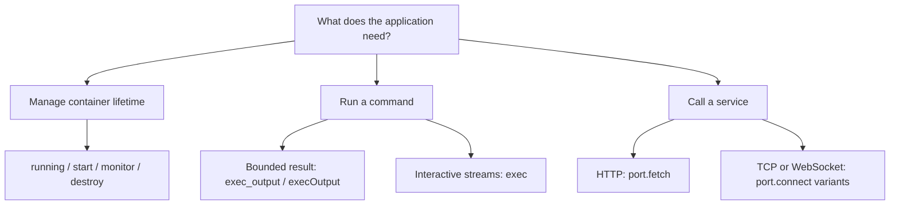
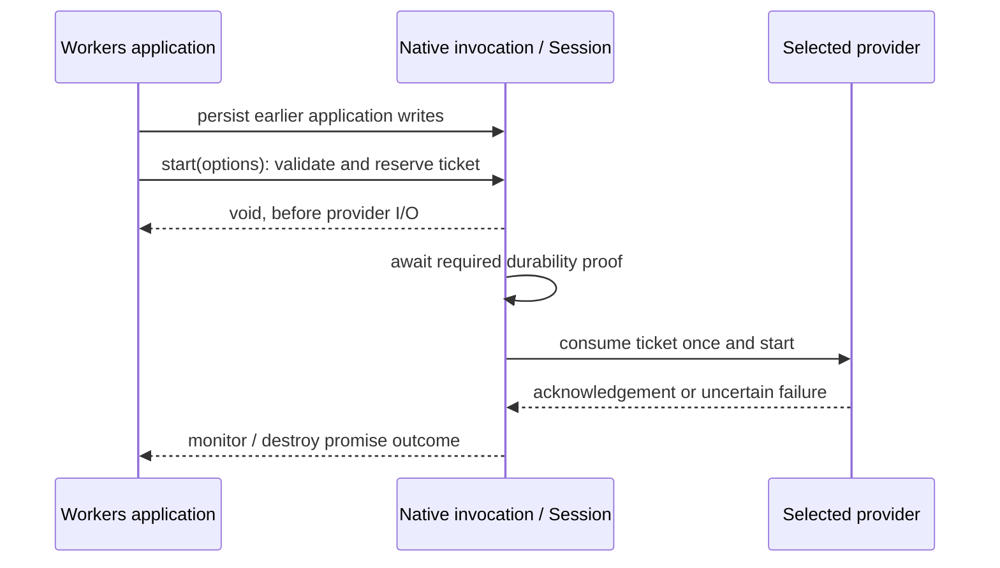
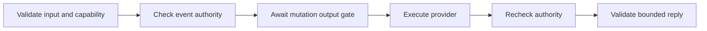

<!-- Copyright 2026 Cellar Project Authors. Licensed under Apache-2.0. -->

# cellar-container

**One provider boundary for Rust, Python, JavaScript and TypeScript container APIs.**
The default `Native` provider uses Cellar's existing Docker/Podman integration;
Rust hosts can supply another backend without changing the guest API.

[Quick start](#quick-start) · [Capabilities](#discover-capabilities) ·
[Lifecycle](#two-lifecycle-interfaces) · [Add a provider](#add-a-provider) ·
[Wire reference](#bridge-protocol-version-1)

## Native containers, this adapter, or Workers?

`cellar-container` puts a shared provider boundary above Cellar's native
container engine. Selecting `Native` keeps the same Docker/Podman execution path.

| Your application needs… | Use | What it adds |
| --- | --- | --- |
| Typed Rust access to the configured local engine | `cellar::sdk::Context::container()` | Direct native lifecycle, exec and port APIs |
| A backend selectable by the host across Rust, Python, JS and TS | This crate's `Adapter` / `Session` | Shared operations, capabilities, validation and bounded replies |
| Existing Workers/Durable Object application APIs | Optional `@cellar/cloudflare` package | Experimental API compatibility above the same provider boundary |
| A hosted sandbox such as Vercel or E2B | A dedicated Rust `Provider` implementation | Remote execution, fencing, reconciliation and cleanup; these providers remain planned |

Cellar follows celld's application pattern: a durable object/cell owns container
controls, while the node executes the backend work. The extra provider boundary
lets a host supply another executor. Compatibility with a published SDK still
requires testing its APIs and matching image together.

## How it fits together


| Layer | Owns |
| --- | --- |
| Language facade | `ctx.container`, typed options and byte conversion |
| `Adapter` / `Session` | Provider selection, validation, invocation authority and bounded replies |
| Provider | Backend effects, process/socket handles, isolation and cleanup |
| Native Cellar host | Cell ownership, activation epoch and required durability/output gates |

**The provider future runs inside the original native SDK invocation.** The
adapter does not move SDK effects onto the Python, Node or V8 runtime thread.

### What ships today?

| Path | Status | Where to look |
| --- | --- | --- |
| Local Docker / compatible Podman Engine | Implemented by the default `Native` provider | [Runnable native walkthrough](../../examples/native-container/README.md) |
| Custom container or sandbox backend | `Provider` / `ProviderSession` extension point is available; the host supplies the implementation | [Provider contract](#add-a-provider) |
| Local Cloudflare Workers / Containers / Sandbox APIs | Experimental compatibility slices in a separate package; full application/image conformance remains pending | [Cloudflare facade](../../packages/cellar-cloudflare/README.md) |
| Hosted Cloudflare, Vercel, E2B, Daytona and Modal | Planned; no remote provider ships in this crate | [Delivery plan](../../plans/sandbox-provider-compatibility.md) |
| Dynamic Worker isolates, PTY and snapshots | Planned features; the current operation set does not implement them | [Implementation ledger](../../plans/sandbox-provider-progress.md) |

The pinned Sandbox 0.12.9 SDK/image passes the unchanged application's exec,
file and background-process route tests, including later process discovery and
explicit teardown. Streaming, previews and fault qualification remain open;
see the [live qualification evidence](../../plans/sandbox-provider-progress.md#returned-functions-and-live-sandbox-processes).

## Quick start

### 1. Configure the host

For the default backend, configure the cell's container image and the node's
Docker/Podman engine using the [native walkthrough](../../examples/native-container/README.md).
`Native` preserves that engine's image loading, network isolation, inactivity
policies and ownership cleanup.

| Host | Provider selection |
| --- | --- |
| Rust | `Adapter::default()` or `Adapter::new(Arc<dyn Provider>)` |
| Python adapter | `cellar_python::Source::container_provider(provider)` before runtime startup |
| JavaScript / TypeScript adapter | `cellar_javascript::Source::container_provider(provider)` before runtime startup |

Omitting `container_provider` selects `Native`. Selection applies to the
application's container calls; a custom provider can route using the context's
class or cell identity. Credentials and routing configuration stay in the host.

### 2. Call from a root-cell event

A session belongs to **one invocation**. Create it once for that event and retain
it for the event's later calls; reacquire it for the next event.

**Rust — dispatch through the selected provider:**

```rust,no_run
use cellar::sdk::Context;
use cellar_container::{Adapter, Limits, Operation};
use serde_json::json;

async fn running(adapter: &Adapter, ctx: &Context) -> anyhow::Result<bool> {
    let session = adapter.session();
    let limits = Limits { max_body_bytes: 1024 * 1024 };
    let value = session
        .execute(ctx, Operation::Running, json!({}), &limits)
        .await?;
    Ok(serde_json::from_value(value)?)
}
```

For typed Rust calls directly against the native engine, use
`ctx.container()?`; see the [integration guide](../../docs/09-integrations.md).

**Python — collect bounded output from an already-running container:**

```python
async def run_tool(ctx):
    output = await ctx.container.exec_output(
        ["/app/tool"], max_bytes=4096
    )
    return output.exit_code, output.stdout, output.stderr
```

**JavaScript / TypeScript — the same operation and combined byte budget:**

```ts
import type { Context } from "@cellar/sdk";

async function runTool(ctx: Context) {
  const output = await ctx.container.execOutput({ cmd: ["/app/tool"] }, 4096);
  return { code: output.exit_code, stdout: output.stdout, stderr: output.stderr };
}
```

`/app/tool` must exist in your configured image. Remove the type import and
annotation for plain JavaScript. Both language facades use the same Rust provider
boundary; Python returns `bytes`, and JS/TS returns `Uint8Array`.

### 3. Choose the operation you need



| Task | Python | JavaScript / TypeScript |
| --- | --- | --- |
| Discover operations and limits | `await c.capabilities()` | `await c.capabilities()` |
| Check / start / wait for exit | `running`, `start`, `monitor` | Same async names |
| Stop or signal | `destroy`, `signal` | Same async names |
| Set idle timeout | `set_inactivity_timeout(ms)` | `setInactivityTimeout(ms)` |
| Interactive process I/O | `exec(cmd)` | `exec({ cmd })` |
| Bounded stdout + stderr | `exec_output(cmd, max_bytes=n)` | `execOutput({ cmd }, n)` |
| Port readiness / buffered HTTP | `port(n).wait_ready` / `.fetch` | `port(n).waitReady` / `.fetch` |
| Raw TCP / WebSocket | `port(n).connect` / `.connect_websocket` | `port(n).connect` / `.connectWebSocket` |

Here `c = ctx.container`. Lifecycle, port and streaming examples are in the
[integration guide](../../docs/09-integrations.md#apis-in-each-language).

## Discover capabilities

Hosts can inspect configuration **without opening a session or contacting the
backend**:

```rust
use cellar_container::{Adapter, Environment, Limits};

let limits = Limits { max_body_bytes: 1024 * 1024 };
let capabilities = Adapter::default().capabilities(&limits);
assert_eq!(capabilities.provider, "native");
assert_eq!(capabilities.environment, Environment::Linux);
assert_eq!(capabilities.max_resources, Some(64));
```

Root-cell guests use `await ctx.container.capabilities()`. This checks invocation
authority, but does not start a container or call the provider's effect dispatcher.

| Descriptor field | Meaning |
| --- | --- |
| `format` | Descriptor version; currently `1` |
| `provider` | Host-selected backend name |
| `environment` | `linux`, `worker_isolate` or `unspecified`; the last means undeclared |
| `operations` | Actually declared bridge operations, plus shared capability discovery |
| `max_body_bytes` | Host limit for binary bodies and bounded results |
| `max_resources` | Provider-declared live-handle cap; `null` means unknown, not unlimited |
| `synchronous_running` | Opt-in, authoritative running observation with no backend I/O; required by the Workers property |
| `queued_lifecycle` | Opt-in to bounded, synchronous lifecycle admission followed by asynchronous provider execution |

`Native` declares Linux and enforces 64 live handles per invocation. JS and Python
return immutable metadata. The `worker_isolate` enum value describes a possible
environment; it does not mean an isolate provider is implemented.

## Two lifecycle interfaces

The portable API waits for provider acknowledgement. The experimental Workers
facade separates immediate admission from asynchronous execution.

| Action | Portable Python / JS / TS | Workers facade |
| --- | --- | --- |
| Observe state | `await c.running()` | `c.running` property |
| Start | `await c.start(options)` | `c.start(options)` returns `void`; validation may throw |
| Signal | `await c.signal(signal)` | `c.signal(signal)` returns `void` |
| Observe exit | `await c.monitor()` returns an exit code | `await c.monitor()` resolves normally or throws an exit error |
| Destroy | `await c.destroy()` | `await c.destroy(reason?)`; monitors receive the explicit reason |



Admission checks immutable inputs, event authority and provider prerequisites.
Each invocation retains at most **64 queued controls**, with their combined JSON
inputs bounded by `max_body_bytes`. Consumed tickets cannot be replayed; an
uncertain startup needs explicit reconciliation or cleanup.

The Workers path requires `Source::workers_lifetimes()` and both provider opt-ins.
It currently refuses queued lifecycle calls inside transaction and
`blockConcurrencyWhile` callbacks before effects. Node supports buffered port
forwarding, and the unchanged pinned Container example runs against an engine
protocol peer. Streaming/upgrades, complete package lifecycle and real-image
acceptance remain pending; see the
[Cloudflare execution evidence](../../packages/cellar-cloudflare/README.md#execution-evidence).

## Understand lifetime and failure outcomes

| Resource | Lifetime / cleanup |
| --- | --- |
| Provider `Adapter` | Reusable host configuration |
| `Session`, context and process/socket handles | One root-cell invocation; drop cancels pending work and releases streams |
| Exec handle | Bound to its container run; `release` closes streams without killing the process |
| TCP / WebSocket handle | Event-owned transport; `release` closes it |
| Container instance | Separate from stream lifetime; follows the provider's inactivity, ownership and destroy policies |

For the native engine, an idle eviction can leave the container running during
its inactivity window. Ownership transfer, reset, node restart or shutdown can
destroy it. Persist job progress in cell state and expect a fresh process after
takeover.



| Failure point | What callers can conclude |
| --- | --- |
| Unsupported operation or invalid input, before dispatch | `Validation`: provider effects did not occur |
| Submitted mutation fails or its reply is lost | Outcome may be unknown; reconcile before retrying |
| Reply fails size/type validation after execution | Effects may already have occurred; failure does not prove rollback |
| Explicit cancellation before dispatch | `Cancelled` / `not_committed`; provider was not called |
| Cancellation after admission | `Cancelled` / `unknown`; waiting stops and the provider future is dropped |

The native gate orders external effects after the required durability proof of
earlier cell writes. It does not make commands transactional or exactly once.

Rust hosts can pass a native abort signal to `Session::execute_with_signal`.
JavaScript/TypeScript buffered port fetches accept `{ signal }` as a second
argument. The runtime retains the operation slot and byte reservation until the
native cancellation response arrives; it does not race away from native work.
Dropping the native HTTP future cancels the outstanding connection/body work.
Other provider implementations must honor their future-drop cleanup contract;
cancellation does not prove that a remote command stopped or rolled back.

## Add a provider

Implement these traits in the Rust host, then select the provider before runtime
startup. See the [trait definitions](lib.rs) and
[provider integration tests](tests/providers.rs) for concrete code.

### Example: expose only native status checks

This complete provider delegates execution to `Native` and advertises only
`Running`. The shared session refuses other operations before dispatch. A hosted
provider instead opens its own session and implements its backend effects.

```rust
use cellar_container::{
    Adapter, Environment, Native, Operation, Provider, ProviderSession,
};
use std::sync::Arc;

struct StatusOnly;

impl Provider for StatusOnly {
    fn name(&self) -> &str {
        "local-status"
    }

    fn environment(&self) -> Environment {
        Environment::Linux
    }

    fn operations(&self) -> &[Operation] {
        &[Operation::Running]
    }

    fn open(&self) -> Box<dyn ProviderSession> {
        Native.open()
    }
}

let adapter = Adapter::new(Arc::new(StatusOnly));
```

### Provider responsibilities

| Method | Responsibility |
| --- | --- |
| `Provider::name` | Stable backend name for discovery |
| `Provider::operations` | Advertise only fully implemented operations; subsets are supported |
| `Provider::environment` / `max_resources` | Declare the execution environment and enforced handle cap; defaults mean unknown |
| `Provider::synchronous_running` / `ProviderSession::running_snapshot` | Opt in to an immediate running-state read; the shared session still checks event authority |
| `Provider::queued_lifecycle` / `ProviderSession::preflight` | Opt in to lifecycle admission; validate backend prerequisites without I/O or effects |
| `Provider::open` | Allocate an invocation-local `ProviderSession`; perform no I/O |
| `ProviderSession::execute` | Run the operation using the original native context and the supplied limits |

The shared session enforces event liveness, current turn, activation epoch and
host ownership before and after dispatch. `Native` additionally checks local
class/image/engine requirements; another backend need not declare a Docker image.

### Provider checklist

| Concern | Provider must supply |
| --- | --- |
| Ownership / fencing | Stable cell identity, ownership epoch and provider-side fencing; local checks cannot revoke an already-accepted remote mutation |
| Isolation | Explicit image, CPU/memory, runtime, filesystem and network policies; refuse unsupported security settings before allocation |
| Bounded I/O | Private invocation handles, run invalidation, bounded frames/bodies and concurrent stdout/stderr collection |
| Port authority | Forward only to the granted port; return redirects without following them |
| Cleanup | Cancel/join pending work, release invocation streams, and reconcile or destroy instances on ownership loss, shutdown and explicit destroy |
| Crash recovery | Provider-side leases/expiry and orphan reconciliation for node crashes |
| Outcome reporting | Ordinary errors for uncertain mutations; attach `Validation` only when provider effects provably did not occur |

Native bridge fences and resource accounting do not automatically protect a
remote service. A lifecycle/exec-only provider may refuse TCP or WebSockets;
capability discovery must make that subset explicit.

## Bridge protocol, version 1

Applications normally use the language facade. Provider implementers use
`Operation::name()` and the owned JSON contract below.

| Convention | Encoding / bound |
| --- | --- |
| Binary data | Standard padded base64 |
| Option keys | `snake_case`, including the JS facade's internal wire values |
| Environment, labels, headers | Arrays of string pairs |
| Void result / IDs | JSON `null` / opaque strings |
| Port / signal / timeout | `1–65535` / `1–64` / integer milliseconds `0–86400000` |
| Buffered exec | Required `max_bytes`, bounded by the host limit; one combined stdout/stderr budget |
| End of stream | Empty stdout/stderr or TCP chunk |

<details>
<summary><strong>Operation reference: lifecycle, process I/O and ports</strong></summary>

### Lifecycle and discovery

| Operations | Input | Result |
| --- | --- | --- |
| `container.capabilities` | `{}` | Versioned capability descriptor |
| `container.running` / `.monitor` / `.destroy` | `{}` | Boolean / integer exit code / `null` |
| `container.start` | `{options:{entrypoint?,env?,enable_internet?,labels?}}` | Run token |
| `container.signal` | `{signal}` | `null` |
| `container.set_inactivity_timeout` | `{timeout_ms}` | `null` |

### Process I/O

| Operations | Input | Result |
| --- | --- | --- |
| `container.exec` | `{options:{cmd,env?,cwd?,user?,combined?}}` | Process ID |
| `container.exec_output` | `{options:{cmd,env?,cwd?,user?,combined?},max_bytes}` | `{exit_code,stdout,stderr}` |
| `container.exec.read_stdout` / `.read_stderr` | `{id}` | Base64 chunk; empty means EOF |
| `container.exec.wait` | `{id}` | Integer exit code |
| `container.exec.close_stdin` | `{id}` | `null` |
| `container.exec.write` / `.kill` | `{id,data}` / `{id,signal}` | `null` |
| `container.release` | `{id}` | `null`; releases the resource according to its kind |

Buffered exec closes stdin and drains both output streams concurrently. For
interactive exec, write input, close stdin as appropriate, and drain both streams
while awaiting `wait`. Issue control operations sequentially; observations and
stream reads can overlap a control operation.

### Ports and sockets

| Operations | Input | Result |
| --- | --- | --- |
| `container.port.wait_ready` | `{port,timeout_ms}` | `null` |
| `container.port.fetch` | `{port,request:{url,method,headers,body}}` | `{status,headers,body}` |
| `container.port.connect` | `{port}` | Socket ID |
| `container.port.connect_websocket` | `{port,url,headers}` | `{upgraded:true,id,protocol}` or `{upgraded:false,response}` |
| `container.socket.read` / `.write` / `.close_write` / `.close` | `{id}`; write adds `data` | Base64 chunk or `null` |
| `container.websocket.receive` | `{id}` | One event from the table below |
| `container.websocket.send_text` / `.send_binary` / `.close` | `{id,text}` / `{id,data}` / `{id,code,reason}` | `null` |

Container port HTTP is buffered. Redirects are returned without following them;
arbitrary HTTP streaming and server-side 101 passthrough use the separate
[language transport API](../../docs/27-streaming-and-websockets.md).

| WebSocket event | Wire value |
| --- | --- |
| Open | `{type:"open",protocol}` |
| Text | `{type:"text",text}` |
| Binary | `{type:"binary",data}` |
| Close | `{type:"close",code,reason,clean}`; retains clean/unclean provenance |

</details>

## Validate changes

```sh
cargo test --locked -p cellar-container -p cellar-guest --lib
cargo test --locked -p cellar-container --test providers
cargo test --locked -p cellar-container --doc
python3 tools/docs/check.py
```

The provider tests cover supported subsets and invocation boundaries. Language
container integration tests in `cellar-javascript` and `cellar-python` use a
host-selected audit provider that delegates to native, covering selection,
binary streams, cancellation, timeout cleanup and ownership rejection through
CPython, Node and embedded V8.

For exact delivered slices and remaining live/fault qualification, consult the
[implementation ledger](../../plans/sandbox-provider-progress.md).
