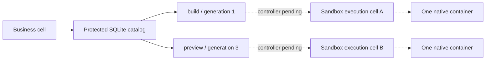
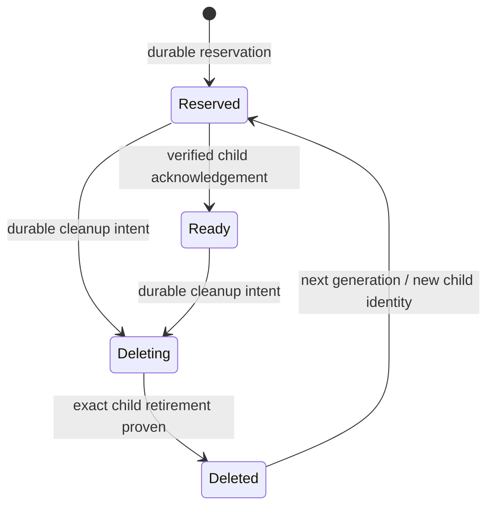

<!-- Copyright 2026 Cellar Project Authors. Licensed under Apache-2.0. -->

# Named sandbox allocations

[Container guide](README.md) · [Provider slots](bindings.md) · [Native capacity](README.md#native-capacity-admission)

`cellar::sdk::containers::SandboxCatalog` is the durable **parent catalog** for
named sandbox execution cells. It reserves identities and tracks cleanup; it
does not yet create containers or expose a callable child handle.



The intended execution topology retains one native container per execution cell.
Independent child cells can use fleet routing; the business cell keeps their
ownership records. The child controller, authenticated parent-to-child calls,
physical deletion integration and capacity-aware fleet placement remain pending.

## Provider slots and sandbox names

| Concept | Example | Meaning |
| --- | --- | --- |
| Host provider slot | `ctx.containers.get("builds")` | Select one configured provider; existing four-language API |
| Named allocation | Catalog reservation for `build-123` | Reserve an independent child execution identity; host Rust API |
| Namespace binding | `SANDBOXES` | Configured execution-cell namespace; resolved before reservation |
| Parent identity | Scope + random durable incarnation | Survives activation changes; distinguishes a recreated catalog |
| Child identity | Parent identity + sandbox name + generation | Deterministic routing name and configured namespace scope |

No fixed sandbox count is imposed by this catalog. Rows remain in SQLite;
queries materialize at most 256 entries. Storage limits still apply, and actual
compute allocation must also pass host/provider capacity admission.

## Reserve before effects

```rust,no_run
use cellar::sdk::{containers::{SandboxCatalog, SandboxReservation}, Context};

async fn reserve_build(
    ctx: &Context,
    parameters_sha256: &str,
) -> anyhow::Result<SandboxReservation> {
    SandboxCatalog::open(ctx)?
        .reserve(ctx, "build-123", "SANDBOXES", parameters_sha256)
        .await
}
```

The parameter digest is 64 lowercase hex characters identifying the creation
parameters. Keep credentials and raw environment values out of the catalog.

| Result | Controller obligation |
| --- | --- |
| `fresh: true` | The reservation passed the native durability gate; correlate any subsequent child effect to this exact identity |
| `fresh: false` | Reconcile the original child; do not repeat an uncertain create |
| Changed parameters or namespace | Refuse until the old generation has confirmed deletion |
| Error or cancelled reservation | A record may have committed; reopen and inspect it before proceeding |
| Capacity refusal | Keep the identity available for reconciliation; the catalog does not infer whether provider creation began |

Reacquire the catalog for each root-cell event. Stateless handlers, facets,
foreign/stale event handles and application storage transactions cannot use it.
Guest SQL and `storage.delete_all()` cannot forge or erase its records.

## Generation lifecycle



Each transition compares the full expected checkpoint. A delayed response from
an old generation cannot delete or confirm its replacement. Successful writes
wait for storage sync and recheck both parent and allocation before returning.
Only the host controller may call `confirm_ready` or `confirm_deleted`, using
verified child evidence. These methods record evidence; they do not obtain it.

## Retire a parent without losing children

| Step | API | Durable result |
| --- | --- | --- |
| Close admission | `begin_retirement(ctx).await?` | Future reservations and readiness acknowledgements refuse |
| Find work | `cleanup(ctx, cursor, 64)?` | Bounded page of children still requiring cleanup |
| Before deletion | `begin_delete(ctx, &allocation).await?` | Exact generation's deletion intent |
| After verified retirement | `confirm_deleted(ctx, &deleting).await?` | Retained child tombstone |
| Finish | `finish_retirement(ctx).await?` | Refuses while any child lacks confirmed deletion; final parent tombstone cannot reopen |

While the parent is active, `cleanup` lists explicitly deleting children. Once
retirement begins, it includes every non-deleted child, including uncertain
reservations. Follow `page.next`, then restart at `None` on the next sweep;
concurrent transitions can make earlier names eligible. SQLite indexes avoid
scanning all retired children on every cleanup page.

## Delivery boundary

| Available now | Still required before a production named sandbox API |
| --- | --- |
| Durable names, generations and parent incarnation | Child controller and authenticated parent authority |
| Idempotent reservations and uncertain-outcome retention | Native/provider creation and reconnect tied to those identities |
| Parent retirement barrier and indexed cleanup inventory | Scheduled cleanup, physical cell deletion and orphan discovery |
| Event authority, protected storage and recovery checks | Four-language allocation facades and fleet placement qualification |

Do not physically erase the parent catalog while it retains children. The catalog
alone cannot discover resources after that erasure or revoke work already
accepted by a child. Its records are the input to the pending lifecycle controller.
