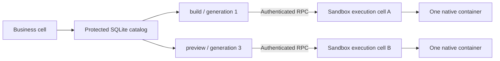
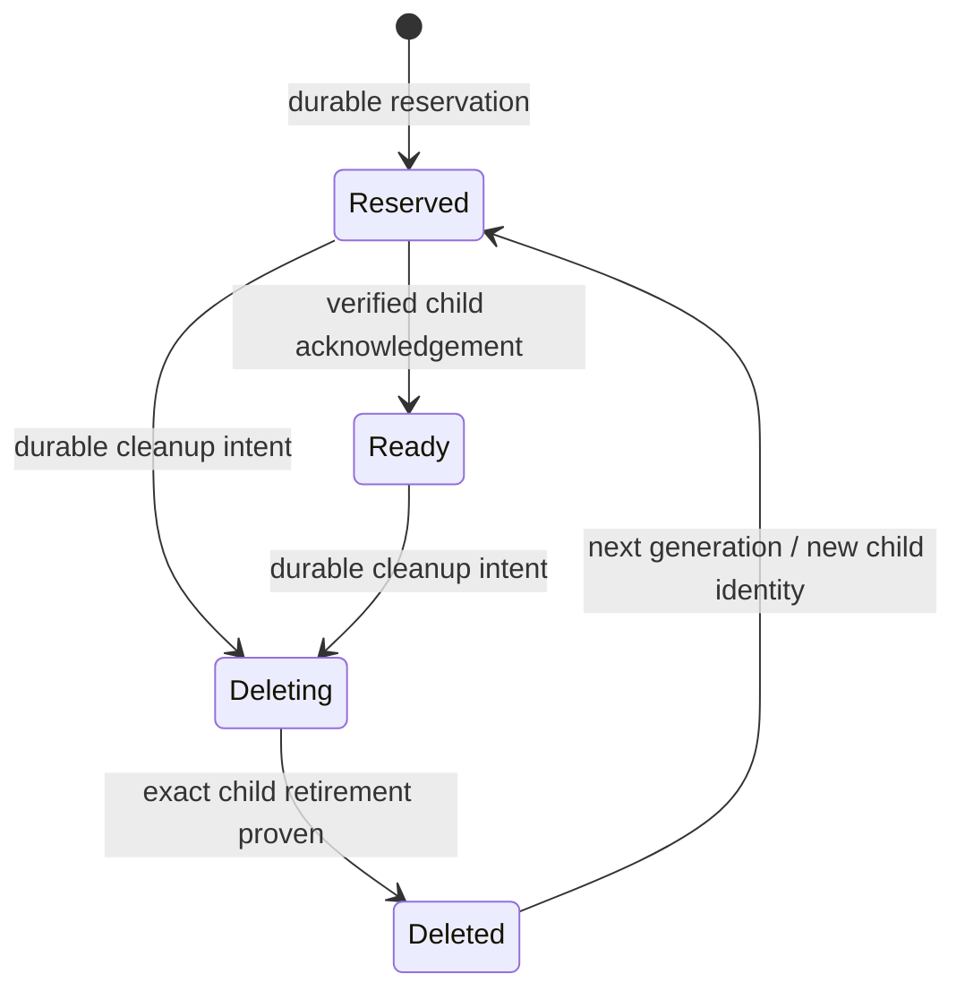
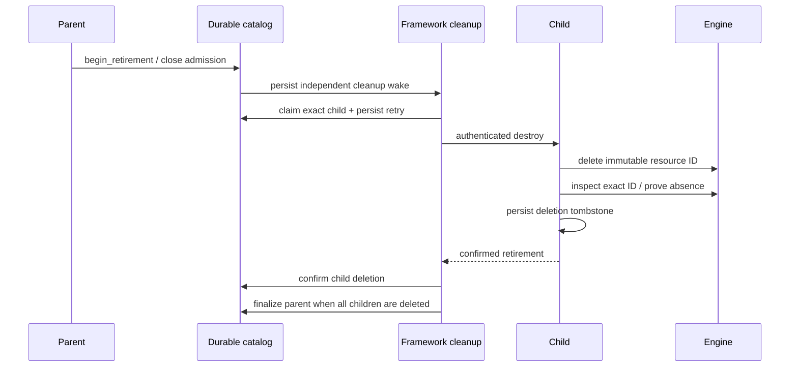
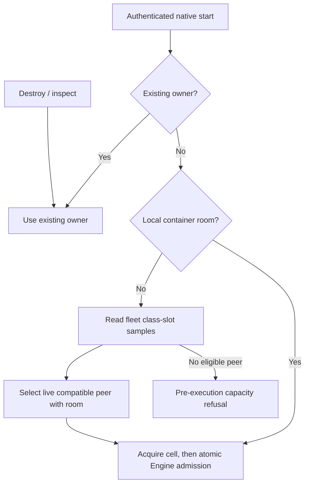

<!-- Copyright 2026 Cellar Project Authors. Licensed under Apache-2.0. -->

# Named sandbox allocations

[Container guide](README.md) · [Provider slots](bindings.md) · [Native capacity](README.md#native-capacity-admission)

`cellar::sdk::containers::SandboxCatalog` is the durable **parent catalog** for
named sandbox execution cells. A host-registered `ChildExecutor` creates and
controls each child through authenticated framework RPC. Parent retirement
schedules exact-resource cleanup independently of application alarms.



The execution topology retains one native container per execution cell. Child
calls use normal cell routing; the business cell keeps their ownership records.
Native host capacity admission applies before Engine creation. A new native
child consults per-class fleet slots when its origin has no container room.
The chosen host still makes the final atomic admission decision.

## Provider slots and sandbox names

| Concept | Example | Meaning |
| --- | --- | --- |
| Host provider slot | `ctx.containers.get("builds")` | Select one configured provider; existing four-language API |
| Named allocation | Catalog reservation for `build-123` | Reserve an independent child execution identity; host Rust API |
| Namespace binding | `SANDBOXES` | Configured execution-cell namespace; resolved before reservation |
| Parent identity | Scope + random durable incarnation | Survives activation changes; distinguishes a recreated catalog |
| Child identity | Parent identity + sandbox name + generation | Deterministic routing name and configured namespace scope |

No fixed sandbox count is imposed by this catalog. Rows remain in SQLite;
queries materialize at most 256 entries. Storage limits still apply, and actual
compute allocation must also pass host/provider capacity admission.

## Register and use an executor

Register a dedicated class through `Application::sandbox_executor`. The same
registration must be available on the parent and execution hosts. Register the
class and its `SANDBOXES` namespace in the deployment; for Native, also configure
its container image and Engine capacity.

```rust,no_run
use std::sync::Arc;
use cellar::sdk::{containers::SandboxExecutor, Application};
use cellar_container::{ChildExecutor, Native};

// In your Application implementation:
// fn sandbox_executor(&self, class: &str) -> Option<Arc<dyn SandboxExecutor>> {
//     (class == "Sandbox").then(|| self.executor.clone() as Arc<dyn SandboxExecutor>)
// }

# fn configure(configuration_sha256: String) -> anyhow::Result<()> {
let executor = Arc::new(ChildExecutor::new(Arc::new(Native), configuration_sha256)?);
# let _ = executor;
# Ok(())
# }
```

The configuration digest covers provider/account, image and host policy. Keep
credentials out of its manifest. Changing it refuses access to retained children;
keep the original executor available until its cleanup obligations finish.
Ordinary fetch/RPC calls to the dedicated class cannot invoke its executor or
application factory.

```rust,no_run
use cellar::sdk::{containers::SandboxCatalog, Context};
use serde_json::json;

async fn build(ctx: &Context) -> anyhow::Result<()> {
    let sandboxes = SandboxCatalog::open(ctx)?;
    let child = sandboxes.start_child(
        ctx, "build-123", "SANDBOXES", json!({"options": {}}),
    ).await?;
    let result = sandboxes.execute_child(
        ctx, &child, "container.exec_output",
        json!({"options": {"cmd": ["echo", "hello"]}, "max_bytes": 65536}),
    ).await?;
    sandboxes.destroy_child(ctx, &child).await?;
    Ok(())
}
```

| Operation | Bound / behavior |
| --- | --- |
| `start_child` | Durable registration and creation intent precede provider submission; equal names retain the original generation |
| `inspect_child` | Observe/reconcile the same identity; never create or resume |
| `execute_child` | Bounded exec output, files, port readiness/HTTP and capability/running observations |
| `destroy_child` | Persist deletion intent, prove exact resource retirement, retain a child tombstone |
| Binary bodies / combined command output | At most 64 KiB per bounded operation |
| Encoded child RPC | At most 256 KiB; metadata and framing also count |
| Process, socket and stream handles | Do not cross child calls in this profile |
| Proven capacity refusal | Creation intent returns to unstarted; the same named generation can be tried later |
| Lost create or command response | Unknown outcome; no automatic mutation replay |

Reopen `SandboxCatalog` in each root-cell event. Parent and full allocation
checkpoints are checked before dispatch and again before returning a child reply.
A child stores its parent incarnation, generation and configuration digest before
provider I/O. Its deletion tombstone rejects delayed starts.

## Manual reservations

The lower-level `reserve`, `confirm_ready`, `begin_delete` and `confirm_deleted`
methods remain available to host controllers. Manual reservations do **not**
register an executor or schedule provider calls automatically. A `fresh: false`
reservation never grants permission to replay an uncertain create.

### Reserve before effects

```rust,no_run
use cellar::sdk::{containers::{SandboxCatalog, SandboxReservation}, Context};

async fn reserve_build(
    ctx: &Context,
    parameters_sha256: &str,
) -> anyhow::Result<SandboxReservation> {
    SandboxCatalog::open(ctx)?
        .reserve(ctx, "build-123", "SANDBOXES", parameters_sha256)
        .await
}
```

The parameter digest is 64 lowercase hex characters identifying the creation
parameters. Keep credentials and raw environment values out of the catalog.

| Result | Controller obligation |
| --- | --- |
| `fresh: true` | The reservation passed the native durability gate; correlate any subsequent child effect to this exact identity |
| `fresh: false` | Reconcile the original child; do not repeat an uncertain create |
| Changed parameters or namespace | Refuse until the old generation has confirmed deletion |
| Error or cancelled reservation | A record may have committed; reopen and inspect it before proceeding |
| Capacity refusal | Keep the identity available for reconciliation; the catalog does not infer whether provider creation began |

Reacquire the catalog for each root-cell event. Stateless handlers, facets,
foreign/stale event handles and application storage transactions cannot use it.
Guest SQL and `storage.delete_all()` cannot forge or erase its records.

## Generation lifecycle



Each transition compares the full expected checkpoint. A delayed response from
an old generation cannot delete or confirm its replacement. Successful writes
wait for storage sync and recheck both parent and allocation before returning.
Only the host controller may call `confirm_ready` or `confirm_deleted`, using
verified child evidence. These methods record evidence; they do not obtain it.

## Retire a parent without losing children



| Case | Behavior |
| --- | --- |
| Active parent, explicit `destroy_child` | Failed cleanup remains scheduled for that child |
| `begin_retirement(ctx).await?` | Close admission and schedule every managed child, including uncertain starts |
| Timeout, cancellation or host restart | Retain the cleanup claim and its next attempt; no application callback required |
| Retry cadence | Claim a retry 30 seconds ahead before I/O; each attempt is bounded to 20 seconds and the host's original deadline |
| DELETE acknowledged but resource still exists | Keep deletion pending and native capacity reserved |
| Last child confirmed deleted | Persist a finalization wake, then retain the parent tombstone |
| Manual reservations also present | Their controller must confirm deletion before parent retirement can finish |

Application alarms and business `delete_all()` cannot erase cleanup work.
`cleanup(ctx, cursor, limit)` remains available for inspection; pages contain at
most 256 rows, using indexed selection without a resident allocation map.

## Place new children by capacity



| Placement rule | Effect |
| --- | --- |
| Instance, class and memory bounds | Advisory slots include native helper memory and retained uncertain reservations |
| Missing class/capacity sample, expired lease, pressure or draining | Peer is ineligible for new native creation |
| Concurrent decisions against one sample | Account for prior selections; a newer sample supersedes that accounting |
| Peer refuses before execution | Invalidate its exact sample and retry within the original deadline |
| Lost response after submission | Stop; retain the same identity and unknown outcome |
| Existing owner | Preserve ownership; placement does not migrate a running sandbox or replay its start |
| Full Engine | Still admit ordinary cleanup/reconciliation routing |

Slot samples are advisory. Capacity may change after placement; a proven Engine
refusal keeps the generation available for a later attempt. An already-owned
child is not automatically relocated after an admission race. Native process and
filesystem recovery still require the separately qualified persistence profile.
Remote providers retain their own admission semantics.

## Delivery boundary

This development format uses a hard cutover: retained work tables without the
`sandbox-cleanup` reason refuse managed registration before provider effects.
There is no automatic schema migration.

| Available now | Still required before full production qualification |
| --- | --- |
| Durable names, generations and parent incarnation | Four-language dynamic allocation facades |
| Authenticated bounded execution and native capacity refusal | Placement saturation, stale samples and recovery qualification |
| Automatic cleanup after explicit parent retirement | Cleanup after deployment removal and independent orphan discovery |
| Exact Engine container deletion and retained tombstones | Physical deletion of parent/child SQLite and replicated objects |
| Provider adapter registration | Separate live/profile qualification of remote providers |

Physical **container** deletion is distinct from erasing the cell's durable data.
Parent and child tombstones remain necessary to reject delayed work. Removing
SQLite files or replicated objects requires an independent durable retirement
barrier; local cache eviction does not supply one. Do not erase the catalog while
it retains children. This profile does not promise restoration of native process
memory or container filesystem state after host loss.
