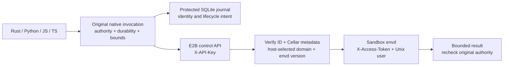
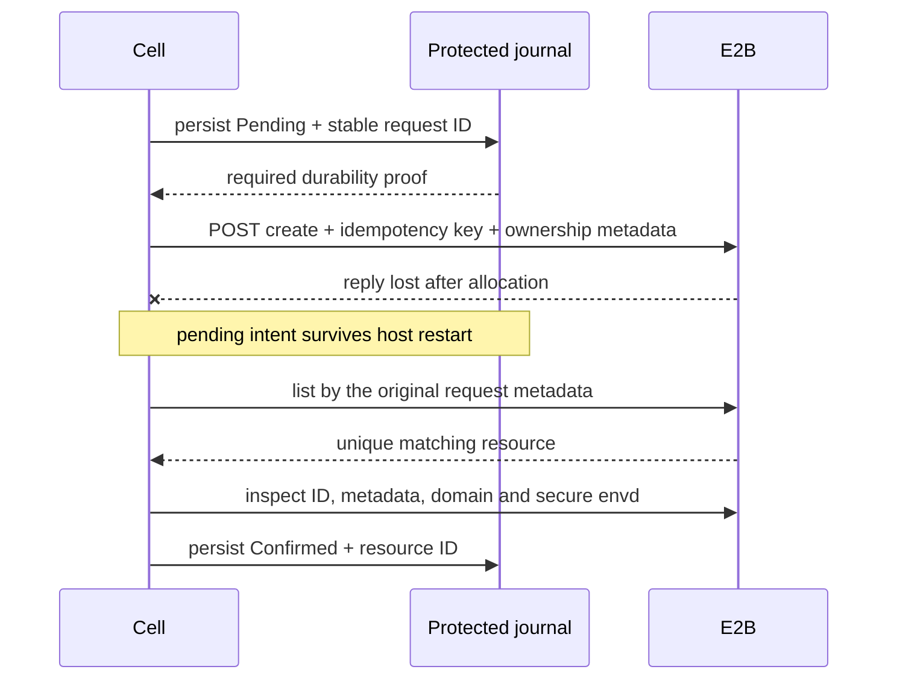

<!-- Copyright 2026 Cellar Project Authors. Licensed under Apache-2.0. -->

# E2B provider

[Container guide](README.md) · [Durable bindings](bindings.md) ·
[Pinned protocol inputs](../../tools/sandbox/e2b/README.md)

`e2b::E2b` implements a **bounded Linux execution profile** using E2B's control
API and envd HTTP/Connect protocol. The host selects a template and account;
Rust, Python, JavaScript and TypeScript keep their existing container APIs.

## Choose the ownership guarantee first

| Profile | Admission / guarantee |
| --- | --- |
| `RequireProviderFence` | Constructor refuses: direct E2B does not validate Cellar ownership epochs on each operation |
| `LocalChecksAndExpiry` | Explicit opt-in: native checks around requests, protected resource identity and a fixed provider lifetime |

**A lost owner cannot revoke a request already accepted by E2B.** The weaker
profile reports `fencing: "local_checks_and_expiry"` in every language. A fenced
broker is still required for a provider-enforced ownership profile.

## Configure in the Rust host

```rust,no_run
use cellar_container::{e2b::{Config, E2b, Ownership}, Provider};
use std::sync::Arc;

fn provider(api_key: String) -> anyhow::Result<Arc<dyn Provider>> {
    let config = Config::new(
        "my-e2b-team",        // Stable account identity; never the API key.
        "my-cellar-fleet",    // Separate unrelated deployments.
        api_key,             // Read from the host's secret configuration.
        "my-template",       // Prepared template with envd and coreutils.
        Ownership::LocalChecksAndExpiry,
    )?
    .lifetime_seconds(300)?
    .request_timeout_ms(30_000)?;
    Ok(Arc::new(E2b::new(config)))
}
```

Pass the result to `Adapter::new(provider)` for Rust or
`Source::container_provider(provider)` before starting the Python/JS/TS adapter.
No local Docker image or JavaScript engine is needed by this backend.

For automatic expiry inspection and deletion after application events end,
register the provider's [maintenance backend](supervision.md) with the native host.

| Setting | Default / constraint |
| --- | --- |
| Account + namespace + binding | Stable host identities; binding defaults to `container` |
| API / envd hosts | HTTPS, pinned by host configuration; redirects are never followed |
| Authentication | Control API key and per-sandbox envd token stay in native memory; neither enters guest results or the journal |
| Lifetime | 300 seconds; configurable 1–3,600; fixed lifetime, **not** an inactivity timer |
| Operation deadline | 30 seconds; configurable 1–120,000 ms; covers all exchanges in one operation |
| Internet | Disabled; guest enablement also requires host `allow_internet(true)` |
| Public traffic / automatic resume | Disabled at creation |
| Template | Compatible envd `>=0.5.2, <1.0`; `/usr/bin/tee` and `/bin/chmod` for portable writes |

`api_endpoint`, `envd_gateway` and `sandbox_domain` are trusted host settings for
self-hosting or protocol fixtures. HTTP is accepted only for explicit loopback
endpoints. Keep the stable account name aligned with the key's actual team;
this name is a configuration boundary, not remote account attestation.

## What can an application do?

| Operation | Support / behavior |
| --- | --- |
| Capabilities / running | Discover the subset; inspect the verified remote resource |
| Reconcile | Recover a matching pending create, checkpoint expiry or observe pending deletion; no allocation/resume/delete dispatch |
| Start / destroy | Protected journal, generation token, metadata correlation and explicit reconciliation |
| `execOutput` / `exec_output` | Direct argv, env, cwd, Unix username, binary stdout/stderr and nonzero exit codes |
| Read / stat / list | Published envd file APIs; bounded bytes and direct-child metadata |
| Write | Binary stdin to `tee`, then `chmod`; existing parent required; no shell or implicit mkdir |
| Monitor, signals, interactive streams, ports, PTY, snapshots | Unsupported; refuse before dispatch |
| Workers synchronous lifecycle | Unsupported; both provider opt-ins remain false |

Commands have a combined stdout/stderr byte budget. A username is accepted;
the native engine's `UID:GID` syntax is refused. Writes are non-atomic: bytes may
have changed if permission setting fails. Cancellation or timeout drops owned
HTTP streams; it does **not** prove that a remote process stopped.

## How a remote call runs



Every command/file operation inspects the resource before using its envd token.
This catches foreign metadata and configuration changes; it cannot close the
race between an ownership change and an already submitted remote request.

## Recover a lost creation reply



| Observation | Next action |
| --- | --- |
| Create reply lost / listing empty | Keep pending; refuse another create; retry read-only reconciliation |
| Exactly one matching resource | Verify full detail, then durably confirm the same generation |
| Multiple matches / metadata mismatch | Refuse ambiguous or foreign ownership |
| Delete reply lost | Keep deletion pending; inspect the original ID before further cleanup |
| Confirmed resource later returns 404 | Treat as gone; an explicit start can reserve the next generation |

The stable idempotency key is defense in depth. Its retention window cannot
justify replaying a create. Unresolved reservations require operator/provider
reconciliation; an empty or delayed listing is insufficient evidence to forget
them. [Host supervision](supervision.md) covers retained-resource obligations in
running-node protocol peers. Account-wide orphan scanning, fleet restart,
ownership-loss cleanup and live expiry behavior remain unqualified.

## Evidence and remaining qualification

| Evidence | Limit |
| --- | --- |
| Pinned upstream OpenAPI/protobuf bytes | Source reference, not SDK conformance |
| Native host + HTTP/Connect peer | Lifecycle recovery, metadata checks, binary files/commands and fault bounds |
| CPython, Node and embedded V8 fixtures | Same host-selected backend through actual language runtimes |
| TypeScript checks | Portable API types; no separately embedded TypeScript runtime |
| Live E2B account / expiry / orphan / takeover | Still required; manifest qualification remains `not_run` |

Run the commands in the [protocol fixture guide](../../tools/sandbox/e2b/README.md).
The [implementation ledger](../../plans/sandbox-provider-progress.md) tracks the
full provider plan, including the stronger fencing and cleanup requirements.
