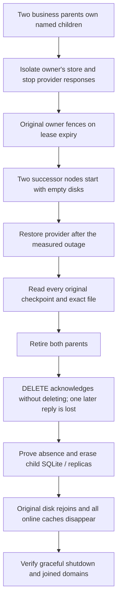

<!-- Copyright 2026 Cellar Project Authors. Licensed under Apache-2.0. -->

# Fleet recovery and cleanup qualification

[Allocation guide](allocations.md) · [Delivery ledger](../../docs/design/sandbox-provider-progress.md)

This campaign measures each named sandbox from **injected owner failure to a
successful read of its original identity and file**. The acceptance ceiling is
300 seconds per sandbox; 60 seconds is the preferred target. Cleanup has its own
300-second observation window after parent retirement.

## Measured profile — 2026-10-28

The run used source `ee2156e3` and the settings below. One campaign allocated
**1,024 sandboxes**, 512 per business parent, on macOS arm64 (Apple M2 Max,
12 logical CPUs, 32 GiB RAM, Rust 1.98.1).

| Observation | p50 | p95 | Maximum | Acceptance |
| --- | --- | --- | --- | --- |
| Recovery from failure, including 30-second provider outage | 44.568 s | 70.128 s | **73.425 s** | 1,024 / 1,024 within 300 s; 812 within the preferred 60 s |
| Confirmed erasure after retirement, including deletion faults | 169.412 s | 171.401 s | **194.371 s** | 1,024 / 1,024 within 300 s |
| Remaining caches after original disk rejoins | — | — | **66.437 s** for the whole fleet | All online child directories absent; joined shutdown |

The campaign took 468.14 seconds including initial allocation, all three
observation windows and teardown. The 60-second preference was **not** met for
212 sandboxes at this workload. The 300-second ceiling passed for every sandbox;
this is evidence for the stated profile, not a universal production SLA.

## Failure sequence



| Assertion | Evidence |
| --- | --- |
| Real fleet ownership and durability | Native nodes, signed peer RPC, SQLite replicas and fleet logs; original owner fences with `NodeLeaseExpired` |
| Cold recovery | Both successors start with empty node directories; the failed store client remains isolated |
| Usable original sandbox | Complete allocation checkpoint is unchanged; exact deterministic 4 KiB file survives |
| No accidental replacement | Provider create count stays equal to the original sandbox count |
| Proven cleanup | An acknowledged DELETE that leaves a resource cannot finish retirement; one committed delete loses its reply |
| Physical data collection | All provider resources disappear; child replica subtrees retain only their ownership epoch; child directories disappear on all three nodes |
| Parent isolation | Retirement retains the business-data sentinel |
| Shutdown | No pending dispatches/events; ingress, cells, application work, log and local durability close within the shutdown budget |

The provider is a local **E2B HTTP/Connect protocol peer**, not an E2B VM. It
retains resources independently of Cellar nodes. This exercises the common
framework, ownership, durable bindings, erasure and reconnect path. It does not
qualify cloud latency, live account quotas, provider fencing or native container
process/filesystem restoration.

## Reproduce

Use Rust 1.98.1 and a private workspace-volume `CARGO_TARGET_DIR`, as described
in [the repository guide](../../AGENTS.md). Run serially, with unrelated load
stopped; the fixture itself retains concurrent work.

```sh
# Small regression case, included in ordinary integration tests.
cargo test --locked -p cellar-container --test sandbox_fleet \
  sandbox_fleet_reconnects_and_erases_every_child_after_owner_loss \
  -- --exact --nocapture --test-threads=1

# Explicit scale campaign: defaults to 512, with a 30-second provider outage.
cargo test --locked -p cellar-container --test sandbox_fleet \
  sandbox_fleet_scale_qualification -- --ignored --exact --nocapture --test-threads=1

# Choose an even allocation count between 128 and 4096.
CELLAR_SANDBOX_QUALIFICATION_COUNT=1024 cargo test --locked \
  -p cellar-container --test sandbox_fleet sandbox_fleet_scale_qualification \
  -- --ignored --exact --nocapture --test-threads=1
```

Each successful run prints `SANDBOX_FLEET_REPORT=` followed by JSON. Retain the
exit status, exact executed test name, source SHA, toolchain, platform and all
samples. A successful command that selected zero tests is not evidence.
Percentiles use nearest rank; acceptance checks **every sample**, not a
percentile. Time includes failure detection, lease expiry, provider outage,
cold restoration, request queueing and successful identity/file observations.

| Setting | Campaign value |
| --- | --- |
| Business parents / cold successors | 2 / 2 |
| Simultaneously allocated provider resources | Selected count; half belong to each parent |
| Resident-cell limit | 64 per node; remaining children recover on demand |
| Observation request concurrency | 8 |
| Host / core runtime threads | 8 / 2 |
| Node lease TTL / recovery retry | 5 seconds / 5 seconds |
| Erasure attempts / scheduling / deadline | 8 per node / 250 ms / 20 seconds |
| Provider lifetime / file payload | 3,600 seconds / 4 KiB per sandbox |
| Store | Local SQLite development object store, with real fleet replication/log paths |

The erased receipt covers the collecting node and shared replicas. The separate
returning-cache measurement starts at rejoin and includes cache discovery and
joined shutdown; offline volumes cannot be erased before they return.

## Deployment acceptance

Repeat against the intended release, live provider and storage topology at the
expected backlog, state size and resource pressure. Increase allocations until
configured capacity refuses admission; preserve the original identity after
uncertain outcomes. Include sustained partitions, disk/store faults, delayed
provider effects and long-lived resources. This local profile does not impose
a fixed catalog limit or establish unlimited fleet throughput.

Permanent barriers and retained ownership epochs must survive operational
retention jobs. Bucket versions, backups and historical shared logs follow
separate policies. Live E2B/Vercel qualification remains deferred until account
configuration is supplied.
