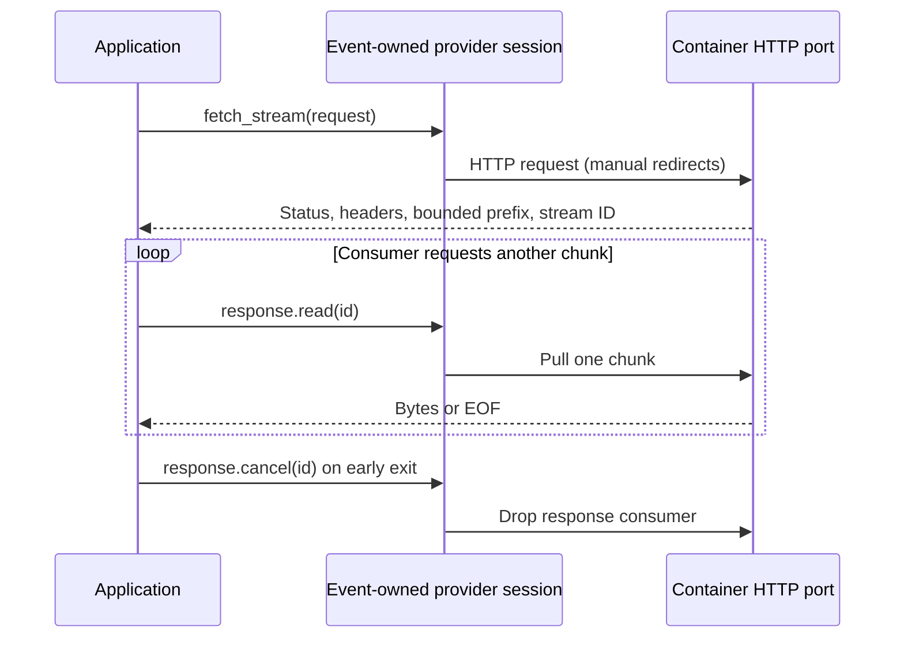

<!-- Copyright 2026 Cellar Project Authors. Licensed under Apache-2.0. -->

# Container HTTP response streams

[Container guide](README.md) · [Provider matrix](compatibility.md)

Read a port response incrementally without collecting its complete body. The
native provider implements this contract; other providers must advertise all
three operations before applications use it.



## Choose a response mode

| Need | JS / TS | Python | Rust operation |
| --- | --- | --- | --- |
| Complete bounded body | `port.fetch(request)` | `port.fetch(request)` | `Fetch` |
| Head before body completion | `port.fetchStream(request)` | `port.fetch_stream(request)` | `FetchStream` |
| Pull the next chunk | `response.read()` | `response.read()` | `ReadResponse` |
| Prefix followed by all chunks | `response.chunks()` | `response.chunks()` | Read `body`, then `ReadResponse` until `done` |
| Stop consuming early | `response.cancel()` | `response.cancel()` | `CancelResponse` |

`read()` returns `null` / `None` at EOF. An empty chunk is valid data and does
**not** mean EOF. The initial `body` prefix precedes reads; `chunks()` includes it.
Each reader has one consumer. Use either manual reads or iteration, once.

## JavaScript / TypeScript

```ts
const response = await ctx.container.port(3000).fetchStream({
  url: "http://container/events",
  method: "GET",
  headers: [],
  body: "",
}, { signal });

try {
  for await (const bytes of response.chunks()) {
    // Consume bytes as they arrive; decode incrementally for text protocols.
    consume(bytes);
  }
} finally {
  await response.cancel();
}
```

## Python

```python
response = await ctx.container.port(3000).fetch_stream(
    Request("http://container/events")
)
try:
    async for chunk in response.chunks():
        consume(chunk)
finally:
    await response.cancel()
```

## Rust / provider wire contract

Dispatch through the same `Session` and original root-cell context for the head,
every read and cancellation. JSON bodies use base64, as with existing operations.

| Operation | Input | Successful result |
| --- | --- | --- |
| `container.port.fetch_stream` | `{port, request}`; same request as buffered fetch | `{status, headers, body, stream}`; `stream` is an opaque ID or `null` for a finite prefix |
| `container.response.read` | `{id}` | `{done: false, body: "…"}` or `{done: true, body: ""}` |
| `container.response.cancel` | `{id}` | `null`; idempotent after EOF or cancellation |

```rust,ignore
let head = session.execute(ctx, Operation::FetchStream, request, limits).await?;
let prefix = head["body"].as_str().unwrap(); // base64 prefix
if let Some(id) = head["stream"].as_str() {
    let chunk = session.execute(
        ctx, Operation::ReadResponse, json!({"id": id}), limits,
    ).await?;
    // Consume this chunk, then read until done; cancel on early return.
    session.execute(
        ctx, Operation::CancelResponse, json!({"id": id}), limits,
    ).await?;
}
```

## Bounds, cancellation and ownership

| Boundary | Contract |
| --- | --- |
| Request body | Bounded and collected before HTTP submission; streaming upload is not implemented |
| Response prefix and each chunk | Each must fit `max_body_bytes`; cumulative output may exceed it |
| Live resources | Native responses share the 64-handle invocation cap with exec, TCP and WebSocket handles |
| Backpressure | One pull at a time; the adapter starts no background body collector |
| Abort | Rust `execute_with_signal` / JS `{signal}` can cancel the head or a pending read; finish or cancel the reader after a read abort |
| Event completion | Drops remaining native response consumers; handles cannot move to another event |
| Mutation uncertainty | HTTP submission may already have effects; cancelling a response does not roll back a request or terminate the sandbox command |

The optional Cloudflare `getTcpPort(port).fetch()` returns a web `Response` using
this boundary. Its byte stream supports BYOB reads, demand-driven pulls and
abort after headers. This does not qualify streamed Durable Object RPC return
values or full Worker response forwarding; those remain separate requirements.
