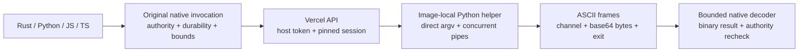

<!-- Copyright 2026 Cellar Project Authors. Licensed under Apache-2.0. -->

# Vercel provider

[Container guide](README.md) · [Durable bindings](bindings.md) ·
[Pinned protocol and helper tests](../../tools/sandbox/vercel/README.md)

`vercel::Vercel` implements bounded commands and files over Vercel's named
sandbox/session REST API. Select it in the Rust host; applications keep the same
Rust, Python, JavaScript and TypeScript container calls.

## Ownership and lifetime

| Choice | Behavior |
| --- | --- |
| `Ownership::RequireProviderFence` | Constructor refuses; direct Vercel does not enforce Cellar epochs on accepted requests |
| `Ownership::LocalChecksAndExpiry` | Explicit weaker profile; native invocation checks, protected identity and a fixed remote session timeout |
| Named sandbox | Stable, randomly reserved name for one creation generation |
| Session | Exact ID pinned in the journal; a changed session refuses commands and deletion |
| Persistence | Disabled; no automatic snapshots or implicit resume |
| Explicit destroy | Verify ownership, delete the named resource and its orphan snapshots, then observe absence |

The descriptor reports `fencing: "local_checks_and_expiry"`. Local checks cannot
revoke an already accepted remote command. Timeout bounds a requested session;
owner-loss cleanup and provider-side fencing still need qualification or a
separate broker. Optional [host supervision](supervision.md) schedules inspection
and deletion for retained resources independently of application requests.

## Configure the host

```rust,no_run
use cellar_container::{vercel::{Config, Vercel}, Ownership, Provider};
use std::sync::Arc;

fn provider(token: String, prepared_image: String) -> anyhow::Result<Arc<dyn Provider>> {
    let config = Config::new(
        "team_example",
        "prj_example",
        "my-cellar-fleet",
        token,
        prepared_image, // Host-approved image with /usr/bin/python3.
        Ownership::LocalChecksAndExpiry,
    )?
    .lifetime_ms(300_000)?
    .request_timeout_ms(30_000)?
    .vcpus(1)?;
    Ok(Arc::new(Vercel::new(config)))
}
```

Pass the provider to `Adapter::new` or the language adapter's
`Source::container_provider` before startup. The host supplies an access token;
the client does not read environment secrets, infer scope from token payloads,
refresh OIDC tokens, follow redirects or retry accepted mutations.

| Host setting | Default / constraint |
| --- | --- |
| Team, project, namespace, image | Required stable configuration; image must provide Python 3 |
| API | `https://api.vercel.com/`; HTTPS or explicit loopback HTTP fixtures |
| Binding | `container`; separate host-selected names use separate protected records |
| Session timeout | 300,000 ms; configurable 1 second–45 minutes |
| Operation deadline | 30,000 ms; configurable 1–120,000 ms across all exchanges |
| CPU | 1 vCPU; 1 or an even count up to 32, subject to account limits |
| Network | `deny-all`; guest internet enablement also requires host opt-in |
| Region | Service default unless explicitly configured |
| Helper | `/usr/bin/python3`; configurable absolute executable path |
| Helper input | At most 64 MiB encoded JSON, within host limits; checked before starting a helper command |

Pin an immutable image for qualification. The published universal image source
includes Python; a minimal Ubuntu image alone does not. Configuration identity
includes team/project, image, policy and helper digest, but excludes the token
so credentials can rotate. Retire existing bindings before changing that identity.

## Implemented operations

| Application operation | Backend |
| --- | --- |
| Capabilities / running | Native discovery / verified inspection with `resume=false` |
| Reconcile | Recover the pinned session, checkpoint expiry or observe pending deletion; no allocation/resume/delete dispatch |
| Start | Durable reservation, `POST /v3/sandboxes`, verify and pin the returned session |
| Destroy | Durable deletion intent, verified named-resource DELETE and absence observation |
| `execOutput` / `exec_output` | Direct argv, cwd/env, bounded binary output and signed child exit code |
| Read file | Raw octet-stream endpoint with exact byte limit |
| Write / stat / list | Image-local helper; binary bytes, permission modes and bounded direct-child metadata |
| Arbitrary user, custom entrypoint | Refused before backend effects; use the selected image's user/entrypoint |
| Interactive streams, signals/monitor, inactivity, ports, PTY, snapshots | Unsupported; not advertised |
| Workers synchronous lifecycle | Unsupported; both provider opt-ins stay false |

Writes require an existing parent directory. They are non-atomic: a failure after
opening or writing the file does not prove rollback. Native host/storage
durability does not establish durability of the remote filesystem.

## Preserve binary command output

Vercel log records contain strings. Passing arbitrary process bytes through them
would lose invalid UTF-8, so the provider runs its checked helper in the selected
VM and frames stdout/stderr as ASCII JSON with base64 payloads.



The request travels over command stdin, avoiding argument-size limits and shell
interpolation. Stdin submission and output draining run concurrently. The helper
enforces a combined output budget and command deadline; native code independently
validates framing, command/session identity and complete results. A dropped HTTP
stream does not prove remote termination or rollback.

## Recover without silently starting a new session

```mermaid
sequenceDiagram
    participant Cell
    participant Journal
    participant Vercel
    Cell->>Journal: persist Pending + stable request/name
    Journal-->>Cell: durability proof
    Cell->>Vercel: create named sandbox, persistent=false
    Vercel--xCell: reply lost after allocation
    Note over Cell,Journal: host restarts with pending intent
    Cell->>Vercel: GET exact name, resume=false
    Vercel-->>Cell: matching ownership tag + current session
    Cell->>Journal: confirm name + session ID
    Note over Cell,Vercel: later session changes refuse; no transparent resume
```

An empty observation of a pending creation retains its reservation and refuses a
second create. A lost write/command response is also uncertain and never replayed.
The provider does not emulate the Vercel SDK's automatic persistence/resume policy.

| Later observation | Next action |
| --- | --- |
| Pending creation, name absent | Retain the reservation; retry read-only reconciliation |
| Confirmed resource absent | An explicit start may reserve the next generation |
| Same session stopped, named metadata retained | `running()` is false; explicitly destroy before creating a replacement |
| Different current session | Refuse controls; reconcile the external session change before cleanup |

## Qualification

| Evidence | Meaning |
| --- | --- |
| SDK `3.9.0` protocol source pinned by Git blob | Reviewed wire/schema reference; no vendor SDK embedded |
| Native host + HTTP/NDJSON peer | Lifecycle/restart, binary files, metadata/session mismatch, limits, lost replies and cleanup |
| CPython, Node and embedded V8 | Same portable application fixture and host-selected backend |
| Actual helper executed locally | Exact invalid UTF-8, child exit, cwd/env, large files/modes, symlinks and deadline/output bounds |
| Live Vercel VM, expiry/orphans, ownership takeover | Still required; manifest qualification remains `not_run` |

See the [fixture commands](../../tools/sandbox/vercel/README.md) and
[implementation ledger](../../docs/design/sandbox-provider-progress.md). A local peer
and helper test do not establish live-cloud or full Workers/Sandbox compatibility.
