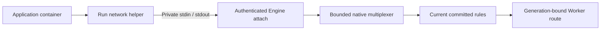
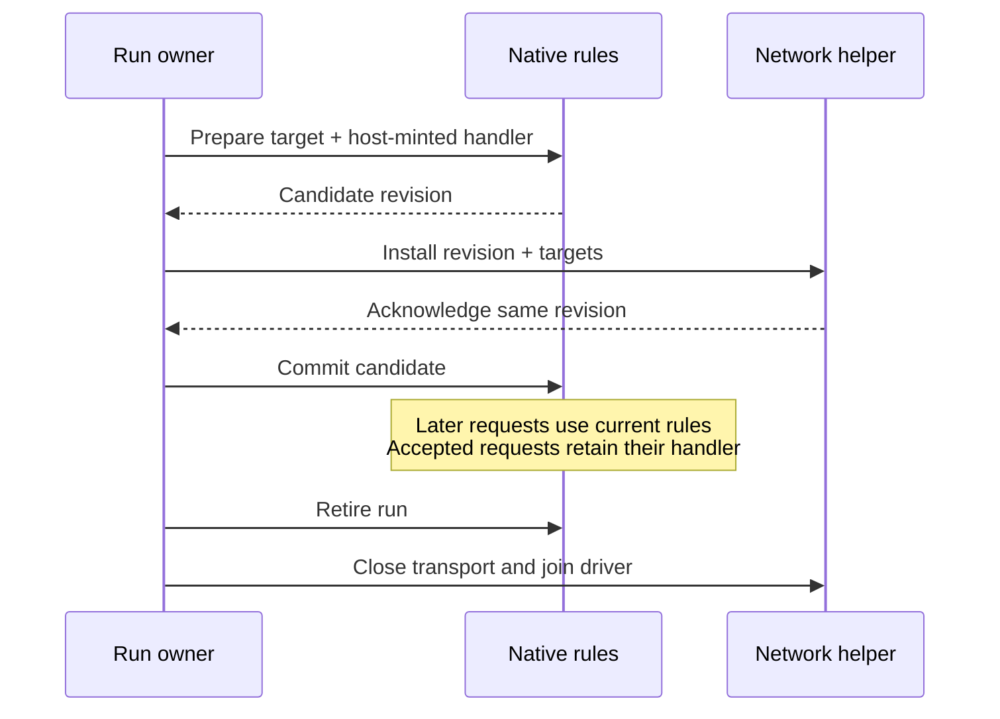

<!-- Copyright 2026 Cellar Project Authors. Licensed under Apache-2.0. -->

# Container outbound transport

`cellar-egress` supplies the native routing table, private byte transport and
dedicated Linux network helper for container outbound interception.
The engine must own and join its driver.
This crate alone does not enable `interceptOutboundHttp()`.

## Connection and ownership



The network helper runs and is qualified separately. The native Engine attach
client and a helper-first two-container topology also have a real `runc`
campaign. Production cell lifecycle and native Worker routing are the next
integration step. Outbound sockets remain
inside the container network fence; the host must not open a fallback connection
on the application's behalf.

| Component | Implemented contract |
| --- | --- |
| `HttpTarget`, `Host` | Validated hostname/glob, IP, IP:port, CIDR and catch-all targets; separate socket destination and HTTP hostname |
| `Rules` | Shared 128-entry budget, stable registration order, replacement, prepared updates and run retirement |
| `wire` | Version-1 bounded stream preludes and revisioned installation messages |
| `control` | Session identity, acknowledged installation, bounded command admission, lost-ack retirement and completion after waiter cancellation |
| `dns` | Bounded ordinary A/AAAA queries, zero-TTL placeholders for granted names, explicit forward/drop policy and malformed-packet refusal |
| `transport` | Bidirectional multiplexed streams, half-close, bounded admission and synchronous revocation |
| `docker_io` | Raw Engine stdin writes and incremental framed stdout reads without frame-sized buffers |
| `firewall` | Validated atomic namespace-local nftables replacement, DNS/HTTP redirects and offline output policy |
| `linux` (`helper` feature) | Kernel original destinations and marked TCP/UDP sockets; caller owns policy, limits and deadlines |
| `helper` / `cellar-egress` binary (`helper` feature) | Real firewall installation, persistent UDP/TCP DNS, bounded intercept/fallback relays, typed direct admission and joined installer retirement over nonblocking private pipes |

## Installation and request routing



`Rules::commit` rejects candidates from another registry and stale competing
updates. Replacement preserves a target's position. A catch-all therefore keeps
the order of earlier hostname rules. Retirement invalidates prepared updates;
the registry never resets its revision when a cell starts another run.

An installation acknowledgement is a protocol message, not proof that a
caller observed success. The controller finishes entered updates after caller
cancellation. A missing or incorrect acknowledgement, idle peer disconnect or
controller drop retires routing and closes the transport. The engine still
must stop and remove the helper and application, and join their owned work.

The generic control loop acknowledges after its installer returns. The network
helper supplies actual nftables installation, then publishes DNS rules before
acknowledging. Installer errors and timeouts cannot report successful readiness
or expose an unacknowledged native route. Normal retirement kills and reaps an
entered installer before the helper exits.

```rust
use cellar_egress::{Host, HttpTarget, Destination, Rules};

let mut rules = Rules::default();
let candidate = rules.prepare(HttpTarget::parse("backup.internal")?, "gateway")?;
// The network owner installs candidate.targets() and checks its acknowledgement.
rules.commit(candidate)?;

let host = Host::parse("backup.internal")?;
let request = Destination {
    socket: "127.0.0.2:80".parse()?,
    host: Some(&host),
};
assert_eq!(*rules.resolve(&request).unwrap(), "gateway");
# Ok::<(), anyhow::Error>(())
```

## Resource and failure boundaries

| Boundary | Limit / behavior |
| --- | --- |
| Interception table | 128 entries; hostname/glob/catch-all costs two, IP/CIDR costs one |
| Live transport streams | 129 across both directions: 64 intercepted, 64 fallback, one control |
| Helper connection classes | Separate 64-slot intercept and direct admission; a separate 64-slot budget shared by UDP DNS work and TCP DNS connections |
| Pending local opens | Eight; overload refuses without waiting in an unbounded producer queue |
| Pending installations | Eight; caller cancellation skips queued work or leaves entered work owned by the controller |
| Yamux wire streams | 137, including eight slots for resets of recently dropped streams |
| Aggregate receive window | 35,913,728 bytes; each initial stream window is 256 KiB |
| Control frames | 64 KiB, checked before allocation and before writes |
| DNS query | 4 KiB; one ordinary question and at most one EDNS record; section counts checked before vector allocation |
| Synthetic DNS answer | At most 512 bytes; A/AAAA only, zero TTL, no DNSSEC validation claim |
| Forwarded DNS answer | 4 KiB and 128 records; connected upstream plus matching ID/question; malformed and foreign replies refuse |
| Docker stdout frame | 1 MiB maximum; payload read directly into the caller's buffer |
| Malformed Engine stream | Poison both directions; reject stderr payloads, unknown types, reserved bytes, oversized or truncated frames |
| Run closure | Refuse buffered reads and writes immediately, even before the driver is polled again |

The helper enforces separate connection allocations and operation deadlines.
The host integration must still bound HTTP headers/bodies, install waits and
resource shutdown. Saturation of each helper class and the complete host
lifecycle remain separate qualification requirements.
The firewall program refuses HTTP registrations on port 53 or either helper
listener port before generating an installable program. These reserved ports
remain an explicit gap in the initial integration profile.

The binary defaults to 300-second data-operation and five-second install
deadlines, configurable through `--operation-timeout-ms` and
`--install-timeout-ms`. Its trusted image-local `--nft-path` must be absolute;
the installer receives a cleared environment. Application code must not select
the executable or network configuration.

Direct streams carry an explicit `Connected` or typed `Refused` reply before
application bytes. Offline, hostname and helper-listener refusals precede socket
creation. Initial fallback accepts kernel-observed IP destinations; hostname
fallback remains unsupported.

## Qualification and remaining delivery

Offline filtering explicitly admits redirected traffic to the proxy listeners.
It also blocks unmarked access to Docker's privileged loopback resolver,
including its private port. The standard DNS port alone is insufficient to
enforce this policy; the actual-socket regression covers that bypass.
[Docker's resolver source](https://github.com/moby/moby/blob/master/daemon/libnetwork/sandbox_dns_unix.go)
defines its reserved loopback address.

Unit tests cover target matching, rule replacement and fencing, malformed wire
messages, stream saturation, installation cancellation and lost acknowledgements,
idle disconnects, DNS policy, half-close, retirement and fragmented Docker frames.
The README example also compiles as a documentation test. These are native
component tests, not container-image or cloud qualification.

The separate [native network campaign](../../tools/sandbox/egress/README.md) checks
actual IPv4/IPv6 TCP destination capture, UDP/TCP DNS redirects, marked bypass,
offline refusal, inbound replies and offline/online rule replacement in an owned
namespace. It also starts the actual network-helper binary over pipes, checks
live rule replacement, persistent DNS TCP, forwarded-answer identity, effect-free
fallback refusal and successful joined process exit. A fault-only installer
wrapper verifies timeout admission and retirement during an entered installation.
The Engine campaign uses Cellar's real private attach client before startup,
then starts a separate application in the helper's exact network namespace.
It checks startup refusal, live-request retirement and successful helper join.
The Engine campaign's route handler is a protocol peer. The separate
[native HTTP profile](../cellar-container/README.md#route-outbound-http-to-a-native-service)
adds generation-bound Worker dispatch and fresh scope/epoch gates. The
[Sandbox 1.0.3 image campaign](../../tools/sandbox/cloudflare-v1/README.md#directory-backups-through-native-http-interception)
runs published directory backup/restore/delete through that profile.

| Next integration | Required evidence |
| --- | --- |
| Network helper qualification | Per-class saturation, broader cancellation/errors, DNS options and additional kernel/runtime profiles |
| Production cell lifecycle | Broader ownership-transfer, expiry and fault qualification beyond the implemented helper-first startup, warm reconnect and paired removal |
| Native/Workers facade | HTTPS, trailers/upgrades and broader failure qualification beyond the implemented plain-HTTP service routes |
| Published Sandbox | S3 mounts and full backup failure/restart/grant lifetime qualification beyond selected matching-image backup/restore/delete |

See the [delivery plan](../../plans/sandbox-provider-compatibility.md),
[progress ledger](../../plans/sandbox-provider-progress.md),
[Cloudflare interception contract](https://developers.cloudflare.com/containers/api/durable-object-container/)
and [Yamux driver contract](https://docs.rs/yamux/0.14.1/yamux/).
DNS parsing uses the pinned [Hickory protocol library](https://docs.rs/hickory-proto/0.26.3/hickory_proto/).
