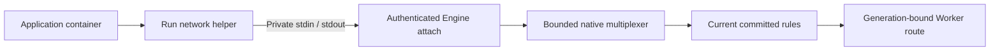
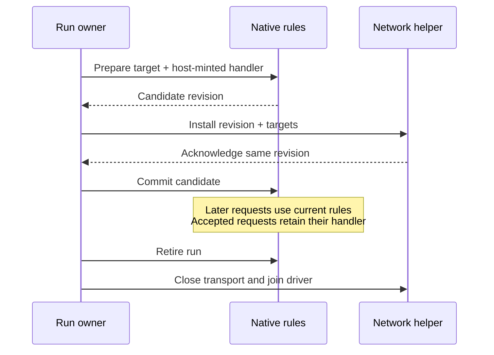

<!-- Copyright 2026 Cellar Project Authors. Licensed under Apache-2.0. -->

# Container outbound transport

`cellar-egress` supplies the native routing table and private byte transport for
container outbound interception. The engine must own and join its driver.
This crate alone does not enable `interceptOutboundHttp()`.

## Connection and ownership



The network helper and engine integration are the next delivery step. They must
keep outbound sockets inside the container network fence; the host must not
open a fallback connection on the application's behalf.

| Component | Implemented contract |
| --- | --- |
| `HttpTarget`, `Host` | Validated hostname/glob, IP, IP:port, CIDR and catch-all targets; separate socket destination and HTTP hostname |
| `Rules` | Shared 128-entry budget, stable registration order, replacement, prepared updates and run retirement |
| `wire` | Version-1 bounded stream preludes and revisioned installation messages |
| `control` | Session identity, acknowledged installation, bounded command admission, lost-ack retirement and completion after waiter cancellation |
| `dns` | Bounded ordinary A/AAAA queries, zero-TTL placeholders for granted names, explicit forward/drop policy and malformed-packet refusal |
| `transport` | Bidirectional multiplexed streams, half-close, bounded admission and synchronous revocation |
| `docker_io` | Raw Engine stdin writes and incremental framed stdout reads without frame-sized buffers |

## Installation and request routing



`Rules::commit` rejects candidates from another registry and stale competing
updates. Replacement preserves a target's position. A catch-all therefore keeps
the order of earlier hostname rules. Retirement invalidates prepared updates;
the registry never resets its revision when a cell starts another run.

An installation acknowledgement is a protocol message, not proof that a
caller observed success. The controller finishes entered updates after caller
cancellation. A missing or incorrect acknowledgement, idle peer disconnect or
controller drop retires routing and closes the transport. The engine still
must stop and remove the helper and application, and join their owned work.

The helper-side control loop acknowledges only after its network installer
returns successfully. Network/firewall installation is supplied by the owning
helper integration; the protocol cannot establish that a callback installed
actual kernel rules.

```rust
use cellar_egress::{Host, HttpTarget, Destination, Rules};

let mut rules = Rules::default();
let candidate = rules.prepare(HttpTarget::parse("backup.internal")?, "gateway")?;
// The network owner installs candidate.targets() and checks its acknowledgement.
rules.commit(candidate)?;

let host = Host::parse("backup.internal")?;
let request = Destination {
    socket: "127.0.0.2:80".parse()?,
    host: Some(&host),
};
assert_eq!(*rules.resolve(&request).unwrap(), "gateway");
# Ok::<(), anyhow::Error>(())
```

## Resource and failure boundaries

| Boundary | Limit / behavior |
| --- | --- |
| Interception table | 128 entries; hostname/glob/catch-all costs two, IP/CIDR costs one |
| Live transport streams | 129 across both directions; intended allocation: 64 intercepted, 64 fallback, one control |
| Pending local opens | Eight; overload refuses without waiting in an unbounded producer queue |
| Pending installations | Eight; caller cancellation skips queued work or leaves entered work owned by the controller |
| Yamux wire streams | 137, including eight slots for resets of recently dropped streams |
| Aggregate receive window | 35,913,728 bytes; each initial stream window is 256 KiB |
| Control frames | 64 KiB, checked before allocation and before writes |
| DNS query | 4 KiB; one ordinary question and at most one EDNS record; section counts checked before vector allocation |
| Synthetic DNS answer | At most 512 bytes; A/AAAA only, zero TTL, no DNSSEC validation claim |
| Docker stdout frame | 1 MiB maximum; payload read directly into the caller's buffer |
| Malformed Engine stream | Poison both directions; reject stderr payloads, unknown types, reserved bytes, oversized or truncated frames |
| Run closure | Refuse buffered reads and writes immediately, even before the driver is polled again |

The aggregate stream ceiling does not yet enforce the intended separate
intercept/fallback allocations. The integration must enforce those allocations
and bound request headers, bodies, installation waits and task shutdown.

## Qualification and remaining delivery

Unit tests cover target matching, rule replacement and fencing, malformed wire
messages, stream saturation, installation cancellation and lost acknowledgements,
idle disconnects, DNS policy, half-close, retirement and fragmented Docker frames.
The README example also compiles as a documentation test. These are native
component tests, not container-image or cloud qualification.

| Next integration | Required evidence |
| --- | --- |
| Network helper | Connect the DNS policy to UDP/TCP listeners; capture actual destinations, install firewall rules and fence direct fallback |
| Engine lifecycle | Helper-before-application startup, acknowledged installation, ownership loss, expiry and joined removal |
| Native/Workers facade | Host-minted generation-bound Fetcher routes, current-run admission and no retained JavaScript event callback |
| Published Sandbox | Unmodified helper image backup/restore and mount operations with grant replacement and cleanup |

See the [delivery plan](../../plans/sandbox-provider-compatibility.md),
[progress ledger](../../plans/sandbox-provider-progress.md),
[Cloudflare interception contract](https://developers.cloudflare.com/containers/api/durable-object-container/)
and [Yamux driver contract](https://docs.rs/yamux/0.14.1/yamux/).
DNS parsing uses the pinned [Hickory protocol library](https://docs.rs/hickory-proto/0.26.3/hickory_proto/).
