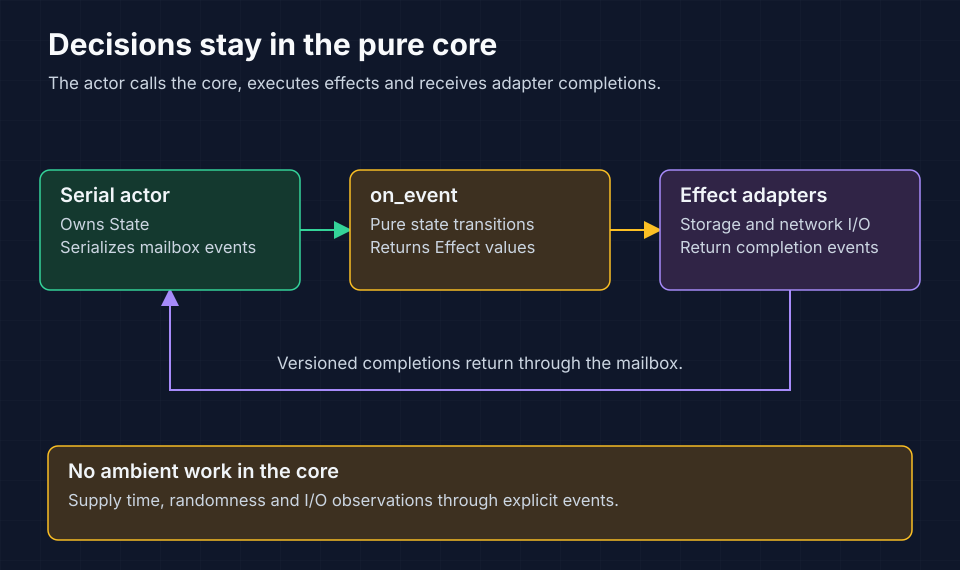

<!-- Copyright 2026 Cellar Project Authors. Licensed under Apache-2.0. -->

# cellar-logic

The pure decision core for Cellar. It decides how cells activate, route calls,
prove writes and release ownership. The production host executes its effects
and returns completion events. Application authors normally use
[`cellar::sdk`](../cellar/README.md); this crate is for runtime contributors and
verification tools.



The actor owns state. The core decides what happens next; adapters perform the
requested work and report its outcome through the mailbox.

## Follow the event loop

[`on_event`](lib.rs) is the entry point for behavioral state changes:

```rust,ignore
let effects = cellar_logic::on_event(&mut state, event);
```

The caller owns `state`, supplies an `Event`, executes the returned `Effect`
values and submits their completion events. The production
[actor](../cellar/actor/mod.rs) serializes this loop. Adapters must not mutate
core state directly.

The core has no crate dependencies, asynchronous work, I/O, clocks, randomness
or locks. Supply external observations through events so decisions remain
reproducible from the same state and inputs.

## Find the owning component

| Area | Responsibility | Source |
| --- | --- | --- |
| State and dispatch | Cell phases, activation and event transitions | [lib.rs](lib.rs), [types.rs](types.rs) |
| Routing | Owner resolution and route decisions | [routing.rs](routing.rs) |
| Durability | Write proof and output admission | [durability.rs](durability.rs), [gate.rs](gate.rs) |
| Background work | Alarms, durable wakes, queues and cron | [alarm.rs](alarm.rs), [wake.rs](wake.rs), [queue.rs](queue.rs), [cron.rs](cron.rs) |
| Event delivery | Stream and subscription lifecycle decisions | [event_stream.rs](event_stream.rs), [subscription_lifecycle.rs](subscription_lifecycle.rs) |
| Resource pressure | Admission, residency and balancing | [pressure.rs](pressure.rs), [rebalance.rs](rebalance.rs) |
| Fleet resource accounting | Retained physical occupancy, unresolved growth and scoped materialization credit | [raft_fleet](raft_fleet/mod.rs) |
| Shutdown | Draining and release decisions | [drain.rs](drain.rs) |

## Preserve authority and proof

Completion events carry the identity and version needed to reject stale work.
Retain epoch, activation and ownership checks when changing transitions. A
failed response does not establish that a mutation rolled back, and a retired
task does not prove durability.

Keep policy decisions here and external mechanisms in host adapters. Read
[architecture](../../docs/03-architecture.md) and the
[authority decision record](../../docs/adr/002-cell-authority-and-proof.md)
before changing ownership, recovery or output gates.

`raft_fleet::ResourceLedger` requires complete reservation input and exact
boot/process/profile-scoped physical observations. It charges physical high
water, unmaterialized incremental growth and an explicit node reserve separately
for engine slots, durable bytes and memory. Materialization replaces only the
attributed part of outstanding growth. Older-boot debt remains fully charged.
Lower measurements do not establish physical release; no release API is exposed.
The pure ledger grants no membership or catalog authority. Authenticated resource
sampling, atomic catalog reservation admission and planner/controller integration
remain separate fleet implementation work.

`raft_fleet::preview_topology` verifies an explicit complete RF3 assignment. It
constructs a serial schedule with per-step domain/quorum and seed-peak checks,
retains every source's physical footprint, and searches for a complete direct
RF3 restoration witness after each kept-node loss. It pins exact capacity scopes
and input/policy revisions. One shared work limit covers all searches; exhaustion
returns no partial preview. `RecoveryUnproven` means no direct restoration witness,
not proof that every possible reshuffle is infeasible.

This pure API requires stable groups, fresh complete node ledgers and no unsettled
reservations. It verifies caller-proposed layouts; automatic layout generation,
load/leadership scoring, owned authenticated input collection and resumable
execution remain separate delivery work. Source-side fixed worker pools must
already be included in physical bounds. A schedule dependency requires actual
terminal completion before admitting its successor; a preview grants no permit,
storage reclamation, node-removal certificate or future health lease.

Startup inventory confirmation is node work, independent of callers joining
its owner reads. Cancelling a caller leaves a queued confirmation in place.
Preserve shutdown and node fencing retire both queued and in-flight confirmation
work and ignore late inventory or owner-read completions. An abandoned inventory
keeps the owned-cell count unknown; retirement does not establish a complete count.

## Validate changes

Check the crate and run its ordinary integration tests from the repository root,
using the checkout-specific target directory in
[repository guidance](../../AGENTS.md#build-and-validation):

```sh
cargo check -p cellar-logic --locked
cargo test -p cellar-logic --tests --locked
```

The manifest disables the ordinary library test target. Internal deterministic
suites require external harness sources and `cellar_internal_tests`; an ordinary
Cargo run does not execute them. Test changed behavior through the relevant
[host integration suites](../cellar/tests) and follow
[testing and qualification](../../docs/19-testing-qualification.md).
