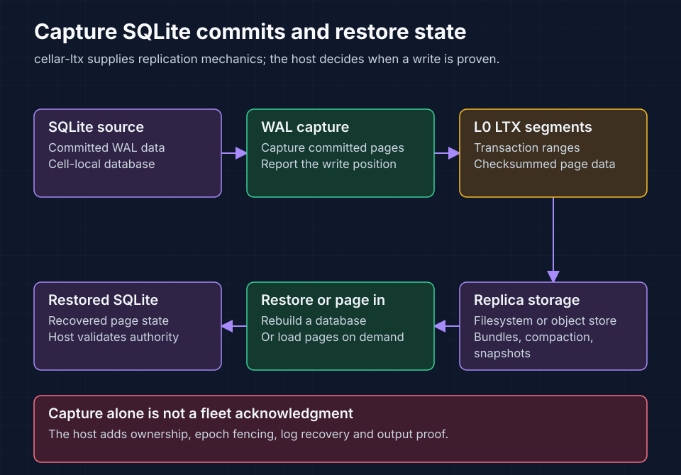

<!-- Copyright 2026 Cellar Project Authors. Licensed under Apache-2.0. -->

# cellar-ltx

Capture committed SQLite write-ahead log (WAL) data as LTX replication segments.
`cellar-ltx` writes and reads replicas, restores databases, compacts history and
supports page-on-demand access. It is an in-process library used by the
[`cellar` host](../cellar/README.md).



Read the top row from source commits to captured segments, then follow storage
and restoration on the lower row. Capturing LTX alone does not prove a fleet
write. The host adds ownership, epoch fencing, replicated logs and output gates;
see [write durability](../../docs/06-storage-transactions.md#durability-and-external-side-effects).

## Find the replication API

| Task | Entry point | Source |
| --- | --- | --- |
| Capture WAL commits | `Db` | [Database capture](src/db.rs) |
| Drive replication | `Replica` | [Replication loop](src/replica.rs) |
| Implement a storage backend | `ReplicaClient` | [Client trait](src/client/mod.rs) |
| Store local replicas | `FileReplicaClient` | [Filesystem client](src/client/file.rs) |
| Restore a database | `restore` | [Restore implementation](src/replica.rs) |
| Read bundled L0 segments | `BundleOverlayClient` | [Bundle client](src/client/bundle.rs) |
| Read pages on demand | `paged`, `paged_vfs` | [Page map](src/paged.rs), [SQLite virtual filesystem](src/paged_vfs.rs) |
| Verify bounded consensus LTX | `ltx::decode_file_bounded` | [Strict decoder](src/bounded_ltx.rs) |
| Materialize and retain immutable images | `GenerationStore` | [Apply contracts](src/apply.rs), [Generation owner](src/generation.rs) |
| Query an immutable image | `generation::open_immutable` | [Read-only virtual filesystem](src/generation_vfs.rs) |
| Supply host tasks and files | `LtxHost`, `FileSystem` | [Host contract](src/host.rs) |

L0 segments capture commits before higher-level compaction. The paged SQLite
virtual filesystem loads each page on first use through indexes in retained
segments. A paged epoch continues the history from which it was opened.
Read the [LTX format notes](reference/ltx-format.md) before changing the codec.

The fleet host uses `Db::capture` for proof-bound work and schedules
`Db::checkpoint_if_due` separately, visiting one resident every 10 ms with one
maintenance job in flight. This spreads age-triggered checkpoints across cells.
Size-triggered checkpoints still run during capture. Both paths share exclusive
database ownership and the same WAL sealing and LTX staging rules; maintenance
does not acknowledge writes. Standalone `Db::sync` retains its combined policy.
A checkpoint captures its own sealing write before clearing maintenance state,
so a later capture cannot re-arm idle maintenance from that control write.

`Db::open_disposable_with_host` is an explicit mode for a private command
workspace rebuilt from an independently authoritative image. It omits SQLite
syncs on the managed connections and syncs of captured LTX files, while retaining
WAL capture, bounded decoding, checkpointing and atomic file replacement. It
refuses existing sidecars or capture metadata before opening SQLite. Every
restart must discard that workspace; captured bytes need a separate durability
proof before acknowledgement. Ordinary `Db` constructors retain durable capture.
The Raft host uses this mode only for private command execution: its verified
preview, committed immutable image and Raft log keep their persistence barriers.

`Db::capture_with_files` also returns the newly encoded L0 cuts in a bounded
batch, including cuts generated by size-triggered checkpoints. The Raft host
uses this handoff to avoid listing and rereading files it just captured. Local
capture writes retain their configured durability; the returned bytes are the
encoder's output, not a read-back proof. Limits or capture errors return no
partial batch, although the local database may already have advanced. Private
command execution then follows its existing discard/rebuild policy. Bounded
decoding, exact base/result checks, image sealing and Raft acknowledgement
proofs still run before a command succeeds.

## Verified immutable images

`GenerationStore::prepare` copies an exact pinned base into a new private file,
then applies a contiguous LTX chain. Both the base and result require SHA-256
digests, including when LTX rolling database checksums are disabled. The bounded
decoder verifies file integrity, physical index coverage, page identities,
snapshot completeness and compressed-frame bounds before retaining page data.
Apply checks transaction ranges, declared page/byte counts, growth coverage and
truncation against the resulting SQLite header and full image digest. Published
images are never patched in place. Supported filesystems use an exclusively
created copy-on-write clone; other providers use bounded copying. Both paths
independently inspect the destination before it can be used. Hard links are not
allowed, and a clone never replaces verification or publication barriers.

`GenerationStore::prepare_chain` replays several exact updates into one private
image. It verifies every intermediate image's digest, SQLite geometry and optional
rolling checksum before continuing, and seals only the final result. The existing
file, encoded-byte, decoded-byte and page budgets apply to the whole chain;
disk admission reserves twice the largest intermediate image, including growth
that is later truncated. No intermediate pin is exposed. Archive recovery uses
`limits()` to partition longer histories within the destination's captured limits,
retiring each previous batch only after its successor is sealed.

`stream_snapshot` encodes and verifies full v0.5.2 images using anonymous files,
64 KiB I/O buffers and a disk-spooled page index. Logical image quotas extend to
decimal 10 GB independently of command-delta decode budgets. Offsets stay `u64`;
the reserved SQLite lock page is omitted from LTX and represented by canonical
zeros in the full physical image digest. `Download` owns ordered scratch writes
and refuses reuse after an uncertain append. A complete transport digest alone
does not establish physical validity or a durable generation.

`GenerationStore::prepare_snapshot_chain` decodes this file-backed source and
applies its bounded tail in one private destination. It independently re-reads
the written image, checks every intermediate result and shares ordinary image
reservation, cleanup and publication barriers. File-backed snapshot callers do
not raise command `max_decoded_bytes`, `max_pages` or encoded-envelope bounds to
the full image quota. All synchronous work belongs to the owning blocking domain.
Native transfer and archive receive spools use the configured replica volume;
generation snapshot sources use a separate sibling scratch directory outside
the generation inventory. Anonymous handles retain their storage through
blocking work and cancellation. `ScratchPool` supplies shared byte/file admission:
encoders reserve a complete body/index bound before file creation and receivers
reserve the declared complete file. Charges survive cloning, failed appends and
cancellation until the last physical file owner closes. Generation stores opened
with `open_with_scratch` and archive/receive callers can share the same pool.
Standalone generation stores use a separate default 2 GiB snapshot scratch pool;
configure a shared larger pool explicitly for larger standalone snapshots.

Snapshot encoder body/index files and receive spools request the injected
`HostFileIo::advise_streaming` policy when the **logical image** is at least
256 MiB. Compression and configured maximum quotas do not select this policy.
The direct macOS provider uses `F_NOCACHE` for these anonymous sequential files;
other direct providers currently return `Unsupported` and retain ordinary
bounded I/O. Injected providers may also decline the hint with `Unsupported`.
Other I/O failures abort preparation and close files before releasing scratch
admission. The hint does not change encoded bytes, physical verification, syncs,
ownership or admission, and supplies no memory bound or recovery-time guarantee.
Small snapshots and hot immutable-generation files retain their normal policy.

`Db::committed_image_digest` independently observes the committed main-file/WAL
overlay without SQLite serialization. Writers must remain exclusively quiescent
during that scan. Main-file reads use SQLite's VFS, including demand-loaded
images; complete WAL transactions supply the page overlay. The live WAL index's
two matching, checksum-verified headers fix the committed frame boundary,
geometry, salts and last-frame checksum. Corrupt or missing committed bytes
refuse observation instead of selecting an older transaction with the same
database length. Uncommitted spilled frames remain outside that boundary.
The metadata sample borrows the WAL write lock for its 96-byte copy and refuses
contention; it does not checkpoint. Unsupported WAL-index formats also refuse
observation.
All writers and checkpoints must remain quiescent throughout inspection.
This still scans the
full image and is not an incremental identity or fast-takeover qualification.

Image preparation also removes up to eight eligible retired files before its
final directory sync, sharing that barrier with the new image's creation. Selected
files stay busy and fully charged until the shared sync succeeds. Existing pins,
retention and monotonic references exclude an image from selection. If space is
needed before reserving the new image, bounded reclamation completes a separate
directory sync first; it never spends unsynced deletion capacity. A failed
removal or shared barrier quarantines admission and returns no new image pin.
Explicit `reclaim` similarly batches its selected names under one directory sync.

File operations use the injected `FileSystem` synchronously on the host's owning
blocking/execution domain. Preparation exclusively creates the final image name
through `create_read_write`, verifies the complete image through that owned
handle, syncs the file, then syncs the directory. It does not create a staging
file or rename over a placeholder. The in-progress entry stays busy: adoption
cannot expose it before both barriers complete. A final filename alone grants
no authority, including after a crash; recovery still requires an exact durable
marker and verifies its image. Directory creation also syncs ancestor entries.
Unsupported operations fail. Failed creation with uncertain ownership or failed
cleanup quarantines the store until it is closed and recovered; it does not
refund unknown disk usage or overwrite an unexpected image.

A returned pin proves physical image sealing. The Raft host must still persist
the corresponding engine apply marker before making that pin queryable or
settling a command. Recovery inventories retained files within configured bounds
and `adopt` verifies the image selected by an authoritative marker. It never
selects the newest filename. The host calls `retire` only after all durable
marker, recovery and archive references are gone. Reader pins retain both the
image and directory lock; bounded reclamation syncs deletion before refunding
capacity. Default admission allows 64 generations and 512 MiB, reserving twice
the largest intermediate image while an update is in progress.

`GenerationStore::open_observed` attaches a `GenerationAccounting` observer to
the same physical owner. Its constant-size snapshot reports open stores,
generations, charged bytes, retained/busy images and aggregate capacities without
I/O or directory enumeration. Pins retain the registration after store handles
drop; reclamation refunds only synced deletion. Quarantine, poison or accounting
overflow makes that observer unavailable for its remaining lifetime. Closing a
store removes its reservations, but does not delete its durable image files;
these observations do not inventory closed directories or grant reclamation
authority. The ordinary `open` path does not enable accounting.

After recovery adopts the complete authoritative reference set, `retain_only`
retires the other inventory without selecting files by age or name. Every
supplied reference must already be adopted; validation finishes before any
retention flag changes. Live reader/archive pins still prevent reclamation.
The Raft host uses this at startup for both the applied image and the durable
Raft snapshot image, and its archive verifier uses an empty set for disposable verification copies. A newer
durable committed image can replace the older image's future full-archive path;
retiring that older image does not revoke an existing reader or archive pin.

`GenerationPin::retain_reference` establishes a no-I/O reference to an already
verified image under a nonzero key and monotonic revision. At most 64 keys,
including released tombstones, are admitted per store. Equal revisions must bind
the same image ID and complete state; a reused name cannot reinterpret a revision.
Stale retains/releases cannot revoke a newer selection. An exact release preserves
its tombstone. Active references protect bytes independently of ordinary retirement
and live pins. They are reconstructed from authoritative markers after opening a
store; they are not separate on-disk consensus state. The Raft adapter uses distinct
prospective and durable snapshot references so uncertain storage completion cannot
erase its candidate image or replace the old durable recovery boundary prematurely.

`generation::open_immutable` opens only the pin's virtual filename. Its SQLite
VFS reads through the injected filesystem, refuses writes, sidecars and native
path access, and receives clock/randomness callbacks through `ReadServices`.
Descriptors use a process-lifetime pool capped at 4,096 concurrent owners; idle
slots retain no pins, services or files and can be reused after their owner and
all files close. Permanent descriptors avoid dangling SQLite registry pointers.
The host's `cellar::storage::open_immutable_generation` adds its SQL limits and
read authorizer without initializing framework tables. Query registration and
Raft publication authority remain the host's responsibility.

Run `cargo test -p cellar --test native_raft_ltx --locked -- --test-threads=1`
for real SQLite images, checksum/chain corruption, retained readers, injected
I/O failures and process-kill publication cuts. Those cuts use a fixture marker;
engine marker atomicity and private command capture are exercised separately
by the host's [Raft command/apply integration](../cellar/durability/raft/README.md).

## Select backend features

The default feature is `s3`. The manifest also exposes `gcs` and `azure` backend
features; see [Cargo.toml](Cargo.toml) for their dependency mappings.
`ObjectStoreClient` and its configuration exports are gated by `s3` in the
current API. Feature selection alone does not configure credentials or qualify
a provider's durability behavior.

Check the core and complete feature builds from the repository root:

```sh
cargo check -p cellar-ltx --no-default-features --locked
cargo check -p cellar-ltx --all-features --locked
```

Use the checkout-specific target directory in
[build guidance](../../AGENTS.md#build-and-validation). The ordinary library test
target is disabled; replication changes also need the owning host's integration
and recovery tests. Internal tests require their external harness.

## Provenance and attribution

Seeded on 2026-08-03 from a read-only snapshot of
[rustyriver](https://github.com/mikenomitch/rustyriver), a Rust reimplementation
of Litestream v0.5 and the LTX format. Cellar maintains this source independently
of the upstream branch.

Attribution for the vendored and ported work:

- **rustyriver** — Copyright 2026 The rustyriver authors, licensed under the
  Apache License, Version 2.0.
- **Litestream** (https://github.com/benbjohnson/litestream) — Copyright (c)
  Ben Johnson and the Litestream authors, licensed under the Apache License,
  Version 2.0. The original replication behavior comes from tag v0.5.11. The
  current block format follows tag v0.5.16 because it includes LTX v0.5.2.
- **LTX file format and reference implementation**
  (https://github.com/superfly/ltx), tag v0.5.2 — Copyright (c) Superfly, Inc.,
  licensed under the Apache License, Version 2.0.
- **pierrec/lz4 block compressor**
  (https://github.com/pierrec/lz4), tag v4.1.23 — Copyright (c) 2015 Pierre
  Curto, licensed under the BSD 3-Clause License. The Rust port preserves the
  exact compressed bytes that the LTX v0.5.2 writer produces.

Cellar omits Litestream's object-storage leaser. The unused port was removed
on 2026-08-06. Cellar instead uses a conditional ownership record carrying an
epoch and stamps that epoch into the LTX prefix. A separate replica lease would
introduce a competing ownership mechanism.

The full Apache License, Version 2.0 text is in [LICENSE](LICENSE). The full
BSD 3-Clause License text is in
[LICENSE.pierrec-lz4](LICENSE.pierrec-lz4).

## File compatibility

Cellar's node-bundle envelope contains verbatim L0 files followed by row metadata,
a little-endian CRC64-ISO checksum, a little-endian u32 footer length and `CLB1`.
Integrity covers payload, footer, length and magic before row metadata can
authorize recovery or collection. Rows must partition the payload, have positive
epoch/TXID and agree with their L0 header transaction range. The development
layout hard-cutover retains marker 1: recreate earlier unchecksummed bundle state
and rebuild participants. There is no legacy bundle reader or migration. This
container change does not rewrite the upstream LTX files described below.

Cellar and Litestream v0.5.16 can read the new block files and the older frame
files. Litestream v0.5.11 can read only the older frame files. This is a reader
compatibility boundary because LTX keeps file version 3 for both layouts.

The ordinary Cellar L0 writer still emits the older frame representation. The
v0.5.2 encoder and compactor emit exact block files. Cellar contains a
node-wide scheduler that publishes additive L1 files, and the scheduler is on
by default. Every takeover target must have the dual decoder before the first
L1 publication, so a mixed fleet must set `CELLAR_LTX_COMPACTION=0` until all
nodes can read block files. The same reader-first requirement applies to a
later L0 writer switch.
