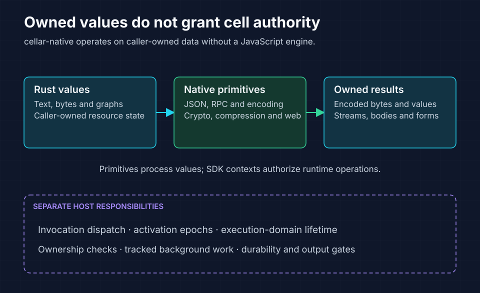

<!-- Copyright 2026 Cellar Project Authors. Licensed under Apache-2.0. -->

# cellar-native

Rust values, codecs and web primitives shared by Cellar's runtime adapters.
This crate operates on caller-owned values without a JavaScript engine.
The host supplies invocation dispatch, cell authority and durability; application
code normally accesses these primitives through [`cellar::sdk`](../cellar/README.md).



These primitives transform values. Use the SDK when an operation also needs
cell authority, tracked work or durability proof.

## Find a primitive

| Module | Responsibility |
| --- | --- |
| [`cell_id`](cell_id.rs) | Namespace-derived cell IDs and identity validation |
| [`clone`](clone/mod.rs) | Structured values, graph encoding and decoding |
| [`rpc`](rpc.rs) | Structured response and remote-error envelopes |
| [`json`](json.rs) | JSON conversion for structured values |
| [`sql`](sql/mod.rs) | SQL values and parameter binding |
| [`streams`](streams.rs) | Owned byte streams |
| [`web`](web/mod.rs) | HTTP-related values, blobs, forms and URL patterns |
| [`encoding`](encoding.rs) | Text encoding and decoding |
| [`compression`](compression.rs) | Whole-buffer and streaming compression |
| [`crypto`](crypto.rs) | Hashing, keys, signatures and cryptographic operations |
| [`call_order`](call_order.rs) / [`event_context`](event_context.rs) | Call ordering and event-context primitives |

Resource state belongs to the caller and is released on drop. Primitive values
do not grant permission to access a cell or extend an invocation's lifetime.
Use SDK contexts and handles for operations that require runtime authority.

## Run the example

The [primitives example](examples/primitives.rs) compresses text, computes a
SHA-256 digest, matches an upload route and round-trips a multipart form.
Run it from the repository root after configuring the checkout-specific target
directory in [build guidance](../../AGENTS.md#build-and-validation):

```sh
cargo run -p cellar-native --example primitives --locked
```

The program verifies the decoded content and prints the upload size and digest.
It needs no node, bucket or running Cellar application.

## Use codecs at their owning boundary

Validate untrusted input and handle decoding failures. Structured values have
encoding and graph limits; a host may impose lower application budgets.
Preserve the distinction between an encoded remote failure and a malformed
response. For application-facing calls, use the SDK's `encode_rpc`, `decode_rpc`
and `decode_rpc_result` helpers rather than inventing another envelope.

See [routing and RPC](../../docs/07-routing-rpc.md),
[integrations](../../docs/09-integrations.md) and the
[SDK API map](../../docs/22-api-reference.md) for the host contracts.

## Validate changes

Run the crate's unit and documentation tests from the repository root:

```sh
cargo test -p cellar-native --locked
```

Changes to value encoding, identity or error envelopes also need the relevant
SDK integration tests. Follow the [SDK CI workflow](../../.github/workflows/native-sdk.yml)
for full workspace validation.
