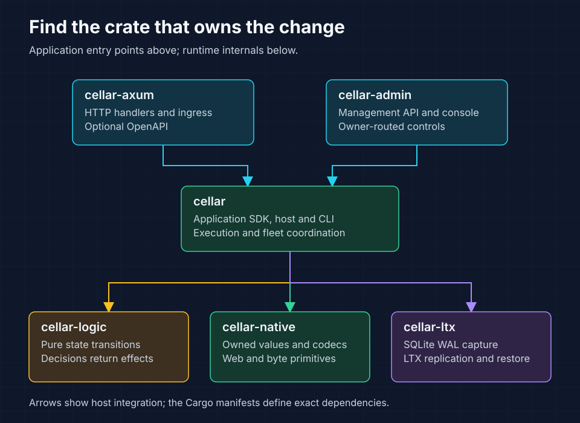

# cellar-main

Build native Rust applications around durable cells. Each cell owns SQLite
state; Cellar routes calls to its owner, replicates committed writes and recovers
state before a replacement owner serves requests. This crate contains the
application SDK, production host and `cellar` command-line interface (CLI).



Use `cellar` for application contracts and hosting. The adapter crates add HTTP
and management interfaces; the lower-level crates own runtime decisions, values
and replication mechanics.

## Add the SDK

Depend on the published `cellar-main` package under the `cellar` alias:

```toml
[dependencies]
cellar = { package = "cellar-main", version = "0.1.0" }
```

Application imports remain `cellar::sdk`. To install the command-line tool:

```sh
cargo install cellar-main --version 0.1.0 --locked --bin cellar
```

The installed command is `cellar`. The `cellar-logic`, `cellar-native`,
`cellar-ltx` and `cellar-axum` packages retain their own names.

## Run an application

From the repository root, use Rust and Cargo with native C/C++ build tools.
Follow [build setup](../../AGENTS.md#build-and-validation) for a target directory
unique to your checkout, then start the counter:

```sh
cargo run -p cellar-main --bin cellar --locked -- \
  dev examples/native-counter/project.json
```

In another terminal, increment and read the same named cell:

```sh
curl -sS -X POST http://127.0.0.1:9876/counters/alice
curl -sS http://127.0.0.1:9876/counters/alice
```

Both requests return `{"count":1}` on fresh state. Restarting `dev` preserves the
count. See the [counter walkthrough](../../examples/native-counter/README.md)
for routing, assets and local-state cleanup.

## Define handlers and cells

Import application contracts through `cellar::sdk`. A `Registry` connects your
root handler to cell factories and workflow handlers. The deployment graph
declares the matching classes, versions and bindings.

| Contract | Use it to |
| --- | --- |
| `Application` / `Registry` | Register application handlers and factories |
| `Cell` | Handle invocations for one durable entity |
| `Context` | Access bindings, storage and the current invocation's authority |
| `Invocation` / `Output` | Receive typed events and return supported results |
| `Storage` | Read and update cell-local state, use transactions and schedule alarms |
| Namespace / cell stub | Resolve a cell by name or ID and call its owner |

A transaction protects a local state change. The output gate checks ownership
and the required durability proof before releasing success. A lost response can
still leave a committed mutation; use stable command IDs and retained receipts
for retryable business operations. Read [SDK lifetimes](../../docs/05-sdk-and-lifetimes.md),
[storage](../../docs/06-storage-transactions.md) and
[routing and retries](../../docs/07-routing-rpc.md) before designing that contract.

## Choose a host

| Host | Responsibility | Example |
| --- | --- | --- |
| `sdk::Host` | Run a compiled application with CLI configuration and process lifecycle | [Native counter](../../examples/native-counter/main.rs) |
| `sdk::Node` | Supply executors, listeners, services, policies and supervision | [Embedded node](../../examples/embedded-node/README.md) |
| `cellar-axum` | Use Axum handlers or an application-owned Axum listener | [Two-host counter](../../examples/axum-counter/README.md) |

Application factories compile into the executable that serves them. The generic
CLI builds and publishes packages; it cannot serve factories absent from its
binary. Follow [packaging and deployment](../../docs/12-packaging-deployment.md)
when promoting an application to a fleet.

## Find the implementation

The crate separates application contracts, runtime execution, storage, fleet
coordination and transport. [lib.rs](lib.rs) maps physical files to public Rust
modules, so a public module name may differ from its directory. Start with the
[architecture guide](../../docs/03-architecture.md) and
[SDK API map](../../docs/22-api-reference.md) when extending the host.

## Validate changes

Run the SDK integration tests and documentation tests from the repository root:

```sh
cargo test -p cellar-main --lib --tests --locked
cargo test -p cellar-main --doc --locked
```

Use the [SDK CI workflow](../../.github/workflows/native-sdk.yml) for workspace
checks and the [qualification guide](../../docs/19-testing-qualification.md)
for lifecycle, durability or recovery changes. Internal simulation tests require
an external harness; do not enable `cellar_internal_tests` in an ordinary build.
