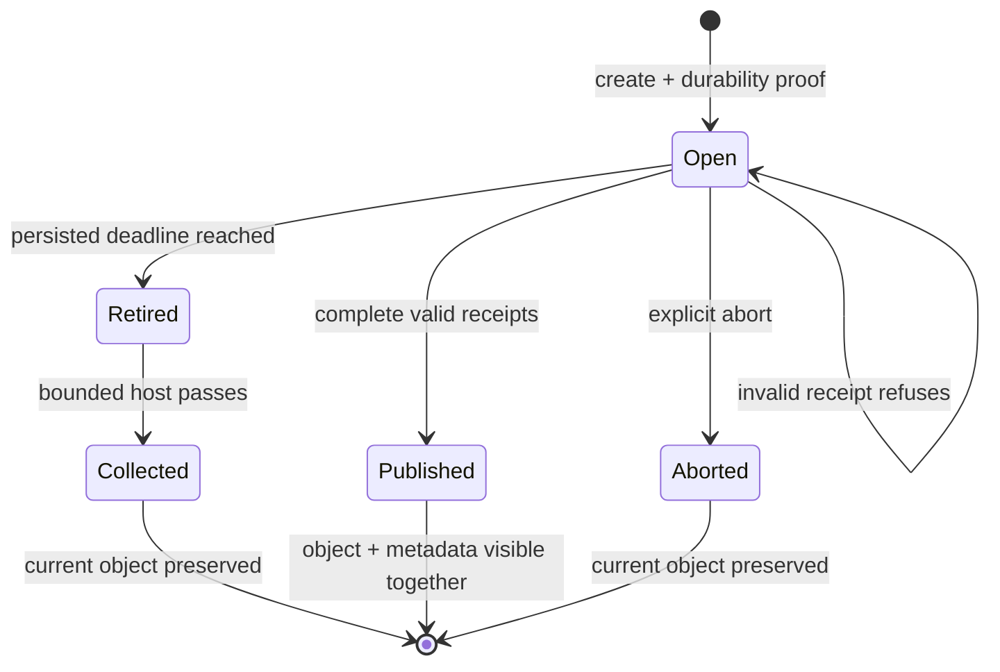

<!-- Copyright 2026 Cellar Project Authors. Licensed under Apache-2.0. -->

# Native Blob uploads

Access a declared bucket with `Context::blob`. All mutations retain native turn
checks and the cell's Blob durability gate. Blob objects and business SQLite
state have separate commits; persist references and reconcile uncertain results.

## Choose an upload contract

| API | Identity and parts | Completion |
| --- | --- | --- |
| `put` / `put_stream` | One invocation supplies the object | Returns stored metadata or an unmet condition |
| `create_multipart` | Process-owned append pipeline; pending parts can be replaced | Requires the already-flushed part order |
| `create_resumable_multipart` | Backend-owned upload ID; indexed parts can be replaced across clients/processes | Requires consecutive part numbers starting at 1 and their current, nonempty receipts |

The resumable API backs the optional [Workers R2 backup subset](../../../../packages/cellar-cloudflare/r2.md).
Its published gateway uses native storage; complete helper backup/restore and
Cloudflare production profile qualification remain open.



## Resume from durable application state

```rust
use cellar::sdk::{blob::WriteOptions, Context};

async fn create(ctx: &Context) -> anyhow::Result<()> {
    let bucket = ctx.blob("BACKUPS")?;
    anyhow::ensure!(bucket.supports_resumable_multipart()?);
    let upload = bucket
        .create_resumable_multipart(ctx, "backup.zst", WriteOptions::default())
        .await?;
    let first = upload.upload_part(ctx, 1, b"backup bytes".to_vec()).await?;

    // Persist upload.upload_id() and first.etag in cell state for a later event.
    let resumed = bucket.resume_resumable_multipart("backup.zst", upload.upload_id())?;
    let object = resumed.complete(ctx, &[first]).await?;
    assert_eq!(object.size, 12);
    Ok(())
}
```

Dropping a resumable handle leaves its upload available until explicit abort or
the backend's deadline. Constructing a resumed handle performs syntax checks;
backend existence, expiry and current receipts are checked by its operations.

## Expiry and abandoned uploads

The local store records a fixed deadline at allocation, seven days by default.
A replacement client cannot extend it by changing host policy. Expired upload
operations refuse; an observed expiry commits a retired state so clock rollback
cannot revive the upload. Completion admitted before the deadline may finish
after it. Temporary stages recheck the upload at indexed part publication.

| Boundary | Local development contract |
| --- | --- |
| Host startup | Installing the fleet Blob bucket starts one domain-owned maintenance task |
| Scope | Exact encoded host bucket scope; adjacent/nested scopes are independent |
| Pass | Retire at most 64 due uploads; inspect at most 64 retired headers and delete one stored part |
| Recovery | Retired headers persist until all parts are gone; new hosts resume from stored state |
| Lost create response | The caller may never learn the ID; host expiry still reclaims its unpublished records |
| Lost cleanup response | A fresh bounded scan converges; never replay application create/complete operations |
| Shutdown | Cancel the maintenance timer and join entered transactions; remaining backlog resumes at next startup |
| Public objects | Collection never deletes or rolls back a completed object |

Host configuration is explicit and captured before startup:

```rust
use cellar::bucket::{Bucket, MultipartMaintenancePolicy};
use std::{path::Path, time::Duration};

let bucket = Bucket::open_dev_with_multipart_policy(
    Path::new("objects.sqlite"),
    MultipartMaintenancePolicy {
        upload_ttl: Some(Duration::from_secs(7 * 24 * 60 * 60)),
        idle_interval: Duration::from_secs(60),
        backlog_interval: Duration::from_millis(10),
    },
)?;
```

`upload_ttl: None` disables deadlines for new uploads only. Without a running
host or explicit `Bucket::reap_expired_multipart` calls, physical collection
waits; deadline checks still refuse expired operations. Wall-clock rollback
before any expiry observation delays retirement. Deleting one large SQLite
part still costs time proportional to its size; pass counts do not bound disk
latency or WAL size. This internal schema cutover refuses older local upload
layouts and requires a fresh development store; it performs no migration.

S3/GCS lifecycle and custom-provider cleanup require their own qualification.
They do not inherit the local host's maintenance guarantee.

## Stage a large part with bounded memory

`begin_part` reserves native scratch capacity before opening an anonymous file.
The temporary stage belongs to the original invocation; its upload ID and the
published receipt remain durable values.

```rust
let mut part = upload.begin_part(ctx, 1, 12).await?;
part.write(ctx, bytes::Bytes::from_static(b"backup bytes")).await?;
let receipt = part.complete(ctx).await?;
```

| Boundary | Contract |
| --- | --- |
| Backend | Explicit `supports_streamed_parts`; local SQLite supports it, undeclared clients refuse before allocation |
| Writes | At most 64 KiB each; original invocation and Blob gate checked before I/O |
| Publication | Exact declared length, SHA-256 receipt and atomic indexed replacement; old receipt survives incomplete staging |
| Interrupted write | Discard the poisoned stage; never replay it as an append |
| Drop / cancellation | Anonymous storage closes with its last owner; already entered file/SQLite work retains capacity and joins with the domain |
| Uncertain completion | The part may have committed; discard temporary state and reconcile its receipt without assuming rollback |

The host configures `CellLimits.blob.max_streamed_part_bytes` (256 MiB by
default), `max_streamed_spool_bytes` (1 GiB across the host) and
`max_streamed_parts` (64 files, including empty stages) before starting the
generation. These limits are separate from buffered parts and bridge frames.

## Backend capabilities and bounds

| Backend | Indexed identity | Metadata initiation | Current qualification |
| --- | --- | --- | --- |
| Local development SQLite | Persistent upload/part rows and fixed deadlines | Supported | Native API, process restart, replacement, expiry, bounded cleanup and atomic completion/abort |
| S3 / GCS low-level client | Provider-owned IDs | Missing in pinned `object_store` API | Metadata-bearing native Blob profile refuses before allocation; cloud qualification pending |
| Azure | No declared resumable client | Undeclared | Refuses this capability |
| Supplied host client | Explicit `ResumableMultipartStore` | Client declaration | Must qualify its own persistence, receipts and uncertain outcomes |

- Native buffered parts obey `blob.max_multipart_backlog_bytes`; completions
  accept 1–10,000 consecutive receipts.
- The local backend's object size is bounded by SQLite's incremental BLOB API.
  Part staging copies at most 64 KiB; final object publication copies at most
  128 KiB at a time in one transaction. Buffered input and caller-supplied
  producer chunks retain their own memory; these bounds do not cap process RSS.
- A failed completion response may follow publication. Do not automatically
  repeat create or completion, infer rollback, or erase an unresolved intent.
  Failure to observe the same completed version/ETag remains an error.

See the [native API](mod.rs), [backend capability](../../storage/object/multipart.rs),
[process and resource controls](../../storage/object/local_store_multipart_tests.rs)
and [durability integration](../../tests/native_blob.rs).
