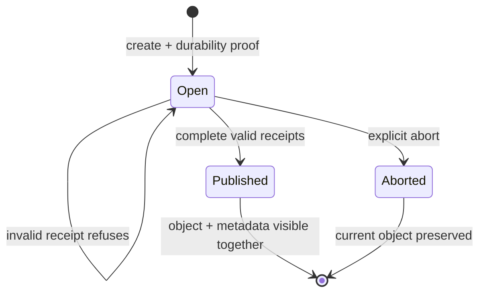

<!-- Copyright 2026 Cellar Project Authors. Licensed under Apache-2.0. -->

# Native Blob uploads

Access a declared bucket with `Context::blob`. All mutations retain native turn
checks and the cell's Blob durability gate. Blob objects and business SQLite
state have separate commits; persist references and reconcile uncertain results.

## Choose an upload contract

| API | Identity and parts | Completion |
| --- | --- | --- |
| `put` / `put_stream` | One invocation supplies the object | Returns stored metadata or an unmet condition |
| `create_multipart` | Process-owned append pipeline; pending parts can be replaced | Requires the already-flushed part order |
| `create_resumable_multipart` | Backend-owned upload ID; indexed parts can be replaced across clients/processes | Requires consecutive part numbers starting at 1 and their current, nonempty receipts |

The resumable API backs the optional [Workers R2 backup subset](../../../../packages/cellar-cloudflare/r2.md).
Its published gateway uses native storage; complete helper backup/restore and
Cloudflare production profile qualification remain open.



## Resume from durable application state

```rust
use cellar::sdk::{blob::WriteOptions, Context};

async fn create(ctx: &Context) -> anyhow::Result<()> {
    let bucket = ctx.blob("BACKUPS")?;
    anyhow::ensure!(bucket.supports_resumable_multipart()?);
    let upload = bucket
        .create_resumable_multipart(ctx, "backup.zst", WriteOptions::default())
        .await?;
    let first = upload.upload_part(ctx, 1, b"backup bytes".to_vec()).await?;

    // Persist upload.upload_id() and first.etag in cell state for a later event.
    let resumed = bucket.resume_resumable_multipart("backup.zst", upload.upload_id())?;
    let object = resumed.complete(ctx, &[first]).await?;
    assert_eq!(object.size, 12);
    Ok(())
}
```

Dropping a resumable handle leaves its upload available. Call `abort` explicitly
when abandoning it. Automatic expiry and orphan reconciliation remain delivery
requirements. Constructing a resumed handle performs syntax checks; backend
existence and current receipts are checked by its operations.

## Backend capabilities and bounds

| Backend | Indexed identity | Metadata initiation | Current qualification |
| --- | --- | --- | --- |
| Local development SQLite | Persistent upload/part rows | Supported | Native API, process restart, replacement, receipt refusals and atomic completion/abort |
| S3 / GCS low-level client | Provider-owned IDs | Missing in pinned `object_store` API | Metadata-bearing native Blob profile refuses before allocation; cloud qualification pending |
| Azure | No declared resumable client | Undeclared | Refuses this capability |
| Supplied host client | Explicit `ResumableMultipartStore` | Client declaration | Must qualify its own persistence, receipts and uncertain outcomes |

- Native buffered parts obey `blob.max_multipart_backlog_bytes`; completions
  accept 1–10,000 consecutive receipts.
- The local backend's object size is bounded by SQLite's incremental BLOB API.
  Publication copies 128 KiB at a time in one transaction. Upload inputs remain
  caller-owned buffers; this is not an aggregate upload-memory guarantee.
- A failed completion response may follow publication. Do not automatically
  repeat create or completion, infer rollback, or erase an unresolved intent.
  Failure to observe the same completed version/ETag remains an error.

See the [native API](mod.rs), [backend capability](../../storage/object/multipart.rs),
[process and resource controls](../../storage/object/local_store_multipart_tests.rs)
and [durability integration](../../tests/native_blob.rs).
