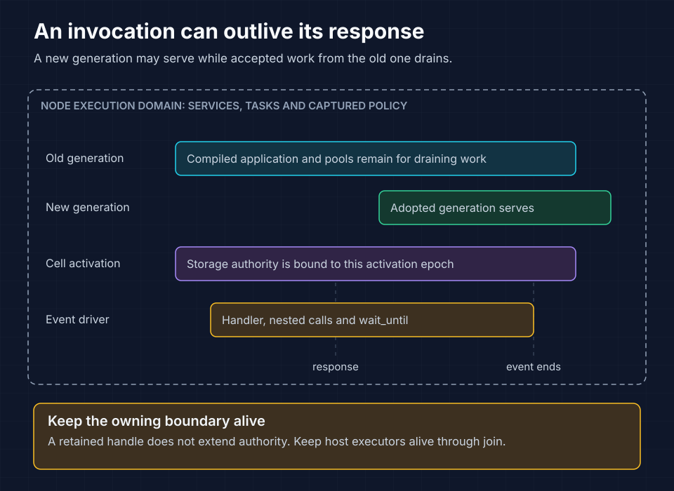

# SDK contracts, concurrency and lifetimes

Use `cellar::sdk` to define handlers and access runtime services. `Registry`
registers the root handler, entrypoints, cell factories and workflows. Keep
contexts and resource handles within their owning lifetimes, protect state with
transactions and attach background work to the event driver.

`Cell::invoke` and `Application::invoke` take `Arc<Self>`, a `Context` and an
`Invocation`, returning `HandlerFuture<Output>`. Factories compile into your
application executable.

Read the bars as overlapping lifetimes, not fixed durations. A response can
finish before its event driver; generation adoption can happen while that
accepted work drains. Keep every handle within its owning boundary.

## Event and output contracts

`Invocation` includes `Fetch`, `Rpc`, `CellRpc`, `Queue`, `Scheduled`, `Alarm`
and WebSocket open/message/close events. `Output` includes `Http`, `Bytes`,
`Rpc`, `Queue`, `WebSocket` and `Done`. Handle the events supported by your
contract explicitly. Returning `Done` for an unsupported event is appropriate
only when ignoring it is intentional; a business command should expose a
defined error.

`Context` provides binding access and the executing event's authority. An
invocation context must belong to the installed turn and originating execution
domain. Cell contexts also require the current activation epoch. The framework
rejects contexts from retired events, retired activations or closed domains.

| Handle | Intended use | After its boundary ends |
| --- | --- | --- |
| Namespace/service binding | Retain a binding and pass the current context per call | Cross-domain calls are rejected |
| Storage and cursors | Operate on the owning cell activation | Retired activation authority is invalid |
| Transaction view | Use inside its callback | Committed or rolled-back view refuses use |
| Event `Context` | Use while that event or its tracked background work executes | Retired event context refuses work |
| Socket/body/facet capability | Use with its owning context/lifetime | Cancellation and retirement release resources |

Never cache a request's `Context` globally for later unrelated invocations.
In-memory fields are transient and can be lost on eviction, recovery or upgrade.
Persist facts needed for correctness.

## Protect an invariant

Use `Storage::transaction_sync` for a short synchronous state change or
`Storage::transaction(&context, callback)` for an asynchronous transaction.
`Context::block_concurrency_while` holds the relevant input gate for a critical
section. Avoid expensive computation or external network calls in protected
sections; they increase contention and can block progress. Do not hold a Rust
synchronous mutex across `.await`.

Admission limits bound concurrent work; transactions protect state invariants.
Size admission for the complete call shape:

- Stateless limits apply per script pool, including draining generations.
- Background work retains its event slot after the response.
- A parent call retains admission while its nested calls settle.

Set finite limits and test nested calls under saturation.

## Background work and stopping

`Context::wait_until` attaches work to the event driver. It participates in the
application-event drain even after the response. It is useful for bounded
post-response work; persist intent and schedule a durable mechanism when that
work must survive a process failure. A response does not prove background work
completed. Arbitrary tasks spawned outside Cellar's event lifecycle remain the
application's responsibility.

Retirement counters include failure and cancellation; they are progress signals,
not durability receipts. Inspect `ShutdownReport` and `NodeOutcome` for proof
and failure information. See [embedded host](10-embedding.md) and
[shutdown flow](diagrams/shutdown-flow.svg).

Sources: [contracts and context](../crates/cellar/application/mod.rs),
[transactions](../crates/cellar/application/storage/transaction.rs),
[runtime policy](../crates/cellar/runtime/policy.rs), [SDK](../crates/cellar/sdk.rs).
