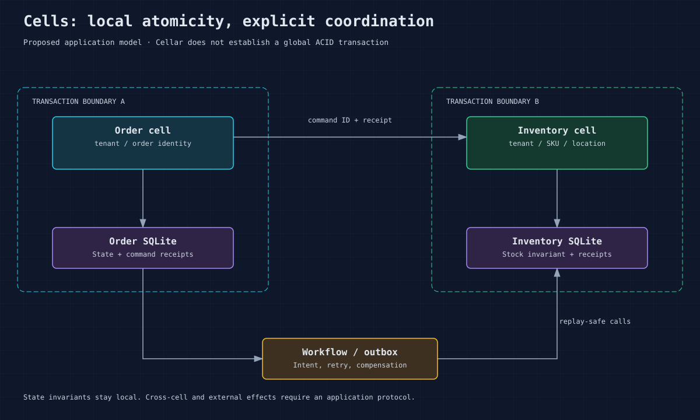

# Storage, transactions and schema changes

A cell's storage belongs to its activation. Obtain it with `context.storage()`.
The SDK exposes JSON and structured values, multi-key operations, bounded lists,
lazy cursors, SQL, transactions, alarms and an explicit `sync` durability wait.
The SQL binding is a separate bound database surface; do not confuse it with
direct access to the current cell's SQLite state.

Retained handles also require their original execution domain. Ordinary storage
access and commit recheck admission even within an already-entered callback.
Forced domain closure refuses new access and rolls back an unfinished transaction
at commit; cleanup may still roll back through the original connection.



For the complete producer/consumer contract and outcome handling, see
[outbox, streams and subscriptions](26-event-delivery.md).

## Local atomic updates

This handler fragment atomically records a command receipt and mutation. It
uses actual `Storage` methods; integrate it into your cell's authenticated
command handling and validate the command ID before use.

```rust
let storage = context.storage()?;
let receipt_key = format!("commands/{command_id}");
let result = storage.transaction_sync(|tx| {
    if let Some(result) = tx.get_json(&receipt_key)? {
        return Ok(result);
    }
    let current = tx.get_json("count")?
        .and_then(|v| v.as_u64()).unwrap_or(0);
    let next = current.checked_add(1)
        .ok_or_else(|| anyhow::anyhow!("counter overflow"))?;
    let result = serde_json::json!({"count": next});
    tx.put_json("count", &serde_json::json!(next))?;
    tx.put_json(&receipt_key, &result)?;
    Ok(result)
})?;
```

Store the request digest with the receipt in a real application. Reuse of one
ID with a different command must fail rather than return another command's
result. Define receipt retention longer than the supported client retry window.
Deleting deduplication state changes the replay guarantee.

Asynchronous transactions reserve root slots in call order; nested children
settle before the boundary commits or rolls back. Errors/panics roll back,
and escaped views refuse access after termination. Synchronous helpers cannot
start asynchronous transaction blocks. Use parameterized SQL and bound values
for untrusted inputs. Close or drop cursors promptly and cap scans.

## Durability and external side effects

A local SQLite commit and an externally acknowledged durable result are
different events. LTX captures committed writes, and output gates prove the
required write position and ownership. Never bypass framework egress or return
a fabricated success when a gate/proof fails. Explore
[write durability](diagrams/write-flow.svg).

For an arbitrary external service, persist a uniquely identified intent with
the state mutation and preserve its idempotency key through delivery/recovery.
No atomic transaction spanning SQLite and an arbitrary external service is
established by this framework.

## Framework stream delivery under implementation

The repository implements a framework outbox for durable stream destinations.
It remains under development with open fleet/release qualification gates; see
the [implementation status](../plans/outbox-implementation-status.md) and the
[runnable stream example](../examples/durable-streams/README.md). A deployed
stream binding currently requires a bucket-backed node or fleet, replicated
storage and durable wake discovery. SQLite-only nodes without that recovery
infrastructure refuse activation.

Define a typed `Event` with a stable family/version and routing key, then resolve
its declared binding through `context.stream::<YourEvent>("EVENTS")`. Binding
flags authorize new publication and the receiver independently checks current
durable resource grants. The producer's short transaction API is:

```rust
let db = context.storage()?;
let events = context.stream::<OrderConfirmed>("EVENTS")?;
db.tx(|tx| {
    tx.put_json("order", &serde_json::to_value(&order)?)?;
    tx.emit(&events, order)?;
    Ok(())
})?;
```

`tx.emit` inserts a framework-owned obligation in the same cell database. It
does not contact the stream inside the transaction. Rollback removes business
state and the obligation together. The response's output gates prove state and
the recoverable obligation; eventual append is a separate result. Caller retries
still need business command receipts or another explicit idempotency guard.
The same atomicity applies to cell-local SQL through `tx.sql`. A separate SQL
binding is another database: updating it and emitting from the caller's outbox
would not form one atomic transaction.

Consumers obtain a subscription batch with `subscription.next`. Fetch does not
advance the checkpoint. Compose each local effect with its inbox receipt:

```rust
for record in &batch.records {
    db.tx(|tx| {
        if tx.inbox("order-projection-v1")?.accept(record)? {
            let event = record.event.decode::<OrderConfirmed>()?;
            // Apply validated business effects using this transaction.
            tx.put_json(&format!("orders/{}", event.order_id),
                &serde_json::to_value(event)?)?;
        }
        Ok(())
    })?;
}
db.sync().await?;
batch.ack(&context).await?;
```

The explicit sync proves local effects before the remote checkpoint changes.
Replay after a lost ack or retry sees retained receipts and suppresses those
effects. Ack uses the exact batch receipt; stale/reset/expired processing
authority has typed results. `batch.retry` releases a delivery for later
processing and `extend_until` uses an absolute bounded lease deadline. Local
inbox protection lasts while receipts are retained; explicit pruning ends it.
External effects still require their own idempotency protocol.

Host event RPC failures expose `DeliveryError`: `Unavailable` for refusal before
submission or a connection that never reached its peer, `OwnershipLost` for
fenced/stale authority, and `Ambiguous` when a submitted result is lost or its
output proof fails. Ownership loss does not undo a commit. Retain the same
operation, fetch or acknowledgment receipt when retrying under that protocol;
ordinary RPC does not automatically replay an ambiguous request.

Streams expose bounded reads and resumable cursors. Retention can expire
optional readers or backpressure producers behind required subscriptions.
Do not promise unlimited history or assume a sealed source proves that unseen
producers are quiescent. Use the [owner-routed controls](23-cli-reference.md) for
inspection, guarded retries, subscription changes and audited retirement.

## Migrations and data retention

Reserve `__sys_` for framework tables. Version application schemas explicitly.
For rolling releases, prefer expand → deploy compatible readers/writers →
backfill in bounded batches → observe → contract after rollback eligibility ends.
An old executable cannot safely roll back an incompatible data transformation.
Use the SQL binding's migration API where appropriate; cell-local migrations
need a tested application convention.

Bound payload sizes, command receipts, history and pending outbox rows. Record
growth rates and retention in the service contract. A small counter benchmark
does not establish large-database restore behavior. Never mutate persisted
SQLite behind a live owner: use SDK or authenticated owner-routed operator
commands. See [backup and restore](18-recovery-backup.md).

Sources: [storage](../crates/cellar/application/storage.rs),
[transactions](../crates/cellar/application/storage/transaction.rs),
[SQL binding](../crates/cellar/application/sql.rs), [LTX](../crates/cellar-ltx/README.md).
