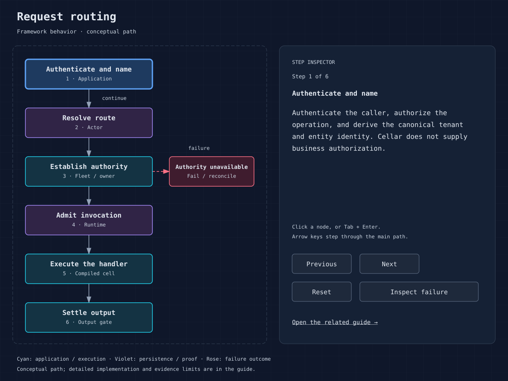
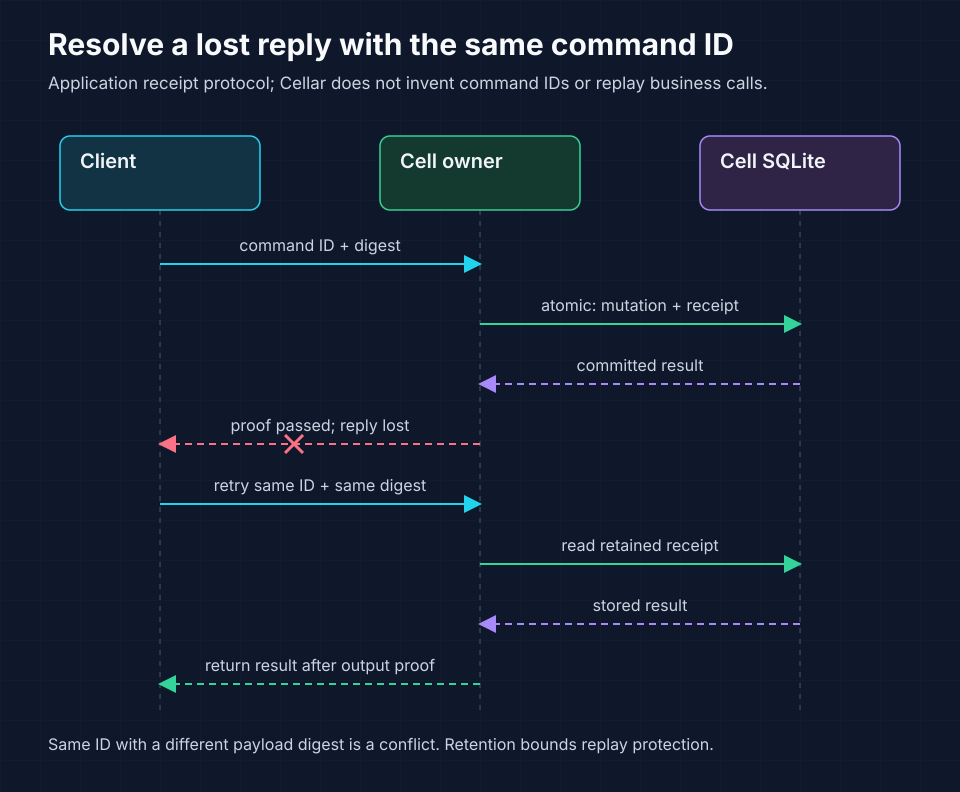

<!-- Copyright 2026 Cellar Project Authors. Licensed under Apache-2.0. -->

# Routing, RPC and command contracts

Call cells through a declared namespace so Cellar can route each request to
its authoritative owner. Use HTTP-shaped fetch calls or structured remote
procedure calls (RPC), with explicit identity and retry contracts for requests
whose results may be lost.

`Context::namespace` resolves the binding. `get_by_name` selects a stable named
cell; `id_from_name`, `id_from_string` and `get` support explicit IDs. Bindings
and identity configuration must match the compiled classes.



## Route authority

The actor resolves ownership and can dispatch locally or through an
authenticated peer path. Conditional bucket writes establish cell ownership.
Ownership carries an epoch, so stale completions and handles cannot authorize
a new activation. A cached route is a hint with lifecycle controls; it is not a
second source of authority.

`ActorPolicy::max_cached_routes` limits idle, unowned routing history. Zero
disables that cache. Owned cells, alarms, queued calls and unfinished work keep
their records independently. Route-cache size does not bound residents or
whole-process memory. Applications select this policy explicitly; the CLI
defaults to 2,048.

A placement route carries the exact peer load-sample timestamp used to select
its epoch-zero candidate. The dispatcher returns that timestamp with a capacity
refusal even if the idle route has already been evicted. The core then excludes
the rejected sample without retaining per-cell history. A delayed refusal cannot
invalidate a newer sample's route or reservations, or act as an ownership epoch.

## Choose the call shape

| Surface | Appropriate use | Contract to define |
| --- | --- | --- |
| Cell `fetch` | HTTP-shaped entity interface | Method, route, body bounds, status and response schema |
| Cell `rpc` / `call` | Structured internal entity operation | Method, argument/result schema, remote errors |
| Generated typed cell client | Named unary business methods across languages | Protobuf service/messages, exact contract digest and command receipts |
| Service `fetch` / `rpc` | A declared application/entrypoint boundary | Service version, capabilities, props and authorization |
| Outbound `Context::fetch` | External HTTP service | Deadline, idempotency and ambiguous outcomes |

Use `encode_rpc`, `decode_rpc` and `decode_rpc_result` for the framework's
structured value and remote-error envelopes. The structured decoder has a
64 MiB ceiling; set lower business payload budgets. Service capabilities retain
their originating execution domain, and copied props are subject to its loader
policy. Cancellation-aware variants are available on cell and service calls.

The [named, typed RPC design](../plans/009-named-typed-rpc.md) defines Protobuf
contracts and generated cell clients/handlers for Rust, JavaScript/TypeScript
and Python over this native path. Named unary APIs run across all four backends
through local and authenticated-peer routes;
[runnable fixtures and qualification commands](../tools/rpc/README.md)
show generation, explicit registration and receipt recovery. Remote routing,
failure, schema and packaging qualification remain open in the
[implementation ledger](../plans/named-typed-rpc/implementation-status.md).

Check generated metadata before starting a node:

```sh
cellar rpc check --descriptor generated/contracts.binpb --inventory generated/rpc.json
```

The [offline checker](23-cli-reference.md#offline-typed-rpc-checks) validates the
descriptor and exact generated digest, methods, limits and codec types. Add a
native catalog snapshot with `--catalog` to check complete service registrations.
This checks local metadata; the runtime still validates live codecs, invocation
authority and output proof on actual calls.

Typed Rust calls start their timeout budget before request encoding. Native
local dispatch carries that deadline into the target invocation. Peer dispatch
sends the remaining duration and the receiver caps it with its own host policy
before reading the body; nested typed calls cannot extend it. Expiry refuses new SDK access, cached storage writes
and transaction commits, while transaction rollback can still clean up the
original connection. A timeout after submission leaves the effect outcome
unknown. The deadline fixture verifies native remote/nested calls and receiver
caps. Broader cancellation, failure provenance and full guest/lifecycle qualification
remain open in the ledger.

Native RPC signals are watched by the host independently of application turns.
Processed cancellation permanently revokes the invocation's SDK authority,
including cached storage writes and commits, and reaches pending nested calls.
Queued RPCs can leave worker/input-gate admission without waiting for that gate
to open. Rollback remains available on the original connection. Cancellation
after submission is `Cancelled/unknown`; a write synced beforehand can survive.
Completed callees detach from their caller's cancellation tree so valid
background work keeps its own lifetime. Full guest cancellation controls and
proof/lifecycle qualification remain open.

### Native result lifetimes

Native adapters can attach `sdk::rpc::Lease::for_context(&context)` to a raw
`RpcData` result with `with_lease`. This retains the producer's original event
under its existing lifetime limits. The finite value and lease travel through
the native RPC route, including the authenticated peer tunnel.

| Action | Result |
| --- | --- |
| Clone a lease | Share ownership of the same result lifetime |
| Drop the last alias or call `close()` | Release the transport and notify the producer |
| Retire/cancel the producer or stop its execution domain | Revoke retained aliases |
| Decode with a value-only codec | Refuse the result instead of discarding its lifetime |

A lease grants no SDK authority. The optional Workers adapter builds returned
function stubs above it, dispatching through the original native event with
bounded handles/mailboxes, disposal and producer-side output proof. Returned
`RpcTarget`, callback arguments and streaming RPC still require further work.
The peer format bounds the finite value at 64 MiB; adapters must impose their
own tighter profile budgets. Closing a result does not roll back earlier effects.

## Design for ambiguous responses



The first mutation may commit even when the reply is lost. Retrying the same
command identity lets the application return its stored result without applying
the mutation again. Cellar still checks output proof before releasing that result.

The following is a proposed application protocol, not a built-in envelope:

```json
{
  "api_version": 1,
  "command_id": "tenant_scoped_command_id",
  "expected_version": 7,
  "operation": "reserve",
  "payload": {"units": 2}
}
```

Authenticate the caller, derive the tenant and cell, validate the payload, then
atomically compare/store the command digest, mutation and result. A duplicate
ID with the same digest returns the receipt; a different digest is a conflict.
An expected version is an application optimistic-concurrency convention.

A timeout, connection loss, fencing or failed durability proof does not imply
the business mutation never happened. Query the command status or retry with
the same ID. Retry only failures permitted by the contract, with bounded
attempts, backoff, jitter and an overall deadline. Avoid retry amplification
across multiple call layers. Validation and authorization failures should not
be retried without a change in input or authority.

## Dependency cycles and rollout

Keep the service call graph shallow. A call chain retains upstream request
slots while downstream calls settle; cycles and mutual waits can exhaust
admission. Exercise nested calls with the actual configured limits. Record
version compatibility, error mapping and retry ownership in the
[service contract](templates/service-contract.md). Deploy additive changes
before consumers require them, and retain old readers during rolling upgrades.

Sources: [cell stubs](../crates/cellar/application/cells.rs),
[services](../crates/cellar/application/service.rs), [actor](../crates/cellar/actor/mod.rs).
