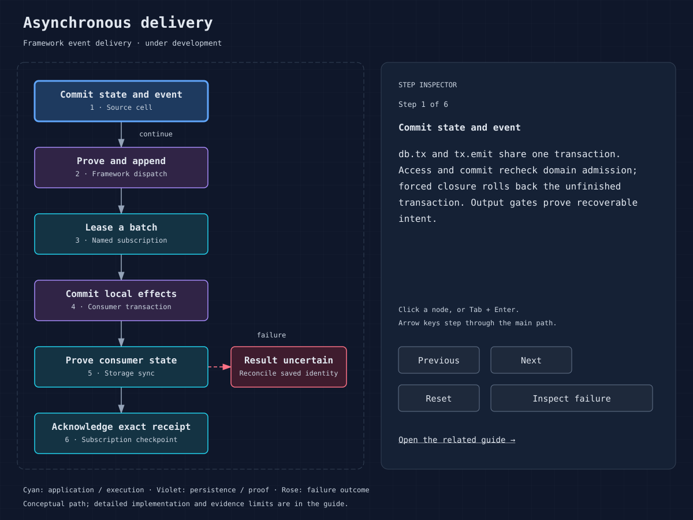

# Alarms, queues, workflows and scheduled work

Choose the mechanism from its durability and coordination needs. The SDK has
alarms, durable wake infrastructure, Queue, Workflow and cron. Application teams
still define business delivery guarantees, deduplication and external effects.

The [transactional outbox and durable event delivery design](../plans/002-outbox-streams-subscriptions.md)
has a native implementation under development: `db.tx`/`tx.emit`, ordered stream
reads, resumable subscription leases and atomic consumer inbox receipts. The
[stream example](../examples/durable-streams/README.md) runs those APIs through a
bucket-backed node. Open fleet/release qualifications remain explicit in the
[implementation status](../plans/outbox-implementation-status.md); this is not a
released production guarantee.



| Mechanism | Use it for | Correctness boundary |
| --- | --- | --- |
| `Context::wait_until` | Bounded work attached to an event after its response | Participates in drain; no crash-survival guarantee by itself |
| Cell alarm | A persisted cell-local deadline | Handler must tolerate failure/re-execution |
| Durable wake discovery | Discover cells with persisted wake/alarm obligations | Framework recovery and ownership cover wake lifecycle |
| Framework outbox + stream | Commit business state and an event obligation together, then consume with replay | One source database is atomic; append/ack are separate durable operations; inbox protection lasts while receipts are retained; under implementation |
| Queue | Decouple producer and consumer throughput | Define ack, retry, deduplication, poison-message handling |
| Workflow | Multi-step durable business process | Stable replay and external-effect idempotency |
| Cron | Periodically create/check work | Invocation is not proof of one completed business job |

## Cell alarms

Use `Storage::set_alarm` with an absolute millisecond timestamp and handle
`Invocation::Alarm { scheduled_ms }`. `get_alarm` and `delete_alarm` inspect or
clear it. Persist work state and schedule changes consistently with your
business mutation. On invocation, load durable state, determine what remains,
and finish, retry with a bounded policy, or record terminal failure.

An alarm is not a hard real-time SLA. Delays can include ownership recovery,
load and dependency outages. Define overdue-work metrics and reconciliation.
Alarm/wake coverage must survive eviction and shutdown; do not discard the
record because a cell is idle.

## Queue settlement

The producer exposes `send`, `send_value`, `send_batch` and `metrics`.
Consumer `queue::Event` provides messages, queue identity and settlement methods.
Messages expose `ack` and `retry`; events expose `ack_all` and `retry_all`.
Read the configured consumer policy and test its retry behavior instead of
assuming a universal delivery count or exactly-once execution.

Give business messages stable IDs. Commit a consumer receipt with its local
state change before acknowledging. External calls require receiver idempotency
or reconciliation. Classify a poison message, retain enough evidence to inspect
it, and define the application's quarantine/manual-replay path. A quarantine
table and replay tool are proposed application features, not a documented
automatic dead-letter service.

## Workflows and cron

Register workflow handlers through `Registry::workflow`. Workflow instances
support creation, status, event delivery, pause/resume, restart, termination and
deletion. Replay uses named recorded steps; keep step names and meaning stable
for running instances. Test old instances after a new executable is deployed.
Capture nondeterministic decisions through the durable step mechanism rather
than recomputing them on replay. An external step may run and lose its response;
use stable receiver-side keys.

The workflow handler receives `workflow::Step`. Use `step.run(name, callback)`
for a recorded step, or `step.run_with(name, config, callback)` to set retries
and a timeout. Rust reserves `do`, so `run` is the equivalent of Cloudflare's
`step.do`. Duration strings can be passed directly to `sleep` and configuration
builders:

```rust
let config = StepConfig::default()
    .retries(Retries::new(3, "5 seconds"))
    .timeout("1 minute");
let result = step.run_with("prepare", config, move |_| async move {
    Ok(params)
}).await?;
step.sleep("delay", "1 minute").await?;
let approval = step.wait_for_event(
    "approval",
    WaitOptions::new("approve").timeout("1 hour"),
).await?;
```

Import `StepConfig`, `Retries` and `WaitOptions` from `cellar::sdk::workflow`;
`params` in this fragment is a `StructuredValue`. Passing just an event-type
string to `wait_for_event` uses the default 24-hour timeout. The previous
three-argument call is now `wait_for_event_with_timeout(name, type, timeout)`.
`Steps`, `do_step` and `do_with_config` remain compatibility names. These API
changes preserve journal step kinds, occurrence counts and replay behavior.

`Workflow::create_batch_with` accepts `BatchCreateOptions::Count` with shared
parameters or `BatchCreateOptions::Instances` with per-instance options. It
returns `BatchCreateResult { created, errors }`; each error identifies its input
index and instance ID. Duplicate input IDs use code `10415`, and existing
instances use `10405`. Invalid options fail preflight before any instance is
created. The existing `create_batch(Vec<CreateOptions>)` remains available.

Register compensation with `step.run_with_rollback(name, config, callback,
RollbackOptions::new(handler).config(rollback_config))`. The handler receives
the failed workflow's error, its step attempt context and the forward output
when available. On an uncaught workflow error, compensations run in reverse
step-start order. Their retries and completed checkpoints survive reactivation.
`instance.terminate_with_options(ctx, TerminateOptions { rollback: true })`
also requests compensation. Status remains `Running` during rollback and then
includes a `rollback` report with outcome `complete` or `failed`. Callbacks are
registered again by replaying the workflow code; retain the code and handler
registrations required by active journals. Compensation calls need stable
idempotency keys, just like forward effects.

For binary results, `step.run_stream` captures a fresh, unlocked `ByteReadable`
in bounded SQLite chunks. It returns an invocation-owned `StreamOutput` with
`next(ctx)` and `into_readable(ctx)`. Replay opens a fresh reader over the saved
bytes. `instance.step_stream(ctx, StepSelector::new(name))` retrieves a
completed stream from another invocation; `count` selects repeated occurrences.
Stream retries remove partial captures before recapturing. The host's default
aggregate stream budget per instance is 1 GiB. `run_stream_with_rollback` exposes
the saved stream through `RollbackContext::stream_output(ctx)`. A sensitive
step redacts its output from history and remote stream access.

`instance.subscribe(ctx, SubscribeOptions { cursor, filter })` provides ordered
historical and live events. `next().await` returns an `InstanceEvent`, or `None`
once the terminal history has been consumed, including when the filter excludes
the terminal event. Cursors are exclusive event IDs and can resume from saved
positions. `close()` ends a subscription; readers remain bound to their opening
invocation and fail if its authority retires. The history and checkpoint are
written in the same transaction and use the ordinary output gate.
Pre-existing journals keep their recorded results; history begins with mutations
made by the extended implementation, without backfilling older execution events.

Native workflow binding configuration accepts `default_retention` and
`schedules`. Per-instance retention overrides the binding default; otherwise
the default is 30 days. Successful and terminated instances use success
retention; errored instances use error retention. For example:

```json
{
  "type": "workflow",
  "name": "REPORTS",
  "workflow_name": "reports",
  "class_name": "Report",
  "default_retention": { "success_retention": "7 days", "error_retention": "30 days" },
  "schedules": ["0 9 * * *"]
}
```

Scheduled workflows receive `Event::schedule` with the cron expression and
`scheduled_ms`. The cron cell derives a stable instance ID from the expression
and scheduled timestamp so a retried trigger reuses the instance. Embedded
hosts supply the same settings through `WorkflowBinding::settings`. Each node
runs its primary deployment's schedules. Referenced applications run theirs on
nodes started with that deployment. Workflow packages retain `workflows-v1`
while Cellar is in internal development. These Rust APIs follow the Workers API
capabilities described by [Cloudflare](https://developers.cloudflare.com/workflows/build/workers-api/).
Cloudflare's JavaScript runtime, REST service, billing and account limits are
separate platform contracts.

Cron reaches `Invocation::Scheduled` with `cron::Scheduled`; `no_retry` can
decline retry. Use a job/time-window ID to deduplicate application jobs and
design a catch-up policy for downtime. Avoid assuming a schedule can replace
an audit of missed business work.

Before releasing async work, test crash before/after state commit, after the
external effect and before receipt/ack; recovery with pending alarms; workflow
version change; duplicate delivery; and a dependency outage beyond the retry
budget. Sources: [Queue](../crates/cellar/application/queue.rs),
[Workflow](../crates/cellar/application/workflow.rs),
[replay](../crates/cellar/application/workflow/replay.rs),
[alarms](../crates/cellar/application/storage.rs), [cron](../crates/cellar/application/cron.rs).
## Visual definitions and execution inspection

Workflow bindings may include a `definition` alongside their compiled class.
This is an explicit diagram supplied by the builder, not executable workflow
code or an automatically inferred control-flow graph:

```json
{
  "version": "reports-v1",
  "nodes": [
    {"id": "prepare", "label": "Prepare report", "kind": "activity", "step": "prepare-report"},
    {"id": "publish", "label": "Publish report", "kind": "activity", "step": "publish-report"}
  ],
  "edges": [{"from": "prepare", "to": "publish", "label": "ready"}]
}
```

Supported node kinds are `start`, `activity`, `decision`, `parallel`, `sleep`,
`wait` and `end`. A node's optional `step` maps to an exact durable step name;
branch labels describe possible paths. Repeated step occurrences are distinct
in execution history. Definitions allow 128 nodes, 256 edges and 64 KiB encoded
JSON. IDs and step mappings must be unique and edge endpoints must exist.
Bindings aliasing the same workflow name must agree on its definition.
Definitions are visible to fleet metadata readers; do not put secrets in them.
See the [workflow example](../examples/workflow/project.json) for a full diagram.

Creation and restart snapshot the receiving activation's definition and SHA-256
content digest into the instance's SQLite state in the same transaction as the
queued event. Each new history event includes its execution generation. Later
deployments cannot change those snapshots; a restarted execution captures the
then-loaded definition. The dashboard separates runs, displays their retained
snapshots and keeps the current binding definition available before any run.
A declared version is a human label; the digest distinguishes edited content
with the same label. This does not pin an executable or implement side-by-side
code versions. Continue to preserve replay compatibility for running instances.

The inspector shows recorded workflow parameters, results, step outputs, retries,
waits, errors and compensation events. To record a step input explicitly, pass
`StepConfig::default().input(value)` to `step.run_with`. Closure captures are not
inspected, and omitted inputs appear as **Not recorded**. `sensitive: true`
redacts this inspection input as well as the step output in history. It does not
redact independently supplied workflow parameters or values returned as the
workflow's final result. Apply the same care to those values and error messages.
Non-JSON structured values retain an encoded structured-clone representation
without obscuring the surrounding event metadata.

History is paged through the owner and remains subject to instance retention;
snapshots are removed when the instance is cleaned up or deleted. Legacy events
without generation metadata remain explicitly unversioned. The browser retains
up to 256 events and a bounded payload window, reports clipped/partial history,
and shows observed event order without inventing dependencies between parallel
activities. Loading another page never replays workflow work.
