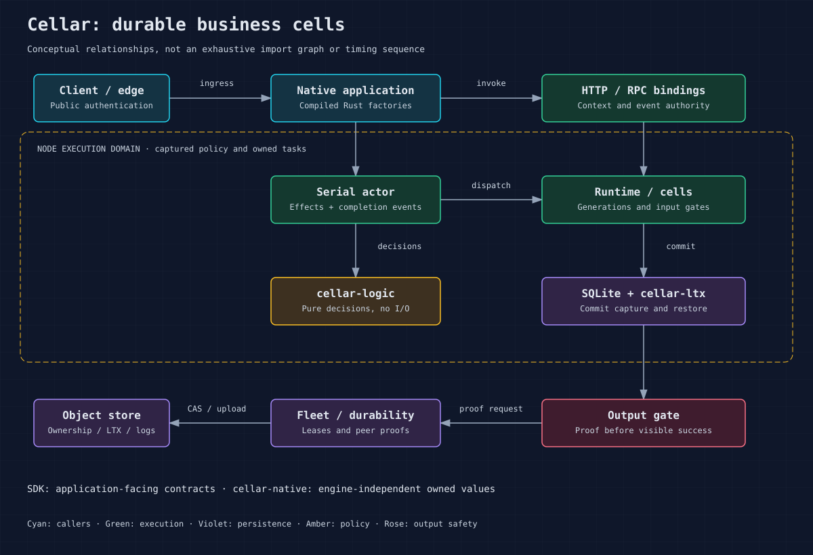

<!-- Copyright 2026 Cellar Project Authors. Licensed under Apache-2.0. -->

# Configuration and policy reference

Set resource limits and runtime policies before starting a node. Embedded
hosts use Rust policy objects; the CLI reads environment settings at startup.
The tables below distinguish their defaults and explain which limits remain
when you select the unrestricted profile.



## Library defaults

| Policy / field | Default | Meaning |
| --- | --- | --- |
| `RuntimePolicy.max_stateless_workers` | 4 | Workers per script pool |
| `max_stateless_requests` | `Some(64)` | Admitted events per script pool; background work retains slots |
| `max_cells_per_worker` | 32 | Residents sharing one worker |
| `max_cell_requests` | 64 | Concurrent fetch/RPC admission per cell |
| `max_outbound_rpc_requests` | 128 | SDK namespace RPCs retained across all host generations |
| `max_outbound_rpc_bytes` | 256 MiB | Length-weighted SDK request/copy/control allowance; minimum 128 KiB |
| `max_inbound_rpc_requests` | 128 | Receiving peer RPCs, including upload, native work, output waits and retained replies |
| `max_inbound_rpc_bytes` | 256 MiB | Shared dense input, possible copy, control and published reply payload allowance; minimum 128 KiB |
| `max_inbound_rpc_tunnels` / `max_rpc_tunnels_per_peer` | 256 / 64 | Receiving RPC connections across the host / per authenticated peer name |
| `rpc_tunnel_idle_timeout` | 30 s | Receiving RPC upgrade/idle/ready-reply write interval; caller deadlines can shorten writes |
| `admission_wait` | 1 s | Saturated stateless pool wait; zero rejects immediately |
| `handler_budget` | 300 s | Handler response budget; excludes subsequent background/proof settlement |
| `HttpPolicy.request_timeout` | 120 s | SDK HTTP deadline, including response-body consumption |
| Lower-level host operation deadline | 15 s | Used when actor policy was not configured; first Queue-policy use pins it |
| `NodeServices.http_client` | `None` | Default HTTP builder ignores ambient proxies; supply a factory for host transport settings |
| `AssetCacheOptions.directory` | Required | Caller-selected asset cache directory; no process default |
| `AssetCacheOptions.max_bytes` | 512 MiB | Best-effort cache cleanup target; open files and failed removals can retain more |
| `AssetCacheOptions.max_file_bytes` | 25 MiB | Serving and fallback-index per-file ceiling, fixed for this cache |
| `LoaderPolicy.max_workers` | 256 | Loaded-worker limit per host |
| `max_workers_per_principal` | 255 | Shared script/generation principal limit |
| `max_environment_bytes` / `max_props_bytes` | 1 MiB each | Encoded values; environment includes service route metadata |
| `ShutdownPolicy.total_ms` | 40,000 | Absolute semantic stop budget |
| `token_wait_ms` / `no_progress_ms` | 30,000 / 25,000 | Token wait and stall window within the absolute budget |

These are source defaults, not recommended production sizing. The structured
decoder caps encoded values at 64 MiB, and loader budgets must not exceed it.
Choose lower business-specific bounds where appropriate.

SDK RPC submission reserves both host quotas before waiting for its source
durability gate or entering the routing queue. Saturation refuses immediately.
A valid typed call receives `ResourceExhausted/not_committed` for that refused
child call; a caller's earlier writes keep their own outcome. There is no
automatic replay. A reservation follows queued/routed work, any local native
driver and an unconsumed reply until the last owner retires, including after
caller cancellation. Reply and shutdown control paths do not acquire this quota.

The byte allowance is twice the encoded payload length, four times the combined
scope/name/method UTF-8 length, plus 64 KiB for bounded control/frame copies.
It is not an RSS or exact allocator measurement: shared backing allocations,
spare capacity, response buffers, guest heaps and peer ingress retain separate
limits. Trusted direct host control requests use their existing admission.
`domain.services().outbound_rpc_usage()` exposes the two sampled counters for
cleanup checks. Configure quotas with `NodeConfig.runtime` or
`domain.services().configure_runtime(...)` before the first submission.

Receiving RPC tunnels reserve a host and per-peer slot before upgrade. The peer
name comes from the verified fleet signature. Entries retire with their last
connection. Upgrade and idle waits are finite; active upload/native work keeps
its existing deadline. Once a handler/proof result is ready, reply delivery is
bounded by this transport interval and the original caller deadline, whichever
is earlier. A stalled writer cannot keep its slots indefinitely. Ordinary
HTTP/fetch tunnels use their existing policies.

RPC upgrades advertise the receiving idle interval. A source caches the tunnel
only during the first half of that interval, measured from its original dial
with the source domain's clock. Clean reply retirement never renews this window;
an expired window retires the idle sender before another call is submitted.
Active exchanges can still finish normally. Missing, repeated or invalid idle
metadata refuses the upgrade before it can produce a business-call sender.
Receivers require exactly one compatible reuse-version capability before
reserving admission; mixed peers use a hard cutover under protocol marker 1.
This cache hint provides no retry or rollback authority: a lost submitted reply
still has an unknown outcome.

Each receiving RPC reserves request/control capacity before decoding authority
or reading its body. Uploads accumulate into one dense buffer: capacity is
reserved before growth, with an allowance for a second native/JSON copy. Tiny
chunks do not retain a list of frames; empty chunks yield so timers and other
replies can progress. Uploads without a declared RPC deadline still use the
receiving host's operation deadline. Existing framework authority headers fit
within the bounded 64-KiB HTTP parser. Cancellation, proof waits, native work
and retained replies keep their admission ticket until the last owner drops.
The ticket follows transport byte slices/clones after the HTTP body yields its
frame, without copying the payload. Cleanup uses the receiving domain's clock
even when a buffer retires in another domain or after its owner stops. Reply
write expiry closes the transport; a lost response still proves no rollback.

Published reply payloads share the same receiving byte allowance. An exact or
upper body length reserves capacity before response headers are sent. Actual
frame totals are checked too, so an absent or inaccurate length cannot bypass
admission. One merged reservation follows all frame clones and slices until
the final owner drops, including after domain shutdown. New frames also check
the original owner and delivery deadline. No extra payload copy is introduced.

A reply-capacity refusal can occur after a handler commits. Before headers it
returns `ResourceExhausted/unknown`; after headers the body fails instead of
ending successfully. Neither result permits automatic replay or establishes
rollback. Size the host allowance for concurrent input and reply ownership.

Receiver overload returns a fixed `ResourceExhausted/unknown` category over the
authenticated transport, without automatic replay. Its status/header pair does
not establish rollback; event calls preserve their ambiguous outcome. Refused
uploads close the connection so unread bytes cannot become another request.
`inbound_rpc_usage()` reports calls, per-request reserved bytes, tunnels and
peers. `reserved_request_bytes` includes input/copy/control and published reply
payload reservations; all retire after their final owners drop. These length
allowances do not measure shared backing allocations, decoded graphs, adapter
copies, allocator overhead or RSS. Durability acknowledgements and cancellation
endpoints retain their independent paths.

Install `ActorOptions` with `domain.services().configure_actor(&options)` before
building generations to select a different operation deadline. Queue leases and
actor settlement share that captured value. A live host rejects a different
deadline; library defaults ignore `CELLAR_OPERATION_DEADLINE_MS`.

## Lift cell API ceilings in an embedded host

`NodeConfig.cell_limits` captures KV, SQL, Blob, Queue and Workflow budgets for
every cell in that node. Its default preserves the existing API ceilings.
Select the unrestricted profile before starting the node:

```rust
use cellar::sdk::CellLimits;

config.cell_limits = CellLimits::unrestricted();
```

The same policy can be installed directly with
`domain.services().configure_cell_limits(limits)` before loading deployments,
building generations or opening storage. The first use pins the defaults when
no policy was supplied. A live host rejects a different policy; another host can
use different limits. Fleet owners should agree on limits for shared resources.

| API | Default ceiling | Unrestricted profile |
| --- | --- | --- |
| KV | 512-byte keys; 25-MiB values; 1-KiB metadata; 100 bulk keys; 1,000-entry list pages; 60-second TTL floor | Removes these compatibility ceilings and the TTL floor |
| SQL | Restricted SQLite connection; 100,000 materialized rows; 32-MiB result budget | SQLite's native compiled ceilings; removes materialized row/byte budgets |
| Blob | 1,000-entry list pages; 256-MiB multipart backlog | Removes the page/backlog ceilings; object size already depends on the backend |
| Queue | 128,000-byte messages; 256,000-byte sends; 100-message batches; 60-second batch timeout; 100 retries; 250 concurrent batches; one-day delay; four-day retention; 100-entry operator batches | Removes byte caps and age-based expiry; expands batches, delays and consumer settings to their numeric ranges |
| Workflow | 1-MiB values; 1-GiB aggregate captured streams per instance; 100-instance batches; 100-byte IDs/event types; 256-unit step names; 30-day retention maximum; one-year sleeps/event waits; 10,000 retries | Removes size/name/batch/duration ceilings; permits up to `u32::MAX` step retries |
| Cron / alarms | No trigger-count quota; cron uses minute resolution and one durable alarm multiplexes deadlines | No additional quota to remove; scheduling and retry semantics continue to apply |

The unrestricted profile still has backend and protocol limits. Structured
values/RPC retain the codec's 64-MiB encoded-value, nesting and graph bounds. SQLite retains its compiled
limits and storage isolation authorizer. Object stores retain their own listing,
multipart and object-size limits. Queue manifests retain `u16` batch, timeout,
concurrency and retry fields and `u32` delay fields; retries stop at 65,534 to
leave one representable final attempt. The CLI packaging adapters continue to
validate the default Queue ceilings; embedded hosts can use
`validate_queue_manifest_with_limits` with their explicit policy when validating
their own manifests.

Omitted KV/Blob page sizes still default to 1,000. Workflow retention inherits
its binding's `default_retention`, falling back to 30 days; request a larger
page or longer retention explicitly.
KV's 1-MiB inline threshold still routes larger values to object storage. Internal
sweep/grouping sizes and upload part sizes bound individual maintenance turns;
they do not cap total stored data. Request admission, response deadlines,
ownership, output gates and shutdown policy remain independent controls.

Individual budgets can also be raised or lowered:

```rust
let mut limits = CellLimits::default();
limits.kv.max_value_bytes = 48 * 1024 * 1024;
limits.sql.connection = None;
limits.sql.max_result_bytes = 48 * 1024 * 1024;
limits.queue.max_message_bytes = 4 * 1024 * 1024;
limits.queue.max_send_batch_bytes = 8 * 1024 * 1024;
limits.queue.retention_ms = None;
limits.workflow.max_value_bytes = 4 * 1024 * 1024;
config.cell_limits = limits;
```

Large values stored directly in SQLite also need an adequate SQL connection
budget. Streaming Blob uploads avoid materializing an entire object in RPC.
Source: [cell limits](../crates/cellar/application/limits.rs).

## Common CLI environment adapters

| Variable | Adapter / effect |
| --- | --- |
| `CELLAR_MAX_REQUESTS` | Stateless admission limit; **unset is unbounded in the CLI** |
| `CELLAR_MAX_STATELESS_ISOLATES` | Stateless worker count; CLI defaults to available parallelism |
| `CELLAR_MAX_CELL_REQUESTS` | Per-cell fetch/RPC admission |
| `CELLAR_MAX_OUTBOUND_RPC_REQUESTS` / `CELLAR_MAX_OUTBOUND_RPC_BYTES` | Host SDK submission count / length-weighted byte allowance; defaults 128 / 268435456 |
| `CELLAR_MAX_INBOUND_RPC_REQUESTS` / `CELLAR_MAX_INBOUND_RPC_BYTES` | Receiving RPC count / input capacity allowance; defaults 128 / 268435456 |
| `CELLAR_MAX_INBOUND_RPC_TUNNELS` / `CELLAR_MAX_RPC_TUNNELS_PER_PEER` | Receiving RPC tunnel count across the host / per verified peer; defaults 256 / 64 |
| `CELLAR_RPC_TUNNEL_IDLE_MS` | Receiving RPC upgrade/idle/ready-reply write budget; default 30000; valid 1..=4294967295 |
| `CELLAR_ADMISSION_WAIT_MS` / `CELLAR_HANDLER_BUDGET_S` | Admission wait / response budget |
| `CELLAR_ASSET_CACHE_DIR` / `CELLAR_ASSET_CACHE_BYTES` | CLI captures cache directory and cleanup target once; default directory is `asset-cache` under the node data directory |
| `CELLAR_MAX_ASSET_FILE_BYTES` | CLI captures the serving file ceiling; deployment builders use the same explicit environment adapter |
| `CELLAR_FETCH_TIMEOUT_S` | CLI captures SDK HTTP request timeout at startup |
| `CELLAR_OPERATION_DEADLINE_MS` | CLI captures the actor/Queue settlement budget before building generations; default 15,000 ms |
| `CELLAR_MAX_RESIDENT_CELLS` | Actor resident-cell limit |
| `CELLAR_MAX_CACHED_ROUTES` | Idle unowned route history; CLI default 2,048, zero disables |
| `CELLAR_LOADER_MAX_WORKERS` | Host loaded-worker limit |
| `CELLAR_LOADER_MAX_WORKERS_PER_PRINCIPAL` | Principal quota; CLI default derived from host limit |
| `CELLAR_LOADER_MAX_ENV_BYTES` / `CELLAR_LOADER_MAX_PROPS_BYTES` | Copied environment / properties budgets |
| `CELLAR_SHUTDOWN_TOTAL_MS` | CLI stop budget; subsidiary drain windows are derived |
| `CELLAR_OTEL` | Unset/0 disabled; 1 bucket; collector base URL selects OTLP |

Reject obsolete settings rather than assuming they are aliases.
`CELLAR_MAX_DYNAMIC_WORKER_CODE_BYTES`, old loader aliases and attempts to
disable the output gate are unsupported. See the
[environment parser](../crates/cellar/cli/environment.rs) for the complete
validated registry and removal messages.

## Fleet and infrastructure policy

`NodeConfig` also captures request-body limit, forwarded-header trust,
generation maximum age, startup recovery deadlines and maintenance cadence.
Public and internal listeners must differ. Local nodes require sticky eviction
ownership to retain their sole copy. Startup recovery backoff must cover the
lease TTL. Use the configuration validator rather than guessing combinations.

HTTP deadlines must be positive and at most `u32::MAX` seconds. The optional
`HttpClientFactory` selects DNS, TLS, credentials, proxies and pool settings.
Cellar applies required redirect policies and worker subrequest budgets.
Ordinary redirect modes reuse host pools; a redirect-limited invocation owns
its accounting client. The CLI explicitly selects reqwest's system-proxy
behavior, while library defaults ignore ambient proxy settings.

`DeploymentGraph::load` and direct asset resolver loading require an explicit
`AssetCache`. Cache construction performs no filesystem I/O. Use
`AssetCacheOptions::from_env` only in an environment-owning adapter. A zero
cleanup target removes cached paths after opening their response handles;
removal is best effort. Caller filesystems must implement atomic `create_new`
for publishing checked content. The deployment protocol still caps each index
at 20,000 files and 1 GiB total content, independently of the per-file policy.

`ReplicationOptions` controls upload/compaction, restoration/hydration and
durability timeout. `coverage_cache_entries` bounds remembered historical
(cell, epoch) coverage watermarks to 4,096 entries by default (maximum 1,048,576).
The CLI uses `CELLAR_LTX_COVERAGE_CACHE_ENTRIES`; zero disables this cache.
Eviction discards the oldest inserted watermark and reloads it from durable
storage when needed. Repeated updates preserve the highest cached watermark
without growing eviction metadata. Smaller budgets trade memory for store
reads; failed reads cannot establish coverage or authorize deletion. This
budget does not bound every other host cache or total process memory.
`LogOptions` controls pipeline, follower windows, streams,
hedging, eviction and publication timeout. Tune from measurements of the actual
store and disks. Increasing concurrency can increase contention and pending
memory; it does not establish additional authority.

Record a redacted effective configuration, source SHA, executable digest,
target, limits and infrastructure identity with each release and benchmark.
Credentials belong in host credential providers/secret infrastructure, not
application manifests committed to source. Changes to resource limits require
a representative load run and saturation test. Sources:
[runtime](../crates/cellar/runtime/policy.rs),
[loader](../crates/cellar/runtime/workers/loader_policy.rs),
[HTTP](../crates/cellar/transport/http/policy.rs),
[asset cache](../crates/cellar/runtime/assets/cache.rs),
[Node config](../crates/cellar/node/embedded.rs),
[shutdown](../crates/cellar/node/lifecycle.rs).
