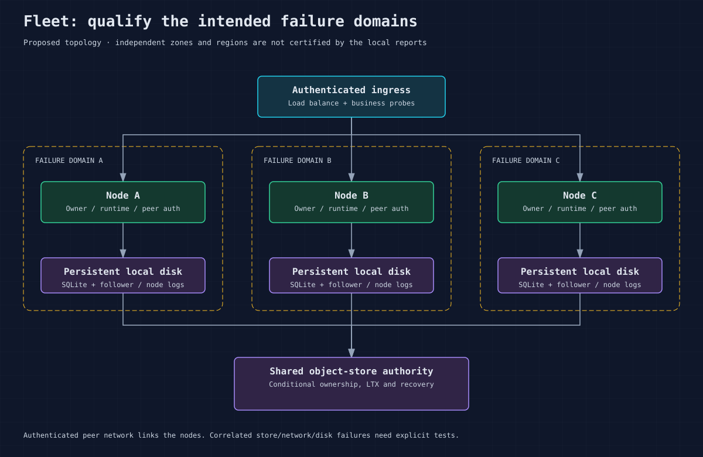

# Fleet topology and infrastructure contract

This is a proposed deployment design method, not a certified topology. Cellar
nodes share bucket-backed fleet ownership and use authenticated peer traffic,
local disk, replication and log recovery. Placement must account for those
shared dependencies.

During internal development, rebuild every participant together for a hard
cutover. Cellar's ranged log-tail request and response use marker 1; missing or
unsupported markers are refused without negotiation. Follower state uses only
`peerlog/<node>/<lineage>/<generation>/`. Owned cell records and node leases
carry the same persistent 128-bit lineage; retained roots preserve it across
process generations. Missing roots mint a fresh lineage, which cannot certify
existing cells or collect the old lineage’s follower proof. Recreate earlier
development state; the runtime does not migrate it. Former `.entry`/`.entries`
payload layouts are also rejected; only current checksum-protected `.batch` files supply follower
entries. Epochs and sequence counters keep their meaning.

## Define the environment

| Dependency | Required design decision | Qualification evidence |
| --- | --- | --- |
| Object store | Bucket/prefix, conditional writes, ranged reads, pagination, credential behavior | Exact provider/version tested, ambiguous CAS and outages |
| Local node disk | Persistent path, exclusive ownership, space, fsync behavior | Disk loss/full/stall and recovery tests |
| Peer network | Reachable advertised addresses, authentication, protected internal listener | Partition, delay, one-way reachability and credential rejection |
| Executors | Host/core capacity and lifetime | Saturation, blocking work and returned completion |
| Ingress | Public auth, load balancing, body limits, graceful removal | Business probes and admitted-work drain |
| Supervisor | Start/stop mode, grace time, logical identity, replacement policy | Rollout and same-node preserving restart drills |

Separate production/staging fleets by infrastructure authority and credentials.
A prefix alone should not be treated as a security boundary unless permissions
enforce it. Ownership and replication must agree on prefix and bucket/backend.
Do not let multiple independent orchestrators assign the same node identity or
reuse a locked data directory.

## Failure domains and availability

The checked-in recovery reference used three nodes on one VM and one RustFS
server. It does not prove independent-zone resilience. For a proposed
multi-zone deployment, place nodes, durable local volumes, networking and the
object store across the intended failure domains, then test losing each.
Do not interpret “fleet proof” as a universal quorum configuration or promise
that any arbitrary simultaneous failures preserve all acknowledged writes.
Inspect the actual log/follower policy and loss assumptions.

Expiry and an unreachable follower do not certify that its acknowledged data
can be discarded. If a log may contain fleet-acknowledged writes, recovery needs
a complete follower witness before sealing it and admitting a replacement.
Without that evidence, recovery stays blocked, including after the follower's
expiry grace. A retained bucket bundle that cannot be decoded also blocks a
fold; a loss diagnostic cannot substitute for the missing bytes. Restore valid
durability evidence before retrying recovery. Existing local SQLite files alone
do not certify a complete node-log prefix.

This preserves safety after proof loss; it does not promise availability after
every durable copy is destroyed. Qualify the actual replica placement, retained
disks and bucket behavior for each deployment. A recorded blocked recovery is
an observation at its timestamp; the current node-log state remains authoritative.

No built-in active-active multi-region certification is established by this
baseline. Start with one qualified fleet region. If multiple regions are
required, specify authority placement, inter-region latency, credential and
data-residency constraints, partition behavior, failover recovery sets and the
traffic steering decision. Measure them before describing the design as supported.

## Admission, readiness and removal

Use the framework health endpoint plus application probes; an open TCP port is
insufficient. Readiness begins only after startup recovery/authority and the
configured fleet-readiness observation. An observation deadline reports a
stalled fleet rather than opening the gate on failure. Later readiness is not
a complete continuous durability or SLO monitor.

For removal, close public admission and request Handoff. Both stop modes drain
complete accepted events, then cells and durability. Set orchestrator grace
periods with joining behavior in mind; a semantic deadline can expire while
already-started blocking work still joins. Incomplete drain falls back to normal
lease-expiry recovery and must be reported.

Choose a fleet capacity from workload evidence, not a count of cold cell names.
Adding nodes helps independent cells but does not split one hot cell. See
[capacity](16-capacity-scaling.md) and [production gates](21-production-readiness.md).
Sources: [Node validation](../crates/cellar/node/embedded.rs),
[peer auth](../crates/cellar/fleet/peer/auth.rs),
[fleet validation limitations](../tools/perf/README.md).
