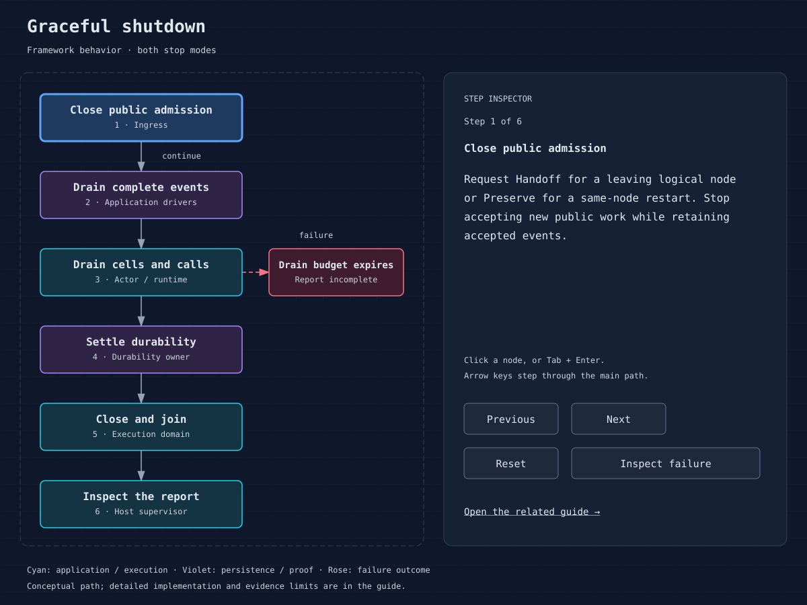

# Observability and service objectives

Observe business outcomes and framework proofs separately. An HTTP response,
a retired task and a stopped process convey different information. This guide
combines existing observation surfaces with proposed dashboards and SLOs.

## Existing surfaces

The public `/.well-known/cellar/health` endpoint returns success only when the
node is not draining, the fleet-readiness gate has opened, and the actor is
healthy. `Node::is_ready` exposes the corresponding embedded observation.
Readiness includes a startup gate; it is not a complete continuous guarantee
that every cell, store or external service meets its business SLO.

`NodeOutcome` separates requested stop, cancellation, fencing, core failure
and replication failure. Preserve the typed `FenceReason`; a closed reporting
channel is a core/supervision failure, not proof that authority was lost.
`ShutdownReport` exposes phase booleans, pending work and timeout/deadline state.
`HostServices::application_work` exposes pending and retired event counts.
`HostMetricsSample` includes CPU, RSS, in-use bytes, cgroup observations and
file descriptor usage; the embedding host can supply a metrics sampler.

Telemetry is off by default. `CELLAR_OTEL=1` selects the bucket sink;
`CELLAR_OTEL=<collector base URL>` selects OTLP/http-protobuf.
`CELLAR_OTEL_BUCKET`, retention/flush controls and standard sampler/exporter
settings are resolved by the telemetry adapter. Its schema marker stays at `1`
during internal development; layout changes require a hard cutover. The bounded
exporter sheds telemetry when saturated and counts drops; absent spans do not
prove absent application work. Never use sampled
telemetry alone as the command receipt ledger.

## Event host observations

`node.services().event_metrics()` returns fixed host-lifetime counters,
histograms and current waiter/dispatch reservations. The same snapshot is
available on the internal listener through fleet-signed `GET /event-metrics`
(Prometheus text) or `GET /event-metrics?format=json`. The signature covers the
complete path/query. Bodies are forbidden. Unsigned reads are refused.

Names and buckets are fixed; event, cell, stream, subscription and caller IDs
are absent from labels. JSON counters and histogram sums/counts use decimal
strings. Histograms use millisecond observations rendered as seconds in the
text format. Counters saturate on overflow. Snapshots are live atomic
observations, not a transaction across all series.

Dispatch series describe RPC completion, not proven source cleanup. Append
counts describe local commits; source-to-append age uses the immutable event
creation timestamp, clamps clock skew to zero and observes only newly appended
records. Ack processing includes successful no-op acknowledgments; replay is
counted separately. A dropped timer records cancellation against its original
host. A closed host clock produces a timing-unavailable counter. These metrics
cannot replace the receipt ledger or ownership/durability proofs.

This export does not yet provide backlog, blocked-reason, stream byte/offset,
lease, subscription-lag or retention-blocked gauges. Current reservation counts
are not cold-cell or fleet totals. The complete event metrics profile remains
under implementation.

Owner-routed subscription status and inventory expose an `observation` with
sample time, unread offset distance (`lag_records`), retained unread count,
oldest retained unread age since append, lost-history flag and lease activity.
All integer values use decimal strings. The sample clamps time to the stream's
durable logical clock but does not advance that clock or mutate a lease.
An expired stored lease remains visible with `lease_active: false`.

Retention can leave positive lag with no retained records. In that case,
`history_expired` is true and `oldest_retained_age_ms` is null; the missing
history's age is unknown. These diagnostics are authorized owner observations,
not series in the host metric export or fleet totals. Inventory uses a bounded
primary-key page plus at most one indexed timestamp lookup per returned row.

Owner-routed outbox inspection reports whole-source pending rows/bytes, sampled
wall time, oldest pending event age, and blocked lane counts for seven fixed
permanent failure codes. Lane pages include their own pending rows/bytes/age
and typed `blocked_reason`. Counts include failed terminal seal delivery, which
can remain blocked with no pending event payload and null event age. Transient
errors retain retry behavior and do not enter the permanent reason counts.

Source and lane accounting commits with event inserts/deletes and block/retry
transitions. Age reads use explicit covering indexes with a one-row limit;
per-lane inspection no longer counts or sums its pending event range. A null
age means no pending event rows; wall-clock skew clamps negative age to zero.
Every continuation repeats whole-source observations, so pages are live samples.
Restore rejects inconsistent counters, missing accounting triggers or age
indexes, and earlier layouts. The schema marker remains 1; recreate development
state on this cutover. These source observations are not fleet totals or
additional series in the host `/event-metrics` export.

`stream.stats(&context)` and `cellar stream describe` expose owner-routed stream
observations under current administration grants. Retained `rows`/`bytes` and
earliest/end offsets accompany sampled time, active leases, expired subscriptions,
oldest retained append age and retention protection. `protected_bytes` counts
all payload bytes pinned by required checkpoints or live leases;
`retention_blocked_bytes` counts the age-expired subset pinned against deletion.
The description does not expire leases or advance durable logical time.

Timestamp/frontier reads use indexes or exact offsets; byte differences use
retained prefix bookkeeping rather than payload-range sums. Live metadata is
bounded by the definition's 128-subscription limit. Byte positions are internal
bookkeeping modulo `2^63`; the
retained byte window is strictly smaller than that ring, so differences remain
exact across wrap without imposing a lifetime admission ceiling. Offset and
sequence identities continue to use checked, non-wrapping counters.

`sqlite_allocated_bytes` reports SQLite's current page allocation including free
pages and metadata; `sqlite_used_bytes` excludes freelist pages. These fields
are not WAL, local LTX, bucket, or filesystem allocated-block usage. Complete
physical-storage observations and fleet aggregation remain unfinished. Restore
checks retained byte/offset/timestamp accounting before base-schema mutation.
The schema marker remains 1; earlier layouts require recreated development state.

## Proposed dashboard contract

| View | Signals to collect | Operator decision |
| --- | --- | --- |
| Business | Successful/failed/ambiguous commands, command receipt reconciliation | Correctness and customer impact |
| Latency | End-to-end percentiles by operation, admission and proof wait | Saturation versus store/follower delay |
| Authority | Fences with reason, recovery progress, ownership/handoff failures | Stop rollout and preserve evidence |
| Work | Pending event drivers, dispatches, alarm overdue age, queue lag | Drain budget, backlog and missed work |
| Resources | RSS/cgroup, disk/free space, FDs, residents and cached routes | Capacity and leaks |
| Durability | Bucket/follower proof outcomes, upload lag, log/recovery failures | Acknowledgement safety and recovery exposure |
| Export | Dropped telemetry, collector failures | Observation coverage |

These are dashboard requirements, not promised metric names or a bundled
Prometheus endpoint. Map each to an actual log/API/host measurement in your
environment. Keep labels low-cardinality; cell IDs and tenant IDs belong in
controlled drill-down data rather than every time series. Redact secrets and
customer content, and restrict access/retention.

## Define an SLO with evidence

For each operation, choose a service-level indicator, a business-approved
threshold/window and an error-budget policy. Define whether rejected admission
and ambiguous writes count as failures; count them consistently. Choose a
separate overdue-work objective for asynchronous completion. Recovery objectives
must include state reconciliation and readiness, not just process startup.

Page on failed proof/fencing, sustained user-impacting failures, missing recovery
coverage or breached backlog objectives according to the on-call policy. Set
thresholds from measured production-like traffic; the local reference p99 is
not a suitable universal alert threshold. Sources:
[health handler](../crates/cellar/node/mod.rs),
[telemetry](../crates/cellar/observability/telemetry.rs),
[metrics](../crates/cellar/execution/services.rs),
[outcomes](../crates/cellar/node/lifecycle.rs).
