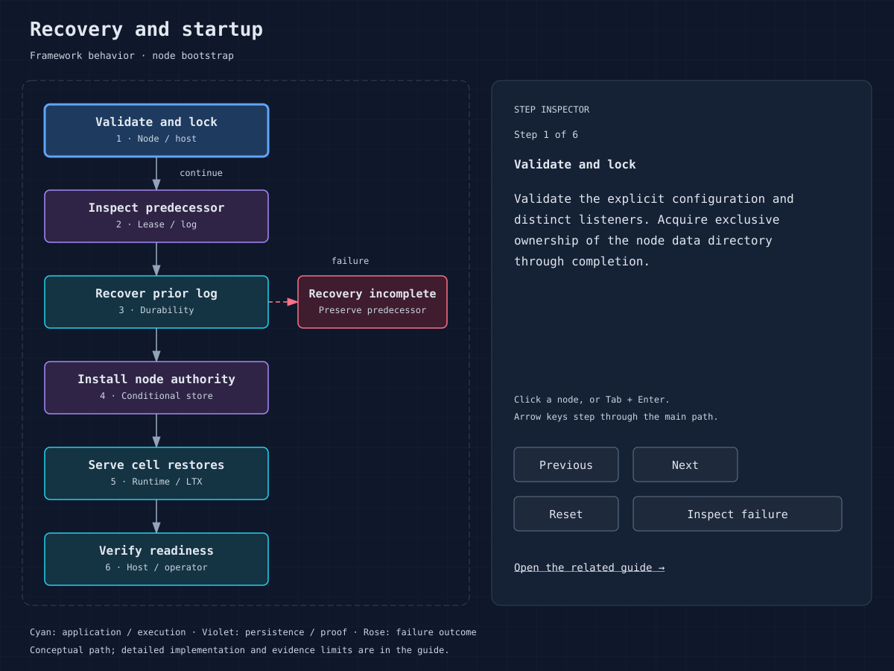

<!-- Copyright 2026 Cellar Project Authors. Licensed under Apache-2.0. -->

# Recovery, backup and disaster drills

Cellar recovers prior owners' replicated logs before allowing takeover. Your
backup policy must also preserve the data, artifacts and configuration needed
after the failures your business chooses to cover. Test the complete recovery
set through restored reads, new writes and a verified stop.

## Framework recovery contract

`Node::start` recovers a predecessor log before installing a replacement lease.
Failed recovery must preserve the predecessor generation. Lease records require
an explicit `generation`; logs require `may_have_fleet_acks`. Recovery accepts
complete ranged tails; original aliases and entries-only tails are rejected.
Expired node leases become CAS tombstones after sealing their logs, retaining
recovery pointers and protecting successor generations.

Do not erase tombstones, logs or ownership data because a node appears offline.
Cell restore/hydration and takeover require the correct write history and
authority. Follower proof can acknowledge before bucket upload; losing all
required follower/local evidence at that moment may violate the deployment's
loss assumptions. A bucket-only snapshot cannot simply be assumed to contain
every fleet-acknowledged write.

## Proposed backup policy

The machine-local development object store can retain committed data in SQLite
WAL sidecars after clients close. An offline backup must stop every client and
preserve the database with its sidecars; copying only the main file can lose
acknowledged objects. Use SQLite's backup API for an online copy. This local
development backend is separate from a production object-store backup policy.

No turnkey point-in-time backup/restore product or arbitrary timestamp recovery
guarantee is established by this documentation. Design and qualify a procedure
for your store, durability posture and retention policy:

1. Define the recovery point objective (RPO), recovery time objective (RTO),
   loss cases and source of authority.
2. Preserve package manifests/executables, application configuration, identity
   conventions and schema/workflow versions alongside the relevant data history.
3. Capture a coherent ownership/log/LTX/object set, accounting for acknowledged
   writes not yet in the bucket. A quiesced, fully proven fleet stop is one
   candidate boundary; online capture needs a separately verified protocol.
4. Preserve application Blob objects and outbox/receipt state consistently with
   cell references. Protect backup credentials, encryption and retention.
5. Record inventory, digests, source version, write/receipt ledger and completion
   evidence. Copy to the chosen independent recovery authority/storage.
6. Restore into an isolated bucket/prefix and distinct node directories using
   matching application versions and credentials. Verify through owner-routed
   reads, then exercise new writes, async work and a complete stop.

Never copy live SQLite files and assume that is a fleet-consistent backup.
Do not run a drill against the live production prefix, reuse production node
identity while active, or mutate a recovered database behind its owner.

## Qualification matrix

| Loss case | State to verify | Additional criterion |
| --- | --- | --- |
| One node killed | Acknowledged receipts/counters on survivors | Takeover and subsequent writes |
| All nodes lost in bucket posture | Fresh local restore | Every required cell, payload and alarm |
| Local cache lost | Bucket/log restoration and hydration | Bounded disk/memory and restore time |
| Crash during writes | Acknowledged versus ambiguous commands | Acknowledged effects present; ambiguous receipts reconciled |
| Shared store or zone lost | Independently retained recovery set | Business-approved RPO/RTO and traffic steering |
| Version rollback | Old executable against resulting state | Schema and workflow compatibility |

Measure RTO through business readiness and state reconciliation, not just
process launch. Measure RPO against a durable client command ledger. Retain
failed drills and their artifacts. The [original baseline reports](sources.md#retained-validation-reports)
do not establish in-flight network-partition or ambiguous-acknowledgment recovery.
Any newer result must identify its exact code and image before it can qualify
a release.

For the experimental native 10 GB Raft path, [Plan 010](design/multi-raft/010-large-cell-recovery-time.md#targets-and-measurement-contract)
sets proposed p95 targets of 120 seconds for complete cold recovery, with a
60-second stretch, and 30 seconds for a declared hot workload under incremental
activation. None is qualified. The timer includes failure detection, replacement
startup, source/archive waits, verification, replay, promotion and the first
verified read and acknowledged small write. Full hydration is measured
separately when activation can precede it. These targets assume a surviving
quorum and a declared infrastructure profile; a warm-replica failover result
cannot establish cold-node recovery time.

Sources: [SDK recovery contract](../crates/cellar/sdk.rs),
[node logs](../crates/cellar/durability/log/mod.rs),
[reference recovery](../tools/perf/results/2026-10-12-embedded-10000-reference.md),
[LTX format](../crates/cellar-ltx/reference/ltx-format.md).
