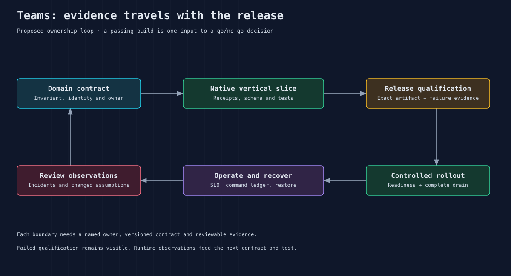

<!-- Copyright 2026 Cellar Project Authors. Licensed under Apache-2.0. -->

# Testing and deployment qualification

Test application invariants and lifecycle behavior, then qualify the exact
release artifact under the intended workload and failures. Continuous integration
(CI) checks establish repository behavior; deployment qualification also requires
workload and failure evidence.



## Repository checks

Run from the repository root with the private workspace-volume target directory
required by [AGENTS.md](../AGENTS.md). SDK CI selects Rust 1.98.1 at this baseline.

```sh
cargo format --check
cargo check-layout
python3 tools/docs/check.py
python3 tools/check_native_dependencies.py
cargo check --workspace --all-targets --all-features --locked
cargo test -p cellar --test native_cli --test native_artifacts --locked
cargo test -p cellar --test allocator_startup --locked
cargo test --workspace --all-features --lib --tests --locked -- --test-threads=1
cargo test --workspace --all-features --doc --locked
cargo clippy --workspace --all-targets --all-features --locked -- -D warnings
python3 -m unittest discover -s tools/perf -p 'test_*.py'
```

Run independent test cases serially, as CI does. Node fixtures own several
concurrent runtimes and short leases; unrelated fixtures competing for the
runner can expire those leases. Concurrency inside each fixture stays enabled.

The allocator startup test uses a fresh process with allocator environment
overrides removed. Linux must start background purging; macOS must leave that
unsupported build default disabled. Forcing `background_thread:true` on macOS
can leave jemalloc partially initialized and put allocations through its global
initialization lock. The test also exercises allocation and deallocation across
threads and reads allocator statistics before any host tuning.

Choose existing tests for the changed binding/host path. The suite includes
storage/transactions, domains, cells, call ordering, Queue/Workflow, sockets,
loaders, packages, nodes, logs and replication. `cellar_internal_tests` requires
external simulation/conformance sources. Do not enable it without those
sources or claim those tests ran in an ordinary build.

### Native event recovery investigation

The SDK workflow has opt-in `consumer-replay`, `clock-replay` and
`reliability-replay` dispatch modes for the preserved initial consumer admission refusal and delayed-cold-read
clock/receipt failure. The reliability mode targets lease readback, cron adoption,
root loss after lineage capture, and settlement reset. The modes run exact
native fixtures serially against
fresh private SQLite state, stop on the first failure and retain the bounded
native cause log and failure JSON. Each repetition is a new fixture; it does not
repeat a claiming request against a live application. Native assertions and
request/lease deadlines stay unchanged.

Before replay, the driver requires the exact fixture name to select one test.
A missing or renamed fixture refuses qualification; libtest's successful exit
after selecting zero tests cannot produce an accepted campaign.

```sh
gh workflow run native-sdk.yml --ref YOUR_BRANCH \
  -f mode=consumer-replay -f repetitions=20
gh workflow run native-sdk.yml --ref YOUR_BRANCH \
  -f mode=clock-replay -f repetitions=20
gh workflow run native-sdk.yml --ref YOUR_BRANCH \
  -f mode=reliability-replay -f repetitions=3
```

For a historical comparison, add `-f replay_sha=FULL_40_CHARACTER_COMMIT_SHA`.
The workflow validates its shape before checkout, verifies the actual checked-out
commit before replay and prints that source identity. Empty `replay_sha` uses the
workflow commit. The run's head SHA identifies the workflow; the printed SHA
identifies the tested source. This input applies only to isolated replay modes;
complete qualification always uses the workflow commit.

The integer repetition count is bounded to 1–100 for consumer replay, 1–50
for the slower clock fixture and 1–20 for reliability replay. Each reliability
repetition runs all four fixtures in fresh processes and stops at the first
failure. Each replay campaign has its own concurrency group
so source comparisons can run alongside ordinary SDK qualification. Each replay
retains a source-bound result ledger with exact fixture names, return codes and
elapsed times; incomplete or failed campaigns never claim completion. Artifacts
also contain the private synthetic fixture's whitelisted evidence JSON, including
accepted prefix, cold recovery observations and post-recovery fetch when present.
Ordinary SDK qualification retains the same observation files from its private
test directory, so evidence survives runner teardown. No cell databases,
node directories or private keys are uploaded. A passing replay run covers only
its selected fixtures; full release qualification still requires the regular
Python ABI matrix and native examples. Ordinary push/PR runs and dispatch mode
`qualification` retain the complete SDK checks.

## Application test layers

| Layer | Required behavior | Evidence |
| --- | --- | --- |
| Domain | Invariant, canonical identity, schema and receipt rules | Unit/property tests with edge cases |
| SDK integration | Context/epoch invalidation, concurrent calls, rollback/cancellation | Existing harness plus application tests |
| Contract | Old/new clients, errors, auth, duplicate command payloads | Consumer/provider fixtures |
| Lifecycle | Old-generation work, `wait_until`, nested calls, stop/fence outcomes | Reports with pending counts and proof phases |
| Recovery | Acknowledged and ambiguous commands, alarms/workflows, new writes | Durable client ledger and reconciled state |
| Load | Independent arrivals, skew, growth, streams, saturation, soak | Limits, percentile method, resources and failures |
| Security | Tenant escape, malformed peer identity, secrets/rotation | Negative tests and review record |

## Fleet drill method

Use the isolated Docker/Colima harness in [tools/perf](../tools/perf/README.md)
as a starting point. Build a private image/cache for this checkout, record its
source hash, run harness proof guards, then run selected bucket/fleet scenarios.
The harness owns disposable credentials, network and local data images; never
point it at production storage.

For release qualification, expand the matrix to independent failure domains,
network delay/partition during writes, object-store outage, ambiguous CAS,
credential expiry, disk full/stall/loss, hot cells, growing state, independent
arrivals, long soaks and rolling mixed versions. Track a durable client ledger
before/after sends so incomplete responses remain distinguishable from
acknowledged commands. Use unique IDs and inspect receipts after recovery.

Require every acknowledged effect to be present exactly as the application
contract defines, all ambiguous commands to be resolved or explicitly retained
for reconciliation, and new post-takeover writes to succeed. A successful
process exit does not replace the complete SDK shutdown proof.

## Report and acceptance

Record source SHA, image/executable digest, toolchain, store/version,
infrastructure, effective configuration, workload, offered/completed traffic,
run duration, failure injection point, raw evidence, reconciliation and stop
reports. Preserve failed runs. Qualification thresholds must come from the
application's approved SLO/RPO/RTO and loss model; no universal thresholds are
invented here. Link this evidence in [production readiness](21-production-readiness.md).
