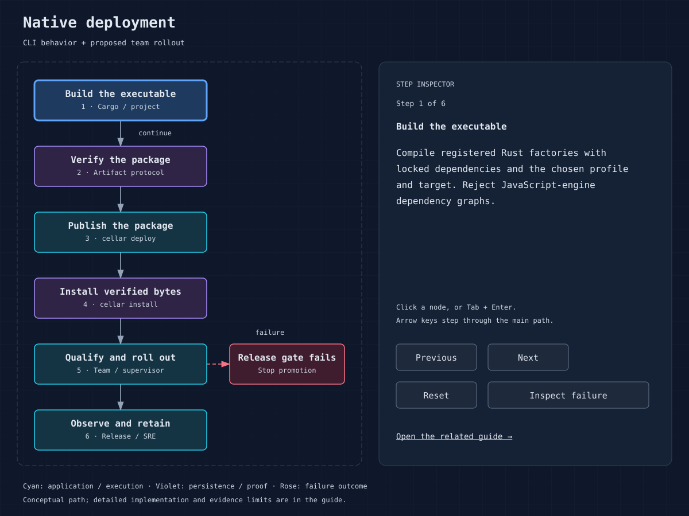

# CLI reference and operator boundaries

`cellar` is the single CLI executable. A compiled application executable
starts a node with its registered factories. The generic CLI builds, develops,
publishes, installs and invokes operator tools.



## Verified packaging syntax

```text
cellar --help
cellar --version
cellar build PROJECT.json --output DIRECTORY
cellar dev PROJECT.json [--host IP] [--port PORT] [--logs] [--no-watch]
cellar deploy DIRECTORY --bucket NAME [--endpoint URL] [--region REGION]
cellar install DIRECTORY --bucket NAME --output EXECUTABLE [--target TRIPLE]
```

`dev --clean` intentionally resets the selected project's local state. The
project stores state under `.cellar/<project-hash>` beside its configuration;
the hash identifies the canonical project path. Earlier development-state
layouts are left untouched and are not automatically migrated. Project paths
resolve relative to the project file. Use the checked-in counter project for
the full native configuration shape. Build's default project profile is release;
the counter project explicitly chooses dev.

`deploy` publishes a verified package to a bucket, including executable/assets
and configuration. `install` reads `package.json` from the supplied directory,
fetches and verifies the target executable, and writes a new output path. It
does not overwrite an existing executable or activate it through your supervisor.
Store operations accept the endpoint/region options handled by the packaging
CLI; use the actual binary's help for the full command.

When running from source, prefix commands with:

```sh
cargo run -p cellar --bin cellar --locked --
```

Use a private `CARGO_TARGET_DIR` per repository guidance. Native package builds
select locked dependencies and reject JavaScript-engine dependency graphs.

## Operator command families

| Family | Scope | Implementation |
| --- | --- | --- |
| `cell` | Cell-oriented authenticated operator work | [cell CLI](../crates/cellar/cli/cell_cli.rs) |
| `sql` | Owner-routed SQL database operations | [SQL CLI](../crates/cellar/cli/sql_cli.rs) |
| `kv` | Owner-routed KV operations | [KV CLI](../crates/cellar/cli/kv_cli.rs) |
| `queue` | Owner-routed queue operations | [Queue CLI](../crates/cellar/cli/queue_cli.rs) |
| `blob` | Shared Blob backend operations | [Blob CLI](../crates/cellar/cli/blob_cli.rs) |
| `diagnose` | Diagnostics through the process adapter | [CLI dispatch](../crates/cellar/cli/native_deploy/cli.rs) |
| `connect`, `credentials`, `token`, `disconnect` | Managed connection and credential commands | [managed host](../crates/cellar/node/managed.rs) |

These families have their own options and authenticated connection requirements.
Consult `cellar FAMILY --help` on the exact release before issuing mutations.
This table intentionally does not invent unsupported fleet-restart, backup or
deployment-controller commands. Operation-specific destructive procedures need
the actual authenticated target and the team's approved change record.

CLI stdout carries command data; diagnostics/progress belong on stderr. Preserve
JSON output, bounded listings and continuation information when integrating
automation. Treat truncated pages as incomplete, and do not parse progress logs
as the command result. Do not place secrets in committed command examples.
See [operations](17-operations.md), [security](14-security-tenancy.md), and
[packaging implementation](../crates/cellar/cli/native_deploy/cli.rs).
