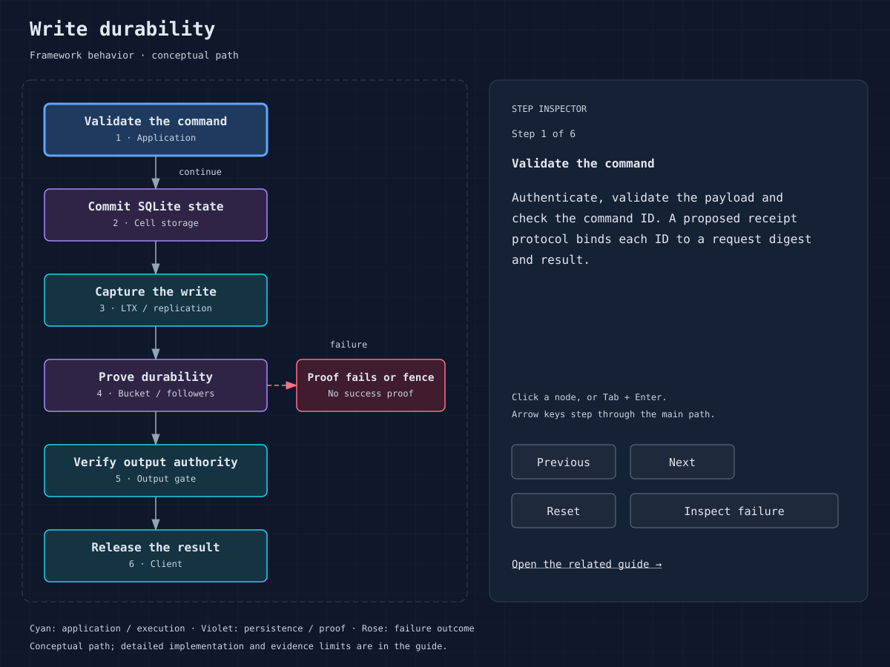

# ADR 002: Preserve single-cell authority and output proof

Status: observed baseline. Source: `c24feb2`. Recorded: 2026-10-12.

## Context and decision

A conditional object-store write assigns cell ownership. One authoritative
owner and epoch control its state. Versioned completion events cannot authorize
later activations. Externally visible writes/egress require the output gate's
durability and authority proof. Recovery accounts for predecessor log history
before takeover.

## Consequences

Do not introduce a second ownership policy in effect adapters or bypass gates
with direct database/network work. Cached routes are reclaimable history, not
authority. Fleet proof may precede bucket upload and has explicit recovery/loss
assumptions. Failed responses can remain ambiguous to the business client.

Cross-cell atomicity and external exactly-once effects require application
coordination and receipts; neither follows from a per-cell proof. Test identity,
epochs, stale handles, proof failures and acknowledged/ambiguous recovery for
any change. See [architecture](../03-architecture.md),
[actor](../../crates/cellar/actor/mod.rs), [logic](../../crates/cellar-logic/lib.rs).
