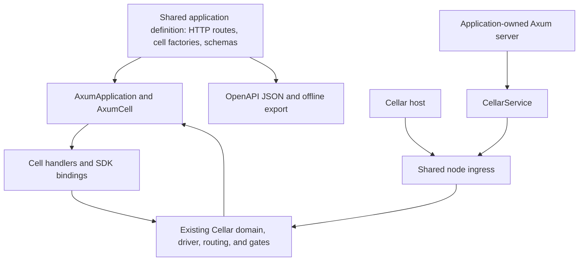

<!-- Copyright 2026 Cellar Project Authors. Licensed under Apache-2.0. -->

# Plan 002: Run one cell application through Cellar or Axum with OpenAPI

Purpose: Specify shared application registration, Cellar and Axum hosting, OpenAPI export, and recorded integration evidence.

[Design library](README.md) · [Related contract](../10-embedding.md)

| Implementation | Validation or example |
| --- | --- |
| [Code and API](../../crates/cellar-axum/README.md) | [Checks and usage](../../crates/cellar-axum/README.md) |

> **Executor instructions**: Read this whole plan and the applicable `AGENTS.md`
> before implementing. Complete the ordered milestones and their verification
> gates. The public API names below are proposed; document any necessary API
> adjustment while preserving the ownership and compatibility requirements.
> Update the status in `docs/design/README.md` when implementation starts or finishes.
>
> **Drift check**: Run `git diff --stat
> 4d52bacbdc49346c1fdc5193ca3d165f543ea753..HEAD -- Cargo.toml Cargo.lock
> crates/cellar crates/cellar-axum examples .github/workflows/native-sdk.yml
> AGENTS.md README.md docs/design/`. Compare changes with the source facts below
> before proceeding. A physical move alone is not an architecture mismatch.

## Status and decision

- **Status**: DONE; all six milestones are implemented and verified locally.
- **Priority**: P1
- **Effort**: L
- **Risk**: HIGH, because ingress, response proofs, cancellation, and shutdown interact.
- **Depends on**: [001-component-layout.md](001-component-layout.md), implemented in PR #12.
- **Category**: direction / integration
- **Planned at**: `4d52bacbdc49346c1fdc5193ca3d165f543ea753`, 2026-10-12.
- **Hosting model**: Axum embeds the existing Cellar runtime. The user selected
  this model explicitly. Both hosts use the same cells, SQLite state, ownership,
  replication, event driver, and shutdown machinery.

## Why this matters

- Application developers should be able to use Axum routing, extractors, typed JSON, and HTTP middleware while keeping Cellar's durable business cells.
- One application definition should run through the existing Cellar host or mount inside an application-owned Axum server.
- Its OpenAPI document should come from the same route definitions and should be exportable without starting a node.

This needs an application adapter and a host adapter. Converting request and response structs alone does not provide a safe integration.

## Current state

All paths and line numbers in this section refer to the planned commit.

| Source | Existing responsibility | Integration consequence |
| --- | --- | --- |
| `crates/cellar/application/mod.rs:67` | `Request` carries URL, method, headers, `RequestBody`, and an optional entrypoint | There is no arbitrary Axum request-extension bag in the invocation protocol |
| `crates/cellar/application/mod.rs:117` | `Cell::invoke(Arc<Self>, Context, Invocation)` returns `HandlerFuture<Output>` | Poll the Axum handler future inside this existing event boundary |
| `crates/cellar/application/mod.rs:121` | `Application` creates cells and supports workflow execution | Keep non-HTTP events and factory behavior in the adapter |
| `crates/cellar/application/mod.rs:160` | `Registry` composes handlers, named entrypoints, cell factories, and workflows | Reuse these contracts instead of adding another application execution format |
| `crates/cellar/application/mod.rs:330` | `Context` is event authority; storage checks domain, turn, retirement, and activation | Insert the current invocation's context into each Axum request |
| `crates/cellar/application/streams.rs` | Bounded byte pipes separate an owned producer from transport readers | Stateful streaming must keep the producer under the event driver |
| `crates/cellar/runtime/contracts.rs:114` | `HttpResponse` includes streams, WebSocket targets, and write/observed positions | A plain `IntoResponse` conversion cannot replace the framework's proof path |
| `crates/cellar/runtime/workers/native/mod.rs:1290` | Event settlement samples storage positions and stamps the response before delivery | The adapter never fabricates or authorizes durability positions |
| `crates/cellar/node/embedded.rs:228` | `NodeServices` requires public and internal TCP listeners | Add external ingress without breaking existing struct literals or `Node::start` |
| `crates/cellar/node/driver.rs:100` | One production driver owns dispatch, fencing, and bounded drain | External ingress must join this driver's admission and work accounting |
| `crates/cellar/node/mod.rs:1751` | Public body handling accepts `Request<hyper::body::Incoming>` | Extract a shared body-neutral ingress seam for Axum bodies |
| `crates/cellar/node/mod.rs:2411` | Public dispatch applies assets, body limits, worker invocation, and HTTP error mapping | Native and Axum ingress must reuse this policy |
| `crates/cellar/node/mod.rs:2859` | Public admission, health, and WebSocket dispatch | Keep readiness and drain rejection consistent across hosts |
| `crates/cellar/node/native.rs` | `CompiledApplications` registers factories by script/version | Both hosts register the same compiled application factory |
| `examples/native_counter.rs` | Public HTTP routes call a namespace stub, which routes to the owning cell | Cell routes must retain that indirection |

The load-bearing contracts currently look like this:

```rust
// application/mod.rs
pub trait Cell: Send + Sync + 'static {
    fn invoke(self: Arc<Self>, context: Context, invocation: Invocation)
        -> HandlerFuture<Output>;
}

// runtime/contracts.rs: HttpResponse also carries status, headers, and body.
pub stream: Option<HttpChunkStream>,
pub websocket: Option<HttpResponseWebSocket>,
pub write_position: Option<u64>,
pub observed_position: Option<u64>,
```

The workspace currently uses Axum 0.7. `fastwebsockets` is pinned to 0.8.1 with `with_axum`, which pulls the older Axum core. Production upgrade code uses the Hyper upgrade functions; tests and static assets also use Axum types. Dependency alignment is therefore a real first milestone.

- Repository conventions: Rust 2021, minimum Rust 1.94.1, centralized workspace dependencies, locked builds, crate modules beside `Cargo.toml`, and `Result` for recoverable failures.
- Follow `native_node.rs` for embedded-node setup and `native_streams.rs` / `native_websocket_opening.rs` for lifecycle tests.
- The execution boundary uses `cellar::asyncrt` and injected services; read `clippy.toml`.
- Do not introduce ambient configuration, raw task spawning for cell work, JavaScript engines, or a second owner of core policy.

## Target architecture



`cellar-axum` depends on `cellar`; `cellar` must not depend on `cellar-axum` or Utoipa. Keep the core ingress API in HTTP/body terms rather than Axum handler types. Use the existing application, deployment, and native package contracts.

### Application adapter

- `AxumApplication` implements `sdk::Application`; it dispatches Fetch to a
  fully initialized `Router<()>`, and delegates other events and factory hooks
  to explicit SDK handlers/registrations.
- `AxumCell` implements `sdk::Cell`. Its router is built once per activation;
  its request context is supplied anew for every event. It preserves the
  configured handler for alarms, RPC, queues, and WebSocket events.
- `CellContext` implements `FromRequestParts` and provides the real `Context`.
  Missing context is a recoverable configuration rejection. An optional
  `CellIdentity` extractor rejects stateless invocations. Use `ctx.storage()`
  for storage; avoid a global storage handle or redundant storage authority.
- Standard `Path`, `Query`, `Json`, and application `State` remain usable.
  State contains immutable application or activation data, not a saved event
  context. Handler futures run through Cellar's installed invocation turn.
- Dispatching unsupported non-HTTP events returns an explicit error; never
  silently acknowledge an alarm or queue with `Output::Done`.
- Middleware that stays in the invocation future can run inside the router.
  Middleware that buffers or spawns the handler onto an ambient executor needs
  a supported domain-aware implementation before it is advertised as compatible.

### Host adapter and lifetime

Add `sdk::IngressHandle` and an additive external startup entry point, proposed as `Node::start_external(...) -> Result<(Node, IngressHandle)>`. Use a separate external-services input that supplies the existing common services, the private internal listener, and the caller's already-bound public address. Preserve `NodeServices`, `Node::start`, and their current behavior.

- The cloneable handle accepts an owned HTTP request with a Send boxed body and returns a framework HTTP response.
- It is an admission capability, not access to `AppHandle`, SQLite, or the execution domain.
- It sends accepted work to the owning driver; polling it in Axum does not execute cell work on Axum's ambient runtime.
- It is available only after predecessor recovery and startup readiness.

`CellarService` implements Tower `Service<Request<axum::body::Body>>`, converting to that handle and mapping transport errors to the existing HTTP rejection policy. It can be mounted with unrelated Axum routes. Use bounded admission and correct readiness semantics; no new unbounded ingress queue and no automatic retry of mutating requests.

- Acquiring an admission permit, enqueuing, dispatching, and completing must leave no accounting gap visible to shutdown.
- Dropping an unpolled call, a pending future, an input body, or an output body releases the right ownership and signals cancellation.
- After drain/fence/closure, every handle clone rejects new work.
- The existing internal peer/operator routes remain on the private authenticated listener and never appear in the public service or OpenAPI.

- The caller owns the Axum listener, signals, and executors.
- Shutdown must close Cellar admission, stop accepting new server connections, drain accepted work and streams, then join the node and return `NodeOutcome` / `ShutdownReport`.
- Use one bounded stop deadline; joining Axum first must not delay admission closure or consume an unbounded Cellar drain budget.
- Keep both executors and the node directory lock alive through the join.

### Shared application builder and cell routes

`ApplicationBuilder` produces an immutable `ApplicationDefinition`, which can instantiate an SDK application for `CompiledApplications` and export its API document. It does not start a node or read environment variables.

It composes public HTTP handlers, named entrypoints, cell class factories, non-HTTP handlers/workflows, and route/schema metadata. The existing `DeploymentGraph` continues to supply bindings and deployment configuration; validate those relationships at assembly/startup instead of inventing another manifest format.

- A cell route descriptor records the public path/method, namespace binding, cell-name resolver, and class route.
- For example, GET and POST `/counters/{name}` resolve `COUNTERS.get_by_name(name)` and call the SDK stub.
- The owning cell's Axum router executes the typed counter handlers.
- Resolve tenant authorization before choosing a cell; never expose a raw scope, SQLite path, epoch, or direct `Arc<dyn Cell>` bypass.

- Choose and test one URI rule: compile the declared canonical path into both the public gateway and the class router, forwarding that URI through the existing SDK request.
- A host mount prefix is declared separately and reflected in OpenAPI server/path composition.
- Do not rely on private Axum extensions to carry route identity to a remote owner.
- Test trailing slashes, encoded names, query strings, nested host mounts, and named entrypoints.

Build factories afresh for each domain/generation using the existing registry. Publish route metadata and OpenAPI with that same generation; never replace the live global document independently of the running application.

### HTTP, streams, and WebSockets

Reuse native ingress limits, forwarded-header trust, admission, asset decisions, error statuses, and request-body ownership. Preserve repeated response headers, including Set-Cookie, and existing HEAD / empty-body response behavior. Define how non-text headers are handled instead of silently making a stronger fidelity claim than the SDK's string header representation supports.

- Keep write/observed positions and WebSocket ownership in the SDK/core response path.
- A private bridge can carry native response metadata through Axum, but mutable response extensions must never become proof authority.
- The event driver still samples positions and the core still proves them.
- Test middleware that changes a response: it must not allow success or the first body chunk before the required proof, or detach an upgrade from its owning cell.

- Do not collect every body into memory.
- Transport-only streams may be adapted directly.
- A producer that reads storage or uses `Context` must run under `Context::wait_until_byte_stream` into a bounded pipe, with the transport body reading that pipe.
- Test backpressure, failed producers, EOF, disconnect, and retirement.
- SSE uses this HTTP stream path.
- The current `HttpChunkStream` carries data chunks rather than HTTP trailer frames: document trailers as unsupported in the first release and return a controlled stream error if encountered; do not silently discard them or change persisted protocols here.

- Retaining the producer is a lifetime guarantee, not proof of writes performed after the response was settled.
- A chunk that acknowledges a subsequent storage mutation must pass the existing egress gate before entering the output pipe.
- Add a small SDK gated-writer helper in `application/streams.rs` if necessary, using the existing gate capture/verdict implementation, with current-turn and activation checks.
- Do not expose raw proof tickets to Axum.
- Test a second chunk after a producer write with its proof delayed and failed; checking only the initial response's proof is insufficient.

- Provide a Cellar-backed upgrade helper that retains SDK WebSocket targets and dispatches open/message/close through the existing cell event machinery.
- The origin HTTP upgrade stays at the ingress transport; remote owners use the existing peer tunnel.
- Axum's ordinary `WebSocketUpgrade::on_upgrade` task is not a replacement for durable cell socket ownership.
- Verify local and remote upgrades, output gates, disconnect, fencing, and handoff against existing tests.

- Authentication can be ordinary Axum middleware before ingress or an inner application middleware.
- Request extensions at the outer server do not automatically cross Cellar's invocation/fleet boundary.
- Use an explicit bounded application representation for forwarded authentication data, with its trust validated by the application.
- Never serialize arbitrary extensions or send a `Context` across nodes.
- Describe authentication in OpenAPI and test the actual middleware independently; a security declaration does not enforce access.

### Integrated OpenAPI

Use one provider initially: `openapi` support, disabled by default, through Utoipa and `utoipa-axum`. Their `OpenApiRouter` / `routes!` registration can produce a router and document together. See the [official integration documentation](https://docs.rs/utoipa-axum/0.3.0/utoipa_axum/). Avoid a new Cellar annotation/proc-macro system. DTOs use `ToSchema`; handlers declare their parameters, responses, errors, and security requirements.

At planning time the published documentation shows Axum 0.8.9, Utoipa-Axum 0.3.0, and Utoipa 6.0.0. Start with this compatible family after verifying the published manifests and minimum Rust versions. Align the workspace's Axum version deliberately; do not leak two incompatible Router/Body types through the adapter. Pin resolved versions in the reviewed lockfile.

Target OpenAPI 3.1.0 initially and assert the serialized version. Utoipa offers that version with 3.2 as an opt-in; check the [version documentation](https://docs.rs/utoipa/6.0.0/utoipa/openapi/enum.OpenApiVersion.html). Do not merely change a document's version string to claim a different dialect.

- The builder must transform cell route metadata into public paths with the cell-name parameter, merge components, and reject duplicate operation IDs, conflicting schemas, and path/method collisions.
- Stable operation IDs must include a declared mount identity when one class is mounted more than once.
- No enumeration of live cells is necessary.
- Include only the exported application surface; RPC/alarms/queues are not invented HTTP endpoints.

- Provide an application `/openapi.json` route plus offline export from the definition for CI and client tooling.
- The route must use the selected generation's document.
- JSON export needs no listener, bucket, node lease, or cell activation.
- An optional static documentation UI can follow after this works; keep it separate from the required OpenAPI contract and the no-engine dependency gate.
- Validate one generated client in the shared counter example before claiming client generation support.

## Scope

Modify only these surfaces, keeping each milestone's diff bounded:

- Root `Cargo.toml` and `Cargo.lock`: dependency alignment and new crate entry.
- `crates/cellar-axum/` (new): `Cargo.toml`, `lib.rs`, `application.rs`, `cell.rs`,
  `extract.rs`, `http.rs`, `body.rs`, `builder.rs`, `service.rs`, `openapi.rs`,
  `websocket.rs`, `README.md`, and integration tests described below.
- `crates/cellar/{lib.rs,sdk.rs,Cargo.toml}`: additive ingress exports and
  workspace/example registration only.
- `crates/cellar/node/{mod.rs,embedded.rs,driver.rs,ingress.rs}`: shared ingress
  extraction, external startup, cancellation, and drain integration.
- `crates/cellar/application/mod.rs` and `crates/cellar/node/native.rs`: an
  additive pure configuration-validation hook, called when compiled applications
  are built, so adapter namespace requirements fail before startup/adoption.
- `crates/cellar/node/network/websocket.rs`: body-neutral upgrade integration.
- `crates/cellar/application/streams.rs` and
  `crates/cellar/runtime/invocation/gates.rs`: only a bounded gated-output helper
  that reuses existing proof policy for post-response producer writes.
- `crates/cellar/transport/http/` and `crates/cellar/runtime/assets/mod.rs`: only
  the existing HTTP body bridge and Axum dependency migration where necessary.
- `crates/cellar/tests/{native_node.rs,native_body.rs,native_domains.rs,
  native_streams.rs,native_log_protocol.rs,native_assets_cache.rs,
  native_websocket_opening.rs,native_external_ingress.rs}` and
  `crates/cellar/tests/support/`: relevant regression tests and bounded fixtures.
- `examples/axum_counter/` (new), `examples/README.md`, root `README.md`,
  `AGENTS.md`, `.github/workflows/native-sdk.yml`, and `docs/design/`: examples,
  verification, and architecture documentation.

Register the example package explicitly in root workspace members; the current `crates/*` pattern does not discover a package under `examples/`.

Out of scope: a plain Axum storage backend; new fleet ownership or output-gate policy; changes to `cellar-logic`, `cellar-ltx`, or `cellar-native`; persisted wire/identity formats; automatic mutation retries; a generic multi-backend framework; another OpenAPI provider; unrelated component decomposition; new JavaScript execution support. Existing SDK applications must keep working.

## Git and build workflow

- Implement after the component layout is available on the base branch.
- Use `codex/axum-ingress` for the first implementation branch, then one branch per milestone or a small dependent PR stack.
- Do not append implementation commits to the open file-organization PR.
- Commit coherent passing units, using the repository's conventional style, for example `feat: expose embedded node ingress`.
- Push/open implementation PRs only when requested.

For every Rust invocation, use a checkout-specific target directory on the mounted workspace volume. For this checkout:

```sh
export CARGO_TARGET_DIR="$HOME/Workspace/crabbuild-target/cellar-5cf0-axum-adapter"
mkdir -p "$CARGO_TARGET_DIR"
test -w "$CARGO_TARGET_DIR"
export CARGO_BUILD_JOBS=4
```

Repeat that setup in each shell invocation; another checkout must use another directory. CI selects Rust 1.98.1 in `native-sdk.yml`; the planning machine has Rust 1.97.0. Verify dependency compatibility with the declared minimum instead of raising it as a side effect.

Commands below are existing workspace gates unless marked **new target**. Every successful verification command must exit 0.

| Gate | Command |
| --- | --- |
| Format | `cargo fmt --all -- --check` |
| No JavaScript engine | `python3 tools/check_native_dependencies.py` |
| Compile | `cargo check --workspace --all-targets --all-features --locked` |
| Existing ingress/lifetime baseline | `cargo test -p cellar --test native_node --test native_body --test native_domains --test native_log_protocol --test native_assets_cache --test native_websocket_opening --locked` |
| Full tests | `cargo test --workspace --all-features --lib --tests --locked` |
| Documentation | `cargo test --workspace --all-features --doc --locked` |
| Lints | `cargo clippy --workspace --all-targets --all-features --locked -- -D warnings` |

Only the dependency milestone intentionally resolves dependencies without `--locked`. Review the resulting lockfile, then use locked commands again. Do not enable `cellar_internal_tests` without its externally supplied harness.

## Ordered implementation milestones

### 1. Align HTTP dependencies and characterize the existing ingress

- Inspect all Axum references and the published dependency manifests.
- Move to the compatible Axum 0.8 family and Tower 0.5.
- Confirm whether the unused `fastwebsockets/with_axum` feature can be removed while retaining the exact 0.8.1 pin and Hyper upgrade support.
- Do not upgrade the WebSocket library incidentally or suppress a duplicate-version incompatibility with conversions.
- Update routing syntax in affected tests.
- Record the deliberate compatibility change because `runtime/assets/mod.rs` exposes concrete Axum response types.

Add/strengthen native ingress characterization for body limits, streaming, admission rejection, and proof-gated responses before extracting the seam. Preserve native error mappings rather than redesigning them for the adapter.

**Verify**: run the existing ingress/lifetime baseline, compile, format, and dependency gates above. `cargo tree --workspace -i axum --locked` must resolve the selected shared Axum version without ambiguity. Review `Cargo.lock` for intentional changes only. All existing public application examples compile.

### 2. Expose shared node ingress with external startup

Extract the shared public dispatch/body policy into `node/ingress.rs` using HTTP/body abstractions. Preserve the native listener path, assets/generation snapshot behavior, connection cancellation, and health semantics. Add `IngressHandle`, an external-services input, and `Node::start_external`. Internally separate common preparation from ownership of a public listener.

Extend the existing driver's work set and drain accounting to include external requests and their bodies. Handle pre-poll drop, queue cancellation, readiness, closure, and bounded admission. Supply the caller-bound public address to `NodeInfo`; validate it consistently with advertisement configuration. Retain the authenticated internal listener and startup recovery order.

Create `tests/native_external_ingress.rs`, modeled on `native_node.rs`, testing an in-process HTTP request without a second public listener or loopback proxy.

**Verify**: **new target** `cargo test -p cellar --test native_external_ingress --test native_node --test native_body --test native_domains --locked`. Assertions must cover: no acceptance after drain/fence, cloned-handle closure, queued-call shutdown accounting, aborted-body cleanup, domain isolation, advertised address correctness, and absence of public operator routes.

### 3. Add the Axum application/cell and host adapters

Create `cellar-axum` with modules beside its manifest and inherited dependency versions/lint policy. Implement Fetch routing, current-context extraction, cell activation factories, named entrypoints, and delegation of non-HTTP events. Use `Router<()>` after application State is supplied. Convert body streams without imposing a new whole-body buffer.

Implement `CellarService` over the ingress handle, with an Infallible Tower service error boundary and native-compatible HTTP errors. Keep cell handler polling in the original event future. Preserve HTTP response metadata through SDK response bridges while keeping proofs authorized only by the core.

Create `tests/application.rs`, `tests/extractors.rs`, and `tests/service.rs`. Do not present streaming/WebSockets as complete until milestone 6 passes.

**Verify**: **new targets** `cargo test -p cellar-axum --test application --test extractors --test service --locked`; also compile without OpenAPI using `cargo check -p cellar-axum --all-targets --no-default-features --locked`. Test standard extractors, duplicate headers, error conversion, missing context, retired handles, concurrent invocations with different contexts, delegated alarm/queue/RPC/workflow events, and unchanged named-entrypoint behavior.

### 4. Build one application definition and prove two-host parity

Implement `ApplicationBuilder` / `ApplicationDefinition` and validated cell route descriptors. Use the existing namespace stub and deployment bindings. Reject duplicates and configuration mismatches before traffic is accepted. Ensure factory/router state is fresh for every node domain and adopted version.

- Create the small workspace example package `examples/axum_counter/` with two binaries: `cellar-host` and `axum-host`, sharing one application module and deployment configuration.
- The former uses the production SDK host; the latter owns its public listener and embeds a node through external ingress.
- Add an unrelated ordinary Axum route to demonstrate composition.
- Document clean shutdown with returned outcomes and explicit services.

Create `tests/builder.rs` and `tests/host_parity.rs`; execute the same counter contract through native and Axum ingress, including restart/recovery.

**Verify**: **new targets** `cargo test -p cellar-axum --test builder --test host_parity --locked` and `cargo check -p cellar-axum-counter --bins --locked`. The parity tests assert matching HTTP data/status/headers, cell-name resolution, storage persistence, nested mounting, domain separation, reload behavior, and complete shutdown reports. Smoke-test both example binaries via their documented GET/POST commands.

### 5. Generate and export OpenAPI from the route definition

Add optional Utoipa integration in `openapi.rs` and the builder, using `OpenApiRouter` metadata instead of maintaining a second hand-written route list. Materialize cell gateway paths from the same descriptors that construct the runtime routers. Support schemas, parameters, explicit response/error metadata, stable operation IDs, and named exported entrypoints.

Add `/openapi.json` to the shared example and an `export-openapi` example binary that instantiates only the definition. Keep JSON export independent of runtime startup. If a Cellar CLI export command is wanted later, it must invoke the compiled application's export mode; the generic CLI does not have that application's factories or schemas.

Create `tests/openapi.rs` and a checked-in counter contract fixture. Assert 3.1.0 serialization, path/method coverage for declared exported routes, mount/name parameters, schema and operation collision rejection, error/security metadata, absence of internal endpoints, and runtime/document generation consistency. Treat implicit HEAD and intentionally undocumented routes with an explicit coverage policy. Validate generated-client calls to the counter.

- **Verify**: **new targets** `cargo test -p cellar-axum --features openapi --test openapi --test host_parity --locked` and `cargo run -p cellar-axum-counter --bin export-openapi --features openapi --locked -- --output /tmp/cellar-counter-openapi.json`.
- The export exits 0 without binding a listener or accessing node/fleet state; its document matches the served version and the contract fixture.
- Repeat the adapter's no-default-features compile gate and the dependency guard.

### 6. Complete streaming, WebSockets, fleet behavior, and release checks

Implement the owned bounded producer bridge, gated chunk writer, and Cellar-backed upgrade helper. Preserve request body cancellation, response backpressure, stream errors, socket targets, and existing origin/remote-owner tunneling. Add `tests/streaming.rs`, `tests/websocket.rs`, `tests/durability.rs`, and `tests/lifecycle.rs`. Reuse local test stores and existing replication/node fixtures; do not exercise a live fleet.

- Run native and Axum ingress variants for delayed/failed proof, observed-only read proof, remote ownership, fencing during a request, reload, and shutdown with queued calls, open streams, and nested `wait_until` work.
- Test a producer that mutates storage after response settlement: each acknowledging chunk must wait for the matching existing proof and ownership verdict.
- A failed proof must never yield a successful response or the affected successful chunk.
- A forced cancel must retain the existing incomplete-drain report rather than claim graceful durability.
- Include local and remote WebSocket upgrade and handoff.

Update adapter/root/example documentation and `AGENTS.md` with the actual APIs, compatibility limits, deployment/package workflow, and verification commands. Extend CI to compile and test the new crate/example in both feature modes; avoid a runtime network dependency for the documentation UI.

**Verify**: **new targets** `cargo test -p cellar-axum --all-features --test streaming --test websocket --test durability --test lifecycle --locked`. Run all existing workspace gates listed above and the documented two-host smoke tests. The externally supplied simulation harness is additional evidence only when available; it cannot replace checked-in integration tests.

## Done criteria

All must hold before calling the integration complete:

- [x] Both example hosts build from the same application definition and pass
  the counter HTTP/persistence contract.
- [x] Existing `NodeServices`, `Node::start`, SDK applications, CLI/package
  workflows, and all existing tests still compile and pass.
- [x] External ingress shares recovery, admission, cancellation, proof gates,
  and bounded drain with native ingress; its behavior tests pass.
- [x] Fresh event context and activation/domain isolation tests pass.
- [x] HTTP stream/SSE and local/remote cell WebSocket tests pass, including
  disconnect, proof of post-response writes, fencing, and handoff.
- [x] The generated 3.1.0 document has stable IDs, validated schemas/routes,
  documented errors/security, and no internal/operator routes.
- [x] Offline export and generated-client counter calls pass; reload keeps
  application/router/document versions consistent.
- [x] Both `--no-default-features` and `--all-features` adapter builds pass.
- [x] Format, dependency guard, workspace compile/tests/doctests, and Clippy
  gates exit 0 with the reviewed lockfile.
- [x] `git diff --check` passes; only in-scope files change; the plan index
  reports DONE and documentation describes the shipped compatibility limits.

## Implementation record

Implemented on `codex/axum-ingress`, based on `c24feb2` after PR #12 merged. The dependency graph uses Axum 0.8.9, Utoipa 6 and utoipa-axum 0.3. The exact fastwebsockets 0.8.1 pin remains; removing its unused `with_axum` feature avoids introducing a second Axum core.

The additive startup API is `Node::start_external` with `ExternalNodeServices`, returning the node and an `IngressHandle`. `NodeServices` and `Node::start` remain compatible. Synchronous admission holds a bounded permit from enqueueing through response body completion. The shared driver owns queued dispatch, cancellation and drain accounting.

- The adapter exposes `AxumApplication`, `AxumCell`, `CellContext`, `CurrentCell`, `CellarService`, `ApplicationBuilder` and `ApplicationDefinition`.
- SDK delegates retain RPC, alarms, queues, workflows and socket events.
- One `cell_api` registration supplies the class router, namespace gateway and OpenAPI paths.
- `Application::validate_configuration` checks required graph bindings before activation or adoption.
- `Context::write_stream_chunk` uses the existing response egress gate for writes made by owned body producers after response settlement.
- Neither hook creates new ownership or proof policy.

`CellWebSocketUpgrade` transfers SDK socket capabilities, including binding upgrades that have no network handshake headers. Public transport continues to validate network handshakes. Native metadata survives Axum response layers in a private, one-shot carrier; observed positions are never proof authority.

- The two host binaries and offline exporter live in `examples/axum-counter`.
- The package project explicitly enables `openapi`, because package builds disable Cargo default features.
- Its checked-in contract drives the small reproducible Rust client generator and client integration tests.
- The adapter README describes SDK HTTP method limits, unsupported trailers, middleware lifetime requirements, mutable Router State, explicit authentication and HTTP/1.1 socket support.

Repeated workspace validation exposed an existing loader test probe checking an ambient registry after a worker left its owning domain. The probe now captures weak references to that owner's registries. Both lock assertions and drop-count checks remain; production loader behavior is unchanged.

Request conversion tests cover buffered and streamed JSON, encoded path/query parameters, separate duplicate header entries, and ordinary Axum rejections. The gateway preserves validated wire headers and the SDK's generated stream framing rather than replacing them with a combined web Headers view.

## Completed validation

Validation ran on 2026-10-12 with Rust 1.97.0, locked dependencies, and the checkout's mounted-workspace target directory. The following gates exited 0:

- Workspace all-features library/integration suite: 263 tests passed. After the
  final forwarding change, both complete adapter feature suites and the example
  client suite were rerun: 31 adapter integration tests with OpenAPI, 25 without,
  and generated-client calls against both hosts passed.
- Workspace all-targets/all-features compile and workspace doctests. The
  adapter's standalone example compiles; its OpenAPI declaration fragment is
  intentionally ignored as a doctest and exercised by the compiled example.
- Example binaries compile without OpenAPI. Offline export and regenerated
  Rust client match the checked-in fixtures byte for byte after formatting.
- The CLI builds the OpenAPI-enabled counter package. Its staged executable
  accepts `--check-native-package`. Both compiled hosts pass HTTP counter,
  document serving, graceful shutdown, and state recovery after restart checks.
- Format checks, workspace Clippy with warnings denied, and `git diff --check`.
  The all-features dependency guard reports 392 reachable packages and no
  JavaScript engine. The lockfile changes are confined to dependency alignment
  and the new adapter/example.

CI now tests the optional feature mode and contract/client reproducibility, and installs Rustfmt alongside Clippy. The CI-selected Rust 1.98.1 toolchain and minimum Rust 1.94.1 were not run locally. The external `CELLAR_INTERNAL_*` / `CELLAR_CONFORMANCE_*` harness was unavailable and was not enabled. Fleet/proof tests use checked-in fixtures and local object stores.

### Pull request preparation

The branch was rebased onto `origin/main` at `fddb002`. External startup now retains the upstream host HTTP factory/policy and captured cell limits through the shared startup services. New sources follow `cargo format`; the client generator includes the same declaration spacing. The adapter documentation distinguishes its initial OpenAPI 3.1 contract from Utoipa's 3.2 support.

- After rebasing, formatting, documentation integrity, the dependency guard (393 reachable packages), locked workspace all-targets/all-features compilation, workspace doctests and Clippy passed.
- Both complete adapter feature suites, the generated-client example, and 80 selected Cellar library/native integration tests passed.
- The example also compiles without OpenAPI.
- Contract/client regeneration, CLI package validation and both compiled-host shutdown/restart smoke tests passed.
- The earlier full workspace suite result above predates this rebase; post-rebase validation focuses on the affected integration surfaces.

## Stop conditions

Pause the affected milestone and report a concrete revised design if:

- The live invocation/gate/domain ownership contracts differ materially from
  those documented above. Rebase and reassess before changing those contracts.
- Supporting external ingress would require a second actor, ownership policy,
  a new persisted protocol, or direct access to a cell's SQLite state.
- Published dependency versions require a higher minimum Rust version or
  expose incompatible Axum types that cannot be aligned within this scope.
- A supported Tower layer moves cell work outside its owning event/domain,
  or the body/upgrade bridge cannot retain cancellation and proof authority.
- Passing a gate would require removing an existing assertion, suppressing
  forbidden boundary operations, or claiming a forced drain proved durability.
- A required change extends outside the scope above. Explain the specific
  additional surface; do not fold unrelated architecture cleanup into the adapter.

## Planning validation and maintenance

- This plan was prepared by inspecting the SDK, embedded-node startup/driver, native event settlement, ingress/body handling, cell stubs, streams, current examples/tests, manifests, Clippy policy, and SDK workflow.
- Official Axum and Utoipa documentation was checked for the integration/dependency direction.
- No adapter source was implemented and no new Rust tests were run during this planning pass.
- The earlier component-layout verification does not validate this future integration.

Reviewers should focus on admission-to-drain accounting, the installed event turn during handler and producer polling, proof timing, upgrade ownership, and route/document agreement. Future dependency upgrades need both feature modes and socket tests. New middleware should be assessed for spawned work, buffering, retries, and cancellation before being listed as supported.

Supporting other OpenAPI providers, a documentation UI, additional transport frontends, and a compiled-application CLI export command are follow-ups. A standalone Axum cell backend would be a separate architecture project.

Additional primary references:

- [Axum Router and nesting](https://docs.rs/axum/0.8.9/axum/struct.Router.html)
- [Axum middleware and Tower integration](https://docs.rs/axum/0.8.9/axum/middleware/index.html)
- [Utoipa schema and handler annotations](https://docs.rs/utoipa/6.0.0/utoipa/)
- [Pinned fastwebsockets dependencies](https://docs.rs/crate/fastwebsockets/0.8.1)
