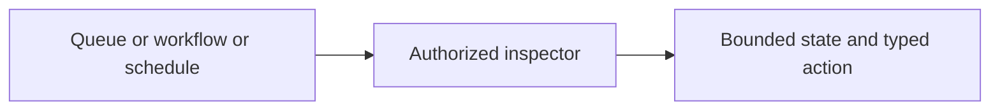

<!-- Copyright 2026 Cellar Project Authors. Licensed under Apache-2.0. -->

# Queue, workflow and schedule inspectors

Purpose: Record queue, workflow, and schedule inspection contracts and their completed console verification.

[Design library](README.md) · [Topic contract](003-fleet-dashboard.md)

| Implementation | Validation or example |
| --- | --- |
| [Code and API](../../crates/cellar-admin/README.md) | [Checks and usage](../../packages/console/README.md) |

The map summarizes this document’s scope; the recorded gates determine completion.

Status: DONE. Based on `4de09b1` (PR #30) on 2026-10-14.

## Required result

- Queue: each loaded message opens a detail panel with its payload, age in this
  queue, delivery attempts, visibility, lease expiry and dead-letter provenance.
  Preserve non-consuming observations, binary bytes and bounded payload reads.
- Workflow: persistent pinned step details, searchable retained history, duration
  overlays and side-by-side comparisons of execution generations/instances and
  their recorded definition versions. Respect redaction, repeated steps, parallel
  events, incomplete history and per-workspace payload limits.
- Cron: configuration/adoption remains distinct from real execution history.
  Record actual handler attempts and scheduled workflow requests in the owning
  scheduling cell, including failures, retry decisions, background settlement,
  timing and the adopted deployment/schedule identity. Inspect this journal through
  the authenticated owner route; a saved or adopted schedule is not a successful run.

## Contracts

- Queue inspection never leases or settles a message.
- Workflow diagrams remain non-executable; comparison does not pin executable versions or change replay.
- Cron history shares the scheduling cell's SQLite and output gate.
- Interrupted attempts remain non-terminal observations; never invent a successful completion.
- Preserve cron retry policy and event/background lifetimes.
- Signed history queries use an owner-routed read-only RPC; an unsupported older owner must never treat inspection as a legacy fetch/arm request.
- Cap retained records, read pages, searches and browser payloads; missing historical facts stay explicit.

## Verification

- Run root AGENTS.md checks in the checkout's stable target directory.
- Cover queue snapshots and leases/transfers with native_queue; workflow history/definitions with native_workflow, native_workflow_cell and native_artifacts; cron attempts, retries, background work, cancellation and reactivation with native_cron.
- Exercise owner routing on SDK nodes and the isolated preview.
- Run cellar-admin tests and dashboard install/build/lint/browser tests.
- Review light/dark and narrow rendered views.

PR #30 is still open. Keep this work on `codex/resource-inspectors`, with #30 as its dependency until the SQL/KV workspaces merge. Completion requires the entire queue/workflow/cron objective and verified evidence for every requirement above.

## Delivered and verified (2026-10-14)

- Queue message sheets preserve JSON/text/binary bytes and display owner-observed
  age, delivery attempts, visibility, active/expired leases and retained transfer
  provenance. Native queue tests cover leases, expiry, settlement and dead-letter
  acceptance; UI tests verify byte-exact downloads, keyboard focus and mobile fit.
- Workflow history search scans bounded owner pages and continues across pages
  with no matches. Sensitive data remains redacted; oversized search fields are
  explicitly omitted. Pinned snapshots, repeated-step timing, complete/partial
  intervals, scoped history retention and definition comparisons are tested.
  Binding identity and owner scope prevent results from mixing after rebinding.
- Cron records actual handler attempts, retry decisions and drained background
  failures, and records workflow acceptance separately. Interrupted attempts keep
  unknown completion/retry evidence. Native tests cover retention, filtering,
  pagination, reactivation and removed schedules. Signed history queries reuse
  cancellable RPC routing; the two-node test verifies forwarded reads without
  arming and refusal of unsupported query protocols. Anonymous cron fetches are
  refused. Configuration adoption remains separate from actual execution.

- Validation passed: formatting, dependency guard, documentation guard, workspace all-target/all-feature check, native CLI/artifacts tests, 13 admin tests, 24 SDK node tests, queue/workflow/cron tests, workspace doc tests, Clippy with warnings denied, dashboard install/build/lint and 33 browser/helper tests.
- SDK lib/tests were exercised in the broad run, focused current-source runs and the remaining workspace run.
- The broad run encountered a connection refusal in the Axum overload fixture; its isolated rerun and the remaining workspace run both passed.
- The isolated harness proof guards also passed all 64 tests.

- The live preview runs eight Docker nodes, each limited to one CPU and 2 GiB, with 10,000 counter values restored from the saved synthetic fixture and verified through SDK HTTP reads.
- Owner-routed queue snapshots, workflow paging/search/run comparison and cron execution records were checked live, with rendered light/dark and 390 px views and no page overflow.
- The original shared Docker VM was deleted externally during verification; the preview now runs in this checkout's dedicated Colima profile.
- Counter values were reconstructed, while prior workflow history was not recovered.
- This is a fresh local fixture, not a crash-recovery claim.

PR #31 is stacked on #30. Definition comparison does not pin executable versions; old executions are not backfilled into the new cron journal. Queue age/attempts refer to the current queue, not unretained source history. Browser state remains bounded and in memory.