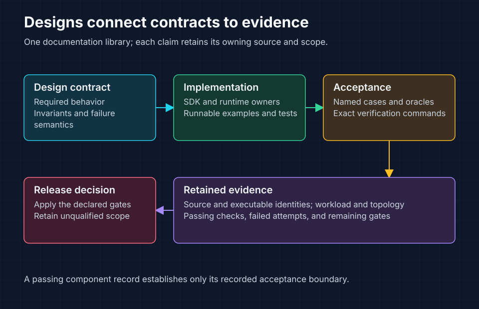

<!-- Copyright 2026 Cellar Project Authors. Licensed under Apache-2.0. -->

# Design plans and qualification records

Purpose: Find technical designs, implementation plans, task inventories, and source-pinned qualification evidence within the documentation library.

[Documentation library](../README.md) · [Offline explorer](../index.html) · [Maintenance rules](../25-documentation-maintenance.md)



The library connects each contract to implementation and evidence. Recorded test results retain their original source, environment, and limitations.

## Choose a topic

| Topic | Contract and delivery plan | Implementation or evidence | Code and usage |
| --- | --- | --- | --- |
| Consensus and recovery | [Multi-Raft package](multi-raft/README.md) | [Task inventory](multi-raft/tasks.json), [validation](multi-raft/validation.md) | [Raft host](../../crates/cellar/durability/raft/README.md) |
| Fleet operations | [Balancing and maintenance](multi-raft/fleet-operations/README.md) | [Progress](multi-raft/fleet-operations/progress.md) | [Operator workflows](multi-raft/fleet-operations/operator-workflows.md) |
| Event delivery | [Outbox, streams, subscriptions](002-outbox-streams-subscriptions.md) | [Implementation ledger](outbox-implementation-status.md) | [Current SDK guide](../26-event-delivery.md) |
| Filesystem | [Primitive design](per-cell-filesystem-design.md), [API](per-cell-filesystem-api.md), [delivery plan](per-cell-filesystem-implementation.md) | [Status](per-cell-filesystem-implementation-status.md), [conformance](per-cell-filesystem-conformance.md) | [Filesystem SDK](../../crates/cellar/application/filesystem/README.md) |
| Optional mounted filesystem | [FUSE and execution proposal](per-cell-filesystem-fuse-design.md) | Separate proposal and acceptance gates | [Primitive boundary](per-cell-filesystem-design.md#primitive-only-boundary) |
| Python | [Plan 007](007-embedded-python-pyo3.md) | [Milestones and gates](007-embedded-python-pyo3.md#implementation-milestones-and-acceptance-gates) | [Adapter](../../crates/cellar-python/README.md), [example](../../examples/python/README.md) |
| JavaScript and TypeScript | [Plan 008](008-embedded-javascript-typescript.md) | [Bridge measurements](javascript-bridge-performance-2026-10-22.md) | [Adapter](../../crates/cellar-javascript/README.md), [Node example](../../examples/node/README.md) |
| Named, typed RPC | [Plan 009](009-named-typed-rpc.md), [registration](named-typed-rpc/registration-and-dispatch.md) | [Implementation ledger](named-typed-rpc/implementation-status.md), [release gates](named-typed-rpc/production-gates.md) | [Code generation](../../tools/rpc/README.md) |
| Sandbox providers | [Compatibility and delivery](sandbox-provider-compatibility.md) | [Implementation ledger](sandbox-provider-progress.md) | [Provider SDK](../../crates/cellar-container/README.md) |
| Durable agents | [Live trial](vercel-agent-live-qualification.md) | [RustFS recovery trial](vercel-agent-rustfs-qualification.md) | [Agent example](../../examples/vercel-agent/README.md) |

## Image persistence performance

These experiments use constrained three-node fleets and retain their original
source identities and qualification limits. Append segments remain opt-in.

| Read when investigating | Record |
| --- | --- |
| Dense and initially empty cells | [One-GiB experiment](dense-durability-2026-10-28.md), [empty-state comparison](empty-state-durability-2026-10-29.md) |
| Quorum versus Fleet latency | [Pipeline diagnosis](quorum-throughput-diagnosis-2026-10-29.md) |
| Staging, preparation and publication | [Image optimization](quorum-image-optimization-2026-10-29.md), [parallel publication and barrier batching](quorum-parallel-publication-2026-10-29.md) |
| Append-segment storage and recovery | [Contract and matched results](quorum-append-segments-2026-10-29.md) |
| Read throughput and client evidence | [File/append comparison](read-performance-verification-2026-10-29.md), [client ledger optimization](client-ledger-optimization-2026-10-29.md), [32/64 readers](readers-32-64-verification-2026-10-29.md) |

## Completed foundation and console work

These records describe completed local implementation boundaries. Their evidence does not qualify later releases or broader deployment targets.

| Record | Delivered boundary | Current entry point |
| --- | --- | --- |
| [001: Component layout](001-component-layout.md) | Physical component grouping with preserved Rust paths | [Architecture guide](../03-architecture.md) |
| [002: Axum and OpenAPI](002-axum-openapi-adapter.md) | Shared application registration and two HTTP hosts | [Axum crate](../../crates/cellar-axum/README.md) |
| [003: Fleet dashboard](003-fleet-dashboard.md) | Fleet, node, and cell management console | [Admin crate](../../crates/cellar-admin/README.md) |
| [004: SQL and KV workspaces](004-sql-kv-workspaces.md) | Owner-routed SQL and key-value operations | [Console](../../packages/console/README.md) |
| [005: Resource inspectors](005-resource-inspectors.md) | Queue, workflow, and schedule inspection | [Admin crate](../../crates/cellar-admin/README.md) |
| [006: Event console](006-event-console.md) | Outbox, stream, and subscription controls | [Event guide](../26-event-delivery.md) |

## Read status and evidence

| Artifact | Interpretation |
| --- | --- |
| Technical design or API sketch | Required contract; consult the owning ledger for implemented behavior |
| `tasks.json` | Package status, dependencies, named acceptance cases, and required commands |
| Implementation ledger | Source-specific progress, failures, and remaining gates |
| Qualification report | Results only for the recorded candidate, workload, topology, and failure cuts |
| Evidence JSON or log | Retained provenance; historical paths and argument vectors describe the original run |

Run documentation checks from the repository root:

```sh
python3 tools/docs/build.py
python3 tools/docs/check.py
```

Inspect the machine-readable task inventories without executing their future commands:

```python
import json
from pathlib import Path

for path in Path("docs/design").rglob("tasks.json"):
    tasks = json.loads(path.read_text())["tasks"]
    for task in tasks:
        print(task["id"], task["status"], task["title"])
```

The [multi-Raft inspector](multi-raft/README.md#inspect-and-validate-the-package) and [fleet inspector](multi-raft/fleet-operations/README.md#inspect-and-validate-the-package) additionally validate dependencies and evidence. Missing retained local artifacts remain validation failures.
