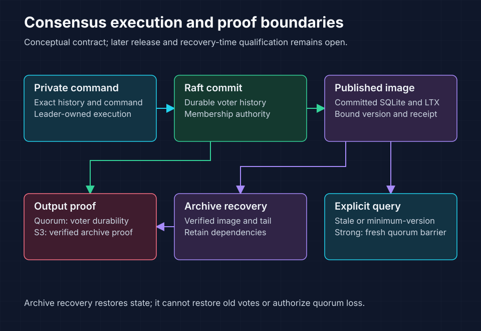

<!-- Copyright 2026 Cellar Project Authors. Licensed under Apache-2.0. -->

# Multi-Raft design and delivery

Purpose: Navigate consensus contracts, ordered implementation packages, recovery work, and source-pinned qualification records.

[Design library](../README.md) · [Current SDK contract](application-contract.md) · [Raft host](../../../crates/cellar/durability/raft/README.md)



Leaders execute private commands; replicas publish committed SQLite/LTX images. Quorum and S3 requests require their respective durability proofs. S3 recovery does not restore votes, leadership, or quorum.

## Shared cell-group replacement

The [density decision](density-decision.md) selects multiple independent SQLite
cells per Raft group. The [cell-group package](cell-groups/README.md) specifies
16 dependent tasks for complete manifests, shared execution, split/merge,
hibernation and fenced recovery. Contracts/storage/routing gates have passed;
shared execution is in progress. Production SDK cutover and final qualification
remain required. A dedicated hot cell uses the same machinery at occupancy one.
The MR evidence below retains the earlier one-cell implementation's scope.

## Delivery status

The [task inventory](tasks.json) records these package boundaries:

| Packages | Status | Remaining boundary |
| --- | --- | --- |
| MR-01–MR-12 | DONE at recorded native boundaries | Preserve each evidence record’s source and scope |
| MR-13 | IN_PROGRESS | Complete resource, lifecycle, management, and recovery qualification |
| MR-14 | IN_PROGRESS | Complete batching and workload qualification |
| MR-15 | TODO | First-release failure histories and release acceptance |
| MR-16–MR-17 | TODO | Density, larger physical tiers, and federation |

MR-01–MR-15 define first-release acceptance. The complete delivery goal remains open. Physical capacity and recovery-time targets require measured qualification.

## Contract and implementation map

| Read when implementing | Owning document |
| --- | --- |
| Authority, identity, commit, storage, and recovery | [Technical design](technical-design.md) |
| Package dependencies, invariants, named tests, and stop conditions | [Implementation plan](implementation-plan.md) |
| Commands, queries, receipts, versions, and effects | [Application contract](application-contract.md) |
| Storage ownership and filesystem adaptation | [Storage audit](storage-integration.md) |
| Host admission and command output | [Host audit](host-audit.md) |
| Read barriers, image ownership, and origin identity | [Read audit](read-audit.md) |
| Archive publication and output proofs | [Archive audit](archive-audit.md) |
| Snapshot authorization and installation | [Snapshot audit](snapshot-audit.md) |
| Placement, repair, and trusted processes | [Membership](membership-design.md), [node directory](node-directory-design.md) |
| Committed Blob, alarms, outbox, and receiver receipts | [Business effects](effects-design.md) |
| Node admission, readiness, drain, and production startup | [Operations](operations-design.md), [receipt maintenance](receipt-maintenance-design.md) |
| Fleet balancing, scaling, and intact maintenance | [Fleet package](fleet-operations/README.md) |

## Recovery and performance records

| Topic | Contract or experiment | Evidence boundary |
| --- | --- | --- |
| Large images | [Large-cell design](large-cell-recovery.md), [10 GB implementation](10gb-implementation.md) | Implemented components and open release requirements |
| Bounded recovery time | [Plan 010](010-large-cell-recovery-time.md) | RT-01–RT-05 in progress; RT-06 TODO; time targets unqualified |
| Demand reads | [Extent-root contract](extent-root-contract.md) | Component verification and public integration boundaries |
| Zero quorum | [Disaster recovery](disaster-recovery.md) | Explicit fencing and admission; independent production adapter gates |
| Owner disk loss | [Separate-process trial](process-recovery-qualification.md) | Frozen 10 GB RustFS trial |
| All-voter disk loss | [Full-quorum trial](full-quorum-recovery-qualification.md) | Frozen 10 GB RustFS trial |
| Log reclamation | [RustFS experiment](log-reclamation-benchmark.md) | Correctness observations; contended timing |
| Control scheduling | [Window experiment](control-window-performance.md) | Matched runs and remaining performance work |
| TiKV comparison | [Investigation record](tikv-performance.md) | Accepted and rejected candidates with retained failures |
| Scale targets | [Scaling](scaling.md), [capacity profiles](capacity-profiles.json) | Illustrative arithmetic and required measurement tiers |

## Inspect and validate the package

Use Python 3.10+ from the repository root. These commands inspect requirements without running the listed runtime commands:

```sh
python3 docs/design/multi-raft/plan.py validate
python3 docs/design/multi-raft/plan.py preflight
python3 docs/design/multi-raft/plan.py ready
python3 docs/design/multi-raft/plan.py show MR-13
python3 -m unittest discover -s docs/design/multi-raft -p 'test_*.py'
```

| Command | Expected contract |
| --- | --- |
| `validate` | Check dependencies, required cases, source paths, links, and completion evidence |
| `preflight` | Compare pinned hashes; fail on source drift without rewriting the baseline |
| `ready` / `show` | Print eligible work or task requirements after package validation |
| `check-list` | Require each named test exactly once; test execution remains required |

A relocated source uses `current_path`; its original `path`, hash, and baseline revision retain their provenance. DONE requires completed dependencies, passing named cases, exact command records, and retained evidence.

## Qualification and compatibility boundaries

- Use the [qualification plan](qualification.md) for failure oracles and release gates.
- Use [implementation history](implementation-history.md) for the former overview’s detailed component evidence and source pins.
- Use [validation history](validation.md) and [evidence schema](evidence/README.md) to interpret retained records.
- Keep Fleet-mode authority separate from Raft membership. Quorum loss cannot authorize a bucket-only fallback.
- Retain immutable namespace identity and capability digests. Numeric format markers remain `1`; hard cutovers require fresh compatible experimental prefixes.

Local fixtures and Colima reports retain their recorded scope. They do not qualify independent physical failure domains, production capacity, or federation.