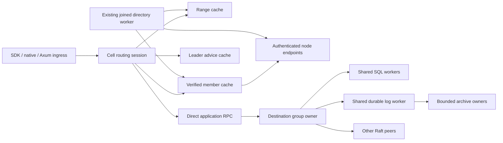

<!-- Copyright 2026 Cellar Project Authors. Licensed under Apache-2.0. -->

# Cell-group routing, lifecycle and performance optimization

Purpose: TiKV-informed design for direct routing, precise cache repair, sustainable group movement and bounded shared execution.

Status: proposed implementation design, written on 2026-11-07. This document
defines work and acceptance criteria; it records no new runtime qualification.
It supplements [design](design.md), [protocols](protocols.md) and
[qualification](qualification.md). It does not close or replace their CG gates,
including full primitive compatibility. Implementation remains tracked by the
existing [plan](implementation-plan.md) and [remaining work](remaining-work.md).

Cellar initial routing review: `b44dd5e0ff185c38fed9d9c33cd732ee3a35b7af`.
The main thread advanced during drafting. The selection and reclamation delta
was reviewed through `b654262e1d7b160faea62015f327034e442d6a52`, including
`ee7d7b62` local selection and `1154e5f1` source cleanup. The current-boundary
table below incorporates that progress rather than proposing it as absent work.
Publication review against Cellar `2a0278cf853fb52f3f4d026e2db2c3bd1929c650`
also incorporates accepted CG-11 placement/continuation/cleanup and CG-12
park/wake behavior. Those scoped acceptances remain closed; the additional
optimization and release oracles below require their own evidence.
TiKV checkout reviewed: `b3995dab28308f09cbb7c125bf32f789dbc203fe` at
`/Volumes/Workspace/Github/tikv`. TiKV client-go reviewed:
`31fb9cbfa2ae69cbc7c2236485ab35bfb6a6bfa9`. The server and client revisions
are separate source observations, not a qualified deployment pairing.

## 1. Decision and measurable outcomes

Keep one Raft group per range of whole cells, many groups per node, and three
voters by default. Optimize the existing shared runtime in four directions:

1. A healthy cached write from an ingress node with no replicas sends one
   application RPC directly to the leader. Raft replication, optional S3 proof
   and initial connection setup are additional work, not hidden in this count.
2. Elections repair leader advice; membership changes repair replica placement;
   split/merge repairs affected ranges; restarts repair authenticated endpoints.
   These events must not all trigger the same metadata refresh.
3. Repeated movement recovers capacity through durable retirement and verified
   physical cleanup, while preserving permanent history fencing and receipts.
4. Shared workers amortize consensus and persistence work with bounded latency
   interference, memory, I/O, controller fanout and shutdown ownership.

Quorum acknowledgement still requires commitment and the exact applied receipt.
S3 acknowledgement still requires verified retained archive coverage. No routing
hint, catalog observation or successful connection is either proof.

## 2. TiKV investigation and architectural lessons

The source links in this section are pinned. The older
[Multi-Raft explanation](https://tikv.org/deep-dive/scalability/multi-raft/)
is conceptual background; its historical tick intervals and storage description
are not current configuration recommendations.

| TiKV mechanism inspected | Evidence | Cellar decision |
| --- | --- | --- |
| Client caches range metadata, versioned Region identity and store information; leader selection can change independently | [RegionCache, RegionVerID and UpdateLeader](https://github.com/tikv/client-go/blob/31fb9cbfa2ae69cbc7c2236485ab35bfb6a6bfa9/internal/locate/region_cache.go) | Separate cell placement, committed membership, leader advice and node endpoints |
| Request handling treats leader changes differently from range-epoch changes | [RegionRequestSender and onRegionError](https://github.com/tikv/client-go/blob/31fb9cbfa2ae69cbc7c2236485ab35bfb6a6bfa9/internal/locate/region_request.go) | Typed repair scopes and explicit mutation outcome classification |
| Peer admission validates store, peer, role, term and Region context before ordinary proposal | [pre_propose_raft_command](https://github.com/tikv/tikv/blob/b3995dab28308f09cbb7c125bf32f789dbc203fe/components/raftstore/src/store/fsm/peer.rs#L5976) | Every destination validates full Cellar identity, authority, range and admission, even on cache hits |
| Peer FSM polling collects work across replicas and has separate apply and I/O owners | [store polling](https://github.com/tikv/tikv/blob/b3995dab28308f09cbb7c125bf32f789dbc203fe/components/raftstore/src/store/fsm/store.rs), [apply FSM](https://github.com/tikv/tikv/blob/b3995dab28308f09cbb7c125bf32f789dbc203fe/components/raftstore/src/store/fsm/apply.rs) | Preserve the group owner and shared SQL/apply/persistence domains; measure fairness instead of adding per-cell Raft tasks |
| Async write tasks batch persistence and report persisted work; messages with persistence dependencies are released in that lifecycle | [WriteTask and write_to_db](https://github.com/tikv/tikv/blob/b3995dab28308f09cbb7c125bf32f789dbc203fe/components/raftstore/src/store/async_io/write.rs) | Batch existing engine writes without weakening Ready, sync or completion ordering |
| Local reads check leases; historical reads check safe timestamps | [local read worker](https://github.com/tikv/tikv/blob/b3995dab28308f09cbb7c125bf32f789dbc203fe/components/raftstore/src/store/worker/read.rs) | Keep Cellar's ReadIndex and immutable image proof as baseline; do not reinterpret a cell version as an MVCC timestamp |
| Region/store reports feed external scheduling; load-based candidates must re-enter current peer validation | [PD worker](https://github.com/tikv/tikv/blob/b3995dab28308f09cbb7c125bf32f789dbc203fe/components/raftstore/src/store/worker/pd.rs), [split controller](https://github.com/tikv/tikv/blob/b3995dab28308f09cbb7c125bf32f789dbc203fe/components/raftstore/src/store/worker/split_controller.rs) | Observations propose plans; rooted admission and actual owners authorize execution |
| Peer destruction is coordinated with metadata and background cleanup | [Peer::destroy](https://github.com/tikv/tikv/blob/b3995dab28308f09cbb7c125bf32f789dbc203fe/components/raftstore/src/store/peer.rs#L1444) | Separate durable non-resurrection from logical removal and eventual file deletion |
| Hibernation is a group protocol with votes and wake state | [HibernateState](https://github.com/tikv/tikv/blob/b3995dab28308f09cbb7c125bf32f789dbc203fe/components/raftstore/src/store/hibernate_state.rs) | Preserve accepted CG-12 eligibility, wake and fencing; cell idleness alone cannot stop group consensus |

The checkout contains both classic raftstore and the separately selected
tablet-based raftstore-v2. The latter has its own
[query/read progress](https://github.com/tikv/tikv/blob/b3995dab28308f09cbb7c125bf32f789dbc203fe/components/raftstore-v2/src/operation/query/mod.rs)
and [merge operations](https://github.com/tikv/tikv/tree/b3995dab28308f09cbb7c125bf32f789dbc203fe/components/raftstore-v2/src/operation/command/admin/merge).
This proposal borrows ownership and protocol principles; it does not combine
the two engines' implementation details. PD server scheduling algorithms were
not independently audited here; the inspected boundary is TiKV's reporting and
operator interface, not a proposal to reproduce PD.

TiKV's Region version identity includes both configuration and range versions.
Cellar should retain the same separation of concerns through its existing
membership revision and range epoch, with Raft term and node boot kept separate.
This is an adaptation of the model, not a requirement to copy TiKV's type names.

Cellar differs materially: whole SQLite cells remain independent state and
transaction boundaries, followers apply cell-addressed LTX effects, and archives
retain complete image/log closures. Hash-ordered cell routing remains the
existing contract. TiKV's byte-range scans, MVCC, timestamp oracle and distributed
transactions are not introduced by this optimization. Co-locating cells in one
Raft group does not create a cross-cell SQL transaction API.

## 3. Current Cellar boundary

| Existing mechanism at the reviewed source | Optimization gap |
| --- | --- |
| [Bounded range cache](../../../../crates/cellar/durability/raft/cell_groups/directory/route_cache.rs) and cache-first routing sessions | A newer routing publication clears all cached ranges; preserve proven unaffected intervals |
| [Managed router discovery](../../../../crates/cellar/durability/raft/group_host/router_directory.rs) validates selected births and observed membership | Coalesce demand refreshes, avoid broad scans for ordinary elections and expose repair cost |
| [Replica route installation](../../../../crates/cellar/durability/raft/query_cell_discovery.rs) checks identities and membership revision | Add independent leader advice without turning a hint into membership or endpoint authority |
| [Mutation routing](../../../../crates/cellar/durability/raft/cell_groups/dispatch/mutation_route.rs) probes candidates when no local replica exists | Reuse validated leader advice across invocations to remove steady-state probing |
| [Read routing](../../../../crates/cellar/durability/raft/cell_groups/controller/query_routes.rs) and [read authority](../../../../crates/cellar/durability/raft/cell_groups/read_authority.rs) retain original budgets and pinned cell state | Add locality/load preferences without weakening the requested consistency |
| [Shared runtime persistence batches](../../../../crates/cellar/durability/raft/cell_groups/runtime/worker.rs) and one [engine worker](../../../../crates/cellar/durability/raft/storage.rs) already exist | Measure batching efficiency, queue interference and physical amplification; do not claim batching is absent |
| [Automatic placement](../../../../crates/cellar/fleet/management/raft/automatic_partition.rs), bounded sizing selection and [durable selected work](../../../../crates/cellar/durability/raft/fleet_catalog/managed_partition_work.rs) | Reuse accepted CG-11 unattended execution; extend load observations and measure repeated movement at release scale |
| [Source cleanup](../../../../crates/cellar/durability/raft/cell_groups/source_reclaim.rs), atomic engine refusal/Clean, bounded payload collection and [rooted all-node settlement](../../../../crates/cellar/durability/raft/fleet_catalog/managed_source_settlement.rs) | Reuse the existing cleanup intent and completion protocol; independently prove physical shared-segment release before crediting those bytes |
| [Conservative resource floors](../../../../crates/cellar/durability/raft/fleet_catalog/resources/completion/records.rs) and [once-only member settlement](../../../../crates/cellar/durability/raft/fleet_catalog/resources/member_settlement.rs) | Keep exact release proofs and unknown debt; lower samples alone cannot refund capacity |

The existing [progress records](progress.md) retain their original qualification
scope. CG-11 and CG-12 have complete functional acceptance records. Those passes
do not prove every additional optimization oracle below or the combined release.
In particular, logical cleanup and proof-based slot settlement do not by
themselves prove that shared segment bytes have left disk.

## 4. Ownership and metadata model



Extend existing owners. Do not add a second directory authority, a RawNode on
ingress-only nodes, one background worker per cached group, or a new production
backend. Runtime state and I/O stay outside cellar-logic; pure ranking and repair
decisions can live there when they form a reusable domain contract.

| Observation | Key and necessary binding | Invalidation |
| --- | --- | --- |
| Cell placement | Cluster, namespace, cell routing key; group history, birth/schema digest, interval, range epoch, verified directory root | Affected interval publication, namespace recovery/fence, incompatible schema |
| Replica set | Full group history, committed configuration revision and configuration digest; member/node/disk bindings | New verified configuration; recovery incarnation change |
| Leader hint | Full group history, configuration digest/revision, leader member, observed Raft term, observation provenance and local monotonic age | Conflicting/newer term, removed member, configuration change, failed target or bounded expiry |
| Node endpoint | Node identity, boot/process/disk/engine bindings, authenticated addresses and trust revision | Enrolled restart/replacement, trust revocation, verified endpoint update |

Range epoch, membership revision, Raft term, directory revision and node boot
generation are different dimensions. Do not compare them as one version number.
Group and cell incarnations prevent observations from a recovered history being
reused for its predecessor. A cached record never extends authority expiry or
avoids an already required trust/revocation check.

Use immutable snapshots for attempt selection and short cache mutation locks.
Each attempt retains the exact route and endpoint generation it entered with.
New observations affect subsequent attempts; they do not rewrite an in-flight
request or release its resource owner.

## 5. Leader advice and direct write protocol

### 5.1 Advice admission

Add a bounded leader-advice index beside the existing transport route registry.
Its entries and refresh requests consume the existing explicit control-memory
and route-entry budgets. Extend configuration only with validated sub-budgets
whose sum fits those parent limits. Expiry uses the execution-domain monotonic
clock. Eviction and expiry reduce routing quality, never correctness.

Accept advice only from an authenticated response for the attempted group and
configuration. The suggested leader must be a legal current incoming voter;
Joint configurations require the committed configuration's role rules. A hint
cannot supply an arbitrary address. Resolve its node through the enrolled node
directory. A leader absent from the cached member set triggers verified membership
refresh rather than insertion from the hint.
Bind the advice issuer to the authenticated endpoint generation of that attempt;
a late response from a superseded boot cannot update a current cache entry.

Within one configuration, an older observed term cannot overwrite a newer one.
Conflicting leaders at the same observed term make the advice unusable and trigger
bounded discovery. Across configurations, revalidate against the new member set.
No hint is a leadership lease. A successful receipt reply also does not prove
its responder is the current leader; advice must come from an actual owner
observation, not be inferred from the responding address.

Extend the existing authenticated response codecs with a typed optional advice
record and outcome classification. Current member-only query hints and boolean
write probes are not sufficient to invent a term or configuration proof. Keep
Cellar-owned markers at 1 and perform an internal hard protocol cutover with
matching rebuilt clients; do not retain a second legacy wire reader.
Use bounded fixed-width identity fields and strict decode limits; advice cannot
carry an unbounded peer list, opaque error text or redirect URL. Charge encoded
and decoded response memory and prove the new fields fit existing frame limits.

### 5.2 Request and result contracts

Every forwarded mutation retains the original logical cell history, command ID,
command fingerprint, captured inputs, schema/class binding, requested durability,
absolute deadline and finite attempt bank. Attempt metadata adds the selected
range epoch, birth digest, group history, target member and endpoint generation.
Do not change the existing business-command fingerprint to accommodate new
routing advice.

The following are proposed semantic types, not existing Rust API names:

```text
MutationOutcome =
  RejectedBeforeAdmission { typed_reason, optional_advice }
  | AdmittedOrUnknown { original_command_id, optional_observation }
  | Applied { exact_receipt, achieved_durability, optional_advice }

RepairScope = Leader | Membership | Endpoint | Range | None
```

Only the owner that can prove no producer/proposal was admitted may return
RejectedBeforeAdmission. A generic NotLeader, timeout, transport close, stale
completion or cancelled waiter must not be relabeled as that proof. Applied
does not satisfy an S3 request until its achieved durability includes the exact
required archive proof; it may instead drive archive reconciliation.
A proven rejection describes that attempt only. It cannot clear uncertainty
from any earlier attempt of the same command; retain the invocation's original
reconciliation state until authoritative settlement.

### 5.3 Steady-state and repair flow

1. Enter the existing invocation owner and consume its original admission budget.
2. Resolve the cell from its range cache; use the trusted directory on a miss.
3. Select the verified replica set and cached leader advice. If usable, send the
   original mutation directly to that member without a leader probe.
4. The destination independently verifies origin permission, all identities,
   active range/epoch, membership, role, readiness, capacity and command identity
   before entering SQL or proposal work.
5. On a proven pre-admission refusal, apply the smallest typed repair and retry
   within the same invocation budget. Unknown leadership may use the existing
   bounded candidate-probe path, coalesced per group/configuration.
6. After possible admission, retain the original producer/reconciliation owner.
   Resolve its authoritative receipt or retry the same command under the existing
   deduplication contract. Do not execute a fresh callback with a new command ID.
7. Acknowledge only the exact receipt and durability required by the invocation.

| Event or response | Repair | Mutation handling |
| --- | --- | --- |
| Authenticated NotLeader with valid current-member advice | Leader only | Resubmit only with proven pre-admission refusal; otherwise reconcile original ID |
| No leader / election in progress | Clear suspect advice; bounded peer discovery and backoff | Same outcome rule and original deadline |
| Verified configuration mismatch or removed member | Membership, then affected advice | Preserve cell placement unless independently stale |
| Process/disk/endpoint mismatch | Node endpoint and dependent route generations | Never redirect to an unverified address or bypass the send fence |
| Range epoch mismatch, sealed parent or selected successor | Affected cell interval and successor membership | Preserve command identity and transferred receipts |
| Busy / overload | Backoff or choose an eligible read replica | No namespace-wide refresh; no larger admission bank |
| Connection loss or timeout after transmission | Mark target suspect; outcome remains ambiguous | Reconcile exact receipt; receipt absence alone is not proof of non-commitment |
| Permission, schema or foreign-history failure | None | Return the typed terminal refusal |

Incoming application RPCs execute at the selected destination. They do not start
unbounded forwarding chains. All discovery, backoff, probes, redirects and receipt
lookups share the original absolute deadline and attempt accounting. Coalesced
refresh has an owned bounded lifetime; one caller cancelling neither frees entered
work nor cancels other admitted waiters. Closing joins the refresh owner.

## 6. Targeted range repair without stale resurrection

The current cache's whole-cache invalidation is the safe fallback. Replace it
only after implementing all of the following proof and race rules:

1. A range update is rooted in the trusted directory publication and identifies
   the complete removed parent intervals and selected replacement intervals.
   Validate non-overlap, boundary coverage, range epochs, histories and schema.
2. Under the cache lock, invalidate every overlapping old entry and install only
   verified selected replacements. Retain unaffected entries as observations
   of their own verified roots; do not relabel them as verified at the new root.
3. Honor each invocation's catalog floor. An older unaffected observation below
   that floor requires a new lookup/proof. Cached permission is never inferred.
4. Every asynchronous lookup captures a local cache generation. Before insertion,
   recheck it and relevant invalidations. An older lookup cannot resurrect an
   overlapping parent or override a recovery fence.
5. If intervening publications cannot be verified within the existing bounded
   metadata work, clear the cache and perform a targeted lookup. Never scan an
   unbounded journal on the request path to preserve a cache hit.
6. Recovery incarnation, namespace fence or incompatible namespace binding
   invalidates all dependent range/member/leader observations.

Keep invalidation metadata bounded. Exhausting its budget selects full invalidation,
not forgetting a safety-critical negative observation. Cold return after all birth
voters have been replaced still uses rooted membership and current enrolled nodes;
birth placement alone is insufficient.

## 7. Read selection and barrier amortization

Separate requested consistency from replica preference. Preference may rank
eligible replicas by locality, observed latency, apply lag and queue pressure.
It cannot weaken consistency when its preferred replica is unavailable.

| Consistency | Required evidence at the destination | Selection behavior |
| --- | --- | --- |
| Linearizable | Fresh correlated ReadIndex/current-term quorum barrier, contiguous local apply, coherent pinned target-cell image | Prefer the leader for low single-query latency; allow eligible follower reads with the barrier cost accounted for |
| AtLeast(version) | Authenticated target cell/schema/lineage and an image whose cell witness meets the requested version | Prefer a caught-up nearby replica; follow the existing transition lineage rules |
| Explicit Stale | Valid locally committed immutable cell image and destination admission | Prefer locality/load; do not claim bounded age |
| RecentSource | Existing bounded source observation and its actual expiry | Preserve the existing source contract; do not call it quorum freshness |

Preserve [CellReadAuthority](../../../../crates/cellar/durability/raft/cell_groups/read_authority.rs)
as a consumed, invocation-bound proof. A group applied index is not a substitute
for the target cell's version. Pin the selected SQLite/LTX image through physical
query completion, including after an async waiter expires.

ReadIndex batching may combine reads admitted before one newly initiated barrier
in the same group/configuration/term. Each read still waits for local apply and
gets its own coherent image and resource owner. Reads arriving after that barrier
was initiated need a suitable later barrier; do not reuse a completed observation
as a leadership lease. Bound cohort size, bytes and wait time under existing limits.

Leader lease reads require a separate clock, election, suspension and fencing
proof before introduction. Arbitrary historical reads require a separately defined
retained-snapshot contract. Cellar's version tokens do not establish TiKV-style
MVCC safe timestamps. Neither optimization is a prerequisite for direct routing.

## 8. Durable source reclamation and capacity settlement

### 8.1 Protocol and irreversible boundary

Retirement, logical engine removal and physical byte reclamation are separate
events. Local refusal/Clean, bounded collection, exact replay and a synced local
completion receipt, rooted Fleet cleanup intent and all-node settlement already
exist. Reuse those owners while extending physical accounting proof and release
qualification. The lifecycle to preserve and qualify is:

```text
SelectedRetirement
  -> OwnersJoined
  -> ReclaimAuthorized
  -> EngineTombstoned
  -> FilesReconciled
  -> CapacitySettled
```

Before ReclaimAuthorized, verify the exact immutable plan, completed directory
publication, final source-member retirement evidence, live child quorum/archive
coverage and release of the plan's source holds. A remaining transfer, recovery,
snapshot, reader, effect, archive or ambiguous command dependency blocks destructive
removal and credit for the resources it retains. Independent cleanup can proceed
only while those dependencies stay protected by their actual owners and pins.
Do not delete an offline member's disk merely because other members retired.
Persist the cleanup intent before final transition ownership is released. Keep
the operation's disruption/resource claims until every selected source node has
an accounted settlement or the separately authorized fencing disposition. The
intent records exact expected source identities and stable node-cleanup request
IDs, so coordinator replacement cannot forget a partially collected source.

OwnersJoined requires actual target-group producer completion, removal of serving,
SQL/seed/checkpoint/transport registrations, and the existing joined runtime,
archive and persistence checks. Waiter cancellation does not establish completion.
Stale local handles must be sealed against new work before engine mutation.

At EngineTombstoned, the engine worker atomically syncs a permanent compact history
tombstone, deletion of the live mapping and cleaning of that physical Raft group.
Use the engine's atomic batch/root fence. Bind the tombstone to full group history,
birth, local engine/disk/member, selected operation/retirement commitment and final
durable cut. The transaction must recover as either the old complete mapping or
the durable tombstone; a missing mapping is not permission to recreate genesis.

All birth, retained-startup, seed, recovery and persist entry points reject the
tombstoned history. Remote Fleet/directory history fencing remains permanent.
Reclamation creates no new incarnation or membership authority. Preserve the
implemented permanent group-ID refusal, including attempted reuse under another
namespace or incarnation. It is stronger than a history-only negative cache.
Keep its persisted metadata quota, reconstructed memory charges and exact replay
at quota exhaustion. A future disk-index optimization needs its own bounded access
and quota design; it must not turn the current bounded tombstone cache into
unbounded startup state or silently discard old refusals.

FilesReconciled uses the existing image/page/extent ownership mechanisms and
engine purge worker. Group-scoped data can leave only when its leases and all
selected closures permit it. Shared extents and engine segments remain until
their remaining live dependencies are rewritten or released. Keep permanent
tombstone metadata when payloads disappear. Remote archive retention is its own
closure/reference protocol and is not shortened by local cleanup.

### 8.2 Accounting rules

Track distinct accounting bases: active runtime slots, live engine mappings,
declared reservation quotas, logical retained-entry memory, installed buffers,
and actual durable files. Releasing one basis does not release another.

CapacitySettled requires an exact boot/engine-bound release receipt, complete
post-cleanup inventory and a rooted CAS that consumes the release once. The
receipt identifies which claims or physical accounting units were released.
Reconcile replay after a lost response before issuing another credit.

For each compatible accounting basis, the conservative update is:

```text
floor_after = max(fresh_complete_usage,
                  floor_before - exactly_proven_once_only_release)
admission_debt = floor_after + independently_unmaterialized_pending_claims
```

Validate subtraction and require evidence that each released unit was included
in the charged basis. Preserve unknown or unattributed debt. Concurrent additions
remain covered by the fresh inventory and rooted pending claims; conflicting
roots refuse settlement and reconcile. No decrease follows merely from a lower
sample, elapsed time, remote archival, a process restart or controller loss.

Cleaning a Raft group is not proof that its bytes left shared segment files.
Physical release receipts must identify actual reclaimed accounting units and
completed deletion/close/sync work, with no duplicate credit across purge jobs.
If the engine cannot provide that evidence yet, retain its byte charge while
exposing logical removal separately. Do not call reserved image bounds measured
RSS or actual disk bytes.

### 8.3 Crash and retry contract

| Crash/lost response | Recovery action |
| --- | --- |
| Before engine transaction | Old source remains sealed, retained and charged; revalidate the same cleanup operation |
| After engine transaction, before reply | Discover tombstone and resume cleanup; never recreate the old group |
| During image/page/segment cleanup | Reconcile surviving references and retry bounded deletion; retained pins still win |
| After physical deletion, before settlement CAS | Reuse the same release receipt and account it once |
| After settlement CAS, before reply | Read rooted completion; no second refund |
| New node boot or changed engine/disk | Reauthorize using the current boot and retained physical identity; old ephemeral observation is insufficient |

The required end-to-end oracle is multiple movement cycles under the original
slot/storage bounds, followed by retained restart. Active histories remain
recoverable; reclaimed histories cannot reappear; receipts remain exact; observed
usage and claimed credits reconcile. A single successful move does not prove this.

## 9. Adaptive placement and controller scale

Extend the existing bounded local sampler, scheduler and durable operation
executor. Local selection already rotates complete active inventory, prioritizes
split pressure over compatible adjacent merges and recovers persisted-plan
admission. Deployment placement and durable request ownership are also delivered
under CG-11. Keep those mechanisms so an unattended coordinator journals, consents
and resumes the exact selected operation. Extend observations to collect
group-level windows for committed image bytes, command/LTX bytes, apply and SQL
service time, queue wait, read load, archive lag, retained bytes and recovery cost.
Cell samples identify hot members within a group. Attach observation age, actual
owner/configuration and sampling window; stale or partial samples cannot admit work.

Apply policy in this order: restore voter/failure-domain safety; preserve repair
and transfer reserves; relieve exhausted capacity; then improve load/locality.
Use minimum benefit, cooldown, sustained-window thresholds and a movement-rate
budget to prevent oscillation. Cell count is an occupancy signal, not a capacity
model. Do not import TiKV's Region size thresholds into SQLite image handling.

Choose among leader transfer, whole-group replica movement, split and adjacent
merge. Admit peak parent-plus-child storage/memory and transfer scratch before
sealing. Moving a replica preserves cell partitioning. Splitting keeps each cell
whole. An unusually hot cell may occupy a dedicated group through the same range
protocol; it does not require a separate legacy backend and cannot parallelize
that cell's own ordered writes.

Every selected plan gets a stable identity and durable consent/authorization
under the existing policy. Coordinator replacement resumes the selected phase,
not a newly generated plan. Reserve and fanout tests must cover simultaneous
repair and movement, lost confirmations, destination failure and late attachment.

First preserve the current disruption-lane serialization while completing these
oracles. Later permit disjoint operations using scoped parent/child/member locks
and node reservation conflicts. Acquire resource claims by atomic rooted decisions,
not distributed in-memory locks. Namespace/root CAS stays short; physical transfer
work runs outside that turn. This concurrency extension needs its own correctness
gate and cannot be enabled solely because independent plans appear disjoint.

## 10. Shared execution, persistence and archive isolation

For C cells at mean occupancy K, group count is approximately G = ceil(C/K).
With R voters and heartbeat interval H, baseline leader-to-follower logical
heartbeat deliveries are approximately G * (R - 1) / H per second, before replies
and transport batching. This is a sizing model, not a throughput prediction.
Consensus metadata and periodic work scale mainly with groups; replicated SQLite
bytes, receipts and application work still scale with cells and their workloads.
Measure partially filled groups and dedicated hot-cell groups rather than assuming
ideal packing. The existing [density decision](../density-decision.md) records
the earlier evidence and its limits.

Retain the current round-robin ready groups and cross-group persistence batches.
Instrument them before changing batching windows. Bound batches by encoded bytes,
group count and oldest waiting work, and flush on deadline pressure. An optional
microbatch delay must fit the original request deadline; sparse traffic must not
wait for a batch to fill. Never solve saturation by increasing global limits.

Separate consensus progress, SQL preparation, ordered apply, checkpointing,
archive transfer and cleanup by their existing execution-domain owners. Preserve
reserved capacity for elections, automatic joint leave and safety progress. Use
per-group quanta plus fair per-cell preparation admission to limit hot-group and
hot-cell queue interference. Do not let one slow callback occupy the Raft loop.

A slow committed apply can still block its group's contiguous prefix: this is a
real shared-group tradeoff. Do not skip its index or publish a later cell effect
early to improve a metric. Bound callback/image work, admit conservatively, and
split or isolate sustained offenders based on measurements.

Reuse per-node authenticated connection pools. Control/progress traffic, foreground
queries and bulk snapshot/archive work need independent bounded queues so a bulk
transfer cannot monopolize control progress. Actual socket and file work remains
charged after an async timeout until its physical owner exits.

Archive publication remains coalesced and asynchronous for Quorum commands.
Measure checkpoint/tail batching, upload bytes, object requests and the lag between
applied Quorum receipts and verified remote coverage. An archive outage may leave
Quorum writes available only until the existing bounded retention/admission limits
are reached; S3 writes cannot acknowledge without their proof. Prefer one complete
group closure over separately archiving every cell at every mutation, while keeping
cell-addressed receipts, versions and independent image references.

## 11. Hibernation and zero-quorum recovery

Preserve accepted CG-12 behavior using the existing group protocol: pending command/apply/read,
effect, alarm, archive, transition, transfer and maintenance state participates
in eligibility. Coordinate the required voters; an idle cell cannot park a busy
group. A routing-only ingress can wake a group through verified members even when
its cached leader is unavailable. Coalesce wake attempts within the same bounded
owner; waking never supplies a reusable quorum or read proof.
Preserve Cellar's specified all-voter eligibility rules; TiKV's ability to use
quorum agreement in some down-peer cases does not relax Cellar's park contract.

Wake measurements must separate warm process wake, cache-cold retained restart,
S3 learner restore and infrastructure cold start. Report distributions and failure
rates under the specified profiles; no immediate-response promise is assumed.

CG-13 disaster recovery continues to require infrastructure fencing of every
possible old writer and a new incarnation. Routing caches are invalidated by that
cutover. S3 recovery uses verified complete archive closures, including interrupted
transitions; it cannot promise the newest Quorum receipt if it was not archived.
Expose the measured RPO, and retain the permanent Docker fencing/all-voter-disk-loss
gate. A peer hint, catalog CAS or local tombstone is not that external fence.

## 12. Observability and performance contract

Use aggregate metrics with bounded dimensions such as outcome, repair scope,
consistency and workload class. Put cell/group IDs in sampled bounded traces,
not unbounded metric labels. For one invocation record queue wait, route cache
hit/miss, metadata requests, membership refreshes, leader probes, application RPC
attempts, backoff, SQL time, Raft commit/apply and archive-proof wait.

Also record persistence batch bytes/groups and fsync count, active versus ticking
groups, per-group scheduling delay distributions, owned bytes/permits, live versus
retired/reclaimed histories, physical files and capacity credit totals. Archive lag
needs a time/byte or recorded receipt-window measure; subtracting unrelated cells'
indexes is not a cell recovery-point measurement.

Required performance properties are proposed acceptance targets, not measured
results:

- In an instrumented stable cached run, each successful ingress-only write uses
  one application RPC, zero leader probes and zero request-triggered directory
  or membership fetches. Report background discovery traffic separately.
- An election with unchanged membership repairs leader advice without a range
  lookup when an authenticated usable hint exists.
- A split elsewhere does not evict verified unaffected entries in the targeted
  repair path. Missing proof follows the bounded full-invalidation fallback.
- Cache/refresh/read-cohort memory plateaus at configured limits under saturation,
  including cancelled callers; shutdown joins all physical work.
- Repeated movement restores proven resource headroom without double refunds,
  stale-history resurrection or lost acknowledged receipts.

Benchmark occupancies 1, 8, 32, 64 and 128; ingress-only and colocated nodes;
steady and skewed writes; leader and follower reads; and concurrent archival/
movement. Hold total logical cells and operation mix constant when comparing
grouping, then separately sweep group count at fixed occupancy. Record image mode,
bytes/cell, RTT, CPU/memory/disk limits, compaction, encryption/TLS, warm/cold state
and exact source/build settings. Report throughput, p50/p95/p99 latency, errors,
CPU, RSS, fsyncs, network and object-store requests, with repeat runs and variance.

Use real RustFS for local S3 behavior. Separately constrained Linux voter processes
are required for process crash, partition and disk-loss claims. One VM is not
independent physical failure domains. Keep the existing enrollment and per-call
budgets; the open occupancy-128 matrix failure remains a release issue. A focused
passing run or larger timeout cannot replace it.

## 13. Implementation sequence and owning boundaries

These OPT labels are executor work packages, not new accepted CG tasks. No source
target or acceptance case in this section is claimed to exist unless marked
existing. Integrate the delivered evidence into the owning CG gate; do not mark
the full task DONE from an optimization checkpoint.

| Package | Concrete delivery and owning files | Dependencies / existing CG scope |
| --- | --- | --- |
| OPT-01 | Typed write outcomes and authenticated term/configuration advice in command/query codecs and transport; bounded leader cache; direct mutation selection in dispatch/mutation_route.rs | First delivery; CG-03/07/08/16 regressions |
| OPT-02 | Targeted interval repair and lookup-generation guards in directory/route_cache.rs and routing.rs; coalesced demand refresh in group_host/router_refresh.rs and router_directory.rs | OPT-01; CG-03/09/10/11 |
| OPT-03 | Consistency-aware replica preferences and safe ReadIndex cohorts in controller/query_routes.rs, runtime and read_authority.rs | OPT-01; can proceed beside OPT-02; CG-04/07/14 |
| OPT-04 | Reuse delivered rooted cleanup, all-node completion and once-only settlement; extend measured physical-release proof for shared files/segments | Physical accounting and release qualification; existing CG-05/09/10/11/13 owners |
| OPT-05 | Build on delivered automatic placement and durable request ownership; extend telemetry and release-scale repeated movement with reserve/failure-domain checks | OPT-04 where shared physical bytes must be reclaimed; accepted CG-11 foundation |
| OPT-06 | Measured fair scheduling, persistence/ReadIndex/archive batching and queue isolation within existing parent budgets | Baseline instrumentation first; OPT-01/03/05 comparison workloads; CG-11/14/15 |
| OPT-07 | Preserve accepted park/wake and qualify optimized routing across wake, interrupted transitions and fenced recovery | OPT-02/04; accepted CG-12 and remaining CG-13 gates |
| OPT-08 | Combined-source native/SDK/Axum/daemon, constrained RustFS and crash/load qualification; remove superseded probe/cache code after equivalent gates | All prior packages and full CG-17 primitive matrix; CG-14/15/16 |

First land OPT-01's exact outcome and codec tests, then its direct-write case.
Extend OPT-04's physical-release proof before making broader shared-byte
reclamation claims. Existing accepted automatic movement remains available.
Do not hold the routing fast path for speculative lease reads,
controller concurrency or historical-query support.

## 14. Named qualification cases

Add proposed public integration target `native_cell_groups_routing_optimization`
with the following exact cases. Run each applicable case in materialized and
extent modes and use the ordinary SDK plus native/Axum hosts, not direct runtime
injection as a substitute for public ingress:

| Case | Required oracle |
| --- | --- |
| RO-01 cached_leader_direct_write | Zero local replicas; warm route/member/leader state; one application RPC, zero probes and exact Quorum/S3 receipt behavior |
| RO-02 election_repairs_leader_only | Stop leader; authenticated new-member advice; no unnecessary range fetch; fresh write and original receipt replay |
| RO-03 hint_cannot_grant_authority | Foreign history, non-member, removed member, lower/conflicting term, untrusted endpoint and expired boot advice refuse without producer entry |
| RO-04 membership_refresh_keeps_range | Replace voter; refresh configuration/endpoints; unchanged cell range; old endpoint cannot send or serve |
| RO-05 split_repairs_only_overlap | Split one range while unrelated cached ranges continue without misses; verify child routes and original cell versions |
| RO-06 old_lookup_cannot_resurrect_parent | Hold an old lookup, publish split/recovery, release lookup; cache cannot reinstall old serving route |
| RO-07 metadata_outage_on_cached_path | Deny directory/registry I/O after valid warmup while authority remains valid; known-group requests work; expiry/revocation and unknown routes still refuse correctly |
| RO-08 ambiguous_write_keeps_identity | Lose response before/after append, apply and archive proof; callback ownership and exact command/receipt reconcile across election and split |
| RO-09 refresh_storm_is_bounded | Concurrent misses, busy peers and cancelled waiters; one owned discovery per selected key, bounded waiters, original budgets and joined close |
| RO-10 read_preferences_preserve_proof | Linearizable, AtLeast, Stale and RecentSource under follower lag/partition; no silent downgrade, foreign token acceptance or image-pin loss |
| RO-11 read_cohort_has_fresh_barrier | Hold barrier/apply; distinguish pre-barrier and later arrivals; term/configuration change invalidates cohort; each query has its own pinned image |

Extend the existing `native_cell_groups_transition_service` and transition/recovery
targets for the following new oracles. Native ordinary cases do not replace the
corresponding real RustFS and constrained-process cuts:

| Case | Required oracle |
| --- | --- |
| RL-01 tombstone_atomic_with_removal | Inject sync failure and crash around engine transaction; recover complete old state or durable tombstone; never missing-state genesis |
| RL-02 cleanup_respects_actual_owners | Hold reader, archive I/O, snapshot and transfer owners; no premature deletion or capacity credit after waiter cancellation |
| RL-03 capacity_credit_is_once_only | Lose cleanup/settlement replies and restart coordinator; stale boot, duplicate file receipt, incompatible accounting basis and conflicting root cannot refund twice |
| RL-04 repeated_move_reuses_capacity | Multiple split/move/merge cycles within original bounds; retired payloads leave safely, live SQL/receipts survive and measured accounting reconciles |
| RL-05 retired_history_cannot_return | Retained restart and delayed seed/persist/create messages for reclaimed history refuse; a fresh unrelated history remains admissible |
| RL-06 placement_respects_reserve | Skew, destination failure and concurrent repair; failure domains, peak capacity, cooldown and durable exact-plan resumption remain intact |
| RL-07 shared_workers_remain_fair | Slow SQL/apply, archive outage and bulk transfer; control/election progress and unrelated groups obey bounded queues; no contiguous-apply bypass |
| RL-08 wake_then_recover | Unreachable cached leader, parked restart and interrupted movement; fresh wake proof, exact receipt and fenced all-disk-loss recovery |

For every case record original request identities, disposition, callback entries,
receipts, required/achieved durability, cell versions, group/configuration/boot
identities, cache repair events and resource owners. Compare history with observed
outcomes; do not infer correctness from a successful final query alone.

## 15. Execution, evidence and cutover

The routing target above is proposed and must be created before its command can
pass. Commands for the implementation executor include:

```sh
# Set a writable target directory unique to this checkout on the Workspace volume.
cargo test --locked -p cellar --test native_cell_groups_routing_optimization -- --test-threads=1
cargo test --locked -p cellar --test native_cell_groups_transition_service -- --test-threads=1
cargo clippy --locked -p cellar -p cellar-logic --all-targets -- -D warnings
cargo format --check
cargo check-layout
python3 tools/check_native_dependencies.py
python3 tools/docs/check.py
python3 -m unittest discover -s docs/design/multi-raft/cell-groups -p 'test_*.py'
```

Use the existing [real-backend tooling](../../../../tools/multi-raft/README.md)
and [qualification rules](../../../19-testing-qualification.md) for fixed RustFS
cases and constrained voters. Add named suites for the new cases to that runner;
its current suites do not automatically qualify them. Use locked workspace Rust
settings, original stack/compiler/capacity/deadline limits and explicit features.
Do not enable cellar_internal_tests without its external harness.

Retain exact source and executable hashes, configurations, ledgers, command outputs,
failed attempts, infrastructure ownership and resource observations. Report
correctness, performance and disaster-recovery scopes separately. Run the final
public primitive matrix and release faults against one source; earlier scoped
CG acceptance remains historical evidence rather than an automatic release pass.

Perform one internal protocol cutover and remove superseded implementations after
their public-path equivalence gates pass. Do not retain an old per-cell Raft mode
or weaker-durability fallback. Existing non-Raft Fleet data conversion remains a
separately specified deployment problem; it cannot be accomplished by interpreting
old bytes as the new architecture.

Tuning values for cache subdivisions, discovery concurrency, load windows, cohort
size and batching delay must be selected from the recorded profiles within existing
parent limits. Correctness rules above are fixed; tuning is not permission to
relax an oracle, increase a failed gate's timeout or claim a measured speedup
before the comparison exists.
