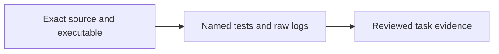

<!-- Copyright 2026 Cellar Project Authors. Licensed under Apache-2.0. -->

# Implementation evidence

Purpose: Describe retained evidence fields, exact command records, test coverage, and the limits of package validation.

[Design library](../../README.md) · [Topic contract](../README.md)

| Implementation | Validation or example |
| --- | --- |
| [Code and API](../../../../crates/cellar/durability/raft/README.md) | [Checks and usage](../../../../examples/raft-counter/README.md) |

The map summarizes this document’s scope; the recorded gates determine completion.



MR-01 has passed its pure-contract and framing tests. Its record states the remaining runtime qualification limits. Store subsequent evidence and logs here. Task evidence paths in `tasks.json` are relative to the package directory, for example `evidence/MR-01.json`.

A record has the following fields. This is a schema illustration, not a passing record; replace every illustrative value with the actual evidence.

```json
{
  "task_id": "MR-01",
  "source_revision": "full 40-character Git revision",
  "toolchain": "actual compiler and platform",
  "executable_digest": "sha256 of tested executable",
  "environment": "host, store version and effective configuration",
  "limitations": "specific untested conditions, or none within the stated scope",
  "tests": [{"name": "mode_isolation", "result": "passed"}],
  "commands": [{
    "argv": ["exact", "argument", "vector"],
    "exit_code": 0,
    "output": "evidence/MR-01-test-output.txt"
  }]
}
```

Include every required case and both exact manifest commands, plus relevant regressions. Attach the actual test listing and execution output. Record source patch, lockfile, image, workload and raw history digests in additional fields when applicable. Keep failures and ignored-test explanations; do not mark DONE until required cases pass.

The package checker validates record structure and coverage. It cannot attest that a claimed external run happened or that a history oracle is correct. Review the actual logs and release evidence. Do not store secrets in logs or this folder.

- The MR-11 [process/control record](MR-11-control-progress.json) qualifies physical process distribution, atomic refresh, reserved host control admission and joined queue teardown at source f328ebd.
- It records 217 unique Rust passes and all 19 checks, without completing automatic repair.
- The separate [5751f36 regression record](MR-11-process-regression-progress.json) retains 359 Rust passes and its failed Clippy check; current qualification fixes that cleanup.
- The [checkpoint repetition record](MR-11-process-checkpoint-repeat.json) counts 2,000 repeated passes separately.
- All original MR-11 completion gates remain.

The [local inspection record](MR-11-inspection-progress.json) pins 2b8d35c and records 78 Rust passes and all 15 checks. Its five binaries include the held private-callback and claim-free standby cases. Remote authentication/collection, aggregate leadership sampling and automatic control remain open.