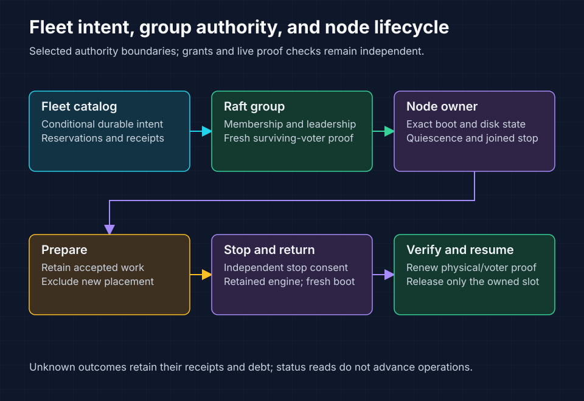

<!-- Copyright 2026 Cellar Project Authors. Licensed under Apache-2.0. -->

# Fleet balancing and maintenance

Purpose: Navigate fleet authority, capacity planning, resumable lifecycle operations, delivery packages, and qualification evidence.

[Design library](../../README.md) · [Multi-Raft package](../README.md) · [Operator workflows](operator-workflows.md)



Conditional object-store writes coordinate fleet intent and bounded admission. Each Raft group authorizes membership and leadership. The local node owner controls its exact process lifecycle.

## Delivery status

The [task inventory](tasks.json) records these package boundaries:

| Packages | Status | Delivery boundary |
| --- | --- | --- |
| FO-01–FO-03 | DONE | Conditional intent, membership permits, trusted enrollment |
| FO-04, FO-06–FO-08, FO-10 | IN_PROGRESS | Redistribution, reconciliation, maintenance, operator controls, and qualification |
| FO-05, FO-09 | TODO | Workload-aware leader balancing and safe desired capacity |

Keep the capability default-off until FO-10 passes. Delivered intact maintenance and local fault checks do not complete the full fleet contract.

## Read the owning contract

| Document | Use it to implement |
| --- | --- |
| [Technical design](design.md) | Authority, durable records, concurrency, admission, and recovery |
| [Capacity and scaling](capacity-and-scaling.md) | Add/remove protocols, feasibility, vertical resizing, and retained state |
| [Planning details](planning-details.md) | Resource ledgers, movement order, failure spreading, and worked examples |
| [Maintenance and rebalancing](maintenance-and-rebalancing.md) | Preparation, settlement, rolling restart, evacuation, and budgets |
| [Lifecycle execution](lifecycle-execution.md) | Independent grants, joined stop, retained return, verified resume, and proof |
| [Implementation plan](implementation-plan.md) | Dependencies, source ownership, required tests, and acceptance |
| [Operator workflows](operator-workflows.md) | Delivered SDK/admin/CLI controls and remaining proposals |
| [Qualification](qualification.md) | Failure matrix, performance gates, and evidence requirements |
| [Progress ledger](progress.md) | Exact sources, selected checks, retained failures, and open gates |
| [Implementation history](implementation-history.md) | Detailed capability snapshot retained from the former overview |

## Capacity and qualification targets

| Dimension | Initial target or bound | Interpretation |
| --- | --- | --- |
| Qualification fleet | Five nodes; one vCPU and 3 GiB each | Local Colima/RustFS profile |
| Workload | 500 logical cells, three voters each | About 100 leaders and 300 copies per node initially |
| Implementation bounds | 64 nodes, 10,000 histories, 16 admitted membership actions | Enforced bounds; measured capacity remains separate |
| Scale-out / scale-in | Five to six / five to four nodes | Preserve resource headroom and all history proofs |
| Release acceptance | FO-10 safety, resource, foreground performance, and soak gates | Required before enabling by default |

Remaining feature gates include repeated deployed maintenance, controller interruption, bounded verification at hundreds of histories, grace expiry, second failure, rolling maintenance, leader balancing, and desired capacity.

## Inspect and validate the package

Run from the repository root:

```sh
python3 docs/design/multi-raft/fleet-operations/plan.py validate
python3 docs/design/multi-raft/fleet-operations/plan.py preflight
python3 docs/design/multi-raft/fleet-operations/plan.py ready
python3 docs/design/multi-raft/fleet-operations/plan.py show FO-04
```

Run the inspector’s own tests separately:

```sh
python3 -m unittest discover \
  -s docs/design/multi-raft/fleet-operations -p 'test_*.py'
```

| Check | Required behavior |
| --- | --- |
| Package validation | Check dependencies, source anchors, named tests, links, and completion records |
| Source preflight | Refuse unreviewed hash drift |
| Test listing | Require every named case; listing alone cannot establish a pass |
| DONE evidence | Require retained records and their exact logs; missing artifacts fail validation |

Retain run data under ignored `.cellar/raft-perf/fleet-operations/` or an external artifact directory. Evidence references remain repository-relative; restore the recorded artifacts before auditing DONE packages.

This package extends MR-11 and MR-13–MR-16. Automatic infrastructure provisioning, RF5, cell splitting, cross-region federation, and zero-quorum disaster recovery have separate contracts.