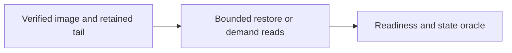

<!-- Copyright 2026 Cellar Project Authors. Licensed under Apache-2.0. -->

# Large cell images and recovery

Purpose: Define large-image storage and recovery boundaries, materialized limits, extent integration, and qualification requirements.

[Design library](../README.md) · [Topic contract](README.md)

| Implementation | Validation or example |
| --- | --- |
| [Code and API](../../../crates/cellar/durability/raft/README.md) | [Checks and usage](../../../examples/raft-counter/README.md) |

The map summarizes this document’s scope; the recorded gates determine completion.



## Scope

- The current Raft storage path materializes a complete SQLite image for every published generation.
- The opt-in `RaftCellsConfig::with_materialized_image_limit` profile now accepts logical quotas up to 10,000,000,000 bytes; its default remains 64 MiB.
- Full snapshots use bounded file-backed v0.5.2 encoding and transfer.
- Archives reference an authenticated index and immutable 4 MiB parts, with bounded read overlap and disk-backed assembly.
- Small snapshots inline their encoded bytes in the index.
- This is an internal format-1 hard cutover, not a legacy-reader or migration path.
- The profile does not raise replicated command/delta buffers.
- The native host shares node-wide anonymous snapshot scratch admission across producers, archive downloads and peer/S3 learner recovery.
- Its independent `infrastructure.log.snapshot_scratch` byte/file bounds retain reservations until the last physical owner closes.
- The large-image profile configures a conservative four-body scratch floor; overload refuses work before creating a partial file.
- See the [active implementation and qualification record](10gb-implementation.md).

- The implementation is not yet a complete native 10 GB capacity or recovery-time qualification.
- Full-image hashing and portable materialized copies still limit takeover and cold restoration.
- The owning test is [`native_raft_large_images`](https://github.com/crabbuild/cellar/blob/bbdc6b2a1ad95fad793a3dc611de6dacae1be2e9/crates/cellar/tests/native_raft_large_images.rs): a real SQLite database grows past 64 MiB, survives leader removal and duplicate retry, seeds an empty learner from a peer or object-store archive, receives further replicated writes, and restarts the seeded worker before any peer is available.
- Compressible data deliberately tests logical image admission independently of encoded object size.
- The default fixtures use an in-process object store.
- An explicit ignored test runs the same archive drill against RustFS or S3 in a fresh random prefix.
- Neither fixture is a throughput or power-loss qualification.

Run the ordinary drills with:

```sh
cargo test --locked -p cellar --test native_raft_large_images
```

For a disposable S3-compatible bucket, set `CELLAR_LARGE_IMAGE_ENDPOINT`, `CELLAR_LARGE_IMAGE_BUCKET`, `AWS_REGION`, `AWS_ACCESS_KEY_ID` and `AWS_SECRET_ACCESS_KEY` through your environment, then run:

```sh
cargo test --locked -p cellar --test native_raft_large_images rustfs_image_above_64_mib -- --ignored --nocapture --test-threads=1
```

Each explicit run retains its test objects under a distinct `large-image-qualification/` prefix for inspection; it does not delete unrelated bucket keys. Use a checkout-specific writable target directory as required by [AGENTS.md](https://github.com/crabbuild/cellar/blob/bbdc6b2a1ad95fad793a3dc611de6dacae1be2e9/AGENTS.md).

Both warm takeover and empty-worker recovery must be implemented and measured before claiming the larger target described below.

- The full-capacity fixture is in [`raft_full_capacity`](https://github.com/crabbuild/cellar/blob/bbdc6b2a1ad95fad793a3dc611de6dacae1be2e9/crates/cellar/tests/support/raft_full_capacity.rs).
- It installs an identical verified initial template on three permanently claimed replicas before starting their runtimes.
- Subsequent SDK commands, quorum apply, receipts and learner recovery use the native paths and ordinary delta bounds.
- Its small ordinary tests exercise quota refusal, cleanup, takeover, peer/S3 seed and restart.
- Full-size tests remain ignored and require explicit infrastructure.

- For a full-size drill, additionally set `CELLAR_LARGE_IMAGE_WORKDIR` to a writable worker volume with ample space for full source, receive and verification spools.
- An optional `CELLAR_LARGE_IMAGE_SECONDARY_WORKDIR` places alternating simulated workers on a second volume; record that layout with the results.
- Without `CELLAR_LARGE_IMAGE_FIXTURE`, the drill creates its own quota-filled SQLite template using 1 MiB deterministic incompressible values.
- A reusable fixture must contain `items(id INTEGER PRIMARY KEY,value BLOB)` and `quota_tail(value BLOB)` at the exact page-rounded quota.
- Input fixtures are cloned or copied and never mutated.

```sh
cargo test --locked --release -p cellar --test native_raft_large_images full_capacity::decimal_ten_gb_rustfs_restores_native_serving_after_owner_and_local_state_loss -- --ignored --exact --nocapture --test-threads=1
cargo test --locked --release -p cellar --test native_raft_large_images full_capacity::decimal_ten_gb_peer_restores_native_serving_after_owner_and_local_state_loss -- --ignored --exact --nocapture --test-threads=1
```

- These runs use separate random `full-capacity-qualification/` bucket prefixes, preserve their objects for inspection, and report stage times.
- Both use the real S3 store for background archives; an in-process store would retain large object payloads in memory.
- They cancel and join the owner execution domain before erasing its complete local data directory.
- The empty replacement must restore, promote through quorum-authorized repair, accept leadership and execute a new command.
- It restarts before its peers for a local historical read; after quorum returns it must reconcile an old receipt, execute a new command locally and return that new receipt without another callback.
- Full-size abrupt OS-process and power-loss qualification remains separate.

## Cloudflare storage parity target

- Use **10 GB (10,000,000,000 bytes) of logical SQLite storage per cell** as the product target, matching Cloudflare's published SQLite-backed Durable Objects limit on Workers Paid.
- Its Free plan permits 1 GB per object.
- Cloudflare defines GB as decimal, rather than GiB.
- Its legacy key-value backend has no individual object storage cap and is not the SQLite parity reference.
- See the [official limits and units](https://developers.cloudflare.com/durable-objects/platform/limits/).

- This is a product quota, separate from per-command limits, encoded object sizes, working memory and physical disk used by replicas, WAL, snapshots or retention.
- Deployments may configure a lower quota.
- Express it in exact bytes; for a SQLite page size, round the admitted page count down so the image cannot exceed the configured quota.
- Include framework tables and indexes in the database allowance, with bounded headroom for durable receipts and housekeeping.

- The materialized profile now supplies a virtual receipt/control allowance of one sixteenth of the quota, capped at 32 MiB, inside the total image limit.
- It does not preallocate a large empty database.
- Live application btrees, including Blob/outbox data, cannot consume that allowance; free pages can be reused after cleanup.
- Accounting includes the reserved tables' indexes and separately budgets SQLite pointer maps and the lock page.
- Receipt capacity remains bounded and may refuse new commands with overload; this is not unlimited retry retention.
- The default execution configuration leaves this optional policy disabled.

Cloudflare documents `SQLITE_FULL` for writes that exceed capacity while reads and deletes remain available. Cellar's implementation must likewise preserve reads, cleanup and retry reconciliation at capacity, without bypassing receipt, quorum or publication proofs. Test cleanup and reuse of freed pages at the quota boundary; deletion need not shrink the SQLite file immediately.

- The previous 256 MiB configured ceiling has been replaced by the decimal 10 GB quota and bounded physical codec; complete runtime qualification is still open.
- A 4 GiB image is an intermediate qualification size, not the final product ceiling.
- A 10 GiB engine stress case exceeds the decimal product quota and must not silently redefine it.

## Recovery boundaries

| Boundary | Existing behavior | Required large-image behavior |
| --- | --- | --- |
| Existing voter takes over | It already owns committed, sealed images. Quorum and election still gate writes. Private writers use COW where supported and bounded copies elsewhere, with a full verification scan. | Keep a ready immutable root and a private copy-on-write writer. Catch up only missing committed changes. First write must not scan the whole image. |
| Empty authorized learner | Obtain an exact live-peer seed grant; restore its physical snapshot and necessary archive tail; seal and sync before durable Raft installation. | Fetch a bounded manifest and hot extents first; fetch and verify remaining immutable extents on demand with bounded background hydration. Preserve the same seed and installation proof boundaries. |
| Planned maintenance | Admit and catch up a replacement, promote it, transfer leadership and drain the old node. A blank standby has no image. | Prewarm and prove applied position before handoff. Enforce a lag and capacity threshold; refuse a handoff that would destroy the remaining quorum. |
| New empty cell | Initialize a small SQLite image. | Keep initialization independent of maximum configured cell capacity. |
| New cell cloned from a large template | No shared page-root implementation. | Share an immutable template root and fork only changed extents; do not copy the template before first use. |

Two replicas alone cannot continue writes after one fails: a majority is still required. Use at least three voters in separate failure domains for one-node failure tolerance. A learner or `Standby` placement does not substitute for a voting quorum or a synchronized local image.

## Why removing the numerical checks is insufficient

- Execution still rebuilds a private base and computes full-image SHA-256 through the committed main-file/WAL overlay.
- Immutable apply clones or copies the base, then checksums and hashes the base/result.
- Physical snapshots no longer retain the complete image or page index in memory, and archive recovery uses bounded parts and anonymous files.
- Generation admission still requires multiple maximum-image copies.
- Large quotas therefore retain substantial disk use and linear I/O on important paths; bounded buffers alone do not satisfy the fast-recovery target.

Images above 1 GiB also cross SQLite's reserved locking-page location. The streamed snapshot codec omits that page from LTX records while preserving canonical zero bytes in the physical image length and a canonical byte representation in its content proof. Do not just raise the page or image counters.

## Implementation sequence for the 10 GB target

### 1. Incremental immutable images and private writers

- Introduce a page-addressed immutable generation behind the existing generation owner.
- Use a persistent extent tree with content-addressed leaves (initial measurement candidate: 4 MiB extents) and copy-on-write index nodes.
- A 10 GB image needs about 2,385 such extents; avoid a heap entry for every SQLite page.
- Publication writes changed extents and tree nodes, syncs them, then syncs an exact root reference.
- Queries pin that root.
- Never patch a published generation.

- The root binds cell history, schema, geometry, logical length, committed position and every reachable extent.
- Introduce an explicit domain-separated content-root identity; do not relabel a Merkle root as the existing full-image SHA-256 digest.
- Coordinate the execution, envelope, generation, archive and snapshot contracts in one internal hard cutover with Cellar-owned format markers staying at 1.
- Do not add a legacy reader or skip verification to avoid a scan.

- Open private SQLite writers over the pinned immutable root plus a private WAL or copy-on-write overlay.
- Preserve the current capture and receipt transaction boundary.
- Applying a small delta and rebuilding a writer must cost changed data and index nodes, not total image size.
- Reflinks may accelerate supported local filesystems, but must remain an optional optimization with a correct portable path and fault-injected file ownership/sync tests.

### 2. Bounded snapshot and object-store transfer

- Represent a snapshot as an exact immutable root, a bounded manifest, and immutable extent objects.
- Upload only missing content and publish the manifest conditionally after its complete dependency closure is verified.
- Retain a bounded subsequent committed tail, rotating on measured replay bytes/time as well as entry count.
- Do not require all historical LTX files or create a single 10 GB download buffer.

- Stream multipart uploads and downloads through the owning execution domain.
- Use separate logical-image, encoded-transfer, working-memory, disk and concurrency budgets.
- Bound each buffer and each manifest/tree traversal.
- Reservations must follow blocking work through cancellation and sync; a dropped network waiter cannot refund bytes still owned by a worker.
- Maintain independent consensus and query capacity while hydration is active.

Use extent digest checks, root/geometry checks and an exact position binding before any data becomes readable. Handle growth, truncation and the reserved SQLite lock page explicitly. Corruption, missing dependencies or an unavailable required extent must fail admission/read with a typed failure, never zero-fill valid pages.

### 3. Warm takeover and cold activation

For warm takeover, maintain followers' committed roots continuously and prepare local writers without a full base scan. Measure election-to-first-successful-write separately from election-to-first-read. During maintenance, prewarm a replacement and confirm its applied position before promotion and leadership transfer.

- For cold activation, fetch and verify the root and metadata tree, restore the necessary committed tail into a private root, and install only under the existing membership, disk-lineage, process and exact seed-ticket checks.
- Initially fetch SQLite schema/root pages and an observed hot set.
- Serve from the exact installed root using verified extent reads; hydrate the rest in the background.
- Persist local cache-presence metadata atomically or rediscover it by verified extent IDs.
- A cache miss or lost local disk must not change the selected database version.

- Storage retention must protect every object reachable from a live root, snapshot, seed lease or replica recovery reference, including during incomplete hydration.
- Garbage collection cannot rely only on the latest object-store head.
- Keep the current rule that a restored image supplies bytes, not voting or ownership permission.
- Object-store recovery alone cannot manufacture quorum after losing all voting members.

### 4. Qualification and operator visibility

Expose logical image size, extent count, verified cached bytes, hydrated bytes, first-read/first-write durations, replica lag, snapshot root and position, replay tail bytes, object fetches, bytes transferred and peak memory/disk reservations. Provide an inspection view linking the exact manifest, snapshot/root objects and ordered tail; distinguish warm promotion from cold restoration.

- Run both paths at 256 MiB, 1 GiB, 4 GiB and near the 10 GB product quota, using compressible and incompressible data and sparse/hot and broad/random workloads.
- Also qualify the engine at 10 GiB and above with explicit test-only bounds.
- Verify exact page-rounded quota enforcement independently of those engine stress tests, including rejection of growth past capacity.
- Include:

- Kill the leader and issue the first read and write on an existing voter; retry
  an acknowledged command ID and prove its effect is not executed twice.
- Join a new authorized worker with an empty data directory from RustFS/S3;
  assert the exact committed version, then read uncached pages and replicate new
  writes while background hydration is incomplete.
- Compare startup against complete hydration. For the same small hot set, require
  initial memory and transferred bytes to remain bounded as total image size
  grows; record p50/p95/p99 first-read and first-write latency, without inventing
  a universal recovery-time promise independent of storage/network bandwidth.
- Interrupt transfer, extent publication, root sync and engine install; restart
  with lost local cache. Inject missing/corrupt extents, stale grants, disk-full,
  partial writes and cancellation. Refuse unsafe admission and retain the last
  usable recovery root.
- Maintain quorum traffic and unrelated small cells under simultaneous recovery.
  Verify backpressure and retention under the configured recovery concurrency.

A full hydration lower bound remains approximately bytes divided by effective storage/network bandwidth. Warm replicas remove that transfer from failover; verified demand loading removes it from cold first-use latency. Neither removes the need for quorum, complete dependency retention or eventual local capacity.

## Validation of the materialized extension

Local validation on 2026-10-24 passed the following targets:

| Target | Passed |
| --- | ---: |
| `cellar --lib` | 536 |
| `native_raft_archive` | 53 |
| `native_raft_execution` | 19 |
| `native_raft_host` | 29 |
| `native_raft_large_images` (in-process object store / peer) | 2 |
| `native_raft_operations` | 23 |
| `native_raft_snapshot` | 44 |
| `native_raft_ltx` | 27 |
| `native_raft_ltx_batch` | 5 |
| Explicit loopback RustFS large-image drill | 1 |

- The large-image drills use a 128 MiB policy and 72 MiB of SQLite BLOB payload, split into ordinary 1 MiB values.
- They verify warm takeover, exact duplicate receipt/version, empty authorized learner seeding, further replication, and a historical local read after restarting the seeded worker before its peers start.
- The large-image runs stop services; the existing snapshot/execution/LTX suites exercise their process-kill matrices at ordinary fixture sizes.
- This does not qualify 256 MiB physical recovery, incompressible transfer throughput, the 10 GB product target, power loss or a production recovery-time objective.
- Configuration and worst-case snapshot bounds are tested through the 256 MiB policy ceiling.
