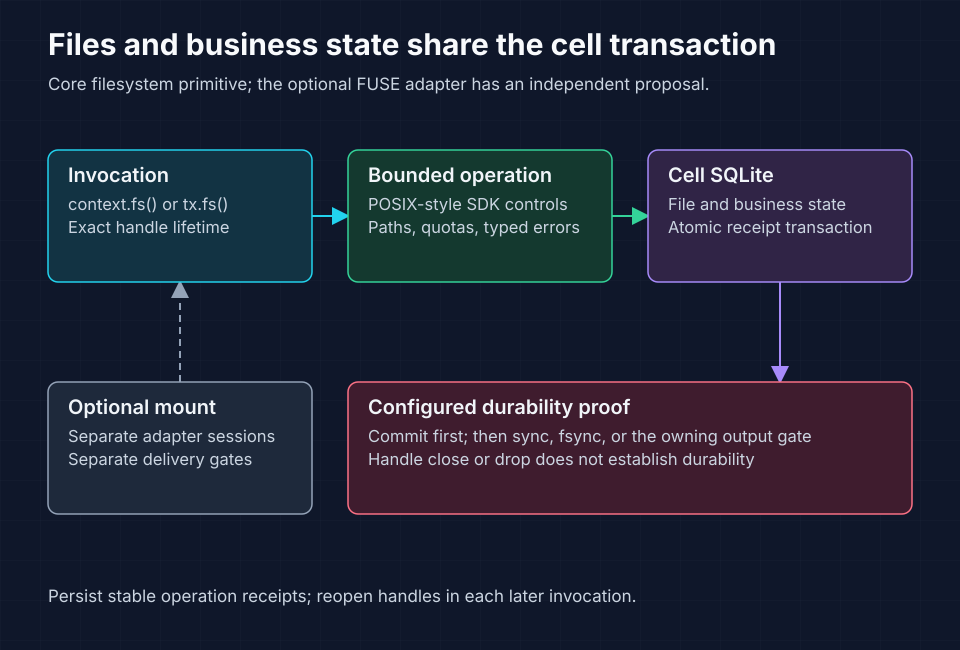

<!-- Copyright 2026 Cellar Project Authors. Licensed under Apache-2.0. -->

# Per-cell filesystem context primitive

Purpose: Define cell-owned filesystem state, atomic business updates, authority, limits, and primitive delivery boundaries.

[Design library](README.md)

| Implementation | Validation or example |
| --- | --- |
| [Code and API](../../crates/cellar/application/filesystem/README.md) | [Checks and usage](../../tools/perf/filesystem.md) |



Filesystem state and business receipts share the cell transaction. Consult the implementation ledger for delivered API boundaries.

## Current SDK fragment

This fragment follows the [implemented filesystem guide](../../crates/cellar/application/filesystem/README.md). The handler supplies `context`, `result_bytes`, and its stable `receipt`:

```rust
let db = context.storage()?;
db.tx(|tx| {
    tx.fs()?.write_file("/result.json", result_bytes)?;
    tx.put_json("result", &receipt)?;
    Ok(())
})?;
db.sync().await?;
```

File content and the business receipt commit together. The asynchronous barrier proves configured durability after commit. The design below retains its original broader acceptance scope.

Status: design contract; implementation and qualification are tracked in the [status ledger](per-cell-filesystem-implementation-status.md). Prepared: 2026-10-25; scope revised: 2026-10-27. Inspected source baseline: `d3206c924031a3f2ca3387b542c02877bb91423d` (local `origin/main` snapshot, not a claim that the remote was freshly fetched).

The filesystem design is divided into independently scoped documents:

| Document | Owns |
| --- | --- |
| This design | Per-cell ownership, SQLite storage, transactions, recovery and durable-agent file tools |
| [POSIX API contract](per-cell-filesystem-api.md) | `context.fs()`, `tx.fs()`, typed file/directory operations, capabilities and errors |
| [Implementation plan](per-cell-filesystem-implementation.md) | Core primitive delivery, verification and release gates |
| [Optional FUSE design](per-cell-filesystem-fuse-design.md) | OS mounting, kernel translation, container attachment and command execution, with separate delivery gates |

This document defines the target behavior; the [status ledger](per-cell-filesystem-implementation-status.md) records which parts have implementation and verification evidence. The core primitive can be implemented, tested and released independently of the optional adapter.

## 1. Decision and intended result

Give each root cell an optional filesystem inside its existing SQLite database, accessed through `context.fs()`. Treat it as an application primitive alongside KV, SQL and queues: a checked capability with explicit operations, captured limits and the normal cell authority/durability contract.

The namespace is local to the current cell. Existing `context.kv(name)`, `context.sql(name)` and `context.queue(name)` address named bindings; the `context.fs()` has no name parameter because v1 owns exactly one root in the current cell. A directory path never selects a host folder or a different cell.

| Concern | Primitive contract |
| --- | --- |
| State owner | Root cell and its existing database |
| Scope | One filesystem per root cell; stateless contexts and facets refused in v1 |
| Public access | Rust `context.fs()`; JS/Python `ctx.fs` |
| Composition | `context.storage()?.fs()` and `tx.fs()` address the same filesystem |
| Compatibility | POSIX-compatible semantics for the declared file/directory operation profile |
| Execution | Explicit SDK operations under the cell's existing invocation model |
| Persistence | File data, metadata and local application state share transactions, replication and recovery |
| Descriptors | Invocation-bound capabilities; transaction-derived handles expire with their scope |
| Durability | Local bounded operations plus normal output gates and explicit asynchronous barriers |
| Sharing | Explicit cell RPC with its own intent/receipt protocol |
| Agent use | Durable file tools whose effects and receipts commit together |
| Platform | Same supported host/runtime matrix as the underlying Cellar SDK/storage path |

A POSIX-compatible filesystem API specifies operations such as open, positional I/O, rename and unlink. It does not require a kernel descriptor table. `File` and `Directory` are typed SDK capabilities. Python built-in `open`, Node `fs` and `std::fs` continue to address their process environment. Applications access cell files explicitly through the primitive.

Core v1 supports regular files, directories, modes, metadata, sparse contents, namespace operations, directory-relative operations and durability barriers. Unsupported POSIX facilities are declared through capabilities and typed errors. Full POSIX certification and process facilities are outside this API profile.

### Primitive-only boundary

The deliverable is an SDK capability acquired from the current cell context, like the other application primitives. Acquiring it initializes no operating system service. A cell can use file operations and transactions throughout its lifetime with only the normal Cellar host, runtime and SQLite storage services.

The programming model follows the existing primitive pattern:

| Step | Application action | Cellar responsibility |
| --- | --- | --- |
| Declare | Enable filesystem policy and quotas for a cell class | Capture configuration before activation |
| Acquire | Call `context.fs()` in a cell invocation | Check the current cell, activation and authority |
| Operate | Use explicit POSIX-compatible file and directory methods | Resolve paths in that cell's root and enforce bounds |
| Compose | Obtain `tx.fs()` inside a local storage transaction | Commit or roll back files and local business state together |
| Prove | Await the existing output gate or an explicit sync barrier | Establish the configured durability proof |
| Recover | Reopen paths in a later invocation | Restore file state with the cell and issue fresh checked handles |

For example, `/workspace/analyze.py` is an ordinary path in the cell's namespace. Saving it creates file data; it does not select a host directory or launch Python. An agent reads and edits it through explicit file tools. Running that script as an operating-system program is a separate execution feature.

The public `Filesystem`, `File`, `Directory`, policy, capabilities, errors and limits describe the current cell's file operations and storage resources. Enabling the primitive makes those operations available under the existing invocation; acquiring a view does not start another service. SDK descriptors retain the invocation and transaction lifetimes defined in the API contract.

Host integration contracts, including their distinct configuration and handle lifetimes, live in the separate extension document. The dependency and public surface of the primitive remain entirely within the existing SDK/storage path.

### Execution model for primitive calls

- The application runs in its existing Cellar handler runtime, just as it does when calling KV, SQL or queue primitives.
- A native call goes from the checked filesystem view to the owning cell's SQLite operation.
- A guest call crosses the existing native bridge before taking the same path.
- The runtime checks cell, invocation, activation and transaction authority at that boundary.

Rust data operations are bounded synchronous storage calls; guest operations are asynchronous bridge calls. Explicit durability barriers are asynchronous in every facade. Persisting an executable or source file stores bytes under these same rules. Evaluating those bytes is a separate application capability.

## 2. Existing code and integration constraints

| Existing component | Observed behavior | Design consequence |
| --- | --- | --- |
| [Context primitives](../../crates/cellar/application/mod.rs) | Context exposes storage plus named KV/SQL/queue bindings | Add `fs()` with current-invocation checks and explicit per-cell scope |
| [SQLite storage](../../crates/cellar/storage/sqlite/mod.rs) | Epoch-bound database owned by the isolate | Reuse the owning connection, admission and transaction path |
| [Storage transactions](../../crates/cellar/application/storage/transaction.rs) | `tx`/`transaction_sync` compose local mutations; async transactions hold an input gate | A filesystem transaction view participates in that exact local transaction |
| [Storage guide](../06-storage-transactions.md) | Local commit differs from proven output; reads also require authority | Preserve output gates and use existing proof barriers |
| [Guest storage batch](../../crates/cellar-guest/storage.rs) | Checks, KV changes and alarms share a native checked transaction | Extend that batch for file effects and receipts |
| [Vercel agent tools](../../examples/vercel-agent/tools.ts) and [runner](../../examples/vercel-agent/durable.ts) | Stable tool IDs, effects/receipt batch, sync; one cell per turn | Add explicit file tools; preserve turn identity or introduce a new session example |
| [Pi agent](../../examples/pi-agent/durable.ts) | Saved decisions and local effect receipts | Reuse the same native file batch contract |
| [Python agent](../../examples/python-agent/app.py) | Deferred tool execution and persisted phases | Use SDK file effects rather than ambient host-file side effects |

Cellar's execution domain owns scheduling, authority and resource lifecycle. It does not make a process or a file descriptor a durable continuation. Recovered work reopens paths under a new invocation and checks expected identity/version.

## 3. Persistent data model

Use reserved framework tables in the same root-cell database. Create them lazily on first enabled filesystem use. Format marker stays `1` during internal development, following repository policy. Unsupported persisted formats refuse activation; future production migration is separate work.

The table sketch is conceptual, not executable DDL. Add checks, indexes and foreign keys where compatible with existing SQLite settings; enforce invariants inside the owning transaction even when foreign-key enforcement is unavailable.

| Table | Key and fields | Purpose |
| --- | --- | --- |
| `__sys_fs_meta` | singleton; format, root inode, next inode, revision, logical bytes, allocated bytes, inode count | Identity, quotas and filesystem revision |
| `__sys_fs_inodes` | inode ID; kind, mode, uid, gid, size, nlink, mtime_ns, ctime_ns, content_version, next_dir_cookie | Stable file identity and metadata |
| `__sys_fs_entries` | `(parent_inode, name_bytes)`; child inode, directory cookie; unique `(parent_inode, cookie)` | Names separate from identity; bounded indexed directory iteration |
| `__sys_fs_chunks` | `(inode, chunk_index)`; bytes, write revision | File contents, initially fixed maximum 64 KiB per chunk |
| `__sys_fs_discarded_ranges` | inode, first chunk, last chunk, cutoff revision | Hide truncated full chunks immediately while physical deletion is pending |
| Existing `__sys_work` | filesystem-maintenance reason, installation generation and deadline | Durable wake discovery; range cursors live in discarded-range rows |

Root inode is `1`. Inodes are positive signed 64-bit values, monotonically allocated without reuse; overflow refuses allocation. SQL integers, Rust values and guest encodings must agree. Nanosecond timestamps use checked signed values. JS carries large integers as validated decimal strings, not lossy numbers.

Names are case-sensitive byte strings, maximum 255 bytes per component, excluding NUL and `/`. Never normalize Unicode or case. SDK path helpers cap total input bytes and traversal depth. JS/Python convenience APIs support UTF-8 paths; a typed binary-name representation preserves non-UTF-8 names across SDKs. Directory listing must never silently replace undecodable bytes.

- Root has no ordinary parent entry.
- Each directory has exactly one parent except root.
- No directory cycles, no hard links to directories, no entries targeting missing inodes.
- In v1 regular files have one name or are unlinked but open; hard links and symlinks are deferred.
- Keep `nlink` and inode separation so that adding them later does not require changing the fundamental identity model.

- Use one content layout initially: bounded chunks, including small files.
- Do not add inline/external-content thresholds until measurements justify them.
- A partial write replaces only affected chunks; truncate removes inaccessible data and zeroes the remaining tail so later extension cannot disclose old bytes.
- Sparse holes read as zero and need no chunk row.
- Enforce both logical size and allocated byte quotas so sparse files cannot evade resource limits.

Filesystem revision increments on visible mutations; inode content_version increments on content/size changes. These are conflict tokens, not LTX positions. Never use them as durability proof. Reads and directory listings report versions that agent tools may use for compare-and-write or replay records.

- Large unlink/truncate operations detach inaccessible ranges atomically, then reclaim chunks in bounded transactions.
- Quota accounting tracks live logical bytes and retained physical bytes separately; pending garbage continues to count toward physical limits.
- GC cannot remove data referenced by a live handle or a future snapshot.
- It uses the current cell owner and durable wake machinery, not a worker-local timer as the sole discovery mechanism.

- For truncate, zero the retained partial boundary chunk in the transaction and record a discarded range for the removed full chunks with a cutoff revision.
- Reads treat matching chunks at/below that cutoff as holes, including after a subsequent file extension.
- Writes merge against this logical zero view and stamp a newer revision.
- GC deletes only chunks covered by the range whose revision is at/below its cutoff, so it cannot erase data rewritten before reclamation.
- Remove a range only after its eligible chunks are gone.
- Bound/coalesce range metadata and apply backpressure if reclamation falls behind.
- An unlinked inode cannot be reclaimed while any handle pins it; inode IDs are never reused.

All tables must be recognized by the existing system-schema protections and backup/restore handling. Application SQL cannot mutate framework filesystem tables directly. Internal implementation access must not broaden the public SQL authorizer. The backend uses the cell isolate's existing connection and transaction owner; it must not create a second connection pool for file operations.

## 4. Operations, descriptors and transaction boundaries

Expose `Context::fs()` as the first-class accessor and `Storage::fs()` for direct and transaction composition. Export types under `cellar::sdk::filesystem`; preserve the existing top-level `FileSystem` host abstraction. There is one native semantic implementation for Rust and guest facades.

The [API contract](per-cell-filesystem-api.md) specifies open/creat, read/write, pread/pwrite, lseek, dup/close, fstat/ftruncate/fchmod, namespace and directory operations, *at variants and proof barriers. Supported operations follow POSIX semantics within the cell root. Cellar adds typed authority/outcome errors, quotas and transaction affinity.

Illustrative proposed transaction composition:

```rust
let db = context.storage()?;
db.tx(|tx| {
    let fs = tx.fs()?;
    fs.write_file("/report.txt", report_bytes)?;
    tx.put_json("report_status", &serde_json::json!({"ready": true}))?;
    // Persist the stable tool ID, fingerprint and result in this same transaction.
    Ok(())
})?;
db.sync().await?;
```

`Storage::tx`, `put_json` and `sync` already exist. `fs` and its methods are proposals. Atomic composition is with state in this cell's transaction. Calls to separately bound KV/SQL/queue services do not join it automatically; use the existing outbox/intent machinery where cross-cell effects are required.

Standalone bounded mutations use short transactions. A synchronous return means local completion; handler output gates or explicit `fs.sync()` / `file.fsync()` provide proven external durability. Reads must observe one consistent bounded metadata/content view under current authority. No open descriptor holds a SQLite transaction open between operations.

| Operation group | Initial behavior |
| --- | --- |
| Paths | Absolute within cell root; repeated separators and `.`; `..` stops at root; trailing slash requires a directory |
| Metadata | stat/lstat, fstat, supported chmod/time changes and configured logical identity |
| Directories | mkdir/rmdir, indexed readdir with stable cookies; synthesize `.` and `..` |
| Creation | Access modes, exclusive create, truncate and explicit creation mask |
| Contents | Bounded reads/writes, atomic accepted append, positional I/O, seek, truncate and sparse zero reads |
| Namespace | Atomic same-cell rename/replace; type, nonempty-directory, ancestor-cycle and root checks |
| Deletion | Unlink removes the name; an open inode remains accessible until its last pin is released |
| Barriers | fsync/fdatasync/directory fsync use the existing cell proof; fdatasync may use the stronger full barrier |
| Capacity | statvfs reports quota-aware cell capacity and inode limits |
| Deferred | Links, advisory locks, ownership/ACL/xattr expansion and OS-specific facilities |

`write_file` replaces contents on the same inode in one bounded transaction. `replace_file` publishes a new inode; old open handles retain the former inode. `edit_file` validates an expected identity/version or digest before a bounded patch. Failure changes nothing. Large loops may commit a prefix; do not imply whole-file atomicity from `write_all` outside an explicit bounded transaction.

An append chooses EOF and updates data, size and the shared descriptor offset atomically. `pwrite` is positional even for an append-open SDK descriptor. Independent opens have independent offsets; dup shares an open description. Handle-state updates and inode pins are serialized by the owning service.

Descriptors belong to the invoking event's tracked lifetime, including accepted background work. Every operation checks cell/domain/epoch/activation/invocation and optional transaction affinity. Transaction-opened descriptors expire at commit or rollback; ordinary descriptors cannot be used implicitly inside a transaction. Reopening later is explicit. Close/drop releases resources and never supplies implicit durability proof.

- Allocate open/create capabilities and provisional inode pins under the same serialized owner boundary.
- Publish a successful capability only after local commit; release provisional state on rollback.
- Guest bridge calls do not blindly retry handle-allocation or offset-changing operations after a lost response.
- End-of-invocation cleanup invalidates the handle registry; recovery fences all former owners before reclaiming unreachable unlinked inodes.
- Directory cookies are monotonic per directory rather than SQL row offsets, with explicit mutation and snapshot limitations.

## 5. SDK and cross-language integration

Place the facade beside application primitives and schema/SQL beside SQLite storage. Keep core filesystem behavior out of `cellar-logic` and `cellar-ltx`; extend existing typed boundaries only where necessary. Use execution-domain services for clock, tasks, cleanup and node storage.

Integrate `FilesystemLimits` into captured `CellLimits`. Extend the existing `storage.delete_all()` table sweep so it refuses live filesystem state and preserves an empty initialized filesystem's schema, root and identity counters. The `__sys_` SQL protection alone does not preserve tables during that sweep.

The guest bridge exposes bounded descriptor, path, metadata and directory calls. Rust uses `context.fs()` and guests use `ctx.fs`. All facades call the native primitive rather than implementing their own chunk SQL. The existing `storage.apply` contract gains typed `filesystem_checks` and `filesystem_mutations`, validated before effects and committed with local state/receipts/alarms in the same transaction.

- Do not implement a durable tool as `await file.write(); await saveReceipt()`.
- Those are separate operations.
- Descriptor calls across awaits do not create an implicit long-lived transaction; checked native batches express atomic work.
- Binary contents use bounded codecs, with bounds before and after base64 decode.
- JS integers beyond safe-number range use bigint plus decimal-string wire values; Python ints receive the same native bounds.
- Names remain byte-preserving.

## 6. Durable agent integration

### Workspace lifetime

The current Vercel example uses one cell per turn; Pi/Python examples use a cell per task. Adding files directly gives those cells a task/turn-local workspace. It does not automatically preserve a shared directory across follow-up turns.

- Implement a new session-scoped agent example for the complete feature: one `AgentSession` cell owns the filesystem, turn records and tool receipts.
- Keep turn IDs and journals independently addressable and bounded inside that cell.
- Serialize active mutating turns initially; concurrent submissions queue or conflict under an explicit policy.
- Completed-turn discovery remains a separate directory projection and cannot participate in the session transaction.

The existing per-turn example can first demonstrate local file tools without changing its identity contract. Moving it to session ownership is an explicit application change and should not silently reinterpret old persisted task IDs.

If a later product requires several agent cells sharing a workspace, a dedicated workspace cell owns the filesystem and operation receipts. Other cells record intents and reconcile stable operation IDs over RPC. There is no transaction across their agent journals and the workspace. The local accessor cannot select another cell or bypass that RPC boundary.

### File tools

Expose `list_directory`, `stat_file`, `read_file`, `write_file`, `edit_file`, `rename_file`, `delete_file` and bounded `search_files`. Tool descriptions specify root, limits, content encoding and conflict behavior. Files are untrusted tool data; they do not grant new execution capabilities.

- The durable agent continues to run in its existing handler runtime.
- Each tool obtains `ctx.fs` in that invocation; mutating tools obtain the transaction view through the native atomic batch.
- The agent persists paths, identities, versions and receipts between steps, then acquires fresh capabilities on the next step.
- The tool contract is entirely expressed through this primitive and local state.

- Persist each complete model decision before tools execute.
- A file mutation uses `(turn_id, tool_call_id)` plus an operation/arguments digest.
- In one checked batch it validates the current run/version, applies file effects, stores the tool result and advances the recovery alarm.
- Sync before returning the result.
- Reusing the ID with different arguments fails.
- Replay returns the prior receipt.

- Read/list/search tools record their bounded returned result atomically with a check of the version they read, or perform the read and receipt creation in one short native transaction.
- If a concurrent change defeats the check, reread before publication.
- The first release stores the actual bounded bytes/list result in the journal; immutable versions are not yet available.
- Multi-page reads verify the same file version and restart on change.
- Search uses bounded work and a documented revision policy, not an unbounded recursive scan.

- Do not copy full files into every journal or relax the current journal caps silently.
- Large artifacts stay in the filesystem; receipts contain bounded metadata, digest, path and version.
- A later request to read an artifact is a new tool call.
- Exact replay of an earlier large read requires retained bytes or an immutable version, not just a hash of content that has since been overwritten.

## 7. Large files and storage evolution

- The initial backend stores bounded chunks in SQLite.
- File size and transfer size are separate limits: a large file is processed through repeated bounded pread/pwrite calls, without whole-file buffers.
- Whole-file helpers require an explicit size bound and reject excess input.
- Sparse extension must not allocate the logical gap.
- Partial edits touch affected chunks; a metadata-only rename must not copy file contents.

- SQLite chunking can represent GB files; file size alone does not mandate another storage system.
- Qualification must measure dense-file writes, WAL/LTX volume, restore time, per-cell contention and memory use, not just sparse offsets.
- The 64 KiB chunk and 1 MiB request sizes are starting experiment settings, not fixed production guarantees.
- No blanket GB support claim precedes measured gates.

An external immutable-object/extent tier is a separate storage extension. It would reuse Cellar's object-store infrastructure, with upload-before-publication, reference retention and recovery-aware GC. It must preserve file identity, partial-edit semantics, sparse holes and file-plus-state atomic publication. Whole-object imports can be bases for changed extents; no whole-file copy-up is required by this context API.

That tier is not implemented or required by core v1. Cold remote reads would require an explicit asynchronous non-transactional surface or bounded preparation outside a transaction. Do not hide network waits in the current synchronous transaction methods or hold SQLite transactions during an object upload. Define that API evolution before enabling an external tier.

## 8. Limits, observability and recovery

Capture maximum logical/allocated bytes, file size, inode count, directory entries, path bytes/depth, transfer sizes, transaction work and open handles. Logical and retained physical usage are distinct; pending GC continues to count. Quota changes and mutations are atomic. ENOSPC/EDQUOT must preserve the actual transaction outcome. Do not vacuum a large live cell on every delete.

Bound work before allocation, including guest decode, directory pages and helper loops. A single large file must not monopolize the isolate; fairness and cancellation follow existing invocation admission. GC has bounded batches and durable wake discovery. No background work escapes domain supervision.

Existing backup/recovery captures the file tables through LTX. Do not serve filesystem requests before recovery and normal admission complete. Acknowledged file-and-state transactions must recover together. Lost responses retain their known local/durable outcome; applications reconcile stable receipts instead of blindly reapplying append or rename.

Measure operation/SQL/proof latency, bytes/chunks touched, WAL/LTX amplification, quota pressure, retained garbage, live SDK handles, stale-context refusals and cleanup completion. Inspect through authenticated owner-routed management. Avoid filenames, contents and agent input in default telemetry.

## 9. Acceptance and open decisions

- Core release requires the published operation profile, Rust/guest parity, transaction rollback and composition, handle cleanup, authority fencing, independent-cell isolation and recovery under the configured durability policy.
- Its tests run through SDK calls and native/guest harnesses on the normal Cellar host/runtime matrix.
- Core qualification and release require only the primitive's SDK, SQLite backend and durable-agent file-tool contracts.

Resolve before API stabilization:

1. Select chunk/transfer/transaction limits from measured workloads.
2. Confirm the declared POSIX profile and symbolic errors across Rust/JS/Python.
3. Qualify dense-file capacity, recovery budgets and many-cell fairness.
4. Validate clear/refusal rules, orphan cleanup and revision-bounded truncate GC.
5. Define external-content API evolution separately if bulk-data requirements
   justify it; preserve bounded transactional operations in the initial release.

## References

- [POSIX API contract](per-cell-filesystem-api.md)
- [Implementation and qualification plan](per-cell-filesystem-implementation.md)
- [Optional FUSE and execution design](per-cell-filesystem-fuse-design.md)
- [Cell authority and proof](../adr/002-cell-authority-and-proof.md)
- [Storage and transactions](../06-storage-transactions.md)
- [SDK lifetimes](../05-sdk-and-lifetimes.md)
- [Durable Vercel agent](../../examples/vercel-agent/README.md)
- [Testing and qualification](../19-testing-qualification.md)
