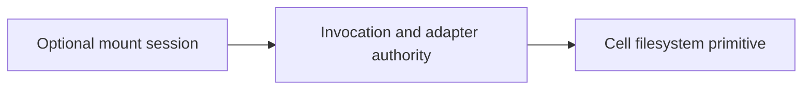

<!-- Copyright 2026 Cellar Project Authors. Licensed under Apache-2.0. -->

# Optional FUSE adapter and mounted agent execution

Purpose: Specify the separate optional mounted-filesystem adapter, execution sessions, lifecycle, and qualification requirements.

[Design library](README.md) · [Topic contract](per-cell-filesystem-design.md)

| Implementation | Validation or example |
| --- | --- |
| [Code and API](../../crates/cellar/application/filesystem/README.md) | [Checks and usage](../../tools/perf/filesystem.md) |

The map summarizes this document’s scope; the recorded gates determine completion.



## Reading map

Start with these sections; subsequent entries retain their original source and evidence scope:

- [1. Dependency and ownership boundary](#1-dependency-and-ownership-boundary)
- [2. Existing integration constraints](#2-existing-integration-constraints)
- [3. Evaluation of the proposed execution code](#3-evaluation-of-the-proposed-execution-code)
- [4. Mount request protocol and runtime admission](#4-mount-request-protocol-and-runtime-admission)
- [5. Cache, permissions and OS semantics](#5-cache-permissions-and-os-semantics)
- [6. Mount and container lifecycle](#6-mount-and-container-lifecycle)

Status: separate optional extension proposal, outside the filesystem primitive's delivery scope; no adapter or container changes are implemented. Separated from the filesystem primitive on 2026-10-26; boundary clarified 2026-10-27. Source baseline: `d3206c924031a3f2ca3387b542c02877bb91423d` (local inspected snapshot).

The [filesystem primitive](per-cell-filesystem-design.md), its [POSIX API](per-cell-filesystem-api.md), and its [implementation plan](per-cell-filesystem-implementation.md) define a complete, independently releasable context API. This document owns all OS mounting, kernel translation, mount sessions, container attachment and command execution. No FUSE dependency, mount method, execution builder or Linux prerequisite is part of `context.fs()`, `File`, `Directory` or their public API contract.

The scope decision is API-only for the filesystem primitive, with POSIX compatibility defined by its supported file and directory operations. This proposal preserves the mounted solution as a separately configurable extension. Implementing it requires its own design review and FUSE-xx qualification; the primitive's implementation plan does not schedule or enable it.

This is the sole design owner for the earlier `context.execution().mount_cell_filesystem(...)` sketch and for mounted agent commands. The sketch is evaluated below; it is not added to the filesystem primitive. Core agents use explicit file tools through `ctx.fs`; agents needing ordinary programs against a mounted path opt into this separate extension.

Nothing in this proposal changes the core POSIX operation profile or makes mounted access an alternate primitive API. The SDK remains the direct way to use cell files. The adapter translates operating-system requests into the same owner-checked semantics through its own host boundary.

### Scope transferred out of the primitive

The context API revision assigns the following concerns exclusively to this document and its independent implementation plan:

| Concern | Extension-owned contract |
| --- | --- |
| Mounted paths | Host mountpoints, container destinations and mount namespace visibility |
| Kernel access | FUSE callbacks, cache policy, lookup references and kernel handle lifetimes |
| Sessions | Mount admission, authority fencing, operation receipts and teardown |
| Execution environment | Container image/runtime selection, startup and filesystem attachment |
| Earlier execution sketch | Evaluation of `context.execution().mount_cell_filesystem(...)` and the separate proposed container API |
| Agent commands | Process launch, output collection, deadlines and interrupted-command recovery |
| Deployment | Linux prerequisites, privileges and actual mounted syscall qualification |

Enabling `context.fs()` does not enable any of these extension capabilities. The adapter needs its own configuration and authorization boundary. In a core-only application, agents use read/write/edit/list/search file tools through the SDK. A shell or Python subprocess accesses cell files only after an explicit adapter or another separately designed execution integration supplies that view.

## 1. Dependency and ownership boundary

- The optional adapter depends on the primitive's owner-checked filesystem backend.
- The primitive never depends on the adapter.
- SDK methods retain invocation-bound handles; the adapter introduces its own activation-bound handle owner and admits fresh built-in operations under current authority.
- It must not retain the Context that started a container or expose a raw SQLite connection to callback threads.

### Public API ownership

| Surface | Owner | Boundary |
| --- | --- | --- |
| `context.fs()`, `Storage::fs()` and `tx.fs()` | Core primitive | Paths, typed descriptors, metadata, transactions and proof barriers |
| Filesystem policy, capabilities and quotas | Core primitive | No mount, container or command settings |
| Mount registration, target, session and kernel options | Optional adapter | Separate host configuration and types; no `Filesystem::mount` method |
| Cell filesystem attachment and image/runtime selection | Container extension | Proposed container start options, not filesystem open options |
| Command launch, output, timeout and recovery | Command runner | Separate durable tool contract and receipt namespace |

- The dependency direction is adapter to owner-checked backend.
- The backend and SDK facades compile without adapter libraries.
- Reuse native namespace/content semantics while defining a separate host admission and handle owner for kernel requests; invocation-bound SDK descriptors cannot be promoted into mount handles.
- Core capabilities cannot advertise this adapter merely because it is installed.
- Mount/command availability requires its own explicit discovery and authorization.

### Adapter configuration and qualification

Mount targets, session IDs, kernel handle references, container settings and command methods belong exclusively to extension types. They are not fields or methods on core `Filesystem`, `File`, `Directory`, policy, capabilities, errors or limits. Neither filesystem registration nor `context.fs()` starts this adapter or an execution environment.

- The extension owns its registration, platform dependencies, activation-bound handles, admission and cleanup.
- These obligations cannot extend the lifetime of an ordinary SDK descriptor or become prerequisites for core tests and release.
- Build and run the primitive with the adapter libraries, device/helper, mount service and container engine absent.
- Adapter qualification separately exercises those components and the actual mounted syscall behavior.

| Concern | Optional extension contract |
| --- | --- |
| Files and business state | Same root-cell database and primitive semantics |
| Mount scope | At most one active session per cell initially; independent sessions across cells |
| Host service | One supervised service can manage many per-cell mounts |
| Execution API | Extend existing `context.container()`; mounting is a container attachment |
| Platform | Qualified Linux host/engine namespace topology |
| Write acknowledgement | Kernel mutation replies wait for Cellar durability proof |
| Recovery | Files recover; mounts, process memory and kernel handles are recreated |
| Release | Separate FUSE and execution qualification; core API release is independent |

The SQLite database must reside on ordinary host storage outside its own FUSE mount. The adapter supplies inode pins to the shared reclamation mechanism. Core APIs expose neither transport session IDs nor kernel lookup references.

Optional reserved tables, created only when this extension is enabled:

| Table | Fields and contract |
| --- | --- |
| `__sys_fs_mount_sessions` | Session ID, epoch, activation generation, state and durable retired sequence floor; never resurrect an old session |
| `__sys_fs_mount_receipts` | Session/sequence, request digest, typed result and filesystem revision; commit atomically with the filesystem mutation |

These tables are extension state, not required primitive schema. Installing this extension also extends storage-clear guards: live sessions, retained receipts, handles or cleanup obligations refuse `delete_all`. An empty quiescent extension preserves required identity/fencing state. A core-only deployment has none of these mount-specific obligations.

## 2. Existing integration constraints

| Existing component | Observed behavior | Extension consequence |
| --- | --- | --- |
| [SQLite storage](../../crates/cellar/storage/sqlite/mod.rs) | Isolate-owned, epoch-bound database | Enqueue fresh owner-checked work; no callback-owned connection |
| [Storage transactions](../../crates/cellar/application/storage/transaction.rs) | Async transactions hold an input gate | Reject command startup while a caller holds that gate |
| [Container SDK](../../crates/cellar/application/containers.rs) | Context-checked start/exec/output APIs; dropping Exec does not kill a process | Add typed attachment, idempotent startup and supervised command cleanup |
| [Container engine](../../crates/cellar/containers/mod.rs) | Idle eviction can retain a container; existing resolver bind | Mounted runs need bounded residency and must preserve other bind entries |
| [Guest operations](../../crates/cellar-guest/operations.rs) | Common dispatcher does not expose the proposed container command API | Add an explicit optional command capability or application-owned native RPC |

## 3. Evaluation of the proposed execution code

The earlier sketch was:

```rust
let execution = context.execution()
    .mount_cell_filesystem("/workspace")
    .start()
    .await?;
execution.exec(["python", "/workspace/analyze.py"]).await?;
```

It does not compile against the inspected SDK. `context.execution()` and `mount_cell_filesystem` do not exist. It also leaves image selection, process lifetime, output collection and command recovery unspecified.

| Expression | Required meaning |
| --- | --- |
| `context.execution()` | Acquire authority for this cell's declared container; must not start a host subprocess with ambient permissions |
| `mount_cell_filesystem("/workspace")` | Attach this cell's root at a validated container destination; this path is not an operator-selected host path |
| `.start().await?` | Verify image/runtime policy, establish a ready mount, create/start the container and return only after startup succeeds |
| `exec(["python", ...])` | Execute an argv vector inside that container; `python` must be supplied by its image and `analyze.py` by the cell's files |
| `.await?` on existing `Container::exec` | Returns a process handle after launch; it does not wait for successful command completion |

### Recommended API shape

Keep `context.container()` and introduce `Container::ensure_started` plus a typed cell-filesystem attachment in `StartOptions`. Retain explicit current context parameters. An activation-bound handle never grants perpetual authority.

Illustrative future code; `CellFilesystemMount`, `filesystem` and `ensure_started` are new. The remaining container/exec shape follows the SDK:

```rust
use cellar::sdk::containers::{CellFilesystemMount, ExecOptions, StartOptions};

let container = context.container()?;
container.ensure_started(
    &context,
    StartOptions {
        filesystem: Some(CellFilesystemMount::at("/workspace")),
        enable_internet: false,
        ..Default::default()
    },
).await?;

let output = container.exec(
    &context,
    ExecOptions {
        cmd: vec!["python".into(), "/workspace/analyze.py".into()],
        cwd: Some("/workspace".into()),
        ..Default::default()
    },
).await?.output(&context, 1024 * 1024).await?;

anyhow::ensure!(output.exit_code == 0, "analysis command failed");
```

This is a low-level execution example, not a crash-safe agent tool. Production agent execution also needs the command ledger, deadlines and interruption policy in section 8. Nonzero exit is a process result, not a transport error. The runner may return it to the agent as a tool result instead of raising an error.

- `ensure_started` serializes startup using the existing container control owner.
- It compares the desired image, runtime, environment, network and mount spec with the existing run.
- Matching state returns that run; a mismatch returns a typed conflict requiring explicit restart.
- It must not silently replace a running container.
- Current `start` may replace an existing named container and is not an idempotent substitute.
- Run IDs remain transient execution identities.

Mount configuration is validated against deployment policy. Only the current cell's filesystem can be attached in v1. Overlapping targets, `/`, `/proc`, `/sys`, `/dev`, path traversal and raw host-path mounts are refused. The initial supported target is `/workspace`; expanding allowed targets is explicit policy.

### What the environment actually contains

| Location/resource | Source | Survives ownership loss? |
| --- | --- | --- |
| `/usr`, Python interpreter, libraries, installed tools | Packaged OCI image declared for the cell class | Recreated from the same verified image |
| `/workspace` | This cell's SQLite filesystem through FUSE | Yes, to Cellar's configured durability contract |
| `/tmp`, ordinary container writable layer | Container-local scratch | No |
| Environment variables and secrets | Explicit deployment/runtime inputs | Reprovided; never automatically copied into workspace receipts |
| PID state, threads, sockets, descriptors, working process memory | Running container | No |
| Command identity, input fingerprint, result or interruption record | Cell application state | Yes when durably committed |

The image needs a long-running supervisor/root process so later exec calls have a live container. Python dependencies should be installed into the immutable image initially. Writing them into the container layer at runtime does not make them durable. A filesystem mount does not install Python or create a virtualenv.

The existing deployment `containers` entry supplies `class_name`, `image`, `instance_type` and optional `runtime`. Add filesystem capability/quotas and allowed target policy to validated configuration, with matching package inventory. Do not invent a second image-selection mechanism in the SDK.

- The agent loop can continue to run through the Node or embedded Python adapter outside this execution container.
- Only its command tool runs inside the container.
- Ordinary `open()` in embedded Python and `node:fs` in the agent's host process still address that host process's OS filesystem.
- Use explicit SDK file tools there.
- Never switch a shared process's cwd to emulate cell isolation.

## 4. Mount request protocol and runtime admission

- Use a host-owned mount service with separate per-cell FUSE sessions and a bounded native request queue.
- A Rust `fuser` adapter is the initial candidate; pin and review its version/license/platform requirements in implementation.
- The service may initially live in the Cellar host process.
- A later helper-process transport must preserve the same protocol and authority rather than exposing SQLite.

Each session records domain ID, cell identity, ownership epoch, activation generation, container run, mount ID and negotiated limits. These values are installed by the host; filenames and guest-provided metadata cannot select a cell. A mount capability is not an alternate ownership lease. It is usable only while existing Cellar authority remains valid.

A mutating request carries session ID, monotonically allocated sequence, operation, bounded payload and digest. A live retry preserves all fields. Kernel request IDs alone are insufficient across remounts. Persistent sessions are never resumed in v1; their IDs are never reused.

### Request execution

1. Validate session, operation bounds, handle/access mode and deadline before
   allocating unbounded memory or queueing work.
2. Admit a built-in filesystem operation on the cell isolate under fresh native
   invocation authority. Do not invoke user agent logic for every syscall and do
   not reuse the context of the call that originally started the container.
3. Recheck epoch, activation, domain and session state under the owning storage
   boundary. Read the receipt for duplicate mutations; digest mismatch fails.
4. Execute a mutation and insert its result receipt in one short transaction.
   Deterministic precondition errors may also be receipted; transient refusal
   before submission is not recorded as a completed mutation.
5. Release the SQLite transaction, then await the normal required durability and
   authority gates. Replayed receipts also require a proven read. Syncing a
   current position that includes the receipt is sufficient; the stored
   filesystem revision is not a proof token.
6. Reply to the kernel exactly once. Cancellation or a failed reply cannot undo
   a committed mutation. Record the outcome for reconciliation and metrics.

Reads use the same admission and proof discipline, with a consistent bounded SQLite read boundary covering metadata and chunks. FUSE reads need not retain their bytes forever. Agent read tools have the separate journal contract in the core design. No long-lived SQLite transaction is tied to an open OS file descriptor.

- Receipt storage is bounded.
- The adapter acknowledges a contiguous sequence prefix only after each request has reached a terminal response/retry decision.
- The owner advances a durable retired floor and deletes eligible receipts in bounded batches.
- A request at/below the floor is rejected, never re-executed.
- Out-of-order responses require a bounded completion set.
- If receipt capacity is exhausted, apply backpressure before another mutation.
- On a terminal session, revoke admission before pruning its remaining receipts; unknown session IDs are refused rather than recreated.
- A crashed adapter causes session closure and container restart, not silent receipt-free replay.

### Avoiding deadlock

Mounted I/O has reserved, bounded admission separate from long-running agent calls waiting for commands. It still respects cell ownership, transaction input gates and isolate serialization. Reserving slots must not bypass an active transaction. Requests blocked by that gate have deadlines.

- Reject command startup while the caller holds a storage transaction or explicit concurrency-blocking section.
- Never hold the container startup/control lock while waiting for filesystem work that needs that same lock.
- FUSE callbacks cannot block the executor responsible for serving their queue.
- Independent cells get fair scheduling and bounded per-cell request/byte budgets.
- No new tasks are detached from execution-domain supervision.

## 5. Cache, permissions and OS semantics

The first release negotiates direct I/O, disables writeback caching and uses zero entry/attribute/negative-entry TTLs. The adapter still supplies correct attributes on every reply. Do not enable mmap or cached read modes until their coherency and revocation behavior is qualified. SDK mutations must immediately be visible to subsequent mount operations under this baseline policy.

This is a deliberate conservative design: Linux FUSE distinguishes direct I/O, write-through and writeback caching; writeback can complete writes in the kernel cache and assumes changes go through that kernel mount. [Kernel FUSE I/O documentation](https://kernel.org/doc/html/latest/filesystems/fuse/fuse-io.html).

Future caching requires a single revision/invalidation mechanism for both SDK and mounted mutations, plus fencing behavior for cached reads after authority loss. A TTL alone is not enough to claim strict current-owner visibility.

- Use kernel permission checking where supported and revalidate session/handle authority in the service.
- Start with one configured non-root execution UID/GID per cell container; the host adapter maps this to filesystem ownership.
- Mode bits enforce access within the supported identity model.
- Reject unsupported setuid/setgid and ownership transitions.
- Private mountpoints and container namespace boundaries provide cell isolation; FUSE itself is not a code sandbox.

- Mounts are `nodev,nosuid` and initially `noexec`; scripts run via interpreters installed in the image.
- `/workspace/program` cannot execute directly under that policy.
- An execute-enabled workspace requires an explicit qualified profile.
- The host mount service owns FUSE privileges; the agent container gets neither `/dev/fuse`, mount privileges nor the container-engine socket.
- If different mount/container UIDs require `allow_other`, provision it only with private host directory permissions and kernel access checks, and test the UID mapping.

- Map deterministic errors to ordinary errno: ENOENT, EEXIST, ENOTDIR, EISDIR, ENOTEMPTY, EINVAL, EACCES, EDQUOT/ENOSPC, EFBIG and EOPNOTSUPP as appropriate.
- Mapping Cellar transaction-affinity or version conflicts to syscall errno is an adapter contract here; the context API returns its typed conflict directly.
- Fenced handles fail with a documented ESTALE/EIO mapping.
- Transport/durability ambiguity surfaces as I/O failure plus an internal typed outcome, never as invented success.
- ENOSYS has protocol-specific fallback meaning; use it only when that fallback is intentional.
- `release`/`forget` are cleanup notifications, not durability barriers; `flush` is not interchangeable with `fsync`.
- [FUSE operation contracts](https://libfuse.github.io/doxygen/structfuse__lowlevel__ops.html).

- `fsync` is ordered after the caller's already-submitted operations and waits for their required cell write position.
- Concurrent later operations are outside that barrier.
- The initial implementation may conservatively sync the whole cell.
- Successful mutation replies already carry proof; a barrier remains useful for explicit ordering and error propagation.
- User-space buffers that were never flushed to the kernel are outside this guarantee.

## 6. Mount and container lifecycle

Session states: `Preparing`, `Active`, `Quiescing`, `Closed`; any nonterminal state may transition to `Fenced`. Only `Active` admits new data operations. Cleanup is idempotent and records incomplete phases for node shutdown reports.

### Startup

1. Validate the class capability, same-host topology, FUSE device/helper,
   runtime, image inventory, resource budget and target path.
2. Recover the cell and acquire a bounded residency pin. Establish current
   activation authority and a fresh session ID; persist session state as needed.
3. Create a private mountpoint, register the queue and mount the filesystem.
   Verify root lookup/readiness without executing agent code.
4. Create the container with the ready root bind-mounted at `/workspace`,
   preserving any existing resolver bind and engine security/resource settings.
5. Verify the container run, mount identity and spec digest; publish readiness.
   Failure unwinds container, mount, session and pin in reverse order.

A private mount service can manage many separate kernel sessions in one process. There is no requirement to allocate a container or mount for an SDK-only cell. Mount count, file descriptors and pinned activations have host-wide limits.

### Idle eviction and activation replacement

- Existing unmounted containers can survive idle cell eviction.
- Mounted containers cannot retain authority to a retired SQLite activation.
- For v1 a live mount pins residency for a bounded command/session lifetime.
- The pin has a deadline and inactivity limit, does not override ownership loss or shutdown, and cannot be renewed forever by untrusted kernel traffic alone.
- Host/application policy owns renewal and concurrent mounted-cell limits.

- When the pin expires or an eviction is required, stop the mounted container, close the mount session and release the pin before database eviction.
- Do not apply the existing `Release::Keep` path to that mounted run.
- Generation adoption also retires the old mount before creating a replacement; an unchanged ownership epoch is insufficient to validate an old activation's handles.

### Graceful close

Stop new command launches, request process shutdown and allow bounded cleanup I/O while authority is valid. Then quiesce request admission, drain accepted operations/proofs, ensure the process tree is stopped, remove the container's bind attachment, unmount, close session resources and release the residency pin. No transaction, handle registry or callback thread may outlive its domain.

### Ownership loss, crash or forced close

Immediately fence new requests and pending success publication through existing authority checks. Stop the process tree and abort/unmount the session. Authority revocation must not depend on successful container deletion. Cleanup failure is reported and retried under supervision; it cannot authorize old writes.

- A replacement owner restores the database before creating a new session and container.
- It marks old sessions terminal and reclaims orphaned data in bounded batches.
- An old mount receives errors rather than being transparently rerouted.
- If the host crashes while the container engine survives, the next supervisor uses host/cell/run labels and session identity to destroy stale managed runs before admitting replacements.
- It does not adopt a container attached to a dead FUSE session.

No promise is made that a partitioned process instantly stops computing. Storage fencing prevents it from acknowledging valid cell writes. External network effects depend on the container network policy and application idempotency.

### Host topology

- The mountpoint must be visible in the container engine's host mount namespace.
- Linux host-native Cellar plus a local engine is the initial qualified setup.
- Running Cellar itself in a container needs an explicitly provisioned helper or mount propagation arrangement; ordinary private container mounts are not automatically visible to the host engine.
- Refuse unqualified topology at start.

- For macOS development, run the Cellar host, mount service and engine in the same Linux VM.
- A macOS process controlling Docker Desktop/Colima over a Unix socket does not by itself satisfy this topology.
- Native macFUSE, Windows adapters, remote mounts and rootless-engine variants require separate qualification.
- Docker bind sources are resolved on the daemon host.
- [Docker bind-mount documentation](https://docs.docker.com/engine/storage/bind-mounts/).

## 7. FUSE translation and shared implementation

| Kernel request | Shared backend behavior | State owner |
| --- | --- | --- |
| LOOKUP / GETATTR | Parent/name lookup and inode metadata | Cell database; mount lookup references |
| CREATE / OPEN | Validated open options, inode pin and handle reservation | Mount session; mutation receipt for create/truncate |
| READ | Positional read using request offset and inode capability | Kernel owns user-process offset; mount checks handle |
| WRITE | Positional/append write under negotiated kernel semantics | Cell transaction and mount receipt |
| SETATTR(size/mode/time) | ftruncate/chmod/time backend | Cell transaction |
| MKDIR / RMDIR / UNLINK / RENAME | Same namespace invariants as SDK | Cell transaction |
| OPENDIR / READDIR / RELEASEDIR | Directory references and stable cookies | Kernel/session enumeration state |
| FSYNC / FSYNCDIR | Existing Cellar proof barrier | Runtime proof owner |
| RELEASE / FORGET | Release open/lookup references | Mount session and owner-coordinated GC |

- FUSE callbacks operate on inode capabilities, not strings reconstructed from every path.
- They call the same backend as SDK methods without allocating a second SDK descriptor layer or updating an SDK cursor on top of the kernel's cursor.
- OS `dup`/`lseek` behavior is normally managed by the kernel; the native SDK implements its own equivalent open-description state.
- Keep tests for each surface rather than assuming that sharing SQL makes their handle behavior equal.

### Kernel-specific differences from the context API

- SDK `pwrite` remains positional even on an append-open descriptor.
- The adapter preserves the actual Linux O_APPEND/pwrite contract; kernel requests may not reveal whether the original syscall was a positional write.
- Qualify this separately from the SDK.
- Each bounded FUSE WRITE is atomic; a large OS write may be split into multiple requests.
- This does not promise whole-syscall atomicity.

- The kernel owns process cwd, numeric fds, dup/lseek, inheritance and close-on-exec.
- SDK `File` and `Directory` values do not become host fds.
- Map O_DIRECTORY to the directory backend; do not create a second SDK offset on top of a kernel offset.
- Creation mode/umask is applied exactly once under the negotiated kernel contract; do not also apply the SDK creation mask.
- Map atime to the declared noatime profile and translate supported timestamp flags explicitly.

Absolute symlinks, if introduced, resolve in the mounted process namespace; SDK symlinks would resolve within the cell root. Sharing a storage backend does not make these resolution boundaries identical. Links, locks, mmap, cached I/O, watchers and optimized copies need their own adapter capability tests.

- Open/create reserves a handle and inode pin under the serialized owner boundary.
- A successful mutation receipt identifies that reservation; duplicate requests reuse it.
- Precommit failures release provisional pins.
- A failure after commit retains reconciliation state or closes the session.
- A new mount cannot restore a former session's descriptor from a receipt.
- After fencing all former handle owners, recovery may reclaim orphaned unlinked inodes.

## 8. Durable agent command integration

The core primitive's agent tools already support durable read/write/edit/list operations and atomic file-plus-receipt batches. This extension adds ordinary OS programs. The agent journal remains in its owning cell; a process is a supervised external effect, not a durable continuation.

### Mounted command tool

Introduce `run_command` as a separate effect with a durable command record:

| Field | Purpose |
| --- | --- |
| command ID + turn/tool ID | Stable logical identity, scoped to the session cell |
| fingerprint | argv, cwd, image/spec digest, permitted environment, input versions and execution policy |
| phase | prepared, running, completed, interrupted, cancelled; ambiguity is retained explicitly |
| attempt + execution identity | Ownership epoch, activation generation, container run and transient engine exec ID |
| limits | Deadline, output cap, workspace quota and allowed network/runtime profile |
| result | Exit code, bounded stdout/stderr or durable output references, workspace revision/barrier observation |

- Persist `prepared` and its recovery wake before dispatch.
- Starting a process is an external effect: a crash can occur after engine acceptance but before the `running` record.
- Therefore `prepared` without a final result is also potentially executed; never assume it is safe to launch again just because no PID was saved.
- Within a surviving run, a supervisor may reconcile a known exec ID.
- After owner loss, stop stale execution and record `interrupted` if no durable completion receipt exists.
- Return that result to the agent; it may inspect files and decide on a new command with a new ID.

- For v1, run one command at a time in a disposable mounted container run.
- On completion or timeout, stop the entire process tree, drain accepted filesystem requests and record the final result/receipt with a proven barrier.
- Do not use parent-process exit alone as evidence that child writers stopped.
- Disallow background-daemon persistence in this command profile.
- The general container API remains suitable for longer-lived services under its own contract.

The runner consumes stdout/stderr concurrently, caps them and records truncation or failure explicitly. Output overflow, cancellation and deadlines terminate the command tree; dropping an existing `Exec` only releases streams/registry entries and does not provide that guarantee. Add supervised cancellation rather than depending on Rust `Drop` to perform asynchronous cleanup.

If the host dies after file writes but before completion is saved, files may contain partial command effects. The recovered journal must say interrupted, not completed and not rolled back. A nonzero exit can also leave valid changes. No automatic retry of arbitrary shell commands is permitted by the v1 contract.

### Optional later atomic publication

A private filesystem version per command can support retryable *file output publication*. This is a separate feature, not a flag on the initial schema. It requires copy-on-write inode/directory/chunk references, immutable base versions, version-aware handles and bounded reference GC.

- The command reads a fixed base and writes a private version.
- After all processes and handles stop, a transaction compares the expected published base and publishes the new root together with its completion receipt.
- A changed base returns a conflict; abandoned attempts remain unpublished and are reclaimed.
- No SQLite transaction spans process execution.
- Initial implementation should require exclusive workspace execution so existing mounted handles cannot write into a root being published.
- Network effects remain independently ambiguous; this provides one publication, not exactly-once process execution.

## 9. Extension limits and observability

Add explicit limits for sessions, pending requests/bytes, retained receipts, command duration/output and pinned cells. A 128 KiB negotiated FUSE write and a small bounded queue are initial experiment settings, not performance claims. All filesystem size/quota checks still come from the primitive.

Measure queue, SQLite and proof latency; kernel/SDK visibility; session replay; active mounts, pins and handles; fences, cleanup failures and command ambiguity. Report current session/run and shutdown accounting through authenticated owner management. Avoid default logging of filenames, file contents and environments.

## 10. Independent implementation sequence

The package IDs here are FUSE-xx. FS-xx packages belong exclusively to the core primitive plan. FUSE-00 may probe feasibility in parallel with core design; production adapter work depends on the core backend/SDK contracts, and command integration additionally depends on the durable agent file-tool contract.

| Package | Deliverable | Dependencies |
| --- | --- | --- |
| FUSE-00 | Kernel/library/runtime feasibility probe | None; never a core API release gate |
| FUSE-01 | Session protocol, owner admission, replay and residency | Core FS-01/02/04 |
| FUSE-02 | Linux FUSE adapter and real syscall tests | FUSE-00/01 |
| FUSE-03 | Container attachment and idempotent startup | FUSE-02 |
| FUSE-04 | Durable command runner | FUSE-03 and core FS-03 |
| FUSE-05 | Deployment, fleet and workload qualification | FUSE-04 and core FS-05 |
| FUSE-06 | Optional command-private versions and publication | Separate versioning design; FUSE-05 baseline |

### FUSE-00: Feasibility probe

- Read current container/storage lifecycle code and applicable AGENTS.md files.
- Build an isolated Linux probe with a disposable filesystem and container.
- Verify the pinned Rust FUSE library/license, callback threading, `/dev/fuse`, helpers, non-root UID mapping, engine visibility and selected OCI runtime.
- Run image-provided Python against mounted script/data, then verify complete teardown.
- Record exact versions, commands and negotiated capabilities.
- This establishes topology compatibility only, not Cellar durability.
- Keep optional platform dependencies outside the primitive's application API/build requirements.

### FUSE-01: Add mount sessions, scheduling and residency pins

Suggested host component: `crates/cellar/filesystem/` for session lifecycle, request types, bounded dispatch, handle registry and cleanup. The owner-side adapter adds its optional session/receipt tables to the same SQLite database. Integrate host-owned services through `execution/services.rs`, domain shutdown and node composition.

Add a built-in native filesystem invocation path through the owning isolate; this is host service work, not arbitrary application code invoked on a FUSE thread. Preserve epoch/domain/generation checks and normal proof gates. Add explicit accounting for request bytes, queue slots, session/handle counts and cleanup phases.

Implement session sequence/digest receipts, contiguous retirement floors and terminal-session refusal. Persist mutation plus receipt in one transaction, then prove it before publishing success. Test dropped replies and out-of-order acknowledgements with a fake mount transport before introducing a real kernel.

Add bounded residency pins and a mounted-I/O admission reserve. Reject command launch from transactions/concurrency-blocking sections. Pins cannot keep a fenced domain alive and must appear in shutdown evidence. Current-epoch but old-generation sessions are invalid. Retire open handles before GC.

Exit: fake-kernel saturation tests prove that waiting commands leave enough capacity to serve filesystem work, unrelated cells make progress and every shutdown path joins work or reports unfinished cleanup without claiming proof.

### FUSE-02: Implement the Linux FUSE adapter

Use a focused optional crate such as `crates/cellar-fuse/` for OS protocol translation, with a bounded backend interface implemented by the host. It must not depend on direct rusqlite access. Decide exact crate placement in FUSE-00 and add its README/manifests to repository checks if a crate is created.

Implement init/capability negotiation, lookup/forget, getattr/setattr, open/create/read/write, directory operations, rename/unlink, flush/release, fsync/fsyncdir and statfs. Enforce request and reply limits and exactly one kernel reply. Implement correct reference counts and error mappings. Disable unsupported capabilities explicitly rather than assuming fallback semantics.

Mount with conservative cache and permission policy from the design. Use private per-cell host paths, inode identities scoped to that mount and a service task/thread lifecycle owned by the domain. Verify both engine namespace visibility and that bind mounts reference the actual FUSE filesystem rather than an underlying empty directory.

Exit: actual Linux tests exercise the declared subset through syscalls and independent SDK operations. A test runner fails if it expected mounting but lacks prerequisites; a reported skip is not qualification. Library-only CI may omit this feature explicitly.

### FUSE-03: Attach mounts to cell containers

Extend `ContainerSpec` capability/configuration, SDK `StartOptions`, host `StartParams`, package validation and `create_and_start`. Add `CellFilesystemMount` and `ensure_started` with desired-spec comparison and shared startup serialization. Accumulate mount entries without overwriting the existing resolver bind. Mount before container creation; do not rely on later mount propagation into an already-started container.

Mounted runs acquire residency pins and never take the ordinary idle `Release::Keep` path after activation retirement. Integrate stop, inactivity, generation change, owner loss, domain closure and stale-run cleanup. Add clear errors for unsupported platform/topology/runtime and incompatible desired specs. Preserve existing unmounted-container behavior and tests.

Add a mounted native-container example with image-provided Python, an explicit root supervisor, `/workspace/analyze.py`, an input file and output JSON. Two named cells must see independent files at the same container path. Include bounded output collection and explicit exit-status handling.

Exit: fresh owner recovery restores files into a new container/mount; no old descriptor remains valid. Inject failure at every startup step and confirm all created resources unwind. A stale container surviving host SIGKILL is removed before a replacement serves the workspace.

### FUSE-04: Add the durable command runner and session agent

Create an application-owned `AgentSession` cell with indexed turn journals and a command ledger. Reuse the existing durable model-decision loop and recovery alarms; do not replace Cellar's event driver with an unmanaged agent process. Add a narrow native command RPC or guest capability for the actual execution container, preserving current-context and process-run checks.

Persist command intent and input fingerprint before launch. Expose status and terminal result by stable command ID. Reconcile known running engine IDs only while their execution identity remains valid. Treat a prepared/running command without a completion receipt after host loss as potentially executed; return interrupted and do not relaunch it under the same ID.

Run one command per disposable container run. Supervise deadline, cancellation, stdout/stderr limits, descendant cleanup and mount drain. Store the final result and agent receipt together after cleanup/barrier requirements succeed. Preserve partial files on failure and report this explicitly. Implement duplicate tool requests as receipt/status reads, not duplicate engine exec calls.

For the demonstration, the agent writes an analysis script through atomic file tools, runs image-provided Python, reads the result through a recorded read tool and completes its turn. A follow-up in the same session reads the prior output. The existing per-turn demo remains available with its original identity model.

Exit: deterministic provider tests cover normal execution, file replay, follow-ups, duplicate submissions and every command ambiguity boundary. Live model tests are optional additional evidence and never required to establish filesystem correctness. No unrequested paid provider call is part of this plan.

### FUSE-05: Qualify and document the deployed feature

Add an explicit mount-capable Linux CI job and native/guest feature matrix. Package the filesystem capability, selected image/runtime policy and required mount prerequisites; validate them before workload admission. Add owner-routed inspection for usage, sessions, pins, receipts, interrupted commands and GC.

Update SDK/storage/container guides, example catalog, deployment prerequisites and production-readiness documentation. Publish the exact supported operation matrix and tested kernel/engine/runtime combinations. Explain the Linux-VM development workflow for macOS and unsupported remote-engine arrangements.

Run the recovery, resource, load and failure matrices below against an exact release artifact. Record source/image digests, toolchain, store/backend, configuration, raw outcomes and shutdown reports. Set release SLOs from the intended application rather than inventing performance guarantees here.

### FUSE-06: Optional versioned command output publication

Write a separate design for immutable versions, copy-on-write namespace/content, handle/version identity, atomic root publication, reader retention and bounded GC. Prototype version creation and compare-and-publish with a command receipt before integrating it with execution. Include disk-pressure and abandoned attempt recovery. Do not retrofit filesystem snapshots by keeping a SQLite transaction open while the command runs.

Exit: retrying an interrupted isolated command can produce several private attempts but publishes at most one result under a stable command ID. Changed base versions cause a conflict. External network effects remain outside this guarantee. No v1 documentation may claim this feature before this gate passes.

## 11. Extension verification and release gates

| Cases | Required evidence |
| --- | --- |
| Session replay | Duplicate mutation, digest conflict, lost response, proof failure, out-of-order completion, retired-floor refusal and receipt backpressure |
| Handles | Open/lookup pins, lost-create reply, flush/release/forget distinctions, old-session refusal and directory cookies |
| Mounted semantics | Actual read/write/stat/namespace syscalls, supported errno, UID/mask policy, statfs quotas, fsync ordering and both directions of SDK visibility |
| Lifecycle | Failure at every startup step, simultaneous start, spec conflict, idle-pin expiry, generation replacement, ownership loss and surviving-engine cleanup |
| Isolation | Two cells at the same container path, guessed IDs, private mountpoints, forbidden targets and no engine socket/device exposure |
| Scheduling | Saturated command waits, held-transaction rejection, bounded queues, cross-cell fairness, callback progress and complete shutdown accounting |
| Commands | Intent-before-launch crash, engine acceptance before ID save, mid-write crash, exit before receipt, receipt before reply, duplicate call, timeout, output overflow and surviving descendants |
| Fleet | Empty-node recovery, stale-owner writes, proof/bucket outages, disk pressure and proven post-takeover writes |

An intent without a completion receipt may already have executed. Recovery records interruption/unknown outcome instead of relaunching it. Completed file mutations may survive a command without a completion receipt. Durable completed receipts replay their saved result. Request deduplication does not make arbitrary program execution exactly once.

- Run actual mounts on explicit Linux CI workers; missing prerequisites fail that job, and skipped tests do not count as qualification.
- Record source/image digests, store/backend, kernel/engine/runtime, feature configuration, client ledgers and cleanup evidence.
- Add repeated activation/teardown and Python processing runs.
- Compare SDK and mounted throughput, proof latency, per-mount memory/FD/task counts and many-cell fairness.
- Core conformance is necessary but does not qualify Git, package tools, mmap applications or a selected container runtime.

Caching and wider OS profiles require coherency, invalidation, truncation and fencing tests before enabling them. Optional private command versions require atomic compare-and-publish with a receipt and retained-reader GC. External network effects remain outside file-publication guarantees.

## References

- [Core filesystem design](per-cell-filesystem-design.md)
- [Context POSIX API](per-cell-filesystem-api.md)
- [Core implementation plan](per-cell-filesystem-implementation.md)
- [Cell authority and proof](../adr/002-cell-authority-and-proof.md)
- [Native container example](../../examples/native-container/README.md)
- [Rust FUSE candidate](https://github.com/cberner/fuser)
- [libfuse API overview](https://libfuse.github.io/doxygen/)
