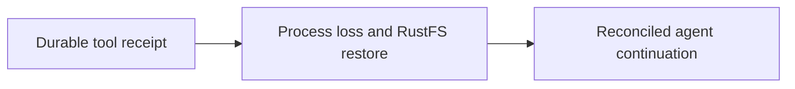

<!-- Copyright 2026 Cellar Project Authors. Licensed under Apache-2.0. -->

# Vercel AI SDK agent recovery from RustFS

Purpose: Record durable agent recovery through RustFS, receipt reconciliation, measured outcomes, and reproduction limits.

[Design library](README.md) · [Related contract](vercel-agent-live-qualification.md)

| Implementation | Validation or example |
| --- | --- |
| [Code and API](../../examples/vercel-agent/README.md) | [Checks and usage](../../examples/vercel-agent/README.md) |

The map summarizes this document’s scope; the recorded gates determine completion.

Validated on 2026-10-24 using the native macOS RustFS `1.0.0-rc.1` binary (commit `778f1dfa2155cbbc61ad54e6896de9e29d2c4d8d`), Node `24.13.1`, the Node-only Cellar host, AI SDK `7.0.152`, `@ai-sdk/openai` `4.0.101` and real OpenAI `gpt-6-luna` calls. The host executable SHA-256 was `f7b87b0ef3f1c5344c76170907667de57d2d72e6c5789024d2978c05584f429b`.

This extends the earlier [development-store qualification](vercel-agent-live-qualification.md). It exercises Cellar's actual S3 client against a separate RustFS process, rather than the SQLite-backed development object store. Credentials and raw reports remain in a private run directory outside the repository.

## Recovery contract

Each scenario creates a fresh RustFS bucket and starts the Rust host plus its supervised Node worker. S3 mode explicitly removes `CELLAR_INTERNAL_DEV_STORE`. The harness inspects S3 using the AWS CLI independently of the worker.

- At the chosen boundary it sends SIGKILL, waits for process exit, physically deletes the worker's data directory, and verifies that the directory is absent.
- The replacement uses a different node identity and a newly created, empty directory.
- Pending work must complete through the bucket's persisted alarm before any task HTTP request is sent to the replacement.

- Before and after recovery, reports contain actual S3 object keys, lengths and ETags, a downloaded LTX segment's SHA-256, and the cell's ownership node/epoch.
- They assert that no `bucket.sqlite` exists.
- The recovered cell moves from epoch 1 to epoch 2.
- Model decisions, receipts, notes and conversation messages are recovered from the replicated cell database; the gateway does not cache them.

## Observed results

| Live GPT-6 Luna interruption | Result after local data deletion |
| --- | --- |
| Durable acceptance | Alarm resumed the pending turn; two provider calls, one increment. |
| Provider dispatch, before decision checkpoint | The uncheckpointed dispatch repeated; three provider calls, two saved decisions, one increment. |
| Saved model decision | Reused the checkpoint; two provider calls, one increment. |
| Local tool commit | Reused the tool receipt; counter remained 3. |
| Final model decision | Reused both decisions; no extra provider call. |
| Completed turn | Retrieved the completed transcript and receipts unchanged; no new attempt. |
| Downstream ticket commit, before local receipt | Two attempts completed six tools; calculation 168, counter 13, one ticket effect from two requests. |
| First real text delta, before that decision's checkpoint | Two attempts completed six tools; saved tool receipts replayed, counter 13, one ticket effect from one request. |

Duplicate submissions preserved the complete task result and provider-call count. All saved live decisions reported nonzero token usage. The six-tool scenarios verify calculation, reference lookup, counter mutation, note storage, state reads and external HTTP writes. Partial text is provisional and may be generated again after a crash; saved model decisions and receipts are reused.

The final six-tool runs additionally opened the recovered SQLite databases in read-only mode and verified the actual counter and note rows against the saved tool inputs. In the stream-interruption case those rows exactly matched the rows read before deletion. Provider dispatch counts matched saved decisions, plus exactly one uncheckpointed response for the streaming interruption.

The real browser also completed all six tools against RustFS. After SIGKILL and deletion of all 21 files in that worker's local directory, a replacement returned the identical completed task. A new follow-up correctly recalled 168, counter 13, the note title and ticket title with zero new tool calls.

- The deterministic suite independently passed all six interruption boundaries against RustFS.
- It also completed 16 concurrent production-entry turns, erased the worker's local files, and recovered identical results for 32 duplicate submissions.
- The unit suite has 36 passing tests, including backend selection, refusal to fall back from incomplete S3 configuration, and inherited local-store override removal.
- Default local-store recovery remains covered.

## Sidebar discovery

The transcript was durable, but the original sidebar depended on the creating browser's local storage. A regression reproduced an empty sidebar in a fresh browser while the saved transcript loaded correctly by URL.

- Conversation discovery now lives in a separate `ConversationDirectory` cell, using cell-owned SQL and the same bucket durability policy.
- Unique task keys make concurrent acceptance/alarm registration idempotent.
- The turn's persisted alarm repairs interruption between acceptance and directory registration before provider work.
- Follow-ups replace their parent in the recent conversation list.
- Browser local storage is only a cache, and directory outages show a retry state.

- The desktop and mobile regression loads history without local storage, clears the cache again, and opens a saved conversation from the home page without a turn URL or resubmission.
- Ten UI tests passed.
- In the live RustFS demo, all 27 worker-local files across three worker directories were deleted.
- Two sidebar conversations then restored identically through the directory endpoint, before any task HTTP request.
- Opening a saved link also registers previously unindexed turns; the directory does not scan or reverse opaque IDs for undiscovered old turns.

- A further regression reproduced sidebar entries moving to the front when selected.
- Entries now sort by saved checkpoint time, with task ID as a stable tie-breaker.
- Activity time commits atomically beside the journal; reads and duplicate acceptance do not change it, and delayed indexing cannot overwrite a newer time.
- Turns without a recorded time remain discoverable in a stable order after dated turns.
- Desktop and mobile tests cover selection, polling, reload, and an actual timestamp change with an unsorted server response.
- Switching between both existing chats in the live demo preserved their order and metadata without resubmission.

The example uses a bounded 128-invocation bridge budget for nested ingress, turn, alarm and directory calls. The deterministic RustFS run verifies that the directory contains the recovered task before a task GET at each crash boundary, and lists all 16 concurrent conversations before replaying duplicate submissions. The framework's default invocation limit is unchanged.

## Reproduce and inspect

- Use the [RustFS example instructions](../../examples/vercel-agent/README.md#use-rustfs-instead-of-the-development-store).
- `test/process.mjs` covers the six boundaries and deterministic concurrent turns; `test/tool-process.mjs` covers external reconciliation and live stream interruption.
- Paid calls require explicit `CELLAR_AI_TEST_LIVE=1`.
- The S3 harness requires the AWS CLI and leaves its per-scenario buckets for inspection.
- JSON reports include the bucket identity and object inventory, but not credentials or object-store authentication bodies.

CI runs the deterministic suites against a digest-pinned RustFS container and uploads their JSON reports. That Linux/container path is separate from the native macOS RustFS version used for the live qualification above; its result must be checked in the workflow run.

## Scope

- This demonstrates recovery after complete loss of worker-local state while the object store remains available.
- It is a local single-server RustFS test and does not qualify loss of the object-store disk, independent failure domains, production fleet partitions or maximum throughput.
- The independent ticket service keeps its own transactional idempotency database; other external tools need the same downstream contract.
- Uncheckpointed provider requests may repeat and incur charges.
- The demo remains a loopback service.
