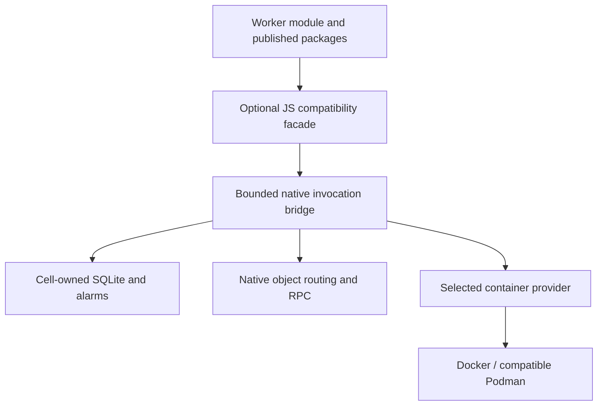
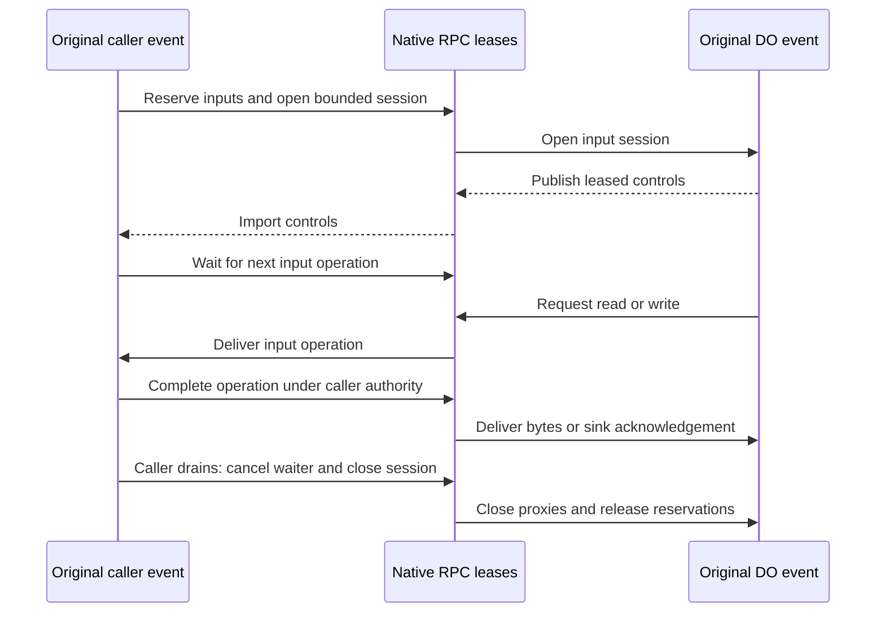
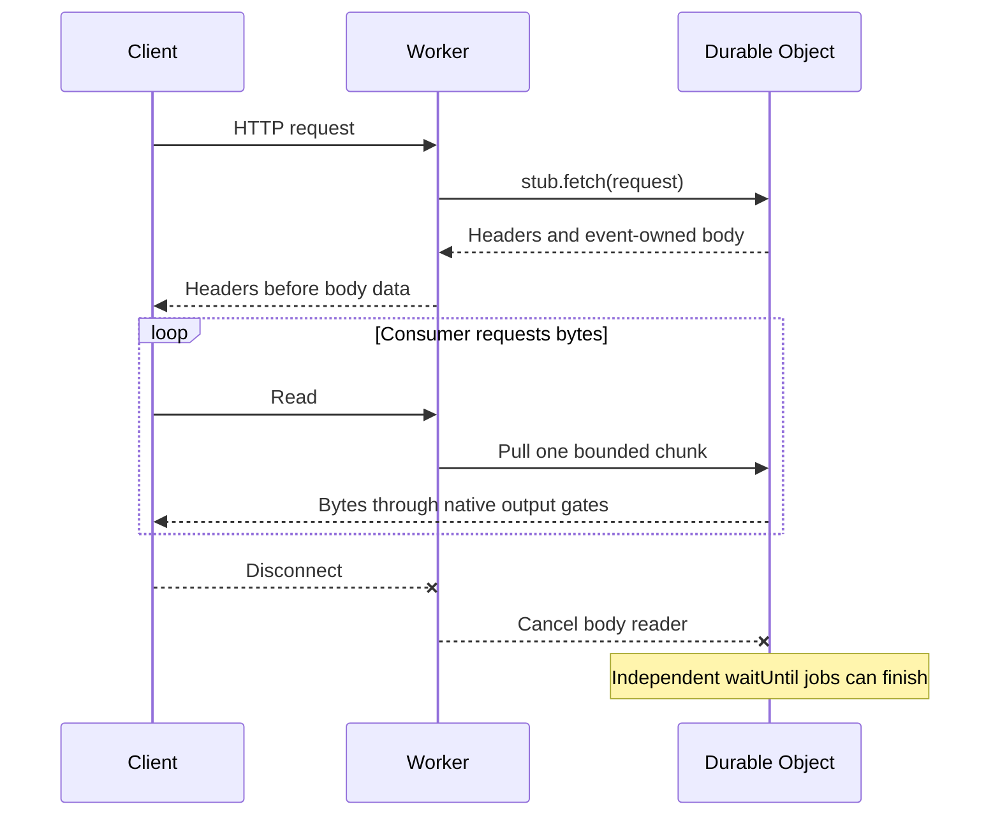
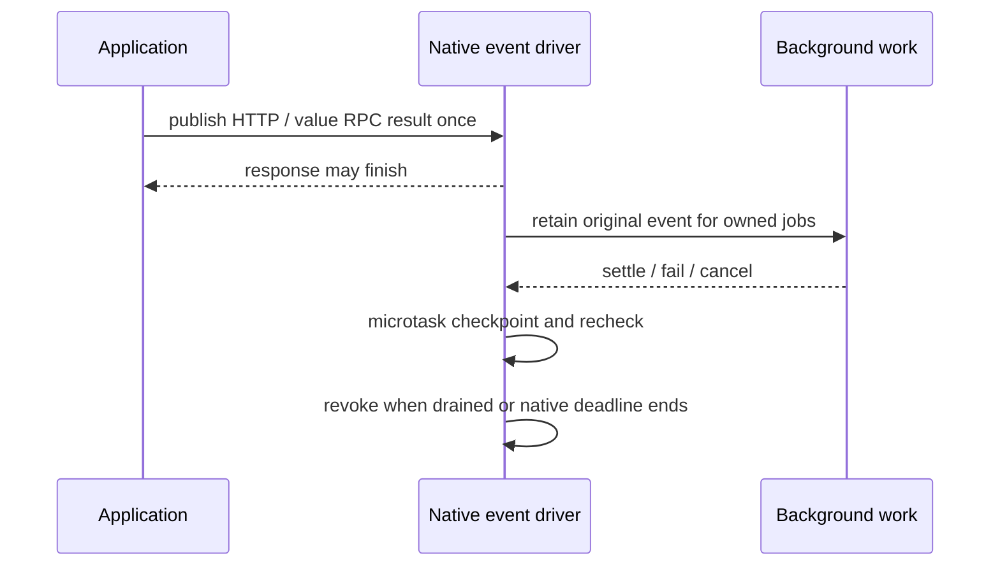

<!-- Copyright 2026 Cellar Project Authors. Licensed under Apache-2.0. -->

# Optional Cloudflare compatibility runtime

Run selected Workers and Durable Object APIs above Cellar's native ownership,
SQLite and durability boundaries. This package is **experimental**; complete
Workers profiles, published Sandbox/image execution and remote providers remain
under development in the [delivery plan](../../plans/sandbox-provider-compatibility.md).

[Module example](#adapt-a-workers-module) · [API coverage](#api-coverage) ·
[Lifetime](#which-context-can-be-retained) · [Tests](#execution-evidence)

## How it works



The JS runtime serializes values and runs application callbacks. Native Cellar
executes SDK effects in their original invocation, including ownership/epoch
checks and durability/output gates. Native-only hosts remain engine-free.

## Adapt a Workers module

Keep application exports in their own module. A small Cellar entry declares the
bindings and classes that the native host makes available:

```js
// cellar-entry.js
import * as worker from "./worker.js";
import { workersApplication } from "@cellar/cloudflare";

const app = workersApplication(worker, {
  namespaces: { COUNTERS: "Counter" },
  variables: ["GREETING"],
});
export const { cells, fetch } = app;
```

```js
// worker.js
import { DurableObject } from "cloudflare:workers";

export class Counter extends DurableObject {
  controls() {
    return { read: () => this.ctx.storage.get("count") };
  }
  async fetch() {
    const count = (await this.ctx.storage.get("count") ?? 0) + 1;
    await this.ctx.storage.put("count", count);
    return Response.json({ greeting: this.env.GREETING, count });
  }
}

export default {
  fetch(request, env) {
    return env.COUNTERS.getByName("alice").fetch(request);
  },
};
```

The current fixture bundler maps `cloudflare:workers` to this package's `workers`
entry. The wrapper requires standard web globals at startup: Node supplies them;
embedded V8 refuses this HTTP module profile before the host starts.

| Native host declaration | Required value for this example |
| --- | --- |
| Source mode | `Source::module().workers_lifetimes()` |
| Root events | `EventKind::Fetch` |
| Class registration | `Counter` |
| Class events | `Fetch`, `Alarm`, `CellRpc`, as used by the application |
| Namespace binding | `COUNTERS` → `Counter` |
| Variable | `GREETING` configured in native host variables |

The wrapper declares adapters, not host permissions. Native configuration must
independently register matching classes, namespaces, variables and container
images. See the [native module tests](../../crates/cellar-javascript/tests/workers_module.rs)
for complete host wiring.

For a published Container class, add its exported class name to `containers`:

```js
const app = workersApplication(worker, {
  namespaces: { MY_CONTAINER: "MyContainer" },
  containers: ["MyContainer"],
});
```

## API coverage

| Surface | Implemented slice | Still required |
| --- | --- | --- |
| Module dispatch | Default `fetch`; exported DO `fetch`, prototype RPC and `alarm`; named namespace and variable bindings | Complete loader, compatibility dates/flags and other binding kinds |
| HTTP | Node Request/Response conversion, bounded uploads, incremental Worker/DO/namespace/port replies, Worker/DO WebSocket forwarding and container-port/local pair upgrades, Set-Cookie fields, manual redirects and aborts | Embedded web bootstrap and complete versioned HTTP/upgrade qualification |
| Streams | Byte-only `IdentityTransformStream`, BYOB reads, backpressure and cancellation; ordinary responses expose `webSocket: null` | Full Workers stream/upgrade conformance |
| SQL | Real lazy SQLite cursors, iteration/raw iteration, `toArray`, `one`, column names, counters and database size | Broader SQLite/runtime profile qualification |
| KV | Sync `storage.kv`, async KV, batches, lists, alarm access and `sync` | PITR and full profile limits |
| Values | Native structured clone: cycles, binary, maps/sets, dates, bigint, undefined and errors; returned functions, byte streams and HTTP messages in results/arguments preserve graph identity through native leases | Callback arguments and returned `RpcTarget` |
| Constructor admission | `blockConcurrencyWhile`, real native input gate, activation reset on failure | Full abort/reconstruction qualification |
| Transactions | Native sync/async savepoints, nesting, rollback and callback return/throw identity | Full lifetime/deadline profile qualification |
| Object RPC | Native IDs/routing; inherited public prototype methods; clone values/errors; root-event returned function calls, nested functions, `dup()`, readable/writable byte streams and disposal | Property RPC, pipelining, returned `RpcTarget`, callback arguments, scoped callback imports and cross-event failure state |
| Event lifetime | Retained native drivers for `waitUntil`, transaction callbacks, outstanding SDK work and complete container monitors | Complete compatibility eviction/deadline policy |

Alarm callbacks serialize per object, including when a running handler rearms
its alarm. Other events can still make progress while that handler awaits work.
This follows the [single running alarm contract](https://developers.cloudflare.com/durable-objects/api/alarms/).

`WorkerEntrypoint` and `RpcTarget` base classes are importable. Defining these
classes does not implement remote target transport. The tracing export used by
the pinned Sandbox fallback is explicitly disabled.

### Returned functions

With `workers_lifetimes()` enabled, a cell method can return ordinary objects
containing functions. Calls execute in the exporting event's native driver.
They keep its epoch, deadline and SDK authority, and await its storage output
proof before returning a delegated result.

```js
// In the caller's event:
async function readCounter(env) {
  const controls = await env.COUNTERS.getByName("alice").controls();
  try {
    return await controls.read();
  } finally {
    controls[Symbol.dispose]();
  }
}
```

| Operation | Lifetime |
| --- | --- |
| `await fn(...)` | Routed native call; only value arguments are supported |
| `fn.dup()` | A separate native alias within the caller's event |
| `fn[Symbol.dispose]()` | Releases that alias; repeated disposal is harmless |
| `result[Symbol.dispose]()` | Releases the function stubs in that returned object |
| Caller completion/cancellation | Drops native imports, even if JS still retains them |
| Producer retirement | Revokes the exported group and its retained aliases |

This follows the [RPC ownership model](https://developers.cloudflare.com/workers/runtime-apis/rpc/lifecycle/)
for these returned-function operations. Export/import uses root events; existing
value RPC remains available in native transaction/block callbacks. Function
arguments, `RpcTarget`, property access, pipelining and complete disconnect/fault
semantics remain unqualified. Capability markers cannot be persisted as callable
values: only a live native session grants authority.

The stream extension follows the documented byte-forwarding and BYOB contract
for [IdentityTransformStream](https://developers.cloudflare.com/workers/runtime-apis/streams/transformstream/).
This API slice does not establish full Workers stream conformance.

### Returned RPC byte streams

A public DO method may return a readable byte stream. For example, the pinned
Sandbox SDK's `execStream()` now crosses native RPC directly:

```js
const sandbox = env.Sandbox.getByName("demo");
const output = await sandbox.execStream("printf 'hello\\n'");
return new Response(output, {
  headers: { "content-type": "text/event-stream" },
});
```

| Boundary | Behavior |
| --- | --- |
| Ownership | Transfer locks the sender's original stream; aliases in one result graph share one imported stream |
| Flow control | Demand-driven BYOB reads, or one bounded default-source chunk split across pulls; native frames cap each read at `min(64 KiB, negotiated_max_body_bytes - 128)` |
| Negotiation | Native publication carries the producer budget; import clamps it to the consumer budget, and each pull grants only that bounded size |
| Limits | The 128-byte reserve covers clone/control fields; native clone and bridge budgets also validate every reply. Budgets at or below 128 bytes refuse transfer |
| Authority / proof | The existing native lease routes each read to the original producer event; its storage proof precedes every chunk and EOF reply |
| Cancellation | `cancel()` awaits upstream cleanup and releases the native handle; synchronous disposal schedules the same owned cleanup. An uncloneable/oversized reason is refused after cleanup without that reason |
| Native event loss | Automatic import disposal closes the lease, wakes the producer poll and cancels its pending source |
| Errors | Source and native reply failures error the reader; they cannot become clean EOF |

Returned streams accept byte sources (`type: "bytes"`) and standard sources
that emit `Uint8Array` chunks. Default-source chunks must fit the producer's
`max_body_bytes`; invalid or oversized chunks error the reader and cancel the
source, preserving previously accepted bytes. Empty chunks do not end the stream.
Locked streams refuse publication; failed admission restores an untouched lock.
Input sessions still require byte sources before invoking a target.

Use `stream.cancel()` or its reader's `cancel()` when abandoning a stream;
`result[Symbol.dispose]()` also disposes streams nested in a returned object.
Node supplies the required web globals. Stream inputs use the separate session
below.

This slice follows the [RPC byte-stream and ownership contract](https://developers.cloudflare.com/workers/runtime-apis/rpc/#readablestream-writablestream-request-and-response).

### Returned RPC HTTP responses and Sandbox downloads

A DO method can return a `Response` directly. Its body retains the original
producer event and output proof, with the same bounded pulls and cancellation as
returned byte streams. The pinned Sandbox SDK returns a file-result object;
wrap its streamed content in the Worker response:

```js
const sandbox = env.Sandbox.getByName("demo");
const file = await sandbox.readFile("/workspace/output.bin", { encoding: "none" });
return new Response(file.content, {
  headers: { "content-type": file.mimeType, "content-length": String(file.size) },
});
```

| Response contract | Supported boundary |
| --- | --- |
| Metadata | Status/text, headers including separate cookies, URL, redirect flag and supported response type |
| Bounds | 128 header pairs / 32 KiB; URL 8 KiB; status text 512 bytes; native clone/bridge budgets also apply |
| Body ownership | Sender remains locked; aliases share one imported response; unconsumed bodies can be cancelled or disposed |
| Bodyless/error responses | Preserve null body, status and type; release the native lease immediately |
| Refusal | Used/locked bodies, opaque responses and WebSocket upgrades |
| Still pending | Workers-specific HTTP extensions and full profile conformance |

The real pinned image round-trips 2 MiB + 17 binary bytes through unchanged
`writeFile` and `readFile` SDK methods. A separate native fixture tests response
metadata, delivery before source release, failure after a prefix, client
disconnect and unconsumed-body disposal.

### RPC Requests and HTTP-message arguments

DO methods and returned RPC functions accept `Request` and `Response` arguments;
methods can also return a `Request`. Each imported message has its standard web
API and `Symbol.dispose`. Forwarding an imported Request into another RPC keeps
the original body producer's authority.

```js
// Durable Object method
async upload(request, reply) {
  await this.ctx.storage.put("content", await request.arrayBuffer());
  return new Response(await reply.text(), { status: reply.status });
}

// Worker
const request = new Request("https://upload.internal/data", {
  method: "POST",
  body: Uint8Array.of(0, 255, 42),
});
return env.UPLOADS.getByName("alice").upload(request, new Response("stored"));
```

| Boundary | Behavior |
| --- | --- |
| Request metadata | Method, HTTP(S) URL, headers, redirect/cache/credentials, integrity, keepalive, mode, referrer/policy and destination |
| Bounds | 128 header pairs / 32 KiB; URL, referrer and integrity each 8 KiB; native clone/bridge limits also apply |
| Body | Pull on demand; total length may exceed one bridge frame. A default-reader chunk must fit the producer's body limit; use bounded chunks for large streams |
| Abort | Propagates the bounded cloneable reason, including default DOMException. EOF leaves the signal live until disposal or event cleanup |
| Proof and scope | A later-event abort waits for that event's storage proof. Body reads and cancellation still execute in the original producer event |
| Cleanup | Idle signal watchers do not retain an event. Disposal cancels the body, closes the watcher and joins/relinquishes native leases |
| Refusal before dispatch | Used/locked bodies, already aborted Requests, non-HTTP(S) URLs, streamed keepalive and `Request.cf`; unsupported metadata and HTTP callback arguments fail explicitly |

The Node native fixture transfers a gated binary body, waits for an abort after
EOF, checks aliases and Response arguments, forwards a returned Request into another
RPC, and disposes an unused returned Request. Pure protocol checks separately hold the later caller's storage proof
and verify original-scope cancellation. Embedded V8 still needs its own web
bootstrap; these HTTP-message APIs require the Node profile.

### Returned RPC writable streams

A DO method may return a byte writer backed by native SDK work. The writer stays
in its original event while the caller sends bounded byte frames:

```js
// A Durable Object method. Choose a unique upload ID in your application.
openOutput(uploadId) {
  let next = 0;
  return new WritableStream({
    write: (bytes) => this.ctx.storage.put(`${uploadId}:${next++}`, bytes),
  });
}
```

```js
const output = await env.UPLOADS.getByName("alice").openOutput(uploadId);
const writer = output.getWriter();
try {
  await writer.write(Uint8Array.of(0, 255, 42));
  await writer.close();
} finally {
  output[Symbol.dispose]();
}
```

| Boundary | Behavior |
| --- | --- |
| Ownership | Lock the sender's writable; shared aliases in a result resolve to one imported stream. Failed encoding/export admission restores an untouched lock |
| Data and bounds | Accept `Uint8Array`, including empty writes. Split larger chunks into `min(64 KiB, floor((negotiated_budget - 128) * 3 / 4) - 64)` byte frames, accounting for base64 and clone/control fields |
| Backpressure / close | Await each real sink write and close, then the original producer's native storage proof; no optimistic acknowledgement |
| Failure | Reject on sink or transport failure. Earlier frames may be accepted; a later frame's `not_committed` refusal becomes an unknown outcome for that composite write |
| Abort / disposal | Abort joins accepted in-flight writes before the sink abort completes. Dispose schedules owned abort/release work; lease loss also aborts the source |
| Mixed results | A result may contain both stream kinds and shared aliases; native tests transfer an actual identity transform pair in both directions |

Cancellation cannot establish rollback of accepted writes. The native fixture
holds write and close independently, then checks exact binary bytes persisted
through RPC, retained background work, a failed write's accepted prefix, abort,
unconsumed-handle cleanup and later-event refusal. Idle remote-loss notification
and the complete cross-event/disconnect profile remain under fault qualification.

Returned writable controls and the input sessions below run in the optional
Node profile. The pinned
SDK's HTTP client refuses `writeFileStream`; SDK uploads use its actual Cap'n Web
RPC transport, qualified separately below.

### RPC stream arguments

Pass a readable byte stream or a writable byte sink to a DO method or to a
returned RPC function. The caller can be a root Worker; it needs no object ID.
Aliases within the argument graph resolve to the same transferred stream.

```js
// On a Durable Object:
async upload(stream) {
  const reader = stream.getReader({ mode: "byob" });
  let bytes = 0;
  for (;;) {
    const chunk = await reader.read(new Uint8Array(4096));
    if (chunk.done) return bytes;
    bytes += chunk.value.byteLength;
  }
}

// In a Worker:
const data = new Blob([Uint8Array.of(0, 255, 42)]).stream();
const count = await env.UPLOADS.getByName("alice").upload(data);
```



| Boundary | Behavior |
| --- | --- |
| Ownership | Lock original sources/sinks. Native admission counts distinct inputs plus four session controls against existing quotas; local encoding/admission refusal restores untouched locks |
| Flow control | Pull only on demand; each write awaits the actual sink. The smaller host budget bounds frames, including both base64 layers in input completions |
| Original authority | Producer work stays in the caller event. Before forwarding, native invocation proves a cell caller's storage writes; stateless Workers have no local SQLite state |
| Lifetime | A method may return a function or stream capturing its input, or forward the input to another DO. It remains usable while the original caller event is alive |
| Cleanup | An idle control waiter does not retain the caller. Once public/background work drains, cancel the waiter, close both sides, join accepted work and release native reservations |
| Errors | Preserve bounded source/sink errors and accepted prefixes; native validation strips producer error stacks. Oversized/uncloneable completions or lost acknowledgements fail with an unknown outcome; never replay mutations. Cleanup refusals cannot replace an already observed source error |

Only byte-readable sources and Uint8Array writes qualify. Callback arguments,
arbitrary RpcTarget objects, complete abrupt-disconnect
and cross-event fault semantics remain incomplete. This common runtime path does
not by itself qualify the published Sandbox SDK's separate Cap'n Web upload
transport; its actual image acceptance is described below.

### Container WebSockets and SDK RPC uploads

A container port accepts a bodyless GET with `Upgrade: websocket`. A successful
fetch exposes status 101, actual network handshake headers and an event-style
`webSocket`. Declined upgrades remain ordinary bounded HTTP replies.

```js
const response = await container.getTcpPort(3000).fetch("http://container/rpc", {
  headers: { Upgrade: "websocket" },
});
if (response.webSocket) {
  const socket = response.webSocket;
  socket.accept();
  socket.addEventListener("message", (event) => console.log(event.data));
  socket.send("hello");
}
```

| Boundary | Implemented behavior |
| --- | --- |
| Native I/O | Original-event receive/transmit pumps; same-activation callers enqueue after their own native storage proof. A foreign or retired activation cannot send |
| Limits | Each text/binary frame respects the host body limit. Each send/receive queue holds at most 64 entries and two frame budgets of bytes; native operation, handle and background quotas also apply |
| Events | `accept`, text/binary `send`, `close`, ready state, buffered bytes, event listeners and handler properties; ArrayBuffer/Blob binary modes. Reserved wire close codes refuse |
| Local proxy | Admitted Workers events install `WebSocketPair` and 101 Response construction for local pair endpoints, as used by the published Containers proxy |
| Cleanup | Unaccepted upgrades release on event drainage. Accepted pumps retain their original event until close/error; peer close or cleanup wakes both pumps. No failed data frame is replayed |
| Outcomes | A failure to represent an already accepted upgrade has an unknown outcome and schedules native handle release. Clean-close status comes from the native peer |

For Node/DOM TypeScript projects, opt in to these declarations with
`import type {} from "@cellar/cloudflare/globals"`. Projects using official
Workers globals should retain that environment's types.

The pinned Sandbox package selects Cap'n Web with the declared host variable
`SANDBOX_TRANSPORT=rpc`. Include that variable in `workersApplication`'s
`variables` list and configure its value in the native deployment. Its published
stream upload then runs unchanged:

```js
const sandbox = getSandbox(env.Sandbox, "uploads");
await sandbox.writeFile(
  "/workspace/data.bin",
  new Blob([Uint8Array.of(0, 255, 42)]).stream(),
);
```

The real-image test sends **2 MiB + 17 bytes**, observes a real temporary-file
prefix through another SDK execution session before releasing the source,
checks that the destination stays unpublished until EOF, then verifies the SDK
byte count and every final byte. The pinned server uses an atomic temporary-file
rename; this test preserves that behavior. SDK destroy and native shutdown must
join all work and release bridge reservations.

Hibernation and complete idle/reconnect and disconnect/fault semantics remain
incomplete. This facade does not implement the global network WebSocket constructor.

### Return an upgrade through a Worker or Durable Object

A module can return an unaccepted container-port endpoint or the client end of
a local pair. A Worker can forward the result of `stub.fetch(request)` unchanged,
or accept its `response.webSocket` locally. This implements the published
Containers/Sandbox proxy shape in the Node profile.

```js
// Inside a Durable Object fetch handler:
return this.ctx.container.getTcpPort(8080).fetch(request);

// Inside the entry Worker's fetch handler:
return env.CONTAINERS.getByName("service").fetch(request);
```

```mermaid
sequenceDiagram
    participant C as Client
    participant W as Worker
    participant D as Durable Object
    participant P as Container port / local pair
    C->>W: Upgrade request
    W->>D: stub.fetch(request)
    D->>P: Open endpoint
    P-->>D: 101 and unaccepted endpoint
    Note over D: Retain opening event; bounded native pumps
    D-->>W: Native upgrade capability
    W-->>C: Forward 101 and headers
    loop Connection open
        C->>P: Text / binary through native output gates
        P-->>C: Awaited bounded frame
    end
    C--xD: Close or disconnect
    Note over D: Cancel waits, close peers and join pumps
```

| Boundary | Behavior |
| --- | --- |
| Transfer | Exactly once, from the opening event. Different context facades for that event share authority; another event or activation cannot claim it |
| Namespace forwarding | Preserve the native upgrade and edited response headers without adding a language proxy at every hop |
| Frame delivery | Local/container bridges await each native send. Existing frame, queue, operation and retained-work limits remain in force |
| Cell execution | Explicit polled delivery retains the original native event, its storage/output gates and native I/O cleanup after publishing the upgrade. Later events cannot borrow it; it cannot become hibernatable |
| Close | A native close observer wakes a bridge even while local delivery waits for application `accept()`. Close code/reason/clean status survive native queue retirement |
| Refusal / cleanup | Accepted, transferred or synthetic endpoints refuse. Invalid heads close their owned untransferred peer; foreign endpoints remain owned by their original event |
| Resource use | The close observer consumes a normal pending-operation slot, alongside the two pumps; header failure, disconnect and shutdown join admitted work |

These are selected Node routing and cleanup paths. Full slow-peer/overflow,
ownership-loss, remote-node and hibernation qualification remain separate.

### HTTP response streaming

A module may return an ordinary web `Response`, including a `ReadableStream`
body or the result of `stub.fetch()`. The adapter publishes its headers before
pulling the body and forwards bounded byte chunks through the native transport.
The whole response may exceed the host's per-chunk body limit.



| Boundary | Behavior |
| --- | --- |
| Backpressure | Each producer awaits the native write before yielding again |
| Completion / failure | Clean EOF trails final-write proof; errors cannot replace an already published status |
| Disconnect | A joined native waiter wakes a pending reader and releases the upstream body |
| Independent work | `waitUntil` jobs retain the original event after body completion, cancellation or failure |
| Native authority | Reads, forwarding and cancellation check the original invocation/facet |
| Stream completion | `response.finish` closes the body independently of background jobs, after the native output gate |
| Limits | The disconnect waiter uses one normal pending-operation slot; producer reads/writes and application work use their own slots |
| HEAD / no-body status | Return `body: null` and release unused upstream readers |

Uploads remain buffered and bounded before submission. Cancelling a response
cannot prove that a submitted sandbox command stopped or rolled back. RPC
byte-stream and HTTP-message arguments use the caller-owned sessions above.
Worker/DO upgrade responses use the separate transfer path above.

### Container API

| API | Behavior |
| --- | --- |
| `running` | Synchronous authoritative provider observation under the current event |
| `start(options)` | Validates and admits a bounded native ticket; returns `void` before provider I/O |
| `signal(signal)` | Admits an ordered control; returns `void` |
| `monitor()` | `Promise<void>`; nonzero exits reject with `exitCode` |
| `destroy(reason?)` | Acknowledges cleanup; monitors resolve or receive the explicit reason |
| `getTcpPort(port).fetch(input, init?)` | Bounded upload, incremental byte response/BYOB reads after admitted startup; native cancellation |

Providers must opt into `synchronous_running` and `queued_lifecycle`. Native
admission permits at most 64 tickets, with aggregate JSON inputs bounded by the
host body limit. Tickets are invocation-owned and consumed once.

| Calling boundary | Queued controls |
| --- | --- |
| Root event | Ordered within the original event |
| `blockConcurrencyWhile` | Start/signal remain `void`; the native input gate stays held until accepted controls settle. `destroy` can be awaited inside the block |
| Nested concurrency block | Retains its own callback through control completion |
| Transaction, including a block nested inside one | Refuses before admission; the transaction cannot supply its own commit proof while awaiting a container effect |
| Continuation after the callback body returned | Refuses new admission, even while an earlier accepted control is still pending |

```javascript
await this.ctx.blockConcurrencyWhile(async () => {
  this.ctx.storage.kv.put("phase", "starting");
  this.ctx.container.start(); // void; native durability still precedes startup
}); // startup acknowledgement/failure has settled before this block releases

await this.ctx.blockConcurrencyWhile(async () => {
  await this.ctx.container.destroy();
  this.ctx.storage.kv.put("phase", "stopped");
});
```

A void control's failure remains attached to the event's control sequence;
joining the callback does not turn it into success or replay it. Observe startup
through a port/readiness operation or `monitor`, and use explicit `destroy` to
recover a failed sequence. Callback failure cannot roll back a submitted effect.
Reads such as `monitor()` still carry the callback in which they were created;
settle them inside that callback before returning. Joining void controls does
not promote other callback-owned work into root-event authority.

For local HTTP previews, use the published SDK's `proxyToSandbox` and
`exposePort` with explicit domain and container-port configuration. The
[preview guide](previews.md) covers routing, token/runtime lifetime and platform
requirements.

## Which context can be retained?

| Value | Valid lifetime |
| --- | --- |
| `activateDurableObject` owner, its storage and module-provided `env` | Same live native activation; each call resolves that continuation's current event |
| `durableObjectNamespace(context, binding)` and its stubs | Supplied event only |
| Namespace/stub saved from module-provided DO `env` | Same activation; cannot be borrowed by another object |
| SQL cursor | Opening event, with bounded handles and retained payload bytes |
| Ordinary Cellar context | Original invocation only |



`workers_lifetimes()` keeps authority attached to original native work after a
response or client disconnect. It never extends native deadlines or permits a
retired activation to submit effects. Explicit jobs and callback boundaries
share bounded admission; joined shutdown waits for owned work.

## Bounds and failure behavior

| Boundary | Contract |
| --- | --- |
| HTTP bodies / clone values | Host body limit; oversize streamed input is cancelled before dispatch |
| HTTP headers | At most 128 fields and 32 KiB of UTF-8 names/values |
| Storage batches / callbacks / background registration | Host batch limit |
| KV keys | Nonempty, well-formed Unicode; at most 2048 UTF-8 bytes |
| Private keys | Direct `__sys_` access refused; lists omit the reserved range |
| Lost or unrepresentable response after execution | Outcome may be unknown; earlier effects may have committed |
| Cancel after native submission | Stops waiting through native acknowledgement; does not prove remote rollback |

SQL retained-payload quotas exclude SQLite VM/page-cache allocations; they are
not process RSS limits. Unsupported capabilities throw explicitly. Native
transaction completion waits for commit/rollback acknowledgement; a lost response
cannot be reported as successful rollback.

Routed object RPC/HTTP and Workers container-port requests have independent
native operation admission. They can overlap without holding the local storage
mutation slot. Their native authority checks, output gates, byte/operation
quotas and unknown-outcome reporting still apply.

## Execution evidence

| Test boundary | What it proves |
| --- | --- |
| Node and V8 native Workers fixtures | Real SQLite/clone storage, native input gates, sync/async transactions, constructor refusal, value/function RPC, disposal, retained events and restart recovery |
| Node module fixture | HTTP object routing by named/opaque ID, activation-owned env, binary/cookie preservation, cross-object refusal and effects surviving an oversized response |
| Unchanged celld Container module + Containers 0.3.7 | Named, singleton and random routing through native cells and an engine protocol peer; separate container ownership and explicit joined cleanup |
| Published constructor fixtures | Containers 0.3.7 construction/scheduling in both engines; Sandbox 0.12.9 configuration/metadata recovery in Node |
| Pinned Sandbox image through Cellar | Unchanged SDK/application exec, file and background-process routes; in-object, DO HTTP and direct RPC `execStream()` probes observe output before command completion, then explicit destroy and joined shutdown |
| Native stream-input fixture | Root Worker and returned-function inputs, cross-DO forwarding, aliases, incremental reads, delayed writes, captured inputs, cancellation, quota refusal, accepted prefixes and unused-session cleanup |
| Native container WebSocket fixture | Actual native socket I/O through an engine peer, handshake headers, ordered cross-event text/binary sends, foreign-activation refusal, close and unused-upgrade cleanup |
| Native module upgrade fixture | Worker/DO pair and container-port forwarding, namespace acceptance, edited headers, binary/text frames, native storage callbacks, clean/abrupt close, held local delivery and drained shutdown |
| SDK RPC image files | Published SDK/Cap'n Web over the native port and local pair proxy, gated 2 MiB binary upload, atomic publication, exact binary download through `readFile`, SDK destroy and drained bridge resources |
| Native returned-response fixture | HTTP metadata/aliases, incremental default-source byte bodies, prefix before error, client disconnect and unused-body disposal |
| Native HTTP-message RPC fixture | Request results and Request/Response arguments, alias preservation, incremental binary bodies and live abort after EOF |
| Published idle lifecycle fixture | Sleep/wake across runtime/host recreation, persisted hook counts, graceful SIGTERM exit and joined cleanup |
| Published callback/hook fixture | Node/V8 concurrency-block controls, void-control input-gate retention, nested transaction refusal, late-continuation refusal and constructor/idle alarm boundaries; Node readiness `onError`, controls from `onStart`, nonzero monitor/`onStop` parameters and hook storage |
| SDK HTTP preview image fixture | Binary forwarding, token and routing-header checks, stopped/replaced-runtime refusal, re-exposure, revocation and overlapping callback/alarm regression |
| Native returned-stream fixtures | Bounded BYOB pulls and writable frames, mixed transform pairs, delayed sink/close acknowledgements, failures preserving accepted prefixes, held background jobs, abandoned imports and later-event refusal |

The engine peer is a test server, not a running container image. The complete
published SDK/image baseline retains `conformance: not_run` in the input manifest.
Complete hook/timeouts and callback failure/cancellation qualification, the remaining SDK/image
upgrade and fault qualification, and hosted providers remain required.

```sh
node tools/sandbox/compat/build.mjs
npm test --prefix tools/javascript
cargo test --locked -p cellar-javascript --features embed,node \
  --test workers --test workers_module
```

See the [API inventory](../../tools/sandbox/compat/api-inventory.md),
[provider guide](../../crates/cellar-container/README.md) and
[implementation ledger](../../plans/sandbox-provider-progress.md) for precise
requirements and remaining work.
