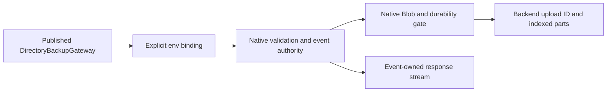

<!-- Copyright 2026 Cellar Project Authors. Licensed under Apache-2.0. -->

# Native R2 backup gateway subset

Declare an R2 facade over a host-configured native Blob binding. This optional
Node/Workers profile uses Cellar's actual object store and event authority.
It does not require a Cloudflare account.

```js
import { workersApplication } from "@cellar/cloudflare";
import { DirectoryBackupGateway } from "@cloudflare/sandbox";

export const { fetch, worker_rpc } = workersApplication({
  DirectoryBackupGateway,
  default: {
    async fetch(request, env) {
      const object = await env.BACKUPS.get("archive.zst");
      return object ? new Response(object.body) : new Response(null, { status: 404 });
    },
  },
}, { r2: ["BACKUPS"] });
```

The host maps `BACKUPS` through its deployment's `blob_bindings`. The facade
cannot supply storage credentials or choose another backend.

The native host enables the Workers lifetime driver and gateway RPC events:

```rust
use cellar_javascript::{EventKind, Source};
let source = Source::module()
    .workers_lifetimes()
    .events([EventKind::Fetch, EventKind::WorkerRpc]);
```



## Implemented operations

| API | Behavior |
| --- | --- |
| `head(key)` | Actual object metadata, uploaded date, checksums and HTTP/custom metadata |
| `get(key, { range })` | Native byte stream; offset/length or suffix range object |
| Object body | `bodyUsed`, `arrayBuffer`, `text`, `json`, `blob`; original event lifetime |
| `delete(key)` | One named object's native delete and durability gate |
| `createMultipartUpload` | Persistent backend ID; HTTP/custom metadata |
| `resumeMultipartUpload` | Reconstructs a key/ID route; no existence check until an operation |
| `uploadPart` | Bounded bytes/stream input; indexed replacement with actual backend receipt |
| `complete` / `abort` | Current receipts publish bytes/metadata atomically in the local store; explicit abort preserves the public object |

Persist key, upload ID and receipts as ordinary application data. Reconstruct
through a fresh binding after restart. Live bindings, upload facades and body
readers carry runtime capabilities and cannot be persisted as plain values.

## Bounds and failure behavior

| Boundary | Contract |
| --- | --- |
| Upload input | Collects at most `max_body_bytes`; oversized or nonbyte streams cancel before backend dispatch |
| Decoded native bytes | Reserve bridge capacity before decoding; byte ownership retains that capacity through entered backend work after waiter cancellation |
| Completion | 1–10,000 consecutive part numbers beginning at one, with current nonempty receipts |
| Read resources | Existing native response count, chunk and event-lifetime bounds |
| Transactions | R2 I/O refuses before dispatch inside a native storage transaction |
| Lost mutation response | Outcome remains unknown; no automatic create/complete replay |
| Abandoned uploads | Drop preserves the backend resource; explicit abort is required |

The pinned S3/GCS low-level client cannot initiate metadata-bearing resumable
uploads; this profile refuses before allocation on those clients. The local
SQLite backend is qualified for this subset. Other supplied backends require
separate qualification.

## Qualification and remaining gaps

The native fixture imports unmodified `@cloudflare/sandbox@1.0.3`. It exercises
control RPC, HTTP part upload, replacement, node/client restart, stale receipts,
completion, HTTP metadata and ranged binary reads through the actual published
gateway. It also checks event/transaction refusal and explicit cleanup. No SDK
bucket substitute supplies positive results.

```sh
cargo test -p cellar-javascript --features node --locked --test workers_r2
```

| Still required | Scope |
| --- | --- |
| Complete directory backup qualification | Selected real helper/image backup/restore/delete, fresh-process recovery, allocation/first-chunk cancellation, missing/corrupt archives and failed completion/deletion acknowledgements pass; abrupt crash, larger/multi-part or verified-swap cancellation and lost create/transport responses remain open |
| Full R2 API | `put`, `list`, conditional/Headers options, storage-class/encryption controls and complete checksum semantics |
| Provider semantics | R2 part-size constraints, automatic seven-day expiry, orphan reconciliation and cloud account qualification |
| Resource profile | Large streaming parts without whole-part buffering and aggregate runtime/OS memory qualification |

This subset enables positive gateway storage operations. It does not qualify
complete R2, full Sandbox backup/restore, S3 mounts or hosted Cloudflare.
The [matching-image directory-backup campaign](../../tools/sandbox/cloudflare-v1/README.md#directory-backups-through-native-http-interception)
records the selected end-to-end helper evidence separately.

See the [native upload contract](../../crates/cellar/application/blob/README.md)
and [upstream API](https://developers.cloudflare.com/r2/api/workers/workers-api-reference/).
