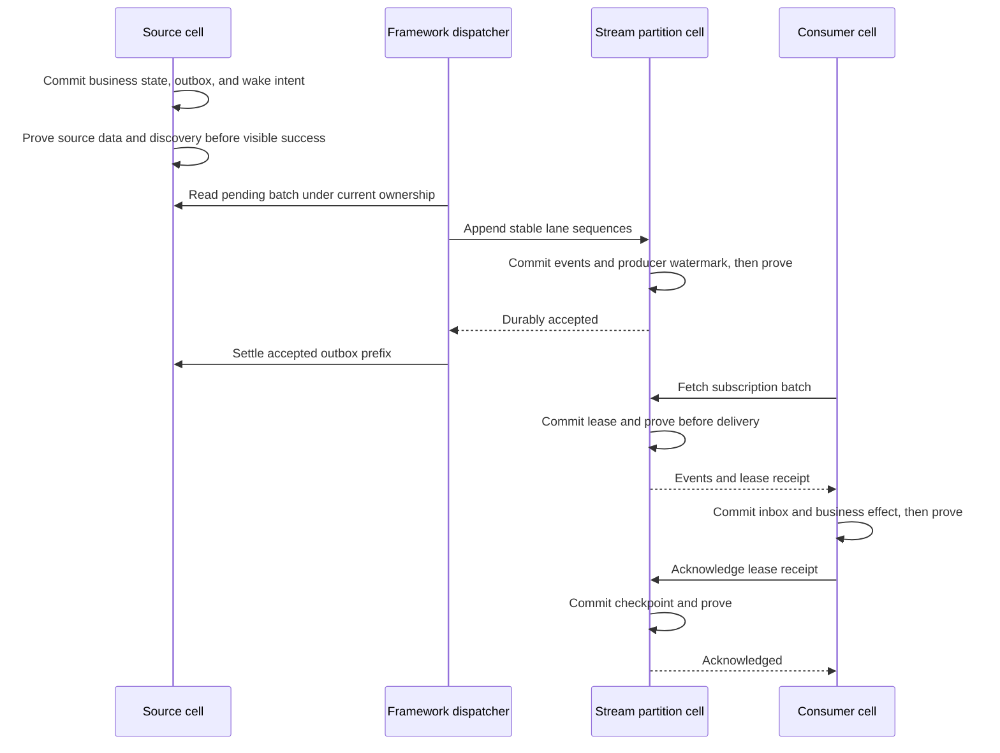

# Transactional outbox and durable event delivery

Status: Proposed technical design. No primitive described here is implemented
by this document. Prepared 2026-10-12 against `origin/main` at
`c35c1b257a5804d367a2aeffe65b8a3ba5c1aa3a`. Design owner: Cellar maintainers;
implementation and release owners must be assigned when work is scheduled.

Design completed and reviewed against the checkout on 2026-10-13. This remains
a proposed product contract; implementation progress and release qualification
are separate. The three primitives belong in this joint design because the
outbox's settlement boundary is stream acceptance and the stream's reclamation
boundary depends on subscription checkpoints and leases.

Implementation is underway. The [requirement audit](outbox-implementation-status.md)
tracks code and verification separately from the complete proposed contract below.

Cellar will provide transactional event emission, durable event streams, and
resumable subscriptions as one delivery system with three distinct contracts.
A business cell atomically records state and an outgoing event; the framework
delivers it to a named stream; each subscription independently records processed
progress. Stream acceptance completes the outbox obligation. Consumer processing
does not hold the originating transaction or outbox entry open.

The first release uses one partition per stream, ordered producer lanes, pull
subscriptions, and one outstanding batch per subscription. It reuses Cellar's
cell ownership, SQLite/LTX recovery, output gates, and durable wake discovery.
It adds no broker process, distributed transaction coordinator, or JavaScript
runtime.



## Contents

- [Scope and decisions](#scope-and-decisions)
- [How applications use the system](#how-applications-use-the-system)
- [Existing foundations](#existing-foundations)
- [Guarantees and terminology](#guarantees-and-terminology)
- [Application API](#application-api)
- [Resource identity and authorization](#resource-identity-and-authorization)
- [Resource configuration protocol](#resource-configuration-protocol)
- [Storage model](#storage-model)
- [Source commit and wake protocol](#source-commit-and-wake-protocol)
- [Outbox dispatch and stream append](#outbox-dispatch-and-stream-append)
- [Subscription and cursor protocol](#subscription-and-cursor-protocol)
- [Consumer transactions](#consumer-transactions)
- [Retention and resource lifecycle](#retention-and-resource-lifecycle)
- [Recovery and failure behavior](#recovery-and-failure-behavior)
- [Limits and operations](#limits-and-operations)
- [Compatibility and deployment](#compatibility-and-deployment)
- [Implementation boundaries](#implementation-boundaries)
- [Validation and delivery plan](#validation-and-delivery-plan)
- [Alternatives and deferred extensions](#alternatives-and-deferred-extensions)

## Scope and decisions

| Decision | First release |
| --- | --- |
| Public producer API | `db.tx` and `tx.emit(&stream, event)` |
| Destination | A bound, named Cellar event stream |
| Atomicity | Business state, outgoing rows, lane sequences, and wake intent in one cell database |
| Stream storage | A built-in system cell for partition zero |
| Publication | Framework dispatcher only; no independent public network append API |
| Ordering | Stream append order within a partition; source commit order within a producer lane |
| Consumer interface | Pull batches with explicit durable acknowledgment |
| Delivery | At least once to consumers; idempotent stream acceptance for framework retries |
| Retention | Explicit bounded-history or required-consumer policy |
| Replay | Independent read cursors or a new durable subscription |
| Payload | Versioned JSON event envelope, stored as encoded bytes |
| Transport | Existing authenticated, owner-routed internal RPC |
| External destinations | Implemented by consumers; not direct outbox destinations |
| Supported durable host | One bucket-backed node or a fleet, with replication and durable wake discovery |

There is no cross-cell atomicity, global ordering across streams, automatic
exactly-once external effect, automatic repartitioning, push consumer runner,
topic filtering, compaction by key, or Blob-backed event body in this release.
Stream retention is not an audit archive guarantee. An outbox entry has no
automatic expiry: delivery remains an obligation until accepted or explicitly
abandoned by an authorized destructive resource operation.

The boundaries between the primitives are explicit:

| Primitive | Durable state owner | Completes when | Does not wait for |
| --- | --- | --- | --- |
| Outbox | Source business cell | Destination has durably accepted the immutable lane prefix, then source settlement is committed | Subscription processing or external effects |
| Stream | Stream partition cell | Append and producer progress pass the destination output gate | Consumer acknowledgment |
| Subscription | Same stream partition cell | Exact leased batch acknowledgment advances its checkpoint and passes proof | Another subscription's progress |
| Optional inbox | Receiving business cell | Receipt and local business effect are committed and proven together | The subscription's subsequent ack |

Streams and subscriptions are usable independently of an application's local
outbox handle. Read and consume grants do not imply publish permission. Version
one still routes publication through transactional emission; it has no unrelated
direct append contract with weaker retry guarantees.

## How applications use the system

The outbox destination is a **Cellar event stream binding**, such as `ORDERS`.
It is not a URL, a subscription, or a subscriber list. A committed event carries
the resolved stream UUID and partition permanently. Consumers adapt that stream
to Queue, Workflow, another business cell, or an external service as application
code; those adapters use their own destination idempotency contract.

A complete order-confirmation flow is:

1. Deploy the `orders` stream and its durable subscriptions. Give order cells
   publish permission, fulfillment consume permission for `fulfillment`, and
   analytics consume permission for `analytics`. Bindings resolve only after
   resource activation; ordinary handlers do not create missing resources.
2. An order cell uses `db.tx` to record the command's idempotency receipt, confirm
   the order, and call `tx.emit(&orders, event)`. A rollback removes all three.
   The request returns only after the source output gates establish its accepted
   boundary. It need not wait for the stream or any consumer to be available.
3. The framework wakes the source and delivers a contiguous lane prefix to the
   stream. After proven acceptance, it settles and removes that outbox prefix.
   An unavailable stream leaves the durable obligation pending.
4. A fulfillment invocation fetches a leased batch, commits each event's inbox
   receipt and shipment state in the receiving cell, proves those commits, and
   acknowledges the batch. Analytics fetches independently and maintains its
   own checkpoint. No copy is emitted per subscriber.
5. A consumer reconnects using the same subscription identity. If a batch was
   fetched but not acknowledged, it is replayed after lease expiry. If local
   processing committed before the interruption, retained inbox receipts make
   the repeated local processing harmless.

Consumers need an execution mechanism in addition to a subscription. Version one
uses an ordinary invocation, cron-triggered bounded worker, workflow activity,
or explicitly supervised caller-owned task. Each run has bounded work and an
invocation deadline; long polling reduces empty fetch traffic. There is no
automatic subscription-to-function trigger in this release. A continuously
available consumer must arrange repeated invocations or supervision itself.

For example, a webhook adapter consumes `webhooks`, sends the event ID as the
receiver's idempotency key, and acknowledges after confirmed receiver success.
A timeout is ambiguous: retry with the same key or reconcile with the receiver.
For live UI updates, an authenticated endpoint exposes read cursors or a
dedicated subscription and returns a resumable position. A disconnected UI can
resume only within retained history; `CursorExpired` requires application
resynchronization. Durable checkpoints do not by themselves make a WebSocket
session, a snapshot-plus-tail protocol, or an external effect transactional.

The transaction boundary is always one cell database. If business state lives
in a separate SQL binding, execute its mutation and emission at that database's
owning cell. Writing through the remote SQL binding and inserting into the
caller's outbox is two transactions and does not provide this guarantee.

## Existing foundations

The current [outbox example](../examples/transactional-outbox/main.rs) is an
application pattern: an order row is also the pending record, an application
alarm sends to Queue, and the receiver deduplicates. It remains valid and is not
silently migrated. The [storage guide](../docs/06-storage-transactions.md)
correctly describes the outbox as application code in the current release.

| Existing implementation | Reuse or extension |
| --- | --- |
| [Storage transactions](../crates/cellar/application/storage/transaction.rs) | Root transaction and nested savepoint authority; rollback and escaped-handle checks |
| [SQLite storage](../crates/cellar/storage/sqlite/mod.rs) | Reserved system tables, outer commit observation, cursor completion, local write position |
| [Output gate](../crates/cellar-logic/output_gate.rs) | Prove observed writes and current ownership before any event-revealing egress |
| [Wake record](../crates/cellar/storage/sqlite/wake_record.rs) | Transactional wake installation sequence and snapshot |
| [Fleet wakes](../crates/cellar/fleet/wake/mod.rs) | Durable discovery, repeated scans, and retirement of obsolete publications |
| [Host gates](../crates/cellar/runtime/invocation/gates.rs) | Associate discovery and durability waits with their originating event |
| [Queue broker](../crates/cellar/application/queue/broker.rs) | Built-in cell dispatch, transactional leases, and stable transfer identities as reference patterns |
| [Cell limits](../crates/cellar/application/limits.rs) | Captured per-domain policy and receiver-side admission |
| [SDK facade](../crates/cellar/sdk.rs) | Public exports without exposing private implementation layout |

The existing `application::streams` module contains byte-stream APIs. The new
module is `event_stream`; Queue remains a separate primitive with its existing
settlement semantics.

## Guarantees and terminology

An **event** is immutable bytes plus type, schema version, routing key, and
identity. A **producer lane** is the ordered sequence from one source-cell
incarnation to one stream incarnation and partition. A **subscription** is a
named durable checkpoint and delivery lease owned by the stream partition.

Three completion points must be distinguished:

1. **Source accepted:** a business transaction is committed, its required
   durability is proven, and pending work has durable discovery coverage.
2. **Stream accepted:** event bytes and producer progress are committed and
   proven at the stream cell. The source can settle its outgoing obligation.
3. **Consumer acknowledged:** the subscription checkpoint is committed and
   proven. This describes the consumer's assertion of processing, not a proof
   that an arbitrary external service performed an effect.

A synchronous `db.tx` return establishes a local commit only. A normal handler
response crosses Cellar's output gates before the caller can observe success.
`db.sync().await` must cover both data proof and pending discovery gates before
it can be used as an explicit source-accepted boundary. That extension is part
of this design, not an assumption about today's `Storage::sync` implementation.
A timeout after local commit is ambiguous; it does not roll the transaction
back. Retry the business command with its own idempotency key.

Required invariants:

- Rolled-back events are never transmitted. Nested savepoint release alone
  does not make an event dispatchable.
- No outgoing event reveals a source commit before its durability and discovery
  gates pass. Stream read responses follow the same visibility rule.
- Every accepted pending obligation is either actively owned or discoverable
  after a process loss; a process-local task is never its sole record.
- Event bytes, routing, identity, and lane sequence never change on retry.
- A destination accepts a lane sequence at most once during its incarnation.
  An ownership epoch change does not reset identity or deduplication state.
- Checkpoints advance only over the exact contiguous delivered batch after a
  valid acknowledgment. No implicit acknowledgment on fetch or disconnect.
- Retention never deletes producer high-water marks. Expired consumer history
  is reported explicitly rather than silently skipped.
- Old activation completions cannot mutate new activation state. Already-sent
  packets may arrive late and are handled by destination deduplication.

Eventual delivery assumes a recoverable source, an available and authorized
destination with capacity, and fair scheduling. Permanent deletion, persistent
authorization failure, or unrecoverable storage loss cannot be hidden behind an
unconditional eventual-delivery claim.

## Application API

All signatures and snippets in this section are proposed Rust API sketches.
They are not executable examples of the current SDK.

```rust
let db = context.storage()?;
let orders = context.stream::<OrderEvent>("ORDERS")?;

db.tx(|tx| {
    tx.sql(
        "UPDATE orders SET status = 'confirmed' WHERE id = ?",
        &[serde_json::json!(order_id)],
    )?;

    tx.emit(&orders, OrderEvent::Confirmed {
        order_id,
        customer_id,
    })
})?;
```

`Storage::tx` is an additive short name for synchronous transactional work. It
uses the existing root/savepoint machinery and does not deprecate
`transaction_sync`. The existing asynchronous `transaction` remains available;
its active `Storage` transaction view gains the same `emit` operation. Emission
outside an active transaction returns `TransactionRequired`. Do not add an
implicit separate transaction that could detach emission from the caller's
business change.

Proposed contracts:

```rust
impl Storage {
    pub fn tx<T>(&self, f: impl FnOnce(&Storage) -> Result<T>) -> Result<T>;
    pub fn emit<E: Event>(&self, stream: &Stream<E>, event: E) -> Result<()>;
}

pub trait Event: serde::Serialize {
    const FAMILY: &'static str;
    const VERSION: u32;
    fn key(&self) -> &str;
}
```

An application implements the event trait once, normally on a versioned enum
such as `OrderEvent`. `key()` returns the stable business entity key. Version
one routes all keys to partition zero but persists the key. The event family
must match the stream binding. The SDK encodes the payload once during `emit`;
the dispatcher never calls user serializers or current application code.

Enforce the encoded byte limit while serializing, not after building an
unbounded intermediate value. JSON integer payloads must fit i64 or u64;
applications encode wider integers as strings. Reject out-of-range literals
rather than round them to floating point while constructing the stored envelope.
Encoding, invalid version, and admission failure consume no source sequence.

The first API deliberately omits `emit_to`, arbitrary headers, per-message TTL,
and delivery receipts. A later explicit-key API can serve events without a
natural key. Runtime-generated envelope metadata supplies the event ID, source,
schema version, and creation time. No stream offset exists at local emission.
`emit` returns `()` so callers cannot accidentally treat a provisional ID as a
durability receipt. Operator inspection and delivered envelopes expose IDs.

The same transaction must record the business command ID and request digest if
the caller can retry. Destination deduplication handles retransmitting one
outbox entry; it does not merge two independently committed business events.

Proposed consumer shape:

```rust
let orders = context.stream::<OrderEvent>("ORDERS")?;
let fulfillment = orders.subscription("fulfillment")?;

if let Some(batch) = fulfillment
    .next(&context, BatchOptions::default())
    .await?
{
    apply_batch(&batch).await?;
    batch.ack(&context).await?;
}
```

`subscription` resolves a deployed resource; it does not create one implicitly.
`next` returns `None` on an empty long-poll timeout. Its alternatives are a batch
or a typed error. `Batch` exposes raw envelopes and fallible typed decoding;
an unknown event version must remain inspectable. It provides `ack`, `retry`,
and `extend` methods using the current authorized context. Handles retain their
execution domain, while wire receipt identity remains valid across ordinary
server ownership changes. Consumers run in ordinary application invocations
or caller-owned supervised tasks; this release introduces no forever-running
subscription callback hidden inside a request.

Typed decoding additionally requires `serde::de::DeserializeOwned`; consuming
raw envelopes does not. Deserialization failure never automatically settles a
batch. Pull, acknowledgment, and inspection remain available to an authorized
consumer even when its compiled event enum cannot decode a new version.

Read-only replay is a separate `Stream::read(context, cursor, options)` API
returning bounded records and the next cursor. It creates no subscription,
holds no retention interest after the response, and never changes a checkpoint.

## Resource identity and authorization

Deployment declares a named stream, its event family, retention policy, limits,
and subscriptions. Stream configuration is durable resource state, reconciled
through its owner. A handler cannot invent resource identity or create a stream
as a side effect of emission.

The following is a conceptual configuration shape, not a currently accepted
project manifest:

```json
{
  "streams": [{
    "name": "orders",
    "eventFamily": "orders",
    "partitions": 1,
    "retention": { "mode": "required", "maxAgeSeconds": 604800 },
    "maxBytes": 1073741824,
    "maxRecords": 1000000,
    "subscriptions": [
      { "name": "fulfillment", "start": "earliest", "required": true },
      { "name": "analytics", "start": "earliest", "required": false }
    ]
  }],
  "streamBindings": [{
    "binding": "ORDERS",
    "resource": "orders",
    "permissions": ["publish", "read", "consume:fulfillment"]
  }]
}
```

Deployment resolves the resource to `(tenant, application, stream UUID,
partition=0)`. A catalog maps human names to UUIDs and preserves deletion
tombstones. Ordinary config updates retain the UUID; recreation changes it.
The catalog is itself a system cell, not a process-global mapping. Resource
creation uses a client operation UUID and idempotent reconciliation: record
`creating`, initialize the deterministic partition cell, then mark `active`.
Bindings become usable only after durable activation. Interrupted creation is
discoverable and retried using internal work, never guessed from a missing reply.

Native `stream_bindings` declarations use `BindingConfig` with a `ResourceConfig`
selector. An explicit `resource.id` is checked as an exact incarnation; omitting
it selects `(tenant, application, name, family)`. Definitions still carry their
creation UUID. A read-only host capability binds name lookup to the namespace,
selector, principal and grant. The bounded request carries requested permissions;
the receiver compares it with that capability and current durable grants. This
lookup cannot create/update resources. Activation then repeats exact catalog and
partition resolution and atomically pins all successful bindings to the generation
before readiness opens. Failed candidate adoption preserves the serving generation.
Runtime stream handles and persisted source lanes carry full UUIDs. A generation
cannot replace its pinned map; a later generation may resolve a recreated name,
and retained old handles fail emission/seal checks against the new UUID.

Source identity includes a persistent, random source incarnation UUID, minted
by the injected host service and committed before external use. A lane is
uniquely identified by source scope, source incarnation, destination UUID, and
partition. Its logical identity does not include a node or ownership epoch.
The event ID is the versioned encoding of `(lane identity, sequence)`.

Protocol version one derives a lane identifier as SHA-256 of the compact UTF-8
JSON array `[source_scope, source_incarnation, tenant, application, stream_uuid,
0]`. UUIDs are 32 lowercase hexadecimal digits; scopes use their exact persisted
canonical strings, with no case folding or Unicode normalization. The framework
codec, not application code, performs JSON string escaping with `serde_json`.
The wire protocol version fixes this recipe; changing it requires a new scheme
without rewriting existing lanes. Freeze independent test vectors before
implementation release. Concatenating unescaped strings is not a valid identity
encoding. An envelope
includes the lane, sequence, event family/version, key, and encoded payload;
receiver validation checks that identity against the authenticated source and
destination. A payload digest covers the committed bytes, not a reserialized
application value. No wall clock is part of logical event identity.

`emit` validates the binding's scope, event family, publish authority, domain,
and local limits before insertion. A destination repeats authorization and
budget checks on every RPC; knowing a resource UUID is not authority.
Persist the publishing principal and grant identity with the lane, not bearer
credentials or an application-generation pointer. Background work resolves
that principal's current resource grant under the serving domain. Resource
grants outlive application generations; removing a local binding prevents new
emits but does not itself revoke existing delivery grants. Explicit revocation
blocks pending delivery and appears in operator status.

Authorization separates publish, read, consume by subscription, and administer.
Cross-tenant use requires an explicit grant; it is never inferred from a name.
Source ownership gates authorize dispatch; receiver authentication does not
attempt to reimplement source ownership through stale cached epoch numbers.

Internal event RPC authority is minted by the host from the current invocation
or authorized framework dispatch, not deserialized from application arguments.
It binds action, caller principal/grant, source scope when publishing, and
destination identity. Reserved catalog and partition classes reject ordinary
application RPC, even if its arguments contain those fields. Authenticated peer
routing carries that host provenance; the receiving owner checks its durable
grants independently. Tokens, resource names, and receipt possession never
replace this authorization check.

Initial catalog creation additionally requires tenant/application resource
management authority from the trusted deployment or operator path. Proposed
grants inside an uninitialized resource definition cannot authorize their own
creation. Bindings are supplied by trusted deployment resolution, not accepted
as user-provided proof. Subsequent changes require current resource admin
authority; reconciliation retains the original caller without turning it into
a permanent bypass for explicit grant revocation.

## Resource configuration protocol

The catalog is keyed by tenant/application. It owns live-name resolution,
resource UUIDs, lifecycle operation receipts, and reconciliation intent. A
partition is keyed by the full resolved resource and partition zero. The catalog
and partition use separate transactions, so neither a successful local catalog
write nor a timeout is treated as partition acceptance.

All create/update commands include an operation UUID, canonical definition
digest, authenticated principal/grant, and expected resource revision. Creation
uses an explicit absent expectation; updates require the existing UUID and
revision. The catalog serializes conflicting operations for one resource.

| State | Name/binding behavior | Durable obligation |
| --- | --- | --- |
| `creating` | Name reserved; new binding not ready | Initialize the exact UUID and definition at the partition |
| `active` | Current definition resolves | None unless maintenance is due |
| `updating` | Preserve UUID; report pending revision | Reconcile the exact successor definition |
| `retiring` | No new binding adoption or same-name recreation | Close partition authority and finish bounded cleanup |
| `deleted` | Old UUID remains a tombstone; name may be recreated | No serving authority for that UUID |

Creation/update proceeds as follows:

1. In a catalog transaction, validate authority, expected revision, immutable
   parameters, and metadata capacity. Store the operation, original authority,
   definition bytes/digest, pending lifecycle state, and retry wake. Prove this
   intent before delegated RPC can leave the catalog.
2. The partition verifies resource identity and delegated authority. It commits
   the exact definition and revision, or replays the same operation's result.
   A reused operation with different arguments is `ConfigConflict`. The reply
   includes resource UUID, operation UUID, digest, and applied revision.
3. The catalog validates that reply against its still-current pending intent,
   then commits the accepted definition, immutable operation result, lifecycle
   transition, and updated work. Prove before returning completed activation.
4. Lost replies or owner changes leave the intent discoverable. Retry with the
   same operation and bytes. A failure records its bounded reason; it does not
   invent activation or allocate another UUID.

An update is not simultaneously visible across catalog and partition. The
partition's committed definition is the data-plane authority; a pending catalog
revision reports reconciliation status. Existing resolved bindings may continue
while an update is pending, subject to current receiver grants. The catalog
publishes the new accepted revision only after partition proof. An update that
revokes a grant can therefore take effect at the partition before its catalog
completion reply; configuration clients must account for that boundary.

Operation receipts outlive later configuration changes. Repeating a completed
create command returns its historical result, not a new creation or a claim
about today's lifecycle. Use describe/status to inspect the current state.
Checking current authority still precedes receipt disclosure. Receipt capacity
is bounded and has no automatic expiry; capacity exhaustion rejects new
administrative operations without losing existing reconciliation obligations.

Startup and deployment adoption reconcile desired definitions through these
owner-routed commands before admitting application event operations. Stable
deployment operation identities include the declaring principal and canonical
definition. Readiness verifies the current catalog lifecycle, accepted revision
and digest after operation replay; a historical `active` receipt is insufficient.
Every binding also checks the catalog's current active lifecycle and resolves
independently against the partition's current resource identity, grants, and
live subscriptions, including bindings to resources declared in another
deployment. Checking only the partition could admit a new binding after catalog
retirement intent but before delegated closure. These are causal checks with
current receiver authorization on every later operation, not an atomic snapshot
or a reservation against future grant/lifecycle changes. A generation-local admission latch prevents
emission, reads, and consumption from staged bindings before this completes.

A failed adoption preserves the serving application generation. Resource
configuration already committed during that attempt remains durable: there is
no atomic rollback across resources or between configuration and application
adoption. Operators reconcile those changes explicitly. In particular, grant
revocation can affect the serving generation even when a later binding prevents
adoption. Cancellation and deadlines fail readiness, release owned work, and
retain any already committed catalog reconciliation obligation.

Family, UUID, and partition count are immutable in version one. Start positions
for existing subscriptions are immutable under configuration reconciliation;
administrative reset is the explicit way to move progress. Resource limit
changes must fit current protected state and the serving fleet's transport and
host budgets. Changing retention mode is explicit, and required mode must
retain at least one required subscription. Omission from a later manifest is
not deletion. New subscriptions capture their start once at partition commit;
retries must not reinterpret `latest` at a later stream end.

## Storage model

These are logical schema contracts. The implementation must add checked SQLite
DDL, foreign keys or equivalent transactional checks and version-1 schema
markers. Development layout changes use hard cutovers with recreated state;
there are no old-layout readers or migrations. All fields below are durable
unless stated otherwise. Positive sequences and offsets use checked signed
64-bit integers; overflow rejects the
operation before mutation. UUIDs and tokens use fixed-size blobs. Absolute
deadlines use signed millisecond timestamps from injected clocks.

### Source cell

| Table | Key and fields |
| --- | --- |
| `__sys_event_source` | Singleton; source incarnation, protocol version |
| `__sys_outbox_lanes` | Lane identity PK; destination UUID/partition, publishing principal/grant, next sequence, settled-through sequence, status, retry deadline, attempts, last error, dispatch generation |
| `__sys_outbox` | `(lane, sequence)` PK; event family/version, key, immutable envelope bytes, encoded size, created time |
| `__sys_outbox_stats` | Singleton; pending row count and bytes, maintained in the insertion/removal transaction |
| `__sys_outbox_seals` | Lane/operation identity; terminal sequence, request digest, pending/blocked/accepted state, retry diagnostics |
| `__sys_outbox_batch_limits` | Lane PK; last authenticated receiver record/byte limits for adaptive contiguous batching |
| `__sys_work` | Internal reason PK; next deadline, generation; outbox dispatch, stream maintenance, and resource reconciliation |

Outgoing sequence allocation and insert are one savepoint operation. Failed
encoding, capacity checks, or insertion consume no sequence. `emit` failures
leave no partial framework mutation even if application code catches the error;
the application must propagate the error to roll back its other business writes.
There is no API for editing emitted rows.
An index on lane retry deadline supports bounded fair selection, and the outbox
primary key supports contiguous lane batches. Retry state is per lane, avoiding
one failing head event being bypassed by later events in that lane.

### Stream partition cell

| Table | Key and fields |
| --- | --- |
| `__sys_stream` | Singleton; stream UUID, partition, family, config revision, next offset, earliest offset, bytes/count, retention policy, logical time, lifecycle state |
| `__sys_stream_events` | Offset PK; lane, sequence, immutable envelope bytes, encoded size, append time; unique `(lane, sequence)` |
| `__sys_stream_producers` | Lane PK; accepted-through sequence, immutable source/principal identity, open/sealed status |
| `__sys_stream_subscriptions` | Subscription UUID PK; unique live name, generation, checkpoint, start definition, required flag, paused/active/expired state, next lease generation, retry deadline |
| `__sys_stream_leases` | Subscription PK; lease generation, random token, fetch request UUID, first/last offset, issued time, expiry, attempts |
| `__sys_stream_ack_receipts` | Subscription PK; last acknowledged lease generation/token and end offset |
| `__sys_stream_operations` | Monotonic audit position; unique operation UUID, request digest, principal/grant, immutable lifecycle receipt, encoded size and time |
| `__sys_stream_retirement` | Singleton; operation UUID/digest, original authority, explicit coordination or loss acknowledgment, original record/byte counts, closure and cleanup completion |
| `__sys_work` | Internal maintenance reason for retention and deadlines |

Use indexes on event append time/offset, lease expiry, and active subscription
checkpoint. The first offset and sequence are 1; checkpoint 0 means nothing
acknowledged. Empty streams have `earliest_offset == next_offset`. Stream
offsets are allocated transactionally and are never reset by retention.
Version one has no filters or compaction, so retained history is a contiguous
offset interval.

Producer progress and subscription checkpoints live in the same SQLite database
as stream records. This makes append/deduplication and fetch/retention exclusion
local transactions rather than cross-cell coordination.

### Resource catalog cell

| Table | Key and fields |
| --- | --- |
| `__sys_event_catalog` | Resource UUID PK; live-name uniqueness, lifecycle, accepted definition/revision, pending definition or retirement, original authority, current operation/digest, retry deadline and diagnostics |
| `__sys_event_catalog_receipts` | Operation UUID PK; resource UUID, operation kind, canonical request digest, principal/grant, immutable result when complete |
| `__sys_work` | Resource reconciliation deadline and generation |

Live-name uniqueness excludes deleted resources so recreation can reserve the
same human name under a new UUID. Resource and operation tombstones remain
addressable by identity. Reopening the current layout preserves every identity, sequence,
checkpoint, lease, and pending operation; unknown future versions fail closed.

### Optional consumer inbox

`__sys_inbox` uses `(processing scope, event ID)` as its primary key and stores
an envelope digest and processing time. A processing scope is a stable business
consumer identity, not a lease generation. This table belongs to the receiving
business cell, not the stream. Capacity and deletion policy are explicit; its
guarantee lasts only while the receipt is retained. The helper ships in a later
implementation phase of this design.

## Source commit and wake protocol

The existing application alarm remains visible through `get_alarm`,
`set_alarm`, `delete_alarm`, and `Invocation::Alarm`. Internal work must neither
replace it nor invoke user alarm handlers for framework maintenance.

Extend the committed wake projection to:

```text
effective_deadline = min(application alarm deadline,
                         each pending internal work deadline)
```

Store internal work and its generation in `__sys_work`. Extend the existing
`__sys_cell_wake` installation sequence so changes to either application alarm
state or internal obligations update the committed wake projection atomically.
SQL triggers or a single enforced storage mutation path must cover rollback,
deletion, and all writers. Do not make an after-commit callback the only way to
discover an obligation. Preserve the existing monotonic installation sequence
and publication identity behavior.

At the outermost transaction commit:

1. Capture the effective deadline, wake installation identity, and committed
   write position together under the SQLite source lock. An unfinished write
   cursor is not a committed snapshot.
2. Register wake-publication coverage with the originating event, even when the
   application alarm did not change. Wake index objects are discovery hints;
   they can be installed before proof, but delivery still requires proof.
3. Hold any source-revealing output behind discovery coverage and the existing
   data/ownership proof. A post-response task must create its own event-scoped
   proof boundary; it cannot attach work to an already sealed response.
4. Admit a bounded internal dispatch event. Execution failure leaves the
   persisted work deadline discoverable. The fast local wake is an optimization.

On a wake hint, the owner restores SQLite, checks all actual due reasons, and
dispatches the appropriate application or internal events. Each internal
completion names its original activation and work generation. It cannot consume
a successor installation. Clearing outbox work recomputes the minimum without
changing the user's alarm or an unrelated maintenance reason.

Before an internal dispatch sends a batch, keep or install a retry deadline in
the same cell and prove its discovery coverage. Do not consume the sole wake
record and then perform network I/O. Replacing or retiring a wake publication
uses the existing replication, ownership, and replacement-coverage rules.

Old wake hints remain harmless because SQLite is authoritative. New wake meaning
requires coordinated reader/writer capability checks; old binaries cannot own
cells whose internal obligations they would ignore. Compatibility is specified
below rather than assumed from unchanged object-key syntax.

## Outbox dispatch and stream append

### Source state machine

```text
pending -> sending (ephemeral) -> settled
              |                    |
              +-> retry deadline   +-> remove accepted prefix
              +-> blocked
```

Only `pending`, retry state, and blocked state are persistent. A process-local
`sending` flag is not recovery authority. One batch per lane is in flight;
different lanes can make progress independently within the host concurrency
budget. A failed lane cannot monopolize scheduling.

The source snapshots a contiguous prefix after `settled_through`, copies its
bounded immutable bytes, records a dispatch generation and retry deadline,
and leaves the transaction before waiting. The egress gate proves the source
position and discovery coverage, then authenticated owner routing sends:

```text
AppendV1 {
  destination UUID, partition, publishing principal,
  lane identity, first sequence, records[]
}
```

The destination authorizes the lane, checks protocol/family and all batch
limits, then performs one transaction:

1. Load the durable producer high-water mark `H`, or initialize an authorized
   new lane at zero if metadata capacity permits.
2. Validate that input sequences are contiguous. Discard the already accepted
   prefix `sequence <= H` without appending it again.
3. If there is a new suffix, require its first sequence to equal `H + 1`.
   Otherwise return `SequenceGap { expected }` without modifying any state.
4. Check capacity and retention eligibility. Append the complete new suffix in
   order with consecutive stream offsets; advance `H` atomically. Never partly
   accept a suffix because only some records fit.
5. Prove durability and any maintenance wake coverage before returning
   `Accepted { accepted_through: H }`. A duplicate-only response still proves
   any observed unproven state through the normal output gate.

After a verified response, the source removes only the matching accepted prefix
in a local transaction, advances `settled_through`, updates counters, and
recomputes work. The response is bound to destination incarnation, lane, and
dispatch generation. Stale activation responses are discarded. If cleanup is
lost, redelivery follows the same protocol and cannot append duplicates.

Validate reply watermarks as well as identity: acceptance cannot be below the
sent prefix's predecessor or beyond its sent last sequence. A surprising higher
watermark is a protocol conflict requiring inspection, not permission to remove
unsent rows. Sampling, retry installation, and settlement use checked counters
and update the lane, row/byte accounting, and work projection atomically.

Already accepted sequences need no original offset in the reply. This is why
the outbox append RPC is internal: an arbitrary caller cannot reuse a lane
sequence with different bytes. For retained duplicates the destination can
compare the envelope digest and reject conflicts; after payload expiry the
protocol relies on the authorized immutable source lane. A byte-comparison
guarantee for arbitrary historical client requests would require additional
unbounded receipts and is outside this contract.

Transient routing, capacity, timeout, and availability errors schedule bounded
exponential backoff with injected jitter. Authorization, deleted destination,
unsupported protocol, sequence gaps, and corrupt payload errors block the lane
with a visible reason. Blocked lanes retain rows and a low-frequency retry wake;
an administrative retry can bring that deadline forward after repair. Later
entries in the lane remain behind the failed prefix. No retry-count limit drops
events and no operator command silently skips one lane sequence.

Stream append order reflects destination arrival order across different lanes.
It does not represent a global source commit order. Multi-stream emission is
atomic as a set of local obligations, but their deliveries are independent.

## Subscription and cursor protocol

### Creating and resolving progress

Deploy or administer a subscription with an explicit start: earliest retained
offset, latest (`next_offset` at creation), or an exact retained cursor. The
creation transaction captures that position and inserts checkpoint `start - 1`.
An existing name with different immutable start parameters returns a conflict;
reconciliation must not reset it. Required retention interest starts at that
checkpoint and does not retroactively protect history already removed.

Each subscription has a random incarnation/generation. A delete/recreate or
explicit destructive reset changes it. Ordinary owner change, reconnect, pause,
and application deploy preserve it. Several workers may share a subscription,
but only one owns a live batch in version one. Separate subscriptions provide
fan-out; shared subscription workers compete for batches.

A subscription handle resolves and retains its identity on first consumption.
Fetches carry that identity as well as the fetch UUID. A delayed fetch from a
deleted or reset generation returns `SubscriptionReset`, including when the
same name has been recreated. Rebinding requires an explicit new handle; a
transport retry never silently attaches to a successor subscription.

### Fetching

`NextV1` carries subscription identity, fetch request UUID, maximum records,
maximum bytes, and wait deadline. The SDK reuses the request UUID when retrying
an ambiguous fetch within the call.

Fetch idempotency lasts for the live lease. A retry after expiry may receive a
new lease and redelivered progress; an expired fetch UUID is not a permanent
batch receipt. The SDK must not run two processing attempts merely because one
transport retry was ambiguous. Batch lease receipts and local inbox identity,
rather than fetch UUIDs, determine settlement authority and effect deduplication.

Under the partition's serialized transaction:

1. Verify permission, lifecycle, pause state, and retained cursor validity.
2. Return the existing live lease for the same fetch UUID. For a different
   fetch UUID, report `LeaseBusy` until expiry; do not hand out another batch.
3. Select a contiguous prefix starting at `checkpoint + 1`, respecting limits.
   If even its first record exceeds the caller's requested batch byte limit,
   return `BatchTooSmall`, not an empty batch or a skipped record.
4. Allocate a never-reused lease generation and random token. Persist its exact
   first/last offsets and expiry before returning any event bytes.
5. Schedule maintenance, commit, and prove the lease and returned event state
   before releasing the response.

On an empty stream, register a bounded in-memory waiter and recheck the append
revision to avoid a lost notification. Release SQLite locks and actor input
holds while waiting. Recheck after notification; notifications do not confer
delivery authority. Waiters are cancelled on domain closure and may reconnect
after failover. Their loss cannot lose durable subscription state.

### Settlement

The receipt contains stream/partition identity, subscription generation, lease
generation/token, and first/last offsets. An authenticated `AckV1` compares the
entire receipt with the current nonexpired lease. It advances the checkpoint to
that batch's end, stores the last acknowledgment receipt, clears the lease, and
updates maintenance state in one transaction. Success is returned after proof.

If the last acknowledgment receipt matches, a retried ack succeeds without
changing progress. An older receipt already behind the checkpoint returns
`AckObsolete` and never advances anything; the SDK exposes this as already
settled progress, not a request to process again. An unmatched, future, reset,
or expired lease returns the corresponding typed error. Do not permit arbitrary
offset acknowledgments, partial batch acknowledgment, or out-of-order ranges.

`retry(delay)` clears the matching lease, preserves the checkpoint, and records
a bounded retry deadline atomically. `extend(duration)` validates the same
receipt and moves expiry within the configured total lease lifetime, returning
only after proof. A lost retry/extend response can be ambiguous; the next
owner-routed request observes the durable result. Repeated extension requests
must name an absolute requested expiry, preventing a transport retry from
extending the lease twice.

Persist lease generation allocation and stream logical time. Use
`max(persisted_time, supplied_wall_time)` for durable deadline comparisons;
process-local waits use the injected monotonic clock. Clock jumps can change
when a lease expires, but cannot authorize stale settlement. Expiry does not
stop a slow consumer's external effects, so consumers still need idempotency.

Lease expiry leaves the checkpoint unchanged. Maintenance or the next fetch
clears the expired lease and permits redelivery with a higher generation.
Recheck retention before granting it. In bounded-history mode a lease pins its
batch only until expiry, after which the subscription may become expired.

### Cursors and reconnects

An opaque versioned cursor encodes `(stream UUID, partition, next offset)`.
Validate its structure and scope on every request. It is a position, not a
capability, and contains no node address or ownership epoch. If `next offset`
is below the retention floor return `CursorExpired { earliest_cursor }`; if
above the current end return `InvalidCursor`. The cursor at the end is valid.
Durable subscriptions resume by name/generation and checkpoint; clients must
not replace that checkpoint with their last fetched offset after reconnect.

Ordinary replay uses a new subscription or read cursor. Resetting an existing
subscription is an explicit owner-routed admin operation that invalidates its
lease and generation. No convenience fetch flag implicitly acknowledges or
skips missing history.

Administrative changes carry a client operation UUID, expected subscription
UUID/generation, action, and bounded reason. A durable receipt records original
and resulting identity, checkpoint, timestamp, and any explicitly skipped range.
Persist the transition and receipt together. Reusing an operation UUID with
different arguments is a conflict; a retry returns the original receipt even
after a later change. Unknown stale commands cannot mutate a replacement.
Audit history is paginated and bounded by a captured metadata capacity; hitting
it rejects new operations instead of discarding correctness receipts. Deleting
the last required subscription requires changing retention policy first.

## Consumer transactions

The following optional helper composes local receipt, state mutation, and next
event. The processing scope must remain stable through ordinary redeployment.

```rust
db.tx(|tx| {
    if !tx.inbox("fulfillment").accept(&event)? {
        return Ok(());
    }
    create_shipment(tx, &event)?;
    tx.emit(&shipments, ShipmentEvent::Requested { order_id })
})?;
db.sync().await?;
batch.ack(&context).await?;
```

`accept` inserts a receipt or returns false for a matching existing digest;
reusing an ID with different bytes is an error. The receipt is rolled back with
business writes. Process every event in the batch before acknowledging the
batch. If event 7 fails after events 1 through 6 committed, redelivery skips
their receipts and retries event 7. The consumer must not ack after merely
enqueueing untracked in-memory work.

The inbox and checkpoint need no distributed transaction: a lost ack causes
redelivery, and durable inbox receipts make local application effects repeat
safely. Explicit `sync` or a correctly sampled source egress gate proves these
effects before checkpoint advancement. External email, payment, or HTTP effects
still require a receiver idempotency key or reconciliation.

Receipts have no automatic TTL in the helper's first release. Bound their count
and reject new acceptance at capacity. Administrative pruning explicitly ends
deduplication for that range; replay after pruning may apply effects again.
Replaying into a fresh projection should use a new processing scope and target
state, rather than accidentally bypassing old receipts in the live projection.

## Retention and resource lifecycle

Retention must be configured explicitly at stream creation. Configuration
includes maximum age, maximum encoded bytes, maximum records, and mode. Zero
or unbounded values are not a substitute for a reviewed capacity budget.

### Bounded history

Age and capacity select an oldest-prefix deletion candidate. Live delivery
leases cap that candidate so their batches remain available through lease
expiry. Read-only cursor requests copy a bounded snapshot under the same
serialization boundary; deletion after that copy cannot invalidate its bytes.

Delete the eligible prefix in bounded transactions and atomically advance the
earliest offset and byte/row counters. If protected leases or a bounded sweep
prevent sufficient reclamation, reject append with `StreamFull` and retry later.
Maximum bytes is a hard admission limit; maximum age is a reclamation target
that live leases and maintenance delay may temporarily extend.

Maintenance schedules an age deadline only when the first retained record lies
inside the current deletion frontier. A required checkpoint can protect the
entire prefix indefinitely; without a lease-expiry deadline, that state has no
periodic age wake. Checkpoint progress, retry, lease extension/release,
subscription lifecycle changes and accepted configuration recompute durable
work in their transaction. Lease expiry remains scheduled even when it cannot
release a required checkpoint. Expired eligible prefixes continue in bounded
sweeps with the existing one-second minimum interval; clearing maintenance does
not clear application alarms or other work reasons. Scheduling clamps time to
the durable logical clock and retains checked age-deadline overflow refusal.
The required frontier uses its indexed minimum checkpoint, lease observation is
bounded by the current 128-subscription definition, and oldest age reads one
primary-key record. Protected payload size cannot expand scheduling reads.

Lagging subscriptions can lose history in this mode. Mark them expired when
their next required offset falls below the new floor. The next fetch returns
`CursorExpired`; an administrator must explicitly reset or replace them. Never
fabricate a checkpoint at the new floor.

### Required consumers

Apply the same age/capacity candidate, but cap deletion by the minimum checkpoint
of all required subscriptions as well as live leases. Paused required
subscriptions still protect their history. A stream in this mode must have at
least one required subscription; removing the last one requires an explicit
retention-policy change. Optional consumers may expire.

Required acknowledgments protect outstanding work, not indefinite replay of
processed work. Capacity pressure can remove an acknowledged prefix before the
age target. Once no eligible prefix remains, appends fail with `StreamFull`.
Source outboxes then grow until their own admission limit rejects business
transactions attempting more emits. This is intentional end-to-end pressure.

A poison event stalls its subscription. Version one provides pause, inspection,
retry, and an explicit audited subscription reset that reports the skipped
range. It does not silently dead-letter or advance a required checkpoint.
Applications can commit a quarantine record as their chosen processing result
and then acknowledge; that is an application policy with visible consequences.

### Metadata retention

Never garbage-collect producer high-water marks based on event age, consumer
checkpoints, or source inactivity. A source might recover after a long outage
and retry any settled-but-not-cleaned entry. Keep one compact producer record
for each lane through the stream's lifetime, with a hard lane-count limit.
Reaching this limit rejects new lanes while existing lanes can continue.

An explicit producer seal handshake is allowed only after the source has no
pending rows and has durably disabled future emission on that lane. The
destination records a terminal high-water mark: old duplicates remain accepted,
but no higher sequence can ever append. Keep the sealed record as a tombstone;
the first version has no automatic metadata reclamation protocol. This is a
real capacity tradeoff for millions of short-lived producer cells and must be
measured before describing the design as fleet-scale qualified.

The source API is `tx.seal(&stream, operation_uuid)`. It requires an existing
fully settled lane and composes producer shutdown state with a source-owned
seal intent in the same transaction. Its synchronous result reports local
intent, not destination acceptance. Persist and discover the seal obligation
before transmission; reuse generation-fenced dispatch and retry. The destination
must match the source's terminal sequence exactly rather than advancing its
watermark to a caller-supplied value. Preserve pending/blocked/accepted seal
status for inspection and prohibit any future emit after source sealing.

Subscription generation, last acknowledgment receipt, and lease state have
bounded per-subscription size. Deleting a subscription retains a compact
generation tombstone in resource metadata so old requests fail clearly. Catalog
and tombstone capacity are budgeted too; none of these records have an implicit
time-based correctness assumption.

### Deletion and replay

Removing a stream binding does not delete the resource. Deployment updates keep
existing incarnation IDs and cannot shrink limits below live protected state
without reporting a configuration conflict.

Normal stream retirement requires producers to be quiesced, pending lanes
drained, and consumers handled according to application policy. The stream's
empty state alone cannot prove every source outbox is empty: a committed source
may not have contacted it yet. Version one does not claim an automatic global
drain detector. Operational retirement is an explicit coordinated procedure.

`Stream::retire` takes an operation UUID, expected resource revision, bounded
reason, and one explicit mode: coordinated retirement names the completed
external drain procedure; forced retirement includes a data-loss acknowledgment.
`retirement_status` distinguishes accepted intent from completed destruction.
The coordination reference is an operator attestation, not an automatically
verified proof that unknown source cells have drained.

Coordinated retirement first checks partition-local facts: every registered
producer is sealed, every live subscription has consumed the final offset, and
no live delivery lease remains. Handling an unwanted optional subscription
requires an explicit reset/deletion before that check. Failed preflight leaves
no retirement intent. A successful preflight is advisory; the partition must
check those facts and the expected revision again when applying closure.

Retirement has two durable boundaries:

1. **Intent accepted:** the catalog stores the exact request/digest, original
   admin authority, operation receipt, `retiring` state, and retry work together,
   then proves them. It reserves the old name during reconciliation. A `retiring`
   response alone does not prove that publication has already closed.
2. **Partition closed:** the partition atomically records the retirement receipt
   and terminal lifecycle state, disables all ordinary append/fetch/read/ack and
   configuration mutations for that UUID, and installs cleanup work. The reply
   passes proof. Delayed requests receive `DestinationDeleted`; old activation
   completions cannot reopen it.

The catalog retries closure with the same operation. A reply lost after closure
is recovered by matching the partition receipt; changed request bytes conflict.
Current data-plane authority is checked at the partition, so it may still accept
records after catalog intent and before closure. Coordinated mode prevents this
through external source quiescence and sealed lanes. Forced mode accepts that
race as part of its explicit loss acknowledgment; its destruction counts are
sampled at partition closure, not catalog intent.

Physical cleanup uses bounded row and byte budgets for event bodies and
protocol metadata, persists progress, and requeues until finished. Partition
closure and its minimal resource/operation tombstone survive cleanup. Only then
does the catalog record `deleted`, finish the operation result, and release the
human name. A physically empty database or missing RPC reply is never sufficient
to infer deletion. Reads of retirement status remain authorized and available
through the control plane while ordinary data access is closed.

Forced stream deletion is a destructive admin operation: close its authority,
record a catalog tombstone, fence serving owners, and reconcile deletion of
partition data. Return a durable operation ID while deletion is in progress.
Late requests receive `DestinationDeleted`; blocked source rows remain visible
until separately abandoned or the source resource is deliberately destroyed.
Name recreation always uses a new stream UUID. Never redirect old rows to it.

Version one exposes no routine outbox row deletion or sequence-skipping API.
Repair blocked delivery, or explicitly abandon an entire source resource with
an audited data-loss acknowledgment. A future per-lane abandonment protocol
must seal destination authority before reclaiming its identity; it is not a
simple SQL delete. Diagnostic export is read-only and is not a delivery backup.

For version one, whole-source destruction with pending rows is permitted only
after every affected pending destination is durably retired. Otherwise return
`PendingDelivery`; drain and seal live lanes first. The audited destruction
receipt identifies the source incarnation, reason, explicit loss acknowledgment,
and discarded obligation counts. Close source serving authority before cleanup,
retain the source tombstone, and mint a fresh incarnation on recreation. Never
erase destination high-water marks as part of deleting the source. This
conservative restriction avoids introducing the deferred cross-resource lane
abandonment protocol through an administrative shortcut.

The source owner first closes new-emission admission and captures its lane/work
generation, then gathers owner-routed terminal retirement evidence for every
pending destination outside a SQLite transaction. Before committing destruction,
recheck that source incarnation and captured lane set still match. Persist the
verified evidence and operation receipt with the closure; an interrupted check
cannot authorize cleanup. Deleted destination UUIDs are terminal, so checking
them separately does not depend on simultaneous cross-cell snapshots.

`Storage::delete_all` must not reset source identity, lane sequence history,
inbox receipts, or stream metadata. With pending outbox rows, it returns
`PendingDelivery` before changing application state. Without pending rows it
may clear application data according to its existing alarm compatibility flag,
while preserving protocol metadata. Actual resource destruction is distinct
and changes the incarnation. Document and test this behavior before enabling
the feature.

## Recovery and failure behavior

Ordinary recovery restores the cell's durable image and predecessor log before
new ownership can write. UUIDs, lane sequences, producer watermarks, checkpoints,
and lease tokens survive ownership changes; writer epochs continue to fence
activations and output gates. Do not derive logical event identity from the
current writer epoch.

| Interruption or fault | Required outcome |
| --- | --- |
| Error before outer source commit | Business changes, emits, allocated sequences, and work changes roll back |
| Source commits but response/proof fails | Caller sees failure or ambiguity; no fabricated success; a command retry uses its receipt |
| Discovery publication fails | No source-accepted acknowledgment or outbound append; local pending rows remain |
| Source crashes after acknowledged commit, before dispatch | Durable wake scan restores the source and discovers pending rows |
| Destination crashes before append commit | Source retries unchanged bytes and identity |
| Destination commits but data proof fails | No accepted reply or record visibility; recover according to existing cell proof rules |
| Destination accepts but reply is lost | Retry returns accepted high-water mark without another append |
| Source cleanup commits but its proof is lost | Recovery either keeps cleanup or repeats delivery safely |
| Owner changes while a send is in flight | Old completion cannot mutate new activation; late packet deduplicates at destination |
| Fetch lease commits but reply is lost | Same request UUID recovers live batch; otherwise lease expiry permits redelivery |
| Consumer commits local effects, then crashes before ack | Batch redelivers; retained inbox receipt suppresses repeated local effect |
| Ack commits but reply is lost | Matching ack receipt makes retry succeed; reconnect begins after checkpoint |
| Expired consumer continues working | New lease may run concurrently; stale ack rejected; local inbox/external idempotency protects effects |
| Retention meets an active lease | Keep protected batch or reject append; never serve a partially deleted batch |
| Cursor is below retained history | Explicit `CursorExpired`; no silent skip |
| Required subscription is paused or broken | Protected history remains; capacity eventually backpressures producers |
| Destination/grant disappears | Block lane with reason and retain payload; no automatic reroute or data loss |
| Application alarm and internal retry share a deadline | Both obligations are inspected; consuming one cannot clear the other |
| Work task is rejected or cancelled | Registry releases owned resources; durable deadline still permits recovery |
| Same-name process restart or fleet handoff | Recover predecessor proof history before serving; stable logical IDs are unchanged |

### Shutdown and application upgrades

Internal dispatch and stream maintenance are tracked execution-domain work,
using injected executors, clocks, randomness, and cancellation. Reserve work
before executor dispatch and join it through the host's existing ownership
rules. No process-global dispatcher and no detached `tokio::spawn` loop.

Shutdown stops new dispatch admission, drains active internal events within
policy, and preserves pending wake obligations. It must not wait for an entire
outbox to empty against an unavailable destination. Report active dispatch,
durable pending count, and incomplete proof/drain phases separately; a durable
backlog can remain after a successful process drain. Forced cancellation is
not a durability proof.

The framework dispatcher reads stored encoded envelopes without loading the
old application serializer. Application hot reload therefore cannot change
pending payloads. Work and capabilities retain their original execution-domain
authority; a new deployment must not transplant handles between domains.

### Backup and historical restore

Ordinary supported recovery preserves acknowledged state. Arbitrary historical
rewind of only a source, stream, or subscription under the same incarnation is
unsupported: it can reuse sequences, lose accepted payloads, or repeat already
processed work while other participants retain newer progress.

Restore historical backups into an isolated new namespace with fresh resource
incarnations and explicit replay/reconciliation. External business idempotency
keys may need to remain stable even when framework IDs change. Do not promise
exactly-once behavior across this operation. A future coordinated point-in-time
restore protocol must define the recovery set across sources, stream progress,
inboxes, and external effects.

## Limits and operations

Resource policy is durable and authoritative across owners. Host execution
policy is captured per domain; it may impose stricter admission limits but
cannot reinterpret already accepted event identity or retention. Operators must
not lower serving limits below accepted payload sizes without a compatible
drain plan. Reject incompatible policy at adoption rather than stranding data
behind a smaller receiver limit.

Initial defaults below are implementation starting points, not measured scale
claims. All byte limits apply to the encoded envelope, including metadata.

| Budget | Proposed initial value |
| --- | --- |
| Event bytes | 256 KiB |
| Event key bytes | 1 KiB |
| Event family bytes | 128 bytes |
| Outbox rows per source | 10,000 |
| Outbox bytes per source | 128 MiB |
| Lanes per source | 128 |
| Registered producer lanes per stream partition | 100,000 including sealed records |
| Durable subscriptions per partition | 128 including paused subscriptions; tombstones budgeted separately |
| Append/fetch batch | At most 100 records and 1 MiB |
| Internal dispatch concurrency | 32 per host, at most one batch per lane |
| Work per internal event | At most one network batch; requeue remaining work fairly |
| Long poll | 30 seconds, capped by remaining invocation deadline |
| Long-poll waiters | 1,024 per partition and 4,096 per host |
| Delivery lease | 30 seconds; extensions capped at 5 minutes total lifetime |
| Explicit retry delay | 0 through 5 minutes |
| Dispatch retry | Exponential backoff from 100 ms to 60 seconds with full jitter |
| Blocked-lane retry | 5 minutes, or earlier explicit administrative retry |
| Retention sweep | 1,000 records or 4 MiB per transaction; requeue if more remain |
| Stream bytes, rows, maximum age, retention mode | Required at resource creation; no unlimited default |
| Inbox receipts per business cell | 100,000; explicit capacity error, no automatic expiry |
| Resource catalog | 10,000 live resources and 100,000 lifecycle tombstones per tenant/application catalog |
| Catalog operation receipts | 100,000 per catalog; no automatic expiry |
| Stream declarations and bindings per deployment | 128 each; validate again under captured host subscription limits |
| Subscription operation receipts | 100,000 per partition; separately account encoded bytes |
| Subscription tombstones | 100,000 per partition, separate from live subscription budget |

The smaller applicable batch/receiver budget wins. Internal retry attempts use
saturating diagnostic counters; identity counters must never saturate or wrap.
An atomic append batch larger than the destination's capacity must not strand
otherwise admissible events. Capacity responses include authenticated batch
byte/record limits. The source persists those hints and retries a smaller
contiguous prefix; successful replies refresh the hints after policy increases.
An individual event that cannot fit is a permanent error. Capacity protected
by a required checkpoint or live lease is transient pressure; neither case
permits partial suffix acceptance or skipping the lane head.
Per-stream byte counters are logical admission accounting, not a bound on total
SQLite/WAL/LTX disk usage. Restore, compaction, replication lag, and metadata
require separate node storage headroom. Report both logical and physical bytes.

Expose typed protocol outcomes:

- Caller errors: `TransactionRequired`, `WrongDomain`, `PayloadTooLarge`,
  `EventFamilyMismatch`, `InvalidCursor`, `BatchTooSmall`, `ConfigConflict`.
- Backpressure: `OutboxFull`, `StreamFull`, `ProducerLimit`, `SubscriptionLimit`,
  `InboxFull`, `TooManyWaiters` with applicable limits and retry guidance.
- Consumer state: `LeaseBusy`, `LeaseExpired`, `StaleReceipt`, `AckObsolete`,
  `SubscriptionPaused`, `SubscriptionReset`, `CursorExpired`.
- Delivery/authority: `Forbidden`, `DestinationDeleted`, `SequenceGap`,
  `ProducerSealed`, `UnsupportedProtocol`, `OwnershipLost`, `Unavailable`,
  `Ambiguous`, `PendingDelivery`.

Host event RPCs preserve execution certainty across local and peer routes.
`Unavailable` covers a request refused before submission or a connection that
never reached its peer. A fenced authority or exhausted stale-owner route yields
`OwnershipLost`. A lost result after submission, unproven output after execution,
or an otherwise unclassified dispatched failure yields `Ambiguous`. Authenticated
peer replies carry bounded host verdicts without copying handler bodies into the
typed outcome. Missing or unknown verdicts cannot establish non-execution.
Existing protocol errors retain their code. These codes do not authorize general
RPC replay: applications retain the same operation/fetch/ack identity when their
protocol permits retry, and consult durable receipts where required. In particular,
ownership loss does not undo a prior commit or prove that an earlier attempt failed.
The tunnel pool retries only when the transport returns the original request as
unsent. A buffered body does not authorize replay after a response is lost;
serialized failures must reach the dispatcher as ambiguous.

Structured RPCs carry a protocol version and bounded fields. Authenticate and
authorize before returning payloads, configuration, or detailed state. Error
messages and telemetry must not log event bodies or bearer credentials.

The SDK's outer result has exactly one ok/error branch. Invalid or contradictory
submitted results are Ambiguous and cannot establish a permanent refusal or
non-execution. Decode wire bytes only within the 64 MiB structured ceiling;
encoded error metadata is bounded at 16 KiB and error message text at 4096 bytes.
Move an accepted branch instead of cloning its payload. Valid protocol codes and
exact bounded metadata survive acceptance. These decoder checks do not substitute
for a bounded transport collector or the cancellation/response-loss matrix.

Sequences, offsets, checkpoints, lease generations, and absolute timestamps
travel as canonical decimal strings on structured RPC and diagnostic JSON.
The retained structured-value number codec uses binary64; bare JSON integers
above its exact range would change durable identity. Rust APIs and SQLite keep
checked signed 64-bit integers. Decoders reject noncanonical spellings and
out-of-range values rather than truncating them.

Append, fetch, and replay RPCs carry stored event envelopes as base64 byte
strings. Receivers bound encoded input before decoding and then enforce decoded
event and batch limits. Keeping payload bytes opaque prevents the structured
value codec from rounding numeric business data or re-encoding a committed
event. Metadata outside those envelopes still uses canonical decimal integers.
The transport imposes a hard decoded envelope/batch ceiling of 16 MiB and
10,000 records even under unrestricted API policy. This leaves space below the
64 MiB structured decoder ceiling for base64 text, wide-string encoding, and
metadata. Default API limits remain smaller. Admission and dispatch apply the
same hard ceilings so an accepted event always fits one protocol batch.

Metrics include outbox rows/bytes/oldest age, blocked lanes by bounded reason,
dispatch attempt latency, source-to-append latency, deduplicated append count,
stream logical/physical bytes, earliest/end offset, active leases, expired
cursors, subscription lag in records/time, ack latency, retention blocked bytes,
and wake discovery failures. Avoid event, cell, and arbitrary subscription IDs
as unbounded global metric labels; use paginated diagnostic endpoints for detail.

The current host observation registry exposes `HostServices::event_metrics()`
and fleet-authenticated internal `GET /event-metrics` exports (Prometheus text
or `?format=json`). Fixed counters and histograms cover dispatch RPC outcomes,
local append/deduplication, source timestamp age at append, ack processing/replay,
cursor expiration and due-discovery listing failures. Timers retain their
original host domain on cancellation. Integer counters and sums saturate and
JSON encodes them as decimal strings. Reservation gauges are live host state;
these observations are neither durable receipts nor a dormant-cell census.
Authoritative fleet root-state gauges are collected by `cellar event metrics`
through signed scope/method-bound `POST /event-state/SCOPE` owner RPCs. The
collector walks at most 100 provider prefixes per page with four probes at a
time, within a root/page cap (default 10,000; hard cap 100,000). Owner queries
read indexed source counters and at most 129 live subscription metadata rows.
They do not expire leases or change checkpoints. Retained retired stream
partitions remain readable and have a separate count. Scope, complete fixed
gauge sets, canonical decimals and accounting are checked before accumulation;
checked u128 sums preserve wide counts and ages use maxima.

Failed/duplicate/invalid probes, failed/repeated listing tokens or an exhausted
bound make collection incomplete and produce a failed exit. Incomplete
Prometheus contains coverage only; JSON has gauges=null with separate partial
observed_gauges. Complete means a successful live root-directory traversal,
not a snapshot or drain proof. Root SQLite pages count once per sample; facet/
WAL/LTX/bucket physical allocation, historical producer inventory and resident-
host aggregate gauges remain implementation/qualification requirements.

Subscription status and inventory now also expose owner-sampled lag records,
retained lag records, oldest retained unread append age and live-lease status.
The dependency-free core derives offset distances without losing expired
history; the owner reads at most one indexed timestamp per returned subscription.
Sample time clamps to durable logical time without changing it or expiring a
lease. No retained unread record means null age, even with positive lost-history
lag. SDK/operator acceptance verifies the observation against offsets and lease
expiry. These are bounded diagnostics, not aggregate host/fleet metric gauges.

Outbox inspection now reports whole-source oldest pending event age and blocked
lane counts for a fixed seven-code permanent reason set, with per-lane age and
reason metadata. Transactional counters replace pending-range count/sum scans;
explicit covering indexes bound timestamp reads. Blocked terminal seal delivery
counts even without event rows. Retry/acceptance clears the current reason;
human diagnostics are not parsed into metric labels. Sample time uses the owner
wall clock and negative age from skew clamps to zero. Restore audits counters
and requires accounting triggers and age indexes. The schema remains 1 with a
development-state hard cutover, without migration. Operator page acceptance
verifies source/lane identity, reason cardinality, totals and age consistency.
These are source observations; complete host/fleet aggregate export remains open.

Owner-routed `Stream::stats` and stream describe now expose payload rows/bytes,
earliest/end offsets, active leases, expired subscriptions, retained append age,
protection frontier, protected bytes and age-expired bytes blocked by retention.
Typed SDK/operator acceptance verifies identity and metric consistency. Live
metadata is bounded by the definition's 128-subscription cap; required-checkpoint
and timestamp indexes plus exact offset reads avoid event-range aggregation.
Private modulo-2^63 byte-prefix positions measure exact retained spans because
admission bounds a retained window below the modulus. These are bookkeeping,
not sequence/offset identities, and do not add a lifetime byte-admission ceiling.
Restore verifies byte positions, contiguous offsets, encoded sizes and timestamp
order before base-schema mutation. The schema stays 1 with a hard cutover.
SQLite allocated/used page bytes are explicitly separate from physical WAL,
local LTX, bucket and filesystem allocation; that full physical profile and
fleet aggregation remain required work.

Owner-routed CLI/API operations provide outbox list/inspect/retry, stream
describe/read, subscription describe/pause/resume/reset, and lifecycle operation
status. Reset/destruction reports the exact incarnation and affected range and
requires explicit destructive intent. Payload display is opt-in and authorized.
Use bounded pagination, machine-readable stdout, and stderr progress according
to the existing CLI contract.

The current source-control implementation exposes fleet-HMAC authenticated
`POST /outbox/SCOPE` operations for inspection, guarded retry, operation status
and paginated audit. It mints a distinct source RPC capability, bound to the
exact source scope and control method; ordinary application RPC cannot supply
that capability. Execution retains the original owner, input, output and
discovery gates and bypasses application constructors/handlers. Event authority
packets retain their previous JSON wire shape.

Source retry records an immutable operation UUID, request digest, authenticated
operator label, reason, expected source/producer revision and result in the
same transaction as re-arming work. The dependency-free core decides receipt
replay/conflict/capacity and dispatch-generation advancement. Exact replay
returns the original receipt, including after owner handoff; changed arguments
or caller identity cannot reuse it. Settled producers return `rearmed: false`.
The independent source-control schema has a version-1 marker and retained
accounting; business reset preserves it. Unknown operations return
`OperationUnknown`. New operations stop at the smaller of the captured receipt
limit and 10,000 records; no automatic receipt expiry or row abandonment is
introduced. Request, RPC, receipt and CLI reply budgets are 16 KiB, 64 KiB,
4 KiB and 1 MiB respectively. Diagnostic/audit pages contain at most 100 records.

For restored sources whose application class has been removed, the runtime uses
a separate framework recovery executor. It verifies retained source identity
after normal ownership recovery and schema validation, rejects unknown fresh
cells and non-source images, and executes delivery and source controls without
application bindings or handlers. Business calls remain unavailable. Due
internal work takes priority; application alarms are retained with bounded
backoff and do not consume the abandonment budget. The pool participates in
generation movement, retirement and joined shutdown. Reintroducing the class
restores business execution without resetting source identity or receipts.

The current stream control route is fleet-authenticated `POST /streams/SCOPE`.
It delegates the request's resource binding and repeats durable receiver grants;
a fleet signature cannot bypass revocation. The authority permits only stream
describe/read, subscription status/change and operation status/audit, with an
authenticated operator label retained in subscription receipts. Ordinary event
packets omit this optional provenance, and earlier SDK receipts default to no
operator. RPC forwarding, execution and response retain existing owner gates.

`cellar stream` provides describe/read/status/audit and `cellar subscription`
provides describe/pause/resume/reset/delete. Both use the same operator label for
receipt replay/status. Reset/deletion require explicit CLI confirmation and an
observed subscription identity. Metadata reads remove bodies and encoded
envelopes; `--payload` opts in. Requests/binding files, expected identity files,
read bytes and replies are bounded to 16/4/256/1024 KiB, with 100-record pages.
`cellar stream retire` and `retirement-status` also provide guarded catalog
retirement. They require the current resource revision, immutable operation UUID,
bounded reason, explicit CLI confirmation, and either an external all-producer
coordination procedure or a force/data-loss acknowledgment. Operator provenance
is permitted only for catalog retirement/status and the matching partition
preflight/closure methods, never configuration or append. Catalog and
stream schemas stay at version 1 and include nullable operator identity in
retirement receipts. Ordinary SDK receipts carry no operator.
Current markers require these columns before base schema
mutation. Terminal results retain captured records/bytes and the exact retained
payload range after cleanup; malformed or conflicting range/provenance echoes
cannot finish the catalog receipt. Fleet inventories and complete exported
metrics remain unfinished; the full release qualification gates still apply.

Catalog inventory uses `cellar stream list --tenant TENANT --application APPLICATION`
and signed `/catalogs/SCOPE` ingress. A private platform capability is scoped to
one namespace and the listing method; individual resource grants are not promoted.
The receiver validates that capability before accessing metadata. Identity,
lifecycle, operation and accepted/desired revisions are selected from scalar
catalog columns using a bounded primary-key range. Configuration changes commit
those columns with the corresponding definition/lifecycle transition. The
`catalog1` continuation binds the namespace and page tail, and every response
validates identity, ordering, bounds, decimal revisions and lifecycle consistency.
Deleted identities remain listed. The schema stays at 1; older development
layouts require recreation, without migration. This is namespace administration,
not whole-fleet discovery or coordinated producer-drain proof. Local cursor, capability and two-node handoff/tombstone checks are qualified;
the broader release fault and capacity gates remain open.

Destination source inventory is exposed as `Stream::sources` and `cellar stream
sources`. Signed command kind `sources` requires current resource administration
on every page and exposes only producer scope/incarnation, lane identity,
captured principal/grant, accepted sequence watermark and terminal seal state.
A primary-key range reads at most 101 rows for a 100-record page. Its bounded
`sources1` cursor binds the tenant/application/stream target and exact page tail;
SDK/operator response validation rederives lane identity and preserves decimal
watermarks through `i64::MAX`. Retained producer metadata survives payload expiry.
Pages are live observations, not a snapshot or an inventory of undispatched
sources. They cannot prove that every producer is drained. Fleet-wide
inventories, source destruction qualification and complete exported metrics remain separate requirements.

`cellar outbox census [CLASS]` additionally walks one bounded provider page of
fleet cell directories and probes their owners through the existing signed
source-inspection route. It includes current root sources unseen by any
destination; it does not infer them from accepted watermarks or a local cache.
Each call scans at most 100 prefixes, with four concurrent probes and one-lane
bounded inspection whose whole-source counters are projected without lanes,
payloads or receipt tokens. Stream/catalog roots are excluded; other framework
roots remain candidates. `census1` tokens bind backend, bucket/prefix, endpoint
and optional class and retain the provider continuation. Filtering does not
trigger more pages; an empty page may still continue. Source/empty/unavailable
rows distinguish observed state from missing evidence; partial probes print
the page/cursor and exit unsuccessfully. Cold inspection may restore a source
and progress existing durable work. This supplies live root-source census,
not facet/historical-source inventory, a snapshot, all-producer drain proof or
aggregate authoritative gauges. Other cloud backends, cold removed-class/facet
coverage, ownership races and capacity remain qualification requirements.

Fleet discovery is now exposed by `cellar event inventory`: one bounded provider
root-directory page and four signed owner descriptor probes, with a fleet-bound
inventory1 continuation. Catalog namespace identity is read from scalar retained
rows and checked against the catalog's hashed scope; an empty catalog cannot
invent a namespace. Stream identity and current source incarnation/history
availability exclude payloads, grants and receipt tokens. Invalid, duplicate or
unavailable roots remain explicit, with failed exit and usable continuation.

Scoped resources/producers/history pages use a separate scope/method-bound
platform InventoryAuthority, native framework interception and ordinary owner/
output/discovery gates. Resource/producer readers share existing validated
primary-key ranges; source receipt projection reads at most 101 rows for a
100-record page, including retries so lifecycle filtering cannot cause unbounded
scans. History1 binds scope and exact sequence tail and preserves predecessor/
current incarnations, lifecycle and loss counts across supported source recreation.
It does not return full receipts, operator reasons or payloads. Stream retirement
intentionally purges producer metadata after preserving terminal identity/receipt;
retired and cleanup_complete flags distinguish this from an active empty producer
set. These are live retained metadata pages, not snapshot or all-producer drain
proof. Facet inventory, arbitrary historical restore, full physical profiles and
all original release gates remain outstanding.

Development mode uses the same source/stream/subscription protocol against local
storage. It must exercise discovery, retries, and retained state on restart;
an in-memory event bus would conceal the main failure modes.

## Compatibility and deployment

The feature adds SQLite tables, SDK methods, resource configuration, system cell
classes, and internal RPCs. It does not change LTX's physical encoding or
introduce Celld compatibility. The `event-delivery-v1` feature identifies support
for internal work reasons and event-stream ownership.

Cellar is in internal development and has no backward compatibility contract.
All Cellar-owned protocol, format and schema markers remain at version 1,
including peer, native host, bucket/wake, catalog, stream, outbox and inbox.
`event-delivery-v1` names the current feature. Breaking layout changes use a hard
cutover: stop all participants, recreate development state, rebuild executables,
and restart on the current build. Mixed builds, old-state migrations, fleet
upgrade receipts and downgrade procedures are outside this development policy.
External SQLite WAL/LTX codec identifiers and runtime revision/sequence counters
are not Cellar compatibility versions and retain their existing meanings.

The supported single-node configuration also supplies a bucket, replication,
and durable wake discovery. A SQLite-only embedded node cannot admit deployed
event bindings: its existing local inventory does not rediscover untouched
outboxes after restart, and an armed internal deadline lacks handoff coverage.
Reject that configuration before resource provisioning or application admission.
SQLite-only support requires a separately qualified local discovery and recovery
path; treating a live process's timer cache as durable discovery is insufficient.

Create fresh system schemas transactionally on activation with version-1 markers.
Reopening current state preserves application alarms, source incarnation,
producer sequences, receipts, tombstones and internal work. Existing unmarked,
unsupported or incomplete event layouts fail before schema mutation; recreate
them rather than migrating. Inconsistent retained accounting fails closed.
Source activation also refuses retained events exceeding the host event/key/family
limits. Reinstating compatible limits permits recovery of those same bytes.
Test fresh initialization, same-build reopening and schema/configuration boundaries.

The current application outbox example remains runnable. Add a new native
stream-backed example when the primitive ships, then update the guide to
distinguish application-managed and framework-managed delivery. Do not change
current guides to present these APIs as implemented during design work.

## Implementation boundaries

| Component | Proposed responsibility |
| --- | --- |
| `crates/cellar/application/storage/transaction.rs` | Additive `tx` method and transaction authority for emission |
| `crates/cellar/application/outbox/` | SDK emission, encoding, bounded dispatch adapter, inspection |
| `crates/cellar/application/event_stream/` | Public handles, built-in partition cell, wire codec, subscription methods, schema |
| `crates/cellar/storage/sqlite/` | System table mutation, counters, protocol metadata preservation, committed work snapshot |
| `crates/cellar-logic/` | Pure work scheduling, admission, retry, lease, and retention decisions with supplied time/random inputs |
| `crates/cellar/actor/` | Versioned internal work events/effects, single authoritative scheduling lifecycle |
| `crates/cellar/runtime/invocation/` | Egress proof, discovery-gate integration, explicit sync, activation authority |
| `crates/cellar/fleet/wake/` | Generalized effective wake discovery and safe retirement |
| `crates/cellar/runtime/workers/config/` and deployment adapters | Stream bindings, capabilities, system-cell resource reconciliation, compatibility |
| `crates/cellar/execution/` and `node/` | Captured limits/services, internal work admission, cancellation, drain reporting |
| `crates/cellar/cli/` | Resource and diagnostic commands through authenticated owners |
| `crates/cellar/sdk.rs` | Public event-stream types and explicit policy exports |

Keep behavior in the dependency-free decision core and I/O in production
adapters as required by [repository guidance](../AGENTS.md). Do not create a
second scheduling authority inside the SDK broker. Add private children beside
their owning components; preserve existing public module paths. Generic
structured clone may remain the transport, but public event payloads are bounded
JSON envelopes and cannot carry RPC capabilities, file handles, or live streams.

## Validation and delivery plan

Each phase is reviewable on its own. The feature is not generally available
until the final phase establishes its crash/recovery guarantees. Earlier phases
may run behind the incompatible-feature gate in isolated development fleets.

| Phase | Deliverable | Acceptance evidence |
| --- | --- | --- |
| 1 | Internal work reasons and generic wake projection | Existing alarm tests remain valid; two independent reasons survive rollback, cancellation, owner change, eviction, and restart |
| 2 | Resource catalog, stream system cell, append/read, durable producer watermark | Atomic batch acceptance; repeated/lost-reply append deduplicates even after event retention; unauthorized calls fail |
| 3 | `db.tx`, `tx.emit`, source tables, bounded dispatcher, capacity limits | Business change and event commit together; acknowledged pending work recovers without another user request |
| 4 | Subscription creation, fetch leases, ack/retry/extend, cursor reads | Lost fetch/ack reply, reconnect, expiry, stale receipts, reset, and competing consumers behave as specified |
| 5 | Retention modes, lifecycle, diagnostics, configuration | Slow required consumer backpressure, bounded cursor expiry, metadata limits, destructive operation tombstones |
| 6 | Inbox helper, native example, documentation, end-to-end qualification | Redelivery does not repeat retained-receipt local effects; exact release passes fault and lifecycle matrix |

### Protocol and transaction tests

- Root and nested rollback; caught emit failure; transaction view escape;
  abandoned async transaction; unfinished SQL write cursor; no dispatch before
  outer commit and proof. Source sequence and stats must remain consistent.
- Duplicate prefix plus new suffix in one append, duplicate-only append, gaps,
  sequence/offset exhaustion, destination recreation, authorization revocation,
  and retained-payload digest conflicts. No partial append under capacity.
- Wake reason add/update/remove while another reason remains due; same minimum
  deadline but changed obligation; application alarm retry; obsolete publication
  cleanup arriving after a replacement; explicit `sync` awaiting coverage.
- Lease installation and retention in both interleavings; duplicate fetch UUID;
  duplicate/old/future/reset ack; expiry racing ack/extend; retry cooldown;
  out-of-range cursor; too-small fetch budget; clock jumps; long-poll lost-wake
  race. All returned batches remain bounded and ordered.
- Inbox receipt rollback, digest conflict, capacity, pruning contract, repeated
  batch with partial prior local commits, and two consumers racing on a receipt.
- Same host with multiple execution domains: no policy, grants, tasks, or
  handles leak between domains. Adoption rejects incompatible serving budgets.
- Catalog intent before/after delegated configuration; same-operation replay
  after later updates; changed-argument conflicts; grant revocation during
  reconciliation; competing revisions; missing manifest entry never deletes.
- Coordinated retirement rejects unsealed lanes, lagging subscriptions, and
  live leases. Force closes those authorities with an explicit loss receipt.
  Drop the closure reply, reopen during bounded cleanup, and recreate the name
  under a fresh UUID; late old append/fetch/ack/configure cannot reach it.
- Whole-source destruction rejects pending live destinations. Pending rows are
  discarded only under the explicit retired-destination contract; ordinary
  reset preserves source/inbox identity and cannot substitute for destruction.
- Fresh schema initialization, reopening and unsupported markers; receipt and tombstone
  capacity; metadata as well as payload cleanup obeys bounded sweep admission.

Model tests should enumerate short interleavings of commit, proof, wake, append,
lease, ack, retention, and ownership events. Assert that observed events have a
proven source, accepted sequences are unique, checkpoints never skip unacked
records, and cleanup cannot destroy current obligations. Add independent
behavior assertions rather than mirroring implementation helper outputs.

### Crash qualification

Inject process loss or dropped responses immediately before and after each
source commit, wake publication, source proof, stream append/proof, cleanup,
lease commit/proof, consumer commit/proof, and ack commit/proof. Include leader
loss, same-name restart, follower recovery, handoff, expired node lease, isolated
owner, object-store outage, and whole-fleet restart under the supported durable
storage assumptions. Exercise both single-node bucket proofs and fleet proofs.

Retain an independent ledger of acknowledged source commands and event payload
digests. Audit it before retrying ambiguous commands so retry cannot conceal a
lost acknowledged write. After recovery, prove each acknowledged obligation is
pending/blocked or accepted as intended, destination acceptance is unique, and
consumer effects match their retained inbox receipts. For event-loss audits,
disable destructive retention or archive an independent acceptance ledger;
intentional expiry must not be mistaken for lost delivery.

The compiled durable-stream example now has an opt-in process-fault harness
with an independent fsynced measuring ledger and audit-before-replay guard.
Local qualification observes source HTTP response loss, SIGKILL while a proven
source obligation remains pending behind required-stream capacity, and SIGKILL
after proven consumer inbox/effects but before ack. Each restart is audited
before source retry or consumer replay; existing leases retain their original
expiry. Saved payload/envelope digests and effect receipts account for accepted
events after intentional capacity reclamation. An audit-only command rechecks
every saved stage and rejects incomplete or misordered evidence.
This is actual single-node process evidence with a persistent SQLite-backed
bucket. The separate `before_send.py` case adds source SIGKILL before its first
attempt, with a killed SQLite-family audit and recovery audit before replay.
These cases do not complete destination append/ack response loss,
separate-host/follower/network/bucket/power faults, all listed cut points, or
capacity qualification. The remaining requirements retain their full scope.

The serial Node suite additionally tests a proven destination append reply lost
on the actual authenticated peer tunnel between independently started embedded
nodes. It audits known command payload/identity, pending source accounting and
exact destination envelope before dropping the captured reply. Retry bytes and
acceptance match, with one offset, one inbox effect and checkpoint 1. It then
loses a proven acknowledgment reply. The consumer's saved exact receipt and
inbox effect pass proof together; checkpoint/lease are audited before dropping
the reply. Retrying the original receipt bytes returns `AlreadyAcknowledged`
without advancing effects or checkpoint twice. Distinct node domains/data
directories and complete shutdown are asserted. This extends
local network response-loss evidence; it does not satisfy separate physical
hosts/process loss, persistent measuring-ledger or the remaining follower/power and cut-point
qualification.

The separate `fleet_faults.py` fixture extends that evidence to three independent
loopback processes with one private SQLite-backed bucket. It holds a proven
append reply through audit, kills the destination, blocks automatic retry and
audits recovered acceptance before release. Exact append/acceptance digests,
process identities, inbox effects/checkpoint and complete final shutdown are
rechecked from the saved measuring ledger. Consumer transport failures are
independently audited before another attempt, retaining original lease expiry.
Its `--rustfs-image` mode repeats the same cut point against a fresh private
network S3 bucket. The measuring client owns that Docker server, records its
actual image/backend and removes it after complete node shutdown. Saved evidence
requires matching cleanup identity/order; credentials are excluded. Both SQLite
and RustFS modes pass with independently archived executable/ledger digests.
This covers one process-loss cut point on those two backends; separate physical
hosts, store/follower/ack/power loss and the complete matrix remain required.

The independent `whole_fleet.py` case selects bucket proofs explicitly and
audits one accepted event with a proven unacked consumer inbox effect plus a
second acknowledged source obligation blocked by required-stream capacity.
After observed SIGKILL of every process, it inventories and discards all three
private local node directories. Replacement nodes must restore original source
receipts, accepted event/effect and checkpoint before any consumer replay, with
no source POST. Redelivery adds no repeated effect; acknowledgment releases the
pending event and final checkpoint 2. Saved evidence checks complete loss/restart
order and final shutdown. SQLite and RustFS runs qualify this selected whole-
fleet bucket recovery boundary; follower-only proof, power/store loss and the
remaining cut-point/capacity requirements retain their full scope.

The independent `ack_faults.py` case holds a complete proven acknowledgment
reply across an audit of checkpoint 1, no live lease and the consumer effect.
The consumer stores its exact receipt atomically with that effect and proves
both before ack. After destination SIGKILL and socket reply loss, recovery must
retain the checkpoint/effect/receipt before replay. Only the persisted receipt
is replayed, without another fetch; identical request bytes return
`AlreadyAcknowledged`. Transport ambiguity requires another saved independent
audit before repeating the same receipt. SQLite/RustFS cases qualify this
independent-process boundary, leaving consumer/follower/store/power loss and
other lease/ack cut points open.

### Capacity and lifecycle qualification

Measure transaction overhead, append throughput, latency percentiles, retry
amplification, many cold source wakes, hot stream limits, consumer lag, disk
growth, compaction, restore time, and memory at configured admission limits.
Run slow-consumer and offline-destination soak tests until backpressure occurs.
Test executor rejection, shutdown at every network wait, cancelled long polls,
and bounded maintenance fairness. Report unfinished work separately from
unproven data and preserve evidence for the exact source/image/configuration.

Embedded startup/adoption must also repeat effect admission within a running
poll: domain closure may occur after that poll was admitted. Generation build
and metrics sampling use fallible blocking admission; refused work returns
`DomainClosed` and invokes neither the factory nor sampler. Previously started
blocking work remains joined before node-directory release. A deterministic
closed-poll regression proves refusal without panic; directory recovery retains
its original deadline and independently diagnoses whether the old lock remains
held or replacement startup is pending. That regression does not establish the
cause of an earlier five-second bootstrap timeout; keep that failure's separate
qualification audit open until reproduced and explained.

Use the existing native transaction/queue/alarm suites as regression coverage;
add dedicated native outbox, stream, and subscription integration targets. Run
the repository formatting, dependency, documentation, locked build/test/doc,
and clippy gates when production implementation is introduced. External
simulation harnesses count only when actually available and exercised.

### Design review gates

Before merging protocol implementation, reviewers must agree on the persisted
schema/wire version, generic wake installation behavior, capability lifetime,
and format-marker rejection of old owners. Before release, benchmark the initial
limits and assign operational owners and SLOs. These are implementation and
qualification gates, not undefined delivery semantics: the first-release API,
failure behavior, and retention choices are fixed above.

## Alternatives and deferred extensions

**Keep only the application outbox pattern.** Lowest framework cost and already
demonstrated, but every application owns alarm/retry/deduplication details. Keep
the example while adding the managed primitive for applications needing the
shared contract.

**Use Queue as the stream.** Queue transfer and lease machinery are useful
references, but settlement removes work and does not establish independent
subscriber replay/retention. Do not change Queue's meaning to obtain fan-out.

**Publish through a post-commit callback.** It can reduce latency as a scheduling
hint but cannot be the durable obligation. A crash between commit and callback
must still be recoverable from persisted work and fleet discovery.

**Use a finite event-ID deduplication window.** Easier cleanup, but a sufficiently
old source retry can append again after the window closes. Ordered lane
high-water marks avoid that time assumption, at the cost of durable lane metadata.

**Put each subscription in its own cell.** It separates load but makes lease
protection and retention coordination distributed. Co-locate version-one
checkpoints with the stream, bound subscription count, and revisit with actual
contention evidence.

**Adopt an external broker.** It can offer a mature independent scaling model,
but the source still needs a transactional outbox and durable discovery. It
adds another deployment/authentication/recovery boundary. A future adapter can
consume Cellar streams without weakening the source contract.

Deferred extensions include fixed multi-partition streams, safe repartitioning,
managed push consumers, transactional queue/workflow destinations, schema
registry tooling, projection helpers, efficient inbox compaction, metadata
retirement certificates, large immutable payload references, stream compaction,
and coordinated historical restore. Multi-partition routing must use a fixed,
versioned hash over canonical key bytes, persist the selected destination at
emission, and keep cursor/checkpoint state per partition. Do not add a mutable
partition count to this release's routing algorithm.
