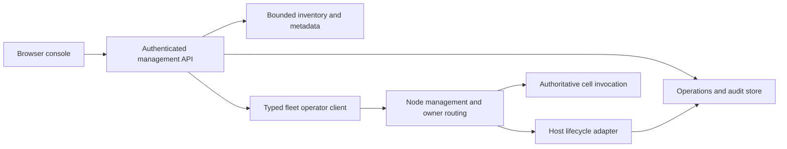

# Fleet dashboard: product and implementation scope

Status: IMPLEMENTED — v1 behavior and local qualification are recorded below.

Prepared 2026-10-13 against `origin/main` at
`6a8e252fe8d171be8f2a19da85ca1acfa9605567`.

## Product decision

Build a browser console for application builders who need to understand and
operate their Cellar fleet. The primary journey is fleet → node or application
→ cell → data or asynchronous work. Use Cloudflare's resource-oriented
navigation and list/detail workflows as a reference, adapted to Cellar's
explicit node ownership and durability model.

The user requested scoping SQL, KV, queues, workflows, cron, nodes and cells.
This document defines the design, delivery boundaries, missing APIs and release
criteria. Browser delivery is an assumption; no iOS client is included.

Success means a builder can locate an application cell, identify its current
owner and observation freshness, inspect its available resources, perform an
authorized operation, and distinguish success, failure and an unknown outcome.

## Resource model

```text
Console
  Fleet connections (each selects an exact bucket/backend/prefix authority)
    Nodes (process identity, generation, lease, load, lifecycle)
    Applications (primary application and cohosted applications)
      Cell classes → application cell instances
      Bindings → shared SQL databases, KV namespaces, queues, workflows
      Schedules → application scheduled handlers or workflow triggers
    Runtime cells (backing SQL, KV, queues, workflows and cron)
    Operations and audit history
```

Relationships matter more than a literal tree:

- A fleet is formed by nodes sharing storage authority. A console connection
  is a management configuration, not a new Cellar ownership mechanism.
- Nodes own cells dynamically. A cell's URL and identity survive owner changes;
  node identity must not be part of the canonical cell URL.
- Application cells have local SQLite state. A SQL binding addresses a separate
  database cell. These are two distinct inspection surfaces.
- SQL and KV identities can be shared across applications. Queue bindings reach
  broker cells. Workflow instances are cells scoped by application and workflow.
- Bindings are application configuration. Show them as **Available bindings**
  on a cell page, with **Shared resource** labels. Do not imply that every cell
  has used, owns, or has a private copy of each binding.
- Cron is deployment configuration executed by a reserved scheduling cell.
  A normal cell's alarm is separate from an application cron trigger.
- A stored cell scope can be opaque. Do not reverse hashes or invent readable
  instance names. Preserve scope lookup; readable names need explicit metadata.

## Navigation and screens

```text
Fleet selector                                      Search / user
├ Overview          Fleet health, attention items, ownership distribution
├ Applications      Deployment, classes, bindings, schedules
├ Nodes             Searchable inventory and node detail
├ Cells             Searchable/paged explorer and cell detail
├ Data & storage
│ ├ SQL             Databases → schema, query, migration history
│ └ KV              Namespaces → keys, values, expiry
├ Asynchronous work
│ ├ Queues          Brokers → backlog, messages, consumers
│ ├ Workflows       Definitions → instances → history
│ └ Cron            Schedules → target, next occurrence, changes
├ Operations        Requested actions, progress, outcomes, audit records
└ Fleet settings    Connection metadata, capabilities, access policy
```

All resource links retain fleet and application context. Global search initially
supports exact IDs and indexed prefixes; it must not scan millions of bucket
objects on every keystroke. Search results state whether they cover the current
page or a complete index.

### Fleet overview

The overview answers “What needs attention, and where is my application running?”

- Attention items: unavailable observations, expired leases, reported pressure,
  incomplete management operations and known lifecycle failures.
- Current node count and reported owned/resident cell counts, with coverage and
  sample timestamps. Stored-cell inventory is a different measure.
- A compact placement view: one row per node, showing reported owned cells,
  residents, restoring work and memory pressure. Clicking opens the node's cells.
- Current deployment identity and application links.
- Resource inventory by application and type; configured resources are distinct
  from resources confirmed to have persisted state.
- Recent dashboard operations. Application activity appears only when an actual
  telemetry source is connected.

No fabricated request-rate graphs, percentiles, availability percentages or
queue throughput. Historical charts require a retained telemetry source and
show gaps and export coverage.

### Nodes

Inventory columns: node ID, observed status, process generation, lease expiry,
sample age, owned cells, resident cells, memory, CPU and pressure. Detail adds
advertised address, protocol, restoration count, rebalancing state, deployment,
available limits and returned lifecycle outcomes.

Distinguish “lease current,” “signed probe reachable,” and “application ready.”
An unreachable node has an unknown current state; an expired lease alone does
not prove a specific process failure. Missing metrics remain unknown.

Management actions:

| Action | Required behavior |
| --- | --- |
| Probe | Fresh signed peer challenge; display check time and result |
| Pause/resume balancing | Target a node generation; show requested versus observed state |
| Drain with handoff | Preview node/cell impact, submit once, track every shutdown phase |
| Stop preserving ownership | Separate advanced action explaining same-node resumption requirements |
| Add node | Configuration instructions for the host/supervisor; registration follows a real lease |
| Restart/replace | Only enabled with a configured supervisor adapter; stopping is not restarting |

Do not expose a generic “Delete node” control that erases leases or local state.
No automatic fleet-wide rebalance or restart button in the first release.

### Cells

Inventory defaults to application cells, with an explicit runtime-cell filter.
Provide class/prefix filtering, exact scope lookup, server-side pagination and
filters supported by the available catalog. An owner filter across the complete
fleet requires an ownership index; filtering one loaded page must say so.

Detail header: readable name when known, full scope, class, application, observed
owner, epoch, observation time and state source. “Stored,” “owned,” “resident,”
“recovering,” and “not observed” are distinct concepts.

```text
Fleet / Application / Cells / customer-123           Copy scope
Customer · owner node-b · epoch 18 · observed 4 s ago

Overview | Local storage | Bindings | Async work | Activity | Settings

Ownership and lifecycle         Available bindings
node-b → epoch 18               DB → customer-data       Shared resource
resident / observation source  CACHE → customer-cache   Shared resource
                               JOBS → email-delivery   Shared resource
```

Show the applicable resource workspace directly for runtime cells. On ordinary
application cells, binding links open the actual shared resource. Async work
shows a cell's own alarm plus related workflows/jobs only when the application
supplies correlation metadata; application-wide schedules are labeled as such.

Cell management initially includes refresh, owner inspection and controlled
eviction through the existing actor. Eviction releases residency; later demand
can reactivate the cell. It is not cell deletion or a guaranteed move to a chosen
node. Arbitrary reassignment and permanent deletion are excluded from v1.

## Resource workspaces

| Surface | Inspect | Manage in the complete v1 scope | Backend work |
| --- | --- | --- | --- |
| SQL binding | Databases, tables/schema, bounded rows, query results, migration history, owner | Execute authorized SQL, copy/export bounded results | Typed HTTP adapter over the existing owner-routed SQL protocol; enforce read-only execution separately from write permission |
| Cell-local SQLite | Availability of an application-approved inspector | Application-defined actions only | Optional class inspector contract; the existing SQL binding protocol is not a generic cell-storage editor |
| KV | Namespaces, paged/prefix-filtered keys, text/JSON/binary preview, metadata, expiry, statistics | Put/edit/delete keys with expiry and metadata | Reuse existing owner-routed KV operations; correct byte/base64 and timestamp conversion |
| Queues | Broker info, ready/delayed/in-flight/dead-letter counts where reported, bounded non-consuming peek, consumer configuration | Pause/resume delivery, bounded dead-letter redrive, confirmed purge | Reuse queue operator calls and their state validation; preview the exact purge/redrive scope |
| Workflows | Definitions, known instance IDs, status, step/event history, output/errors and retention | Start, pause/resume, restart, send event, terminate | Authenticated adapter over existing invocation-bound workflow SDK controls; instance discovery/catalog is additional work |
| Cron | Configured expressions in UTC, handler/workflow target, computed next occurrences, applied revision | Validate, add/edit/disable via a deployment configuration revision | Revision-checked deployment update and explicit propagation status; no direct edits to scheduler SQLite |

SQL queries have a row, response-byte and execution budget enforced on the node;
clipping results in the browser does not bound query work. Read-only access needs
an actual SQLite authorization/read-only mechanism, not a regex for `SELECT`.
Writing SQL shows the selected fleet/database and requires write permission.
Protected framework tables remain protected.

KV values may be binary and must not be silently re-encoded. Expiry is labeled
with units/time zone. Unless the KV protocol gains version preconditions, editing
uses its documented last-write-wins semantics; do not promise conflict detection.

Workflow restart and termination preview their effects. The returned status is
authoritative: `waitingForPause` is not `paused`, and a requested rollback is not
a completed rollback. Full instance browsing cannot be implemented by recovering
instance names from hashed bucket keys. Initial exact-ID lookup can ship before
the durable instance catalog, but that is an interim delivery, not full v1.

Cron validation and next-run previews reuse `cellar-logic::cron` semantics. Show
both requested configuration and each node's observed deployment generation.
Editing a schedule must define what happens to a previously armed occurrence
using the existing scheduler policy and tests. A new runtime pause/resume policy,
manual “Run now,” and historical success rates are later work; none is simulated
by changing alarms or treating a deployment update as already applied everywhere.

## Design direction

Use a quiet light console with compact tables, a 232 px sidebar, breadcrumbs and
a consistent detail-tab layout. Put the visual emphasis on the node/cell
placement view and on actionable state. Avoid a wall of unrelated metric cards.

| Token | Value | Use |
| --- | --- | --- |
| Canvas | `#F6F8FB` | Page background |
| Surface | `#FFFFFF` | Tables and workspaces |
| Ink | `#172B4D` | Primary text |
| Action | `#2459C4` | Links, selection and primary controls |
| Healthy | `#147D64` | Confirmed positive observations |
| Attention | `#B45309` | Stale observations and actions needing attention |

Headings use a compact system sans face with restrained weight; body copy uses
the platform UI font; IDs, SQL and tabular values use the platform monospace face.
Use text and icons as well as color for state. Reserve red for destructive actions
and confirmed errors. The console has no remote font or CDN dependency.

Keyboard navigation, visible focus, accessible tables/dialogs, reduced motion,
and narrow-screen layouts are acceptance requirements. At small widths the
sidebar becomes a drawer, detail panes stack, and only data tables scroll
horizontally. Never hide the fleet/target identity inside a confirmation dialog.

## Technical architecture

Recommended implementation:

- `packages/console/`: TypeScript/React browser application, shared resource tables,
  routing, data-fetch lifecycle, permissions and UI tests. Browser JavaScript is
  separate from the native application execution format; introduce no JavaScript
  engine into Rust crates. Prebuilt assets are served locally without Node.js in
  the deployed console.
- `crates/cellar-admin/`: optional Rust/Axum management service above `cellar`,
  serving the UI and a versioned management API. Explicit fleet configuration,
  injected authentication/authorization, credentials held only by the service.
- Shared typed operator capabilities stay beside Cellar's existing operator and
  node modules. Extract reusable clients from CLI code; keep CLI flags, stdout
  and environment access at the CLI boundary. Do not shell out to the CLI per
  web request or implement a second owner-routing algorithm.
- Host adapters expose node lifecycle requests and report completion. Embedded
  Axum hosts and standalone native hosts must use the same underlying behavior.



The management service is not in the application's request or durability path.
If it fails, applications keep running. Its catalogs and metric caches do not
grant cell authority. Do not acknowledge an application write because an audit
record or catalog entry was saved.

### Management API outline (proposed, not existing routes)

All paths are under `/api/v1/fleets/{fleet}`:

| Resource | Read routes | Action routes |
| --- | --- | --- |
| Fleet | `/overview`, `/capabilities`, `/applications` | Connection administration at console scope |
| Nodes | `/nodes`, `/nodes/{node}` | `/nodes/{node}/actions` |
| Cells | `/cells`, `/cells/{scope}` | `/cells/{scope}/actions` |
| SQL | `/sql`, `/sql/{database}/schema` | `/sql/{database}/query` |
| KV | `/kv`, `/kv/{namespace}/keys`, exact key read | Put/delete through typed bodies; keys are not interpolated raw into paths |
| Queues | `/queues`, `/queues/{queue}`, `/queues/{queue}/messages` | `/queues/{queue}/actions` |
| Workflows | `/workflows`, instance detail/history | Instance creation and typed instance actions |
| Cron | `/schedules`, `/schedules/{schedule}` | Revision-checked schedule update |
| Operations | `/operations`, `/operations/{id}` | No generic arbitrary-node request proxy |

Lists return `items`, an opaque continuation cursor, observation time and
coverage (`complete`, `partial` or `unavailable`). Counts explicitly identify
whether they are exact, reported or indexed. Catalog lag is exposed. Cursor
handling must work with provider tokens, including Azure; a universal
start-after-name cursor is not supported by today's storage adapter.

Capabilities report what this fleet/host supports and why a control is
unavailable. Feature checks apply on the server as well as the browser. The UI
preserves last-good data during refresh failures, labels it stale, and never
replaces missing observations with zero.

### Authorization and operation outcomes

The browser never receives fleet shared secrets or object-store credentials.
Production access uses host-supplied identity and per-fleet permissions. Separate
metadata viewing, data reading, data writing, runtime operations and connection
administration. A role that can view topology does not automatically read KV
values or execute SQL. Local development may use a loopback-only console with
a session credential; production uses an authenticated same-origin service.

The private `/state`, `/shutdown`, `/evict/*` and rebalancing routes are not a
browser management API. Several rely on the private-listener boundary rather
than per-route `PeerAuth` verification. Add narrowly typed authenticated node
management endpoints or invoke an explicit embedded host adapter. Do not expose
the entire private listener through the dashboard service.

Mutations record actor, fleet, exact target, target generation/revision where
relevant, action, request ID, timestamps and outcome. Redact data values, query
payloads and credentials from ordinary audit views. Durably record operation
intent before dispatch. Protect stored outcomes with the same fleet access rules.

Long operations return an operation ID and show progress. A request accepted by
a node is not proof of completion. Use `succeeded`, `failed`, `incomplete` and
`outcome_unknown` distinctly. After a timeout or management-service restart,
reconcile against node/host evidence. If no receipt exists, retain an unknown
outcome; adding an HTTP idempotency header alone does not make node actions
exactly once. Never blindly resend an ambiguous SQL write or lifecycle action.

## Baseline implementation and gaps (before this change)

| Evidence | Reuse | Missing for the console |
| --- | --- | --- |
| [Cell listing](../crates/cellar/cli/cell_cli.rs), [bucket pagination](../crates/cellar/storage/object/bucket.rs) | Bounded scope enumeration and reserved-class classification | Stable management DTOs, indexed owner/name lookup and observation coverage |
| [Node leases](../crates/cellar/fleet/ownership.rs), [fleet diagnostics](../crates/cellar/deployment/fleet.rs), [signed probe](../crates/cellar/fleet/peer/probe.rs) | Load samples, generation, lease, identity verification | Bounded node inventory, status aggregation and readiness observation |
| [Node ingress](../crates/cellar/node/mod.rs), [actor](../crates/cellar/actor/mod.rs) | Snapshot, eviction, rebalancing and shutdown behavior | Authenticated typed management contract, generation preconditions, bounded per-cell inspection |
| [Operator client](../crates/cellar/fleet/operator.rs) | Fleet discovery, signed requests, owner dispatch, conservative retries | Reusable public typed interface and bounded web-service responses |
| [SQL](../crates/cellar/cli/sql_cli.rs), [KV](../crates/cellar/cli/kv_cli.rs), [queue](../crates/cellar/cli/queue_cli.rs) | Existing operator protocols | HTTP adapters, permissions, result budgets and resource catalog |
| [Workflow SDK](../crates/cellar/application/workflow/mod.rs), [workflow cell](../crates/cellar/application/workflow/cell.rs), [history](../crates/cellar/application/workflow/history.rs) | Status, lifecycle, events and retained history | HTTP operator bridge retaining invocation authority; durable instance discovery |
| [Cron cell](../crates/cellar/application/cron/mod.rs), [manifest](../crates/cellar/deployment/protocol.rs) | Schedule parsing/execution and deployment-owned configuration | Schedule management API, conflict checks and propagation evidence |
| [Lifecycle types](../crates/cellar/node/lifecycle.rs) | `ShutdownReport`, typed `NodeOutcome` and fencing reasons | Persistent remote operation receipt supplied by the host after shutdown |
| [Observability guide](../docs/15-observability.md) | Current metrics and optional telemetry | Retained time series, alert evaluation and historical query service |

At the planning baseline, the workflow cell handled SDK RPC/alarm events, not a general operator
HTTP fetch contract. Passing workflow JSON to `/runtime/` is not sufficient.
Cron fetch arms scheduling and returns no inspection payload; it must not be
used as a read-only dashboard endpoint.

## Delivery sequence

Each milestone is a working vertical slice with real data and tests. Synthetic
fixtures are allowed in design previews only and must be labeled as demo data.

1. **Fleet explorer.** Establish management service/authentication, read DTOs and
   browser shell. Deliver connection selection, overview, nodes, applications,
   paged cells and ownership drill-down. Include freshness, partial failure,
   empty states and exact scope lookup. No mutation controls before the server
   implements their contracts.
2. **Data workspaces.** Extract the shared operator client and connect SQL, KV
   and queues. Ship bounded reads, authorized mutations, resource/binding links
   and audit outcomes. Preserve reserved-cell routing and existing CLI output.
3. **Async workspaces.** Add workflow operator adapter and instance catalog;
   deliver lifecycle controls and history. Add cron list/validation and
   revision-based schedule changes with propagation status. Reuse core policy.
4. **Fleet management.** Add authenticated generation-bound node controls,
   controlled cell eviction and durable host operation receipts. Deliver
   balancing controls and drain/stop progress with explicit proof phases.
5. **Release qualification.** Exercise both standalone and embedded hosts,
   backend pagination, authorization, fleet failures, accessibility and measured
   large-inventory behavior. Document feature availability and deployment.

The first milestone is the implementation starting point. The complete v1
includes all five; shipping a static dashboard or only the read-only explorer
does not complete the requested management experience. No calendar estimate is
claimed before the operator API and instance-catalog designs are validated.

## Acceptance criteria

- Two registered fleets containing identical cell/resource names remain isolated
  in reads, actions, search, caches, permissions and deep links.
- A builder can find a cell by scope and reach its owner and available bindings
  without copying identifiers between screens. Owner movement preserves links.
- A 10,000-cell fixture loads through bounded pages. Initial overview/navigation
  does not walk every cell or query every cell's data. Filter coverage is honest.
- Lost nodes and unavailable storage produce partial/unavailable views with
  timestamps; they never produce a fabricated healthy empty fleet.
- SQL/KV/queue writes go through the authoritative owner and retain existing
  durability/output-gate behavior during owner changes and failures.
- Workflow status/history survives restart; unknown instance discovery coverage
  is explicit; rejected transitions are shown without optimistic success.
- Cron edits reject stale revisions, validate with the actual parser and show
  delayed/failed propagation. Previously armed occurrences follow tested policy.
- Node actions reject an unexpected generation. A drain is complete only when
  the required returned report phases pass; accepted shutdown, process exit and
  graceful proof remain distinct.
- Replaying a browser action or losing a response cannot silently issue a second
  non-idempotent action. Ambiguous outcomes remain visible for reconciliation.
- Unauthorized metadata/data/mutation requests, cross-fleet IDs, CSRF attempts,
  arbitrary proxy targets and oversized bodies/results are rejected server-side.
- Every enabled action has a real backend, a useful failure state and a tested
  result. Audit data and UI never disclose fleet secrets.
- Desktop and narrow-screen views pass keyboard/focus checks; tables, loading,
  stale states and confirmations are readable without relying on color.

Use the repository's required locked Cargo checks plus affected SQL, KV, Queue,
Workflow, Cron, CLI and host integration tests. Add API/browser tests for these
new contracts. A fresh isolated multi-node test is required for lifecycle claims;
existing historical fleet reports do not qualify the new management path.

## Deferred scope

Cloud billing, Cloudflare account compatibility, DNS/CDN/WAF, infrastructure
provisioning, autoscaling, arbitrary native-code upload, node SSH terminals,
forced ownership moves, permanent cell deletion, backup/restore orchestration,
multi-region active-active management, full log search, alerts and long-term
metrics are separate projects. Blob can follow the same resource pattern after
the requested five services. Generic cell-local SQL editing requires a separate
application/host contract and is not implied by the SQL binding workspace.

## Reference products and source limits

The resource categories follow Cloudflare's official documentation for
[D1](https://developers.cloudflare.com/d1/),
[KV](https://developers.cloudflare.com/kv/),
[Queues](https://developers.cloudflare.com/queues/),
[Workflows](https://developers.cloudflare.com/workflows/) and
[Cron Triggers](https://developers.cloudflare.com/workers/configuration/cron-triggers/).
These references guide the product organization, not a claim of feature parity
or an inspection of an authenticated Cloudflare dashboard.

The baseline analysis above describes the recorded revision. The implementation
and verification below supersede its identified gaps; the API outline remains a
product sketch, while the service router defines the shipped paths.


## Implementation and local verification — 2026-10-13

Implemented in the working tree:

- Vite/React/shadcn frontend with Lucide icons, responsive navigation, light/dark
  themes, lazy pages, permission-aware actions and explicit operation confirmation.
- Separate `cellar-admin` process and library router, caller-owned execution domain,
  same-origin token authentication, per-fleet permissions and persistent audit intent.
- Bounded fleet/application/cell inventories, advisory lease freshness, signed probes,
  and cell-to-application declaration/binding links.
- Owner-routed SQL with SQLite-enforced read-only mode, bounded VM work, row/value
  budgets, atomic writes, result tables and bounded JSON export. CLI SQL retains
  its existing contract through the shared operator transport.
- KV key continuation, UTF-8/binary value inspection and download, metadata/TTL
  editing and deletion; queue inspection, payloads and broker controls.
- Workflow operator fetch bridge reusing invocation-bound control methods, bounded
  retained-cell discovery, status/history and start/pause/resume/restart/event/terminate.
- Cron validation and next-occurrence preview using the actual Cellar parser.
  Revision-checked schedule edits, loader/watcher resolution and bounded per-node
  adoption observations are implemented. Native tests verify stale revision refusal,
  loader resolution, empty overrides and pending/adopted observations on a real SDK node.
- Signed, generation-bound node state/balancing/reload endpoint and capability-aware
  controls, epoch-checked cell eviction, live node cell/alarm pages and durable
  handoff/preserve stop receipts with post-shutdown reconciliation.
- Separate browser CI job; production frontend contains no synthetic fleet provider.

Local verification covers the five delivery milestones:

- Frontend production build, lint and thirteen Playwright fixture tests pass.
  The fixture tests cover permissions, target-preserving navigation, resource
  controls, refresh conflicts, lost stop acknowledgments, responsive layout and
  keyboard focus trapping/restoration. Production has no fixture data provider.
- All nine management API tests pass, including independent SQL read/write and
  cron configuration grants, origin rejection, fleet isolation, durable audit
  deduplication, actor-scoped stop reconciliation and late acceptance protection.
- The 10,000-cell inventory test traverses all 100 bounded pages without missing
  or duplicate scopes. Its first 100-cell page measured 47 ms locally; this is
  fixture evidence, not a production latency guarantee.
- Runtime suites cover SQL authorizer enforcement, execution/result budgets and
  atomic rollback; paged schema/migration inspection; KV; non-consuming queue
  previews with large payloads; workflow controls, generation checks and history;
  cron revision conflicts, empty overrides and pending/adopted observations.
- Fresh two-node SDK tests preserve acknowledged SQL/KV/Queue state across both
  graceful owner handoff and forced owner closure before new writes are issued.
  Management tests cover signed generation checks, eviction and all four stop
  outcomes: handoff, preserve, forced cancellation and deadline expiry.
- A standalone compiled host adopts a cron edit through its deployment watcher,
  then accepts a signed stop and exits with a persisted complete, joined receipt.
  A separate dashboard process smoke test verified built assets, authenticated
  inventories, unauthorized rejection and graceful process shutdown.
- The workspace all-target/all-feature check and documentation tests pass. The
  final broad library/integration run passed every target except the Cellar
  library target, where a wake-format fixture shared process runtime state. Both
  wake-format storage fixtures now enter and
  shut down their own execution domains; the corrected workspace library run
  passes, including all 53 Cellar unit tests both normally and serially.
  No failing assertion was removed or weakened.
- Axum all-feature tests and the shared example passed in the broad run.
  No-default-feature targets passed, with its four WebSocket tests rerun serially
  after parallel startup failures. Earlier actor/node timing failures also passed
  unchanged in isolation and in the final broad run.
- Workspace all-target/all-feature Clippy with warnings denied and the minimum-
  feature Axum example check pass. The standalone CLI tests pass again after
  adopting execution-domain timers in the harness. Dependency and documentation
  guards pass, as do all 39 fleet-harness proof guards. The closing
  `cargo format --check` and `git diff --check` pass.

Qualification used Rust 1.97.0 and a checkout-specific target on the workspace
volume. CI's Rust 1.98.1, the external simulation/conformance harness, live cloud
fleets and a new Docker/RustFS fleet-scale run were not exercised locally.
Browser end-to-end cases use labeled API fixtures; native/API tests and the
standalone smoke tests independently exercise the real service/runtime paths.

Host limits remain explicit: embedded hosts load and adopt cron revisions;
`cellar dev` owns reloads instead of running the standalone deployment watcher.
Cron adoption proves loaded configuration, not execution of an occurrence.
Authentication uses configured principals and per-fleet grants; infrastructure
provisioning and supervisor-driven restart are not included. Operation history
shows the latest 100 records. Application bindings are shared resources, and
arbitrary application-cell SQLite editing remains outside this contract.

### Shutdown receipt implementation and qualification

The signed management endpoint now accepts a generation-bound stop action. It
reserves one operation per node instance and writes a node/generation/operation
receipt to the fleet bucket before requesting the existing bounded driver drain.
It returns acceptance and a receipt locator; that response is not completion proof.
Console operation identities include a hash of fleet, actor and request ID so
independent operators cannot collide during reconciliation.

A node-owned reporter persists driver phases without blocking actor policy.
The final `ShutdownReport` records application work, cell handoff, log quiescence
and local durability. Only after the serving domain joins does a separate reporting
domain publish `domain_joined: true`. The CLI also joins its dedicated core thread;
its maintenance loops and generation-build work retain domain ownership. Directory
locks and caller executors stay alive through final publication. A failed write
leaves the last observation and never replaces the typed `NodeOutcome`.

The console reads the durable receipt after the peer listener disappears, keeps
partial phases visible, and reconciles its audit entry from that receipt. A stale
lease or unreachable endpoint alone does not prove joined work. Capability discovery gates the control on host support. Browser tests cover a lost
acknowledgment followed by joined proof. The native SDK stop test passes graceful handoff, preserve, forced cancellation and
deadline expiry cases, including peer-listener closure and caller-executor survival.
The standalone process test also passes cron adoption and complete joined stop
receipts. The verification record above includes the initial timing failures and
the corrected storage-format test isolation; process exit alone is never counted
as graceful proof.

## Workflow visual inspection follow-up — 2026-10-13

The workflow workspace now previews the current declared definition before any
instance exists. It provides an execution path, activity timeline, step inspector
and per-run definition view. Nodes are keyboard-selectable; definitions support
branch labels, parallel groups, waits, sleeps and cycles. The execution graph
labels observed step activity without inferring causal edges from event order.

Workflow bindings accept an optional bounded `definition` with a version label.
Create/restart persists its snapshot and content digest in the owning instance
transaction. History records execution generations so earlier runs remain
separate after restart. This iteration deliberately implements versioned
**definitions and history**, as requested, rather than side-by-side executable
versions. Existing executions still require compatible compiled code.

Step inputs are opt-in through `StepConfig::input`; sensitive inputs are redacted.
Per-field structured-clone encoding preserves readable event metadata for non-JSON
values. Snapshot cleanup follows instance retention. The report workflow example
includes a real definition, and the asynchronous-work guide documents the contract.

Fourteen browser tests pass, including paged histories across restarts, definition
versions, input/output inspection, redaction and desktop/mobile containment.
The native workflow test verifies a completed v1 snapshot after deployment of v2,
a v2 snapshot after restart, both versions in retained history, structured values
and sensitive-input redaction. Native workflow/cron/artifact/CLI suites and all nine
management API tests pass. The closing all-features run passes all 54 Cellar
library tests and the workflow integration test. Workspace all-target/all-feature
Clippy passes with warnings denied; the formatter checks all 382 Rust files.
Frontend build/lint, dependency-engine guard, documentation checks and diff
whitespace checks also pass.

### Theme and usability polish

The console now has a shared neutral scale and semantic tokens for light/dark
surfaces, text, borders, actions, focus and statuses. Spacing, typography, control
sizes, radii and motion are documented in `packages/console/README.md`. Shared primitives
apply them across the fleet, resource and workflow views.

The shell adds an explicit light/system/dark preference, keyboard-focusable active
navigation, and mobile menu dismissal after navigation. Resource lists support
local filtering with a clear-filter recovery path, reset when the fleet or resource
type changes. Routine reads no longer stack success toasts over inspected data.

Frontend build, lint and all 17 browser fixture tests pass. New coverage checks
persisted theme/system changes, 4.5:1 contrast for the tested semantic text pairs in
both themes, mobile controls and overflow down to 320px, navigation dismissal,
keyboard focus, and resource filtering. Desktop, mobile, SQL and workflow screenshots
were inspected in both themes as applicable. These are Chromium fixture checks;
no physical-device or cross-browser qualification is implied.


## SQL/KV workbench follow-up — 2026-10-14

The [SQL and KV workspace implementation](004-sql-kv-workspaces.md) adds query
tabs, CodeMirror completion, session history, query plans and a resizable result
explorer. KV uses loaded drafts, exact expiry policies and owner-side revision
preconditions across SDK and operator writers. This supersedes the original
last-write-wins-only console editing description; unconditional application and
CLI writes keep their existing semantics. See that follow-up for its independent
verification record and remaining SQL extensions.
