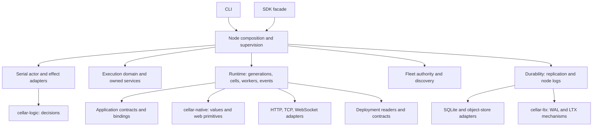

# Cellar architecture and integration plans

## Runtime integration proposals

| Design | Status | Scope |
| --- | --- | --- |
| [007: Embedded CPython through PyO3](007-embedded-python-pyo3.md) | Partial; full-plan audit active | Python request and cell handlers, invocation-bound SDK access, atomic storage batches, interpreter lifecycle, packaging and qualification gates |

The optional interpreter adapter is implemented above the native Rust SDK.
Its Python API sketches are not implemented or runnable examples.

## Primitive designs

| Design | Status | Scope |
| --- | --- | --- |
| [002: Transactional outbox and durable event delivery](002-outbox-streams-subscriptions.md) | Proposed | Atomic event emission, durable streams, resumable subscriptions, recovery, retention, and implementation phases |

The primitive design is separate from the completed component organization
work below. Its API sketches describe proposed behavior, not the current SDK.
Implementation is underway; the [requirement audit and verification status](outbox-implementation-status.md)
track the full remaining scope.

## Component organization baseline

Prepared on 2026-10-12 against `origin/main` at
`0bbb2b11ffbcc2ccb3bd08f62a83c84c73c8c5f6`, using the improve planning workflow.

The CLI organization from PR #4 is already on main. The subsequent changes
made embedded nodes, execution-domain ownership, complete event draining,
bounded routing history, and typed fencing outcomes more explicit. The next
organization should follow those responsibilities.

Refreshed after PR #9. Production crates, manifests, lint policy, and SDK CI
are unchanged from the previous review; the 95-file move map remains valid.
The new commit adds recovery evidence, documented embedding examples, and
mandatory captured-policy/cache-snapshot checks to the performance harness.

| Plan | Priority | Effort | Risk | Depends on | Status |
| --- | --- | --- | --- | --- | --- |
| [001: Group framework files by component](001-component-layout.md) | P2 | M | MED | None | DONE |
| [002: Embed Cellar behind Axum with integrated OpenAPI](002-axum-openapi-adapter.md) | P1 | L | HIGH | 001 | DONE |
| [003: Fleet dashboard](003-fleet-dashboard.md) | P1 | L | HIGH | 002 | DONE |
| [004: SQL and KV workspaces](004-sql-kv-workspaces.md) | P1 | L | HIGH | 003 | DONE |
| [005: Queue, workflow and schedule inspectors](005-resource-inspectors.md) | P1 | M | HIGH | 004 | DONE |
| [006: Outbox, event stream and subscription console](006-event-console.md) | P1 | L | HIGH | 005 | DONE |

Plan 003 scopes the browser console for fleet, node and cell management, with
SQL, KV, Queue, Workflow and Cron workspaces. It maps the UI to current owner
routing and lifecycle contracts, identifies missing management APIs, and defines
five implementation milestones. Plan 003 records the completed v1 implementation,
local verification and host/deployment limits.

Read plan 001 fully before implementation. Its three batches can be reviewed
and landed separately, in order. Update the status when implementation begins
or finishes. Do not implement the deferred refactors as part of the file moves.

Plan 002 was prepared on 2026-10-12 at
`4d52bacbdc49346c1fdc5193ca3d165f543ea753`, after the component layout was
implemented in [PR #12](https://github.com/crabbuild/cellar/pull/12). The user
selected Axum with an embedded Cellar runtime. It adds two adapters: Axum
handlers inside SDK invocations, and shared node ingress mounted in an
application-owned Axum server. One application definition supplies the cell
factories, HTTP routes, and optional OpenAPI document for both hosts.

Implementation is complete on `codex/axum-ingress`, initially based on merged
PR #12 (`c24feb2`) and rebased onto `origin/main` at `fddb002` for its pull request.
The adapter, shared builder, two-host counter and
OpenAPI export are implemented. Integration tests cover typed request bodies,
host parity, SDK events, replication proof, streams, local/remote WebSockets,
reload and bounded shutdown. Local workspace checks, both feature modes,
generated-client calls, CLI package validation and two-host restart smoke tests
passed. See plan 002 for the verification record and toolchain limits.

## Recommended layout

```text
crates/cellar/
  lib.rs                    Existing module names and compatibility exports
  sdk.rs                    Application-facing facade
  build.rs                  Cargo build script
  cli/                      Commands, packaging, development, environment parsing
  application/              Application APIs, bindings, built-in KV/Queue cells
  actor/                    Serial decision-core driver and effect execution
  execution/                Domain admission, injected services, task ownership
  node/                     Startup, supervision, shared ingress, shutdown
    network/                Node ingress WebSockets and authenticated peer tunnels
  runtime/                  Generations, assets, application execution
    cells/                  Cell activation, dispatch, facets
    workers/                Compiled workers, pools, loading, configuration
    invocation/             Event context, gates, turns, channels, service calls
  transport/                HTTP, TCP/TLS, WebSocket mechanics and registries
  storage/                  SQLite, object-store clients, Blob backend
  durability/               Replication, fleet logs, recovery, proof task ownership
    replication/
    log/
  fleet/                    Leases, peer authentication, handoff, wake discovery
  deployment/               Shared manifests and deployment loading
  containers/               Cell-owned container adapters
  observability/            Telemetry export and encoding
  platform/                 Process memory and machine adapters
  tests/                    Existing Cargo integration-test entry points
```

These are physical folders. Existing Rust paths such as `cellar::daemon`,
`cellar::host_io`, `cellar::storage`, and `cellar::ws_registry` remain intact.
The plan does not introduce matching public namespaces.

## Architecture behind the layout

The diagram shows composition and the main dependency directions; it is not
a complete import graph.



The four foundational crates retain their ownership boundaries; `cellar-axum`
adds an SDK adapter above them. `cellar-logic` owns behavioral
decisions without dependencies or I/O. `cellar-ltx` owns replication mechanics,
not fleet authority or output-gate policy. `cellar-native` owns engine-independent
primitives. `cellar` composes production adapters and exposes the SDK and CLI.

## Findings that determine the plan

| Finding | Evidence at the planned commit | Consequence |
| --- | --- | --- |
| Prefixes obscure distinct owners | `host_services.rs:76` owns domain registries; `host_service.rs:10` dispatches generation-scoped binding calls | Put them under execution and invocation respectively |
| Node composition is shared with library hosts | `daemon/embedded.rs:228` supplies services; `daemon/driver.rs:100` is shared; `daemon.rs:2405` reaches into `main/` | Give the production node and its ingress code one physical home |
| Node logs are a durability subsystem | `node_log.rs:4` describes follower/bucket proof; `node_log.rs:3997` owns the coupled durability stack | Keep log and replication as siblings under durability |
| Fleet naming hides deployment responsibilities | `fleet.rs:571` parses/publishes CLI work; `fleet.rs:652` loads deployments for runtime callers | Move intact to deployment first; split operator orchestration later |
| Similar protocol names have different authority | `host_websocket.rs:7` uses invocation gates; `host_services.rs:93` owns registries; `main/websocket.rs:342` uses peer-tunnel ownership | Keep node ingress separate from transport adapters and retain event/domain ownership |

These findings have high confidence from source inspection. File moves have
low individual risk; the combined migration has medium risk because module
discovery, conditional builds, macro exports, and embedded fixtures must agree.

## Follow-up refactors after the layout lands

Each item needs its own bounded plan and behavior checks before implementation.

1. Separate CLI bootstrap and managed connection/credential commands from
   `node/mod.rs` and `node/managed.rs`. Keep the shared production driver,
   recovery ordering, and typed outcomes as one implementation.
2. Separate shared deployment readers/publication helpers and package
   configuration from CLI orchestration. Today `sdk.rs:168` reexports
   `native_deploy` types, and managed ingestion calls
   `deploy::prepare_queue_attachments`. Moving whole modules into or out of
   CLI would hide these shared dependencies.
3. Extract private modules from `runtime/mod.rs` for request cancellation and
   event driving; from `storage/sqlite/mod.rs` for schema, cursors,
   transactions, and alarm persistence; and from `durability/log/mod.rs` for
   wire framing, follower storage, recovery, shipping, and maintenance.
   Preserve one lifecycle owner and public entry points for each subsystem.
4. Split `platform/machine.rs` identity/configuration helpers from process
   observations, and move explicit environment adapters to their appropriate
   CLI boundary. Preserve injected library defaults.

Prioritize the CLI/shared-code separation before decomposing the large
ownership-sensitive modules. File length alone does not define a safe seam.

## Latest-main validation context

- The [10,000-cell reference report](../tools/perf/results/2026-10-12-embedded-10000-reference.md)
  records completed bucket/fleet recovery and 14 returned shutdown proofs.
  Its image predates routing-cache bounds and typed fencing outcomes.
- The [zero-cache report](../tools/perf/results/2026-10-12-embedded-cache-zero-1000.md)
  records a newer single-node image visiting 1,000 cells with 64 resident slots,
  zero cached routes, and successful recovery of all acknowledged writes.
  Positive cache limits and remote routing still need a newer three-node run.
- Keep the measuring SDK application and harness under `tools/perf/`; the new
  examples guide links there. Preserve those Cargo targets and references.
- Later lifecycle refactors should rebuild a checkout-specific image and
  exercise positive/zero cache limits, recovery, handoff, and complete returned
  shutdown proofs using `tools/perf/README.md`. Keep ownership, alarms, and
  unfinished work separate from the cache bound in checks and documentation.

## Approaches considered and rejected

- A broad `utils/` directory: the reviewed helpers carry specific ownership,
  binding, configuration, or protocol contracts.
- Grouping every `host_*` file together: names do not distinguish execution
  services, invocation authority, cell dispatch, and network mechanics.
- Putting node logs under generic storage: it hides their coupled proof,
  recovery, and shutdown responsibilities.
- Moving all WebSocket code beneath one new Rust module: it changes parent
  scopes used by node ingress and risks losing domain/event authority.
- Changing public module paths, extracting new crates, or adding a `src/`
  migration in the same change: these add compatibility work without helping
  the immediate organization.
- Moving integration tests into component subdirectories: Cargo currently
  discovers 43 direct test targets; test grouping needs a separate manifest
  change if pursued.

## Planning validation and limits (before implementation)

Verified the current Git revision, source relationships, relative include
paths, manifests, lint rules, and CI commands. `cargo metadata --no-deps
--format-version 1 --locked` succeeds and reports four packages and 43 Cellar
integration-test targets. At the planned revision there were 74 Rust files
directly under `crates/cellar/`; the move map relocates 71 and retains the three root files
shown above.

The current harness proof guards pass: `PYTHONDONTWRITEBYTECODE=1 python3 -m
unittest discover -s tools/perf -p 'test_*.py'` ran 13 tests successfully.
The move inventory was revalidated against the pulled revision with no source
or destination collisions.

Local Rust is 1.97.0; SDK CI selects 1.98.1, while the Cellar manifest declares
1.94.1 as its minimum. No fresh Rust compilation, Rust runtime test suite, security audit,
or fleet-scale validation was performed during this planning pass.

## Implementation and verification

Completed on 2026-10-12 on `codex/organize-components`, against the same
`origin/main` revision. `git pull --ff-only origin main` confirmed it was still
current. The three implementation batches relocate all 95 tracked files,
including 71 crate-root Rust files. Only `lib.rs`, `sdk.rs`, and `build.rs`
remain as Rust files at the Cellar crate root.

Byte comparisons against the planned revision confirm that relocated contents
are unchanged except for the documented node-module and TLS-fixture paths.
Removing the added physical path attributes reproduces the original `lib.rs`
exactly. The SDK facade, module visibility, conditional builds, macro exports,
Cargo package/target metadata, all 43 integration-test entry points, manifests,
lockfile, other crates, examples, tools, and CI remain intact. `NOTICE` now
points to `execution/select.rs`; its attribution and license text is preserved.

All verification gates passed using Rust 1.97.0 and the checkout-specific
target directory on the mounted workspace volume:

- `cargo fmt --all -- --check`
- `python3 tools/check_native_dependencies.py`: 386 reachable packages,
  no JavaScript engine
- `cargo check --workspace --all-targets --all-features --locked`
- Each batch's targeted tests: 61, 44, and 9 passing tests respectively
- `cargo test --workspace --all-features --lib --tests --locked`: 227 tests
  passed, including the external Rust application's Cargo dev/restart workflow
- `cargo test --workspace --all-features --doc --locked`: eight doctests passed
- `cargo clippy --workspace --all-targets --all-features --locked -- -D warnings`
- `PYTHONDONTWRITEBYTECODE=1 python3 -m unittest discover -s tools/perf -p 'test_*.py'`:
  13 tests passed
- Both CLI help commands available at that baseline (the CLI is now `cellar` only)
- Original move-inventory assertions, exact-content/scope audits, obsolete
  physical-path search, and `git diff --check`

The SDK CI toolchain (1.98.1), externally supplied simulation/conformance
harnesses, and a new Docker/Podman fleet-scale run were not exercised locally.
The follow-up refactors above remain separate work.
