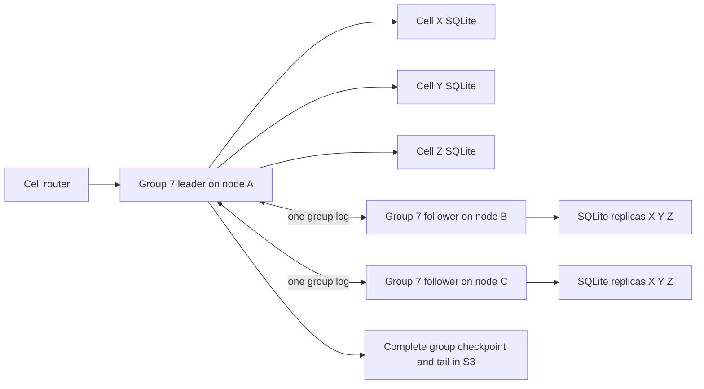

<!-- Copyright 2026 Cellar Project Authors. Licensed under Apache-2.0. -->

# Cell group design

Status: target contract for CG-01 through CG-16; implementation in progress.
See [implementation progress](progress.md); no runtime cutover is qualified yet.
Cellar baseline: `1be27d234d4674d4d014785c60cecbfe394bdab9`.
TiKV investigation: `b3995dab28308f09cbb7c125bf32f789dbc203fe` in the supplied
checkout. The [decision](../density-decision.md) records the inspected source.

## Architecture and scope

A cell group owns one Raft state machine on each of its replicas. The group
contains whole cells; every serving replica has each cell's committed SQLite
state. Only the leader executes cell commands. Followers apply cell-addressed LTX
updates. Independent groups share node workers, persistent log batches, transport
and resource budgets. Three voting replicas remain the production default.



Cells share placement, leadership and log order, but keep separate transactions,
receipt tables, LTX chains, schema checks, authorization and query versions.
Neither cross-cell transactions nor intra-cell sharding are introduced. One hot
cell can occupy one group; all group sizes use identical consensus machinery.
The feature-off Fleet/bucket protocol and non-Raft applications keep their contract.

Full delivery includes split/merge, automatic placement, coordinated hibernation,
materialized and extent images, managed and unmanaged namespaces, native/Axum
ingress, alarms/outbox/inbox, group S3 reclamation and fenced disaster recovery.
TiKV transaction/MVCC APIs, SQL over multiple cells, geographic replication, online
conversion of old one-cell storage and a claim of TiKV-equivalent performance are
outside this package. No new consensus algorithm or raft-rs fork is needed.

## Identities and versions

| Type | Fields and lifetime |
| --- | --- |
| `CellHistory` | Cluster, namespace, validated cell ID, cell incarnation; stable through elections, replica moves, split and merge |
| `GroupHistory` | Cluster, namespace, opaque group ID, group incarnation; one physical log history |
| `GroupRoute` | Group history, half-open cell-key range, routing epoch, birth/schema binding |
| `GroupMembership` | Group history, committed membership revision, member/node/disk identities; independent of routing epoch |
| `CellVersion` | Cell history, nonzero monotone mutation sequence, LTX epoch/txid/checksum and image commitment |
| `CommitWitness` | Group history, term/index and proposal identity; locates the decision without defining the cell's lifetime |
| `TransitionId` | Non-reusable operation ID plus pinned source/destination histories and expected catalog root |

Increment the cell mutation sequence for every committed cell image update,
including internal receipt/effect maintenance. Group no-op or membership entries
do not increment it. Overflow refuses before proposal. Enrollment creates sequence
1. Preserve the sequence and `CellHistory` through normal group transfer.
Disaster recovery creates new group and cell incarnations, retaining receipt
contents/client floors but rejecting tokens from the prior cell history.

Version tokens authenticate cell history/version, schema, expiry/key identity and
the commit witness. They grant no access. AtLeast after normal transfer compares
the same cell history's mutation sequence, using installed transfer provenance;
it does not compare log indexes from unrelated groups. A token for another cell,
incarnation or schema refuses. Preserve original command-result bytes and receipt
identity through transfer. A recovery-seeded duplicate returns the retained result
without callback execution and a version covering that effect in the new history;
the old witness remains provenance, never new-incarnation authority.

Image roots bind logical cell history, schema and LTX position. Group manifests
bind those roots to physical group history and a committed prefix. Extent payloads
remain content addressed. A normal transfer can reuse verified immutable cell
roots locally; it cannot borrow another group's authority or an unsealed local
reference. Disaster recovery rebinds the cell root's history, retaining payload
objects only after full verification. Materialized images follow the same rules.

## Partitioning and directory

Use a stable ordered cell routing key:

```text
digest = SHA256("cellar-cell-route-1\0" || namespace_id[16]
                || cell_id_length_u32_be || cell_id_utf8)
CellKey = (digest[32], cell_id_utf8)
```

Compare the tuple lexicographically by bytes. The full cell ID breaks digest ties;
a hash collision never aliases cells. Validate IDs before hashing, without locale
normalization. Ranges are `[lower, upper)` with explicit negative/positive infinity
sentinels. Split boundaries always lie between whole cell keys. A namespace's
active range map covers the complete domain without overlap or gaps.

This hash ordering distributes application IDs and differs intentionally from
TiKV's user-key byte ordering. Cellar exposes no cross-cell ordered scan contract.
A dedicated hot-cell interval can use actual neighbor boundaries; it need not
split a cell or special-case the consensus engine.

The namespace root conditionally publishes a digest of an immutable paged range
tree and its mutation journal. Pages have fixed byte/count limits; readers descend
only the relevant path and cache hints. No per-request full namespace scan, no
monolithic million-cell map and no environment-selected alternate routing hash.
Updates copy bounded tree paths and CAS one root, serializing namespace topology
changes only. Independent namespaces can progress independently. The final load
profile must measure this catalog write bottleneck.

Initially provision a bounded explicit set of non-overlapping ranges; an empty
range record may remain unmaterialized until first enrollment. Lazy group birth
uses the existing conditional creation and permanent member claims. A node move
changes peer placement, not cell partitioning. An enrollment request goes to the
current group leader, which commits the cell's initial image. Concurrent creators
converge on that log decision and receipt. The previous per-cell reservation idea
is replaced by unique range ownership plus replicated enrollment; do not build two
assignment authorities. While a range is sealed, enrollment is refused/retried.

Cached routes carry group history and routing epoch; every destination verifies
the complete binding. Redirects are authenticated hints, bounded by the original
deadline and hop count. An ambiguous submitted command is retried only with its
original cell-scoped command identity. An unavailable catalog may prevent births
and topology changes; it does not turn a known group's write path into S3 quorum.

## Runtime and persistence

Split the current host's combined `Cell` owner into a group owner and bounded cell
execution owners. Only the group owns RawNode, hard state, membership, read barriers,
apply prefix, snapshot/archive jobs and topology transitions. A cell owns receipt
admission, private execution, pending proposal, image/query pins and effect state.
The node owns log engine, extent store, transport, SQL worker pool and global quotas.

One unresolved data proposal per cell is sufficient initially. Prepare different
cells concurrently through fair queues; serialize publication by group log index.
No slow callback or image preparation runs on the consensus tick loop. Group/node
byte quotas include queued, prepared, in-flight and ambiguous work; charge physical
owners until they release it, even after the request waiter is cancelled.

Data entries carry cell history, route binding, schema, mutation sequence,
base/result image, receipt/proposal identity and bounded LTX payload. Administrative
entries are explicitly typed: enroll, membership, checkpoint, seal, install,
activate, park. Unknown tags, unsupported domains or inconsistent lengths refuse
before allocation. Batch independent proposals where useful, retaining each
cell's identity and base chain; batching is never a cross-cell transaction.

The durable group root contains group history, applied position, routing/transition
state, membership binding and an authenticated map of all cell image leaves.
Each leaf contains cell history/version, last group mutation position and effect
summary. Use a content-addressed paged tree with bounded copy-on-write paths, not
an O(cell-count) full manifest rewrite for every update. An engine transaction
publishes the durable root and contiguous apply position after referenced image
and manifest pages are synced. Readers pin a published root and exact cell image.

Configuration/no-op entries advance the group prefix without changing cell versions.
A missing earlier cell update prevents later group publication. Parallel staging
may finish out of order but cannot advance a hole in the durable applied prefix.
Retain exact term/index proof for each pending output; an unrelated cell's progress
cannot settle it. Storage sync failure quarantines the owning engine as today.

## Reads, caches and effects

Linearizable reads obtain a fresh current-term group ReadIndex, wait for contiguous
apply through it, then select the target cell from a coherent root. An unchanged
cell's last mutation can precede the barrier. AtLeast uses cell version lineage;
Stale explicitly permits an older coherent image. No clock lease optimization is
introduced. Transfer-sealed groups refuse new strong reads and mutations for their
range; requests already in progress retain their original deadlines/proof rules.

Idle cell eviction closes disposable execution/SQLite caches only when no proposal,
effect callback or unsafe pin is active. Reopening reconstructs the private base
from the committed cell root. Group membership, data and receipt floors remain.
File-descriptor and cache byte limits must apply to thousands of enrolled cells,
not just an active-cell metric. Cache misses, image downloads and application work
are separately measured from consensus wake latency.

Alarms and outbox/inbox IDs bind `CellHistory`, not current group or node. Transfers
preserve delivery identity and receiver dedupe; they must drain/journal already
dispatched work and never mint new IDs for an unknown outcome. Durable summaries
let node schedulers find the next due effect without opening every SQLite DB.
Control ownership follows the current group leader. A pending old-origin delivery
after disaster recovery still needs reconciliation; the existing refusal remains.

## Resource policy and operational API

Expose distinct limits for cells/group, group logical bytes, resident cell bytes,
queued LTX bytes, unarchived bytes, snapshot/transition slots, open readers and
group replicas/node. Existing validated envelope/image limits remain in force.
Initial candidate occupancies are 8, 32, 64 and 128; no numeric default becomes a
capacity claim before qualification. Oversized single cells use dedicated groups
and explicit per-cell quotas. Never raise a hard cap to hide a failed test.

Scheduler inputs include cell count, bytes, write/apply rate, queue age, archive
lag, leader CPU and failure-domain placement. Split/merge use hysteresis, cooldown
and bounded concurrent work. Only compatible adjacent ranges can merge. Replica
movement uses learners, verified catch-up and committed configuration changes;
membership changes cannot race a seal, park or disaster operation.

The SDK continues to address cells. Add operator group list/inspect, split/merge,
rebalance, park/wake and transition status/resume operations. Status is read-only;
waiting does not advance a mutation. CLI/admin/native and Axum enforce the same
identity and authorization contract. Metrics use bounded labels and distinguish
cells, group replicas, leaders, parked groups, unresolved operations and archive
lag. Shutdown seals admission, drains/records ambiguity, joins all owned work and
preserves transition pins/debt for restart.

## Cutover and delivery boundaries

Use the existing raft-rs and Raft Engine integration; no TiKV source copying or
dependency replacement. Add private contracts during staged development, switch
all production consumers together, then delete superseded one-cell assumptions.
Do not ship a toggle selecting legacy per-cell consensus. Occupancy one exercises
the same group path as larger occupancies.

All Cellar-owned markers stay at 1, with new semantic domain/protocol digests and
fresh namespace/storage roots. Old wire, image and archive layouts refuse. There
is no automatic data migration or rollback by pointing an old binary at new data.
Retain existing disks/archives; any developer reset is an explicit separate action.
The final release sweep covers catalog, tokens, public SDK, CLI/examples, effects,
managed fleet and destructive recovery, not just the new host fixture.
