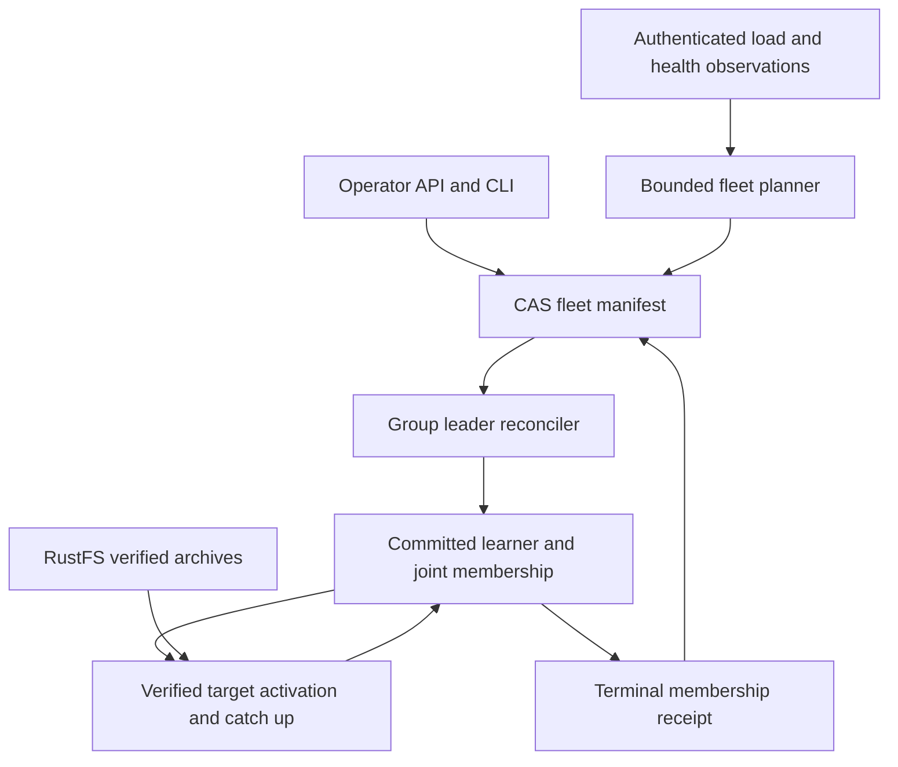
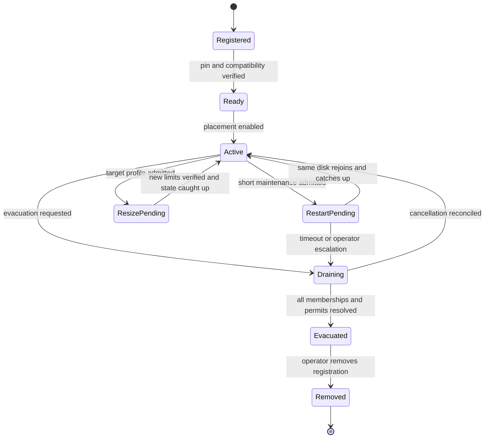

# Fleet balancing and maintenance technical design

## Outcome and boundaries

The fleet maintains three voters per cell, distributes replicas and leadership,
and exposes resumable operations for adding and removing capacity. Operators can
restart an intact node or evacuate it before extended maintenance. A completed
evacuation means the node is absent from every current group configuration and
every admitted placement, with surviving durability verified.

The detailed execution contracts are [capacity and scaling](capacity-and-scaling.md)
and [maintenance and rebalancing](maintenance-and-rebalancing.md). They distinguish
horizontal node-count changes from vertical resource resizing, and define the
guarded stop and terminal-receipt protocols used by this design.
The [planning details](planning-details.md) add accounting rules, legal move
ordering, worked topology changes and the distinction between monotonic absence
proofs and expiring survivor-health observations.

Object-store compare-and-swap (CAS) serializes desired state and admission of
membership work. It does not grant votes, elect leaders or replace a fresh Raft
quorum. No object-store call is added to the business-command acknowledgement
path. Existing archive retention limits can still backpressure writes during a
store outage; control-plane independence is not unlimited store-outage capacity.

## Existing implementation and required additions

| Boundary | Existing source | Required addition |
| --- | --- | --- |
| Conditional writes | `crates/cellar/storage/object/bucket.rs`, `Bucket::put_cas` | Bounded fleet record adapter using the existing no-hidden-retry CAS client |
| Stable node identity and routes | `crates/cellar/durability/raft/node_directory.rs`, `host_directory.rs` | Trusted dynamic node-set revision and revocation, retaining immutable storage pins |
| Repair | `host_controller.rs`, `controller_action.rs`, `host_membership.rs` | Durable fleet admission binding around ordinary begin/advance/activate operations |
| Placement | `crates/cellar-logic/raft_placement.rs` | Healthy-replica movement, projected reservations and whole-fleet capacity checks |
| Leader balancing | `crates/cellar-logic/raft_leadership.rs` | Fresh workload measurements in addition to leader counts |
| Local registration | `host.rs`, `application/consensus/client.rs` | Bounded dynamic history registration and inventory accounting |
| Shutdown | `host_drain.rs`, `operations.rs` | Fleet evacuation proof distinct from best-effort leadership handoff |
| Management | `crates/cellar/fleet/management/`, `crates/cellar-admin/`, `crates/cellar/cli/` | Explicit Raft fleet operation API, authorization and CLI |

The current controller is opt-in and its leadership policy is separately opt-in.
Its native six-node repair tests do not establish fleet-wide autoscaling. Current
standbys require pre-registered histories. An occupied or retired local binding
cannot be reset to a new member: `LocalMember` is deliberately one-way. This
design preserves that invariant and defines a fresh-registration return path.

## Safety invariants

| ID | Requirement |
| --- | --- |
| F01 | Only committed Raft configuration and fresh quorum proofs authorize membership, seeding and writes. |
| F02 | Node, disk, storage-instance, member and cell-incarnation identities cannot be rebound or reused. |
| F03 | CAS ambiguity retains the original operation and payload; retries never invent a second intent. |
| F04 | A stale controller cannot reuse a consumed or cancelled membership permit. |
| F05 | Removal requires complete history inventory and resolution of every placement involving the node. |
| F06 | Capacity, bytes, memory, probes, transfers and outstanding work remain explicitly bounded. |
| F07 | Missing observations, store outages and lease expiry cannot establish membership authority or absence. |
| F08 | Cancellation, shutdown and ownership changes join physical work and preserve committed intent. |
| F09 | Placement respects node separation and configured failure domains, including during repair. |
| F10 | No success receipt precedes its durability or evacuation proof; failed/ambiguous writes remain distinct. |
| F11 | Balancing uses fresh complete samples, hysteresis and bounded movement; unknown load is not zero. |
| F12 | Qualification verifies acknowledged history, replicas and archives while reporting latency and failures separately. |

## Authority and coordination



Use one manifest per fleet for the first release. A fleet explicitly lists its
managed Raft namespaces. All mutations affecting those namespaces must pass the
new admission boundary, including manual membership changes, automatic repair,
birth, deletion and learner activation. Existing APIs remain usable outside this
capability; within it they require the same typed permit. Otherwise a bypass
could add a replica after the operator received a removal certificate.

Any authorized reconciler can make progress. There is no time-expiring global
leader lease and no TTL-based reassignment of unfinished work. Two reconcilers
may submit the same permitted action; group revision checks and exact plan
identity converge on one result. Per-process activity hints reduce duplication
but are never safety fences. The object store is a low-frequency coordination
service; the per-cell Raft log is the membership state machine.

## Object-store contract and records

Require atomic conditional create, atomic replacement against an opaque version
token, and strongly consistent exact-key reads. Verify these on the deployed
RustFS version. An S3-compatible endpoint name is not evidence of these semantics.
AWS documents `If-None-Match` and `If-Match` for conditional writes and strong
object read consistency; atomic updates across multiple keys are not provided.
See [AWS conditional writes](https://docs.aws.amazon.com/AmazonS3/latest/userguide/conditional-writes.html)
and [AWS consistency model](https://docs.aws.amazon.com/AmazonS3/latest/userguide/Welcome.html#ConsistencyModel).

Under `<catalog-prefix>/raft/<cluster>/fleet/`, introduce:

| Exact key | Contents and mutation rule |
| --- | --- |
| `head` | CAS root: format 1, fleet incarnation, monotonic revision, policy hash, node-table hash, history-index hash, operation-index hash, active permits, reservations and maintenance exclusions |
| `objects/<sha256>` | Immutable bounded pages for policy, node table, history index, operation index and receipts; conditional create and exact byte/hash verification |
| `requests/<operation-id>` | Immutable canonical operator request, principal, request digest and expected revision; creation alone has no effect |
| `receipts/<operation-id>/<sha256>` | Immutable candidate terminal outcome and linked proof objects; authoritative only when referenced by the terminal operation index |

Existing `nodes/<node>/pin` and `nodes/<node>/view` remain unchanged in purpose.
Do not repurpose process-view revisions as fleet or group membership revisions.

The root is at most 1 MiB, immutable pages at most 64 KiB, with at most 128
history entries per leaf and bounded traversal depth. Reject duplicate fields,
unknown formats, bad hashes, invalid identities and arithmetic overflow. The
initial bounds are 64 nodes, 10,000 histories, 32 active operator operations and
16 admitted membership permits. Long operation histories use an immutable paged
index, not a growing root array. Bound decoded metadata to 8 MiB per controller;
stream inventory pages and retain cursors. Refuse admission rather than truncate.
All numbers are initial engineering bounds requiring FO-10 qualification.

For each update:

1. Read and validate one exact root and its opaque CAS token.
2. Check the operation request and rooted operation-index entry after that root
   read. A repeated ID with different bytes conflicts; a terminal request returns
   its referenced receipt. The index retains terminal identity permanently. An
   unreferenced receipt object cannot report success or authorize removal.
3. Write new immutable pages with conditional create; verify an existing key
   contains identical bytes. Unreferenced pages are harmless and grant no action.
4. CAS the root with revision + 1, unchanged fleet incarnation and references to
   those pages. The root update is the only admission linearization point.
5. On a clean conflict, reread and replan. On timeout or other ambiguous failure,
   read back the same operation/permit identity before retrying. A later root
   must retain enough index history to settle an older ambiguous operation.

Never blindly overwrite, delete/recreate `head`, or retry a mutation with a new
operation ID. Missing previously initialized root, corrupt pages or backend
semantic failure blocks new operations. Lifecycle expiration and external edits
are forbidden for live coordination keys. Durable receipts and identity
tombstones have no automatic garbage collection in v1. Object listing may assist
diagnostics; it cannot establish complete membership or authorize deletion.

## Inventory and mutation permits

The root's immutable history index contains every managed `GroupScope`, schema
and birth digest, lifecycle state and last reconciled membership reference.
It is an admission inventory, not a replacement for reading current Raft state.
Creation first reserves the history and initial nodes in the root, then uses the
existing conditional birth protocol. Before that root CAS, the namespace's
permanent group-ID claim may be confirmed to fence competing catalogs sharing
the data prefix. This identity claim grants no birth or membership authority;
retain it even when root admission loses or is cancelled. The root atomically
indexes both the cell name and fleet-wide group ID with its history.
The history reservation remains visible until an
exact birth result is reconciled; a lost response cannot produce an untracked
group. Imported fleets require a quiesced membership/birth cut and explicit
registration of all histories before enabling managed operations. Business writes
can continue. Incomplete enrollment blocks maintenance certificates.

Cancellation of a not-yet-created history must contend on the exact birth key:
conditional creation stores either the canonical birth or an immutable cancelled
birth tombstone for that incarnation. Whichever wins is reconciled before its
root reservation releases. A timeout is not absence. A late birth create cannot
overwrite the tombstone; if birth won, use the ordinary quorum-backed lifecycle
instead of declaring cancellation. Extend the existing birth codec/protocol at
the managed capability cutover. The current birth key is scoped to the cell name,
not just the incarnation: v1 tombstones also reserve that cell name. Re-creating
a cancelled or retired name is outside this release; use a new logical cell name.
Never delete the birth/tombstone to retry or reuse its incarnation.

Each membership permit contains:

```text
fleet_incarnation, permit_id, operation_id, purpose,
scope, per_group_sequence, expected_configuration_revision,
source_binding, target_binding, policy_digest,
reserved_group_slots, reserved_storage_bytes, reservation_nodes
```

There is at most one unresolved membership permit per group. Admission atomically
reserves source/target movement slots and target capacity in `head`. Expected
revision and target eligibility are rechecked by the group owner. A target's
physical initialization also reserves real host resources; a metadata promise
cannot override actual memory/disk admission. Other groups' pending reservations
count when calculating projected load. Birth reservations use the same limits.

Add a durable consumed-permit sequence and exact active permit binding to the
group's membership state, snapshots and archives. A guard must be committed as
part of beginning a membership plan; it is not just an in-memory API check.
The exact active permit can resume; older sequences and mismatched payloads
are refused. Cancelling an action which never started requires a quorum-committed
fence advancing that sequence before the root releases its reservation. Without
quorum, keep the permit blocked and reserved. This closes the delayed-request
race where a previously checked CAS token could otherwise execute after removal.

The fleet root orders permission to begin; Raft orders execution. Root admission
does not promise immediate execution. Draining excludes new target reservations
but previously admitted actions may finish. Evacuation must account for those
actions and move any resulting replica away. Policy changes and operator cancel
follow the same rule; they do not retroactively erase submitted work.

| Permit phase | Required transition |
| --- | --- |
| Reserved | Exact root entry and capacity reservation exist; leader can begin or commit a cancellation fence |
| Seeding | Committed repair plan binds the permit and fresh learner; resume activation/catch-up |
| Joint | Finish existing joint transition under both majorities; cancellation cannot remove it locally |
| Terminal | Quorum-observed complete/aborted/fenced result for the exact sequence; publish receipt then release root reservation |
| Blocked | Retain identity and resources, report reason; resume after the missing prerequisite returns |

Terminal observations are authenticated and include a fresh quorum read barrier,
configuration revision and exact plan/sequence. They are not inferred from RPC
admission, missing status, timeout or a cached archive. Before scheduling another
permit, reconcile the preceding result. Only one retained last receipt per group
is needed locally when the root forbids advancing past an unresolved sequence.

## Trusted dynamic node and history registration

An authorized operator adds a descriptor to the trusted node table using CAS.
It binds node ID, disk lineage, storage instance, protocol/schema capabilities,
authenticated label, server name, pool, region/zone and capacity. The node proves
its existing immutable storage pin and current process view. An arbitrary object
appearing in the bucket never enrolls a node.

Distribute the trusted-set revision through the existing bounded directory
worker. Update peer routes, inspection permissions and endpoint pools atomically;
cancel superseded routes while joining their physical owners. Revocation must
not close transport needed by an unresolved membership transition. Final revoke
occurs after evacuation, while placement eligibility can be withdrawn earlier.
Stale process publications cannot undo a removed-node tombstone.

Register target histories lazily through an authenticated, bounded host API.
The request binds the root inventory entry, compiled class/schema and exact
scope. It creates a dormant binding, not a voting member or SQL image. Activation
still requires the committed learner and fresh quorum grant. No incoming Raft
frame implicitly creates a history. One owned initializer per node and existing
snapshot body reservations remain in force.

An intact restart resumes the same engine/node/disk and existing member IDs.
If any history was permanently removed from that node, v1 does not overwrite its
retired local slot. Returning that physical machine as general capacity uses a
fresh node/disk/engine registration on a new persistent volume; retain the old
volume and pin for separate retention handling. Selective same-engine reseeding
is deferred because it needs generation-aware handles and log ownership.

## Health and automatic repair

Distinguish `healthy`, `suspect`, `unavailable`, and `unknown`. Repeated direct
connection failures or authenticated failed-state observations can cross the
unavailability grace. Missing directory entries, local overload, authentication
failure and S3 errors remain unknown and cannot evict a voter. Default direct
probe bounds remain four concurrent requests, 500 ms per probe and five seconds
per observation; five seconds is the initial unavailability grace, not a
promised recovery time. Apply receiver-local sample aging across the whole scan.

Repair priority is: finish admitted joint transitions; restore under-replicated
groups with quorum; evacuate requested nodes; repair domain violations; perform
optional load balancing, preferring eligible leader transfers over replica copies.
Reserve work opportunities for the first
two classes and use aging within classes. Never repeatedly abandon one slow
group to admit unlimited plans elsewhere.

One failed node in the five-node example leaves every RF3 group with quorum.
Approximately 300 copies need replacement. Two failed nodes can leave some groups
with only one replica; classify those groups `QuorumUnavailable`, preserve their
intent and stop ordinary repair. Healthy groups continue. Available RustFS data
does not authorize reconstructing old votes. Raft's majority and joint-membership
rules remain authoritative. [Raft specification](https://raft.github.io/raft.pdf)

## Placement and load balancing

Keep the planner pure in `cellar-logic`. It receives bounded immutable observations
and returns one proposed action plus a typed reason. Adapters collect samples,
reserve permits and execute effects. Do not add dependencies or I/O to the core.

For each candidate, require fresh identity/protocol/schema, distinct physical
node, configured domain policy, non-draining state and headroom. Calculate
projected pressure as the maximum of group-slot utilization, reserved storage
utilization and measured resource utilization. Storage estimates include image,
tail, archive retention and seed staging; reserve conservatively and reconcile
actual sizes. Missing required measurements make a candidate ineligible for
optional balance, never an empty node. For cold registered nodes, obtain a
complete authenticated zero-work sample before using them.

For automatic load balancing, require a source-target pressure gap of at least
five percentage points for three 10-second windows. Capacity additions and explicit
placement requests do not require an overloaded source. Prefer eligible leader
transfers, then replica moves that keep predicted peak pressure nonincreasing and
reduce the lexicographic peak/imbalance potential defined in
[rebalancing](maintenance-and-rebalancing.md#rebalance-triggers-and-objective).
This permits small performance improvements when several nodes tie for peak
load. Explicit topology redistribution instead reduces distance to its feasible
live-replica assignment under all hard capacity bounds; it can increase retained
physical storage and does not claim a performance gain. Record projected
reservations in CAS and recheck before activation. Do not credit retained disk
bytes/engine slots as freed
until physical reclamation is observed. Thresholds remain configurable starting
values requiring qualification.

Leader movement is cheaper than replica movement. First try moving a hot leader
to an existing caught-up voter when this solves the pressure without a copy.
Use complete node load plus per-cell command rate, SQL execution time, queue
time and bytes written over the same window. Treat latency as a congestion signal,
not an additive CPU estimate. The physical node's CPU/disk/network measurements
bound the estimate because followers still perform replication and SQLite work.
Do not claim leader movement moves all cell cost. Retain term/configuration,
matched/activity, published-progress, cooldown and deadband checks.

Initial limits: one active initialization per destination, one outgoing snapshot
per source, two admitted moves fleet-wide for the five-node profile, one leader
transfer per node per five seconds, and a 60-second per-cell movement cooldown.
The absolute permit cap remains 16. Start snapshot traffic at 8 MiB/s per node
with a 1 MiB burst, configurable under the host's existing byte/memory budgets.
Charge real bytes as they flow; a rate limit cannot release a physical buffer
early. Prioritize consensus control over seed traffic.

Pause new optional moves if rolling foreground p99 exceeds the configured budget,
archive backlog grows for three windows, or any relevant admission budget is
exhausted. Missing telemetry pauses optional moves. Required repair continues
at its reserved bounded rate; report the availability/latency tradeoff. Never
pause Raft progress or discard an active joint transition to improve a metric.

For 500 equal-sized cells, aim for 100 leaders and 300 copies on five nodes;
after adding a sixth, approximately 83/84 leaders and 250 copies. Exact equality
is subordinate to domains, hot cells and reservations. Adding a node does not
split a hot cell or establish linear TPS scaling.

## Node lifecycle and maintenance

Desired state and observed health are separate. A crashed node remains registered
until an explicit removal; healthy does not imply eligible for new placement.



Restart, resize and evacuation share one disruption slot per fleet in v1. Before issuing `RestartReady`,
check every affected group has two healthy, caught-up, published surviving voters,
no conflicting repair/joint state, and no other planned unavailable voter. Move
leaders away, close local new placement/application admission and observe handoff.
Keep the original memberships. Revalidate readiness through a process-bound,
durably guarded `StopForMaintenance` request before invoking owned Node shutdown.
Persist a maintenance exclusion and finite repair delay starting at stop admission,
capped at five minutes; unknown time after controller restart ends the
delay conservatively. The delay only postpones optional replacement and grants
no vote, ownership or safe-discard authority. Additional failure cancels the
delay immediately for groups that can still repair. A restart-ready receipt is
a point-in-time maintenance assessment, not a guarantee against a second crash.

Evacuation withdraws placement eligibility in the root, resolves earlier admitted
work, then replaces every hosted voter/learner. Prefer leadership transfer before
replacing a leader when it preserves progress. Check capacity for the whole move,
including temporary fourth replicas, concurrent reservations and configured
failure-domain headroom. One evacuation operation per fleet is admitted initially;
other repairs share the same budget. A node may remain running throughout.

To certify `Evacuated`, traverse the complete history index and record a fresh
quorum-confirmed configuration for every history that references the node or has
an unresolved permit involving it. Index references are conservative: changes
add target references at reservation time and remove source references only
after committed completion. Confirm no incoming/outgoing voters, learners or
admitted placements involve the node. Live seed tasks must be joined; unreachable
processes must have old activation authority fenced by committed membership and
consumed permits. Affected groups must have three healthy published voters with
required archive coverage. Pin a committed verification position for each group;
require all three published positions and its verified archive to cover that cut.
Later writes run under the new configuration and do not keep moving this barrier.
Recheck membership revisions at finalization. Resolve
or explicitly block history births/deletions. Then CAS a certificate bound to
the checked index digest, policy/node revisions and zero-reservation cut. Use
`Finalizing` plus immutable receipt publication followed by a terminal root CAS;
only the referenced terminal receipt grants completion. Relevant root changes
invalidate the attempted certificate and cause rescan. Invalidated candidate
receipts remain harmless unreferenced objects under distinct digest keys.

This completeness argument depends on managed enrollment and the runtime permit
guard; neither a best-effort bucket listing nor a successful process shutdown
is an evacuation certificate. Concurrent new cells may proceed on other nodes;
their index update must participate in the final root CAS. Under continuous
churn, briefly gate new lifecycle admissions to obtain the final cut, with an
explicit deadline; business commands continue.

`Removed` retains the node/storage tombstone, revokes routing/inspection trust
after configuration references are gone, and returns an infrastructure removal
receipt. It never deletes local data or the object-store archive. A failed node
can reach the same state through quorum-backed repairs; an unreachable node is
not a reason to waive the certificate.

Scale-in chooses explicit nodes or a deterministic low-migration-cost candidate,
then performs this evacuation. Default minimum is four active nodes for an RF3
fleet with one spare placement node, subject to stricter zone requirements.
An explicit three-node policy is allowed only with a reported lack of repair
spare; fewer than three is refused. After one-node loss and RF3 restoration,
average serving copies on the four survivors grow from 300 to 375, a 25%
increase. Leader pressure can rise before repair; follower-copy work rises as
copies are restored. Neither figure predicts TPS or replaces resource headroom.
Cold cells retain replicas. Actual cell deletion needs a committed retirement
and admission-index tombstone; it does not immediately delete retained archives.

Implement retirement as an explicit guarded group command, serialized after
accepted business work. Its committed marker closes further command admission
for that incarnation and is included in snapshots/archives. Keep the group in
the live inventory until all three current voters have durably applied the
marker, all admitted lifecycle actions are resolved, and a verified archive
contains the terminal state and required dependencies. If a voter is missing,
repair it first or report blocked. The root can then publish the retained
retirement receipt and tombstone and stop counting serving replicas. Do not
attempt a zero-voter Raft configuration to delete a cell. Restarts must recognize
the terminal marker before opening admission; unsupported old binaries cannot
join the managed fleet. Physical byte reservations release only when actual
retention policy permits reclamation, not merely when the cell becomes retired.

## Failure and recovery contract

| Failure | Required behavior |
| --- | --- |
| Lost successful CAS reply | Find the same request/permit in the root/index; do not allocate a new ID |
| Planner crash after reservation | Another reconciler resumes the durable permit; no TTL release |
| Target fails during seeding | Commit guarded learner abort, retain consumed member ID, then release reservation |
| Leader fails in joint state | New leader resumes the exact committed plan and finishes both-majority transition |
| S3 unavailable | Preserve cached routes and quorum traffic; no new fleet mutations; already admitted Raft work can reconcile locally; release root reservations after S3 returns |
| Controller loses quorum access | Report blocked; never treat timeout as non-commitment |
| Delayed action after cancel/drain | Exact active permit can finish; consumed sequence rejects it after terminal fence |
| Operator cancels during joint state | Finish joint first; cancellation reports partial effects and does not undo committed membership |
| Node returns with old disk after removal | Pin/tombstone and committed membership prevent resurrection |
| Mixed software without permit support | Refuse managed capability activation; do not run a partly guarded fleet |

Physical provisioning remains the operator/orchestrator's job. The fleet API
returns desired capacity, readiness and a removal receipt; it does not invoke
cloud APIs or terminate a machine automatically. Build autoscaling above this
same contract later, using sustained measured pressure rather than cell count.

Vertical resizing uses the same maintenance protocol and validates an observed
target resource profile before changing effective placement capacity. V1 uses a
controlled restart for Cellar budget changes. Scale-down cannot shrink below
retained physical bytes, engine slots or fixed/shared runtime pools. Disk shrink
and selective retired-state reclamation require separate support; use a fresh
replacement registration when the requested smaller profile cannot fit.

## Delivery and rollout

Use the existing public SDK module mapping and execution-domain services. New
wire/record fields keep Cellar-owned format markers at 1 with an explicit protocol
identity cutover, as required by repository policy. Enable on a fresh experimental
fleet after all participants support the guard. Do not silently backfill an old
namespace, reset claimed voters or downgrade a live guarded fleet to older code.

FO-01 through FO-10 in the [implementation plan](implementation-plan.md) deliver
this contract. Roll out inventory/read-only observation first, then opt-in repair,
operator evacuation, and finally optional load balancing. Pause only new optional
work during rollback; retain and reconcile existing permits and joint states.
