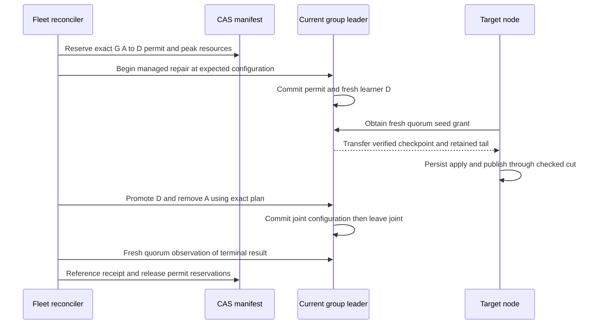

# Maintenance and rebalancing execution protocols

Status: implementation contract for the proposed managed fleet capability.
Read with [capacity and scaling](capacity-and-scaling.md) and the authority rules
in the [technical design](design.md). These protocols extend the existing repair
and leadership primitives; they do not describe behavior already enabled today.
The [lifecycle execution contract](lifecycle-execution.md) adds crash/retry
ownership, shrink admission fencing, prediction-versus-observation rules and
the exact evidence behind each operator-visible result.

## Implemented restart preparation and reversible gate boundaries

The catalog now has owned M1 restart preparation and preparation-only
cancellation. `begin_restart_maintenance` pins exact process, request identity,
complete namespace/history inventory and requested grace (1–300 seconds). One
CAS changes Active to RestartPending, increments its enrollment epoch and claims
the same disruption slot used by evacuation. It preserves voters, running
consensus and retained resource charges. `restart_maintenance_admission` is a
historical observation, not a RestartReady or stop receipt. Grace has not started.

A new boot remains fenced while preparation is unresolved; an ordinary Node
shutdown does not supply managed joined-owner proof. The unchanged original
preparation epoch can use `cancel_restart_preparation` to return to Ready without
capacity. Original confirmations reconcile through the permanent journal, and
historical retries cannot release a later operation's slot. A different process,
grace, principal or request cannot rebind the same intent.

`admit_restart_gate` advances the same node epoch before issuing a reversible
physical gate request. Preparation-only cancellation then refuses. A mandatory
maintenance-purpose selector distinguishes it from evacuation. The catalog owns
`quiesce_restart` through the authenticated control lane and a configured
surviving observer. The engine syncs the exact boot/epoch selector before public
and peer application admission close. The owning Node driver continues polling
accepted handlers and their post-response `wait_until` producers; their final
SDK writes finish before SDK business admission seals. A registration barrier
and a later work sample precede the quiescence acknowledgement. Consensus and administrative traffic remain running.
There is no additional idle tick when no gate turn is pending.

`cancel_restart_gate` owns a synced exact-process fence before its atomic Ready,
cancellation receipt and shared-slot release. It does not reset permanent
shutdown flags, restore capacity or release retained resource charges. Parent
payloads and the child fence are immutable: after a definite changed-root loss,
a new parent retains that child fence. A timeout leaves admission closed until
explicit fence reconciliation. Lost confirmations reconcile from the journal;
historical retries cannot reopen a later operation or release its slot. Neither
a quiescence response nor gate metadata grants RestartReady, stop or new-boot
authority. Native qualification is separately recorded in [progress](progress.md).

The reversible gate is a prerequisite within M2–M4, not completion of those
phases. Incoming-action settlement, complete fresh both-survivor inspection,
owned observed handoff/readiness, guarded maintenance stop, intact-engine rejoin,
grace expiry, rolling execution and SDK/admin/CLI maintenance surfaces remain
unfinished. The protocol below is still the full delivery contract.

## Select the correct maintenance mode

| Work | Mode | Membership and storage treatment |
| --- | --- | --- |
| Short process or OS restart | Restart maintenance | Retain voters and the same intact engine; temporarily suppress replacement within the bounded grace |
| CPU or memory limit change | Resize maintenance | Reconcile target profile and capacity fit, then restart the same intact engine |
| Extended outage or uncertain return time | Evacuation | Replace all members before stopping; old bindings remain retired |
| Disk replacement or filesystem shrink | Fresh replacement node | Add a new identity/volume, evacuate old registration and retain its volume |
| Permanent decommission | Evacuation then removal | Revoke registration only after complete absence proof |

A restart is not a safe way to replace a volume, and evacuation is not a promise
that the old member IDs can be reused afterward. Maintenance should return a
clear result even when the node has followers but no leaders, or is registered
but has no cells.

## Prepare and stop an intact node

The shared disruption slot covers all planned offline operations. Maintenance
readiness has to be revalidated at stop time; an old receipt is not a lease that
makes it safe to stop a node hours later.

| Phase | Required work | Durable or observed proof |
| --- | --- | --- |
| M1 Admit | Claim disruption slot, increment node-operation epoch and exclude new incoming placement | CAS operation record bound to node/disk/process and maintenance mode |
| M2 Settle | Resolve previously admitted incoming actions and current joint transitions | Exact terminal permits or a typed blocked result |
| M3 Inspect | Enumerate every hosted/pending history and check its two surviving voters | Fresh quorum/configuration cut, matched and published progress, no competing planned outage |
| M4 Handoff | Transfer each local leadership to an eligible survivor; drain accepted application work | Observe actual new leadership and completion of accepted work; request acceptance alone is insufficient |
| M5 Ready | Publish `RestartReady`, still holding exclusions and disruption slot | Receipt binds process, maintenance epoch, affected-history digest and verified cuts |
| M6 Stop | Operator submits `StopForMaintenance` for that receipt/process | Revalidate relevant state and consume a durable local stop guard before invoking Node shutdown |
| M7 Offline | Observe shutdown/physical owner exit or report an ambiguous stop | Persist `WaitingForRejoin`; no second offline operation is admitted |
| M8 Return | Restart original engine, install current trust/profile and catch up | New process generation, same immutable storage pin, verified membership and published/archive cuts |
| M9 Resume | Recheck healthy placement and clear exclusions | CAS terminal receipt; only now release disruption slot and admit new targets/leaders |

`StopForMaintenance` is a separate mutation with its own idempotency key. It
invokes the existing owned Node stop path; it does not power off a VM or delete a
container. The platform operator performs the external action only after stop
status is resolved. For deployments without remote stop support, the local
operator must use the same guarded shutdown API. A raw process kill is recorded
as failure injection/crash recovery, not successful planned shutdown.

The stop guard is persisted by the node's engine owner and serialized with local
lifecycle admission. It binds node-operation epoch, operation ID, request digest
and expected process. Introduce a distinct lifecycle record; do not overload a
group term or directory publication revision. All automatic/control/API stop
paths in managed mode use this guard.

A cancellation fence and a stop acceptance race at this serialized owner. If
the fence wins, a delayed stop is refused. If stop acceptance wins, cancellation
reports that shutdown was already admitted and waits for the real outcome.
After restart, the old expected process generation cannot stop the new process.
A lost stop response therefore cannot justify freeing the disruption slot or
issuing a second stop to another node. Unreachable state remains explicitly
unknown until observed/reconciled. This is the node-lifecycle counterpart of the
durable per-group membership permit fence.

Closing command admission during handoff must preserve accepted-command
completion and consensus. New client requests obtain a current route or typed
retry response. Existing request IDs preserve ambiguous outcomes. The target
node's capacity/profile/maintenance exclusions must be checked before moving a
leader; not every caught-up voter is a permissible destination.

The pre-stop maintenance gate is a new reversible, epoch-bound managed admission
barrier, separate from the existing permanent shutdown gate. Cancellation before
stop can lift it only after the same operation's handoff and pending work are
reconciled. Once Node shutdown is admitted, resume requires a real rejoin; never
reset the permanent closing/draining flags in place. Keep consensus, required
replication and owned completion work running through the reversible barrier.

## Maintenance decisions at each irreversible boundary

The operation owns the decision; the node lifecycle owner performs stop. Keep
these boundaries visible in SDK/API status rather than one generic `draining`
flag. A readiness receipt has a checked input cut, not open-ended stop authority.

| Observed phase | Next permitted action | Cancellation or failure handling |
| --- | --- | --- |
| Preparing, before stop admission | Settle transfers, verify survivors, refresh readiness | Cancel can restore eligibility after its handoff/actions settle and the stop request is durably fenced |
| Ready, process still running | Exact-process guarded stop after revalidation | Stale readiness requires another check; a local cancellation fence defeats delayed stop |
| Stop durably admitted | Finish the owned shutdown and join workers | Cannot reopen the permanent gate; cancellation waits for stop/rejoin outcome |
| Stop response lost | Reconcile the same request, local guard and process identity | Keep disruption slot; neither timeout nor missing response proves the process exited |
| Offline within grace | Restore the same intact volume/process lineage | Elections continue; second failure or elapsed grace permits bounded ordinary repair |
| Rejoined, catching up | Install current trust/profile, verify all still-valid memberships and cuts | Exclude new placement/leadership until verification; stale stop for old process is refused |
| Some memberships retired while offline | Report exact surviving and retired bindings | Do not label the result an intact restart; reconcile partial effects and use fresh replacement capacity where needed |
| Resume terminally rooted | Release operation exclusions and disruption slot | Retry returns the same receipt; another lifecycle operation needs a new epoch |

Serialize stop, stop-cancellation fencing and rejoin against the engine's
lifecycle record. A root `CancelRequested` alone does not defeat an already
issued stop capability. If the node is unreachable, preserve the unresolved
stop and disruption reservation until its outcome/fence is established. Remote
observation that a TCP port closed does not prove all physical owners joined.
An external platform stop/isolation attestation is reported separately from a
successful graceful-shutdown receipt; it cannot fabricate the latter.

The pre-stop check identifies both surviving voters for every affected group,
their current configuration, health freshness, published cut and placement
eligibility. One reachable survivor is not enough. All affected groups must pass
before admitting a planned stop. A concurrent unexpected second failure can
still remove quorum after this point; the shared disruption slot prevents a
second planned outage, not hardware failure. Expose this point-in-time safety
boundary in the receipt and qualification rather than promising zero downtime.

Leadership exclusion filters managed transfer/campaign requests; it is not
vote revocation and cannot override a committed Raft configuration. Leadership
can change during preparation. If the target becomes leader again before stop
admission, repeat handoff or report blocked after revalidation. Do not freeze
ticks, heartbeats, votes or append/apply work to keep a node out of leadership.

Use the same sequencing for vertical resizing. For shrink, first obtain the
target physical-fit assessment, then stop/join, then lower platform limits. For
growth, first stop/join, then apply larger platform/runtime limits, then verify
the observed profile before granting capacity. Both paths retain the original
effective profile and pending target revision until rejoin is accepted. A
configuration-only rollback is possible only after checking the actual physical
resources and unchanged storage identity.

## Grace expiry and unexpected failure

Default requested restart grace is 120 seconds, capped at 300 seconds. Start it
when the owned stop is admitted, not while a lengthy handoff is still preparing.
The grace only postpones replica replacement for the known maintenance target.
Normal elections and quorum checks continue immediately. The system does not
wait 120 seconds to elect another leader.

Use an observer's monotonic elapsed time. Persist the operation and stop event,
but do not compare monotonic timestamps from different machines. A replacement
controller that cannot establish the remaining interval treats the grace as
expired; it cannot extend the outage indefinitely. Wall-clock times are for
display/audit, not membership authority or TTL fencing.

On grace expiry, expose `RepairingAfterMaintenance`. Keep the disruption slot,
reconcile missing voters using existing quorum-backed repair and require an
operator decision before returning a partially retired registration to service.
If all affected memberships moved away, finish through evacuation/removal or
cancel with exact partial effects. Do not silently declare an intact restart.

If a second node fails, immediately stop optional balancing, invalidate pending
readiness receipts and evaluate each affected group. Repair groups that retain
quorum, and report `QuorumUnavailable` for the others. Ask the operator through
status to restore an original intact member; there is no minority/S3 activation
shortcut. Extend the failure report to show which groups need which original
members, without exposing credentials or claiming one follower proves a complete
acknowledged history.

When the old node returns, quarantine it from new application leadership until
its current configuration is reconciled. Retained members still in the committed
configuration may catch up normally. A locally retired/removed history cannot
be rebound to a fresh member in the same slot. For a general replacement, use
a new node/disk/engine registration and retain the old volume. A partially useful
node may keep serving still-valid histories, but status must expose its retired
slots and reduced eligible capacity.

## Rolling maintenance across several nodes

Represent a rolling operation as an ordered list with one active child lifecycle
operation. For each node: prepare, stop, rejoin, verify full redundancy and
publish resume receipt before advancing. Re-evaluate policy, load and failure
headroom before each child. Failure, unexpected repair or unresolved stop pauses
the rolling operation. A user-requested list is not permission to take all those
nodes offline concurrently.

Cancel prevents starting the next node and reconciles the current one. Already
completed restarts remain completed. No action rewrites an old node identity or
rolls back committed membership to make the list look unchanged.

## Rebalance triggers and objective

Three triggers have different completion criteria:

| Trigger | Eligibility to move | Completion |
| --- | --- | --- |
| Capacity change or explicit placement request | Complete feasible plan plus ready targets; no overloaded source required | Requested eligible set/placement objective satisfied within its declared tolerance |
| Automatic load imbalance | Source-target pressure gap at least five percentage points for three fresh 10-second windows | Gap inside deadband for three windows, with no active optional permits |
| Repair/domain/evacuation obligation | Safety and capacity permit the required move | Its exact redundancy, domain or lifecycle obligation is settled |

The five-percentage-point number is a trigger on the load gap. It is not a
required improvement from every individual cell move. At 500 cells a single move
often changes utilization by much less than that. Requiring global peak load to
decrease on each move also stalls when multiple nodes share the maximum.

For performance-triggered optional moves use a deterministic lexicographic potential:

```text
P = maximum projected normalized pressure across eligible nodes
E = sum over nodes/resources of weight * capacity_share * utilization_squared
accept if hard constraints hold, P does not increase, and (P, E) decreases
```

Weights, units and integer comparison precision are explicit policy inputs.
Use checked integer/rational comparisons; do not mix CPU seconds, byte counts
and latency milliseconds in one unnormalized sum. Capacity shares account for
heterogeneous nodes. Select a move only when expected improvement exceeds the
measurement uncertainty margin; if estimates cannot distinguish it, do not move
for performance alone. For topology-driven equal-cell placement, exact slot and
byte counts can establish the objective without pretending to predict TPS.

For an explicit topology/capacity objective, instead reduce distance to the
complete feasible assignment (or its declared live-replica distribution tolerance).
It need not improve physical-storage E: retained source copies can increase total
stored bytes while serving replicas become better distributed. Hard resource,
failure-domain and movement bounds still apply, and the predicted extra storage
must be disclosed. This is an operator placement result, not a claimed throughput
gain. Do not let a stale assignment override a newly unsafe capacity observation.

Example: all five original nodes have 300 serving copies, a sixth has zero.
Moving one copy leaves other nodes at the old maximum but reduces live-placement
imbalance and distance to the target assignment. The sequence can progress toward
approximately 250 serving copies each without any overloaded source. Retained
source bytes remain charged throughout. Report final tolerance and counts; equal
counts are not required when images, capacities or command costs differ.

Required domain repair and evacuation may increase peak load. Evaluate them
against hard limits, failure headroom and the disruption budget; do not apply
the optional-performance potential as a safety veto. Their impact stays visible
in operation status and SLO evidence.

## Classify the bottleneck before choosing a move

| Observed pressure | First candidate | Refusal or escalation |
| --- | --- | --- |
| Hot leader command execution/SQL queue | Transfer to a caught-up existing voter with measured spare capacity | If follower application dominates equally, leader-only transfer may not help |
| Too many active replica groups or follower apply work | Move a replica to a node outside the group | Account for target apply cost and source retained metadata before predicting relief |
| Local durable bytes exhausted | Add disk/capacity or a fresh replacement node | Retired bytes are still charged; ordinary movement may not free local disk |
| Shared RustFS/archive saturation | Throttle optional seeding and address shared backend capacity | Adding a Cellar node can increase archive work; do not claim node balance fixes it |
| One cell dominates all eligible nodes | Isolate on measured larger capacity or redesign partitioning | A group still has one leader; this release does not split a cell |
| Wide cold-group skew after adding nodes | Topology-driven bounded replica redistribution | Require complete idle/resource samples; absence of foreground traffic is not missing inventory |

Keep observations separate for leader-only execution, follower apply, shared-log
persistence, archive work and background maintenance. Estimate the incremental
cost of changing a replica's role, not its entire total cost. Resource samples
must include window boundaries, sample age, process/profile revision and the
number of histories observed. Fewer histories than the inventory requires is an
incomplete sample.

Retained bytes and occupied engine slots do not disappear on membership removal.
Do not credit their relief in P/E until a physical reclamation observation exists.
V1 has no automatic durable-history garbage collection. Sustained churn may
exhaust slots/bytes and require a fresh replacement node even if live group
counts are low. This is a surfaced operating limit, not a reason to delete the
last acknowledged recovery path.

## Execute one replica movement

For moving group G from A to D while B and C remain voters:



Before reservation, validate A is the selected current member, D is a trusted
eligible distinct physical target, and D has no conflicting/retired local binding
for G. Check schema/protocol, domains, projected capacity, process/profile
revisions and movement budgets. A stale dry-run plan is not authority.

After beginning, the committed group plan is authoritative. Start a bounded
checkpoint transfer and retain the needed tail until D catches up; do not trim
the only available recovery prefix under transfer pressure. Choose peer or
verified archive seeding based on available progress and measured resource cost;
neither route bypasses the fresh quorum grant. Charge shared RustFS work even
when network traffic appears to bypass the source node.

If D cannot catch up because new writes outrun its measured apply capacity,
report actual lag and estimated catch-up trend. Do not promote on elapsed time
or a small-looking lag alone. Before joint entry, bounded learner timeout may
commit abort and choose another fresh eligible target. A failed/aborted target
can retain consumed bindings and capacity; do not retry endless new IDs into the
same local slot. Once joint entry commits, finish that exact transition whenever
quorum permits; no timeout discards it.

Transfer leadership away from A before its removal when A is leader and a safe
eligible target is caught up. If the leader changes mid-operation, resume from
committed plan and membership rather than replaying an external instruction list.
Final receipt includes the new configuration and checked progress/archive cuts.
Release only the action's unused reservation; source retained physical state
continues to consume capacity.

## Bound scheduling and foreground impact

Use two active membership moves for the five-node profile, with at most one
initializer on each destination and one outgoing snapshot on each source.
At least one move opportunity is reserved for required repair. Optional balance
uses at most one move while a required queue is nonempty. Already committed
work is non-preemptible: if both slots are occupied, queue the repair or safely
abort an unpromoted optional learner; never free its slot merely to meet priority.

Maintain one unresolved membership action per group, one leader-transfer attempt
per node per five seconds, and a 60-second per-cell optional-move cooldown.
Required evacuation/repair can bypass the performance deadband/cooldown but not
the safety, memory or physical-task bounds. Charge all plans, including manually
requested ones, to the same budgets.

Seed body traffic starts at 8 MiB/s per node with a 1 MiB burst. Count both peer
and object-store receive bytes and retain existing memory reservations throughout
physical work. Separate control-message service from bulk transfer; throttling
cannot delay quorum control behind a large snapshot queue. Increase parallelism
only after measured completion rate improves without breaching foreground SLOs.

Pause new optional actions when p99 crosses the configured budget, archive
backlog grows for three windows, CPU throttling persists or relevant budgets
are exhausted. Resume only after three healthy windows below a lower watermark
(initially 80% of the p99 ceiling) and no increasing backlog. Known idle traffic
is represented explicitly; never synthesize p99=0 from an empty or missing sample.
Finish active joint transitions and reserve bounded required repair while paused.

Capacity/maintenance mutations share the same CAS root. Poll its version on a
bounded, jittered interval (initially one second per controller), cache immutable
pages and allow one in-flight new-root CAS per process. On conflict, reread and
use jittered exponential backoff, initially 50 ms capped at one second. These are
efficiency settings, not leases. Do not write heartbeats, telemetry or every copied
chunk into the root. Coalesce status observations; publish durable root changes
for admission, cancellation, finalization and lifecycle transitions. The single
root's contention/latency is a measured scale limit, not an unlimited coordinator.

## Select and schedule a concrete balancing action

Run this sequence against the same complete observation window and projected
reservation ledger used by capacity admission:

1. Select the obligation: finish a committed joint action, restore redundancy,
   evacuate, restore domains, satisfy explicit topology, then optional load work.
   Required work is not a performance claim. Shared slots still bound it.
2. For leader-only pressure, enumerate current eligible voters in the same
   stable group. Check term/configuration, activity, matched and published cuts,
   process/profile eligibility, transfer budget and expected incremental relief.
   If no candidate passes, do not transfer to a merely reachable follower.
3. If a replica move is required, select a node outside the group with an unused
   valid local history binding, feasible domains and peak resources. Check the
   complete final/staged plan for lifecycle work; a locally attractive first
   move cannot substitute for scale-in feasibility.
4. Evaluate the relevant objective. Optional performance work must clear
   uncertainty and reduce the declared potential. Explicit topology work must
   reduce distance to its feasible assignment. Required repair/evacuation uses
   its safety and completion criteria even when load rises.
5. Reserve exact resources with CAS and revalidate before starting. Record the
   predicted relief and actual result; reconcile failed/ambiguous actions before
   choosing another permit for that group.
6. Reobserve before the next optional action. After convergence, require three
   healthy windows and no residual optional permit. Keep the cooldown to prevent
   an immediate reverse move. Completing already admitted seed/joint/handoff
   steps is not a fresh, unrelated balancing decision.

Separate per-node source, destination and leader-transfer tokens from the
fleet-wide membership count. Two membership slots do not allow two physical
initializers on the same destination. A small control frame cannot be queued
behind rate-limited seed body work, and a token is released when its owning
physical task completes, not when its RPC caller times out. Do not add new
control-queue scheduling behavior without the separate evidence required by the
performance work.

Expose a reason when no action can help: `NoEligibleLeaderTarget`,
`NoUnusedHistoryBinding`, `SharedBackendPressure`, `BelowUncertaintyMargin`,
or `MoveBudgetExhausted`. These are planner diagnostics carried with an existing
typed blocked/capacity result, not new claims that a node failed. Distinguish
structural lack of a destination from temporary scheduling backpressure.

Count both the source and destination against the per-node leader-transfer
attempt limit. Failed attempts also consume that rate budget. This prevents a
new target from receiving a fleet-wide burst even when each source sends slowly.

## Predict convergence from the limiting service stage

Report estimated work and measured stage rates before promising a completion
time. With `M` replacements, seed bytes `B`, measured mean initializer ownership
`s`, mean move occupancy `m`, and effective shared bandwidth `b`, lower bounds
include:

```text
seed transmission time >= B / b
one-target initialization time >= M * s
two-slot membership occupancy time >= M * m / 2
```

Use actual per-stage concurrency and source/backend sharing; do not simply add
overlapping lower bounds or treat their maximum as a guaranteed ETA. Catch-up,
CAS conflict, elections, archive verification and the final observation window
can extend the result. If apply rate cannot exceed incoming changes, catch-up
has no finite projected finish and status must say so.

For five-to-six equal-copy redistribution, F needs 250 new replicas. A single
initializer on F makes 250 times its measured ownership duration a lower bound.
Giving F 83 leaders through the one-transfer-per-node-per-five-seconds budget
also spans at least 410 seconds between its first and last admitted transfer
attempts; retries can extend that interval. The ten-minute qualification target
therefore requires pipelining leadership as replicas become ready, plus enough
remaining time for copies, retries and verification. It is an unpassed gate,
not a duration implied by the target copy count or nominal network rate.

If a gate fails, identify its limiting stage before raising concurrency. More
simultaneous snapshots can increase SQL/image contention, archive backlog and
foreground p99. Retain a higher-parallelism candidate only with measured benefit
and unchanged safety/resource bounds.

## Operator status and recovery decisions

For each group expose purpose, source/target, admitted permit, Raft phase, applied
and matched lag, transfer bytes, physical reservations and last typed error.
At operation level show foreground p99/TPS/error rate, oldest blocked item,
budget utilization, predicted versus actual pressure and the finalization state.
Do not present a proposed move as a completed role change.

| Situation | Automatic behavior | Operator choice |
| --- | --- | --- |
| Target dies before activation | Reconcile unused permit with quorum fence | Retry on a different qualified target |
| Target dies during seeding | Commit guarded learner abort when possible | Add capacity if consumed/retained slots leave no target |
| Node dies during evacuation | Continue surviving quorum-backed moves | Restore original node when minority groups block |
| Object store loses availability | Preserve admitted work and block new root transitions | Restore backend; do not recreate the root |
| New node has insufficient measured capacity | Keep it ineligible or pause incoming moves | Resize it or cancel with existing effects retained |
| Resume request races delayed stop | Exact local epoch/process guard settles one outcome | Inspect the original operation; never use a new ID to guess |
| Workload changes after a balance plan | Recompute remaining actions and report new plan digest | Accept the current objective or cancel/reconcile before changing it |

All cancel/timeout results identify which actions committed, remain uncertain or
were durably fenced. A physically stopped node or completed membership movement
is never undone by deleting an operation record.
